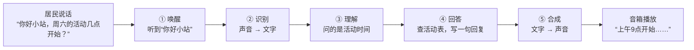
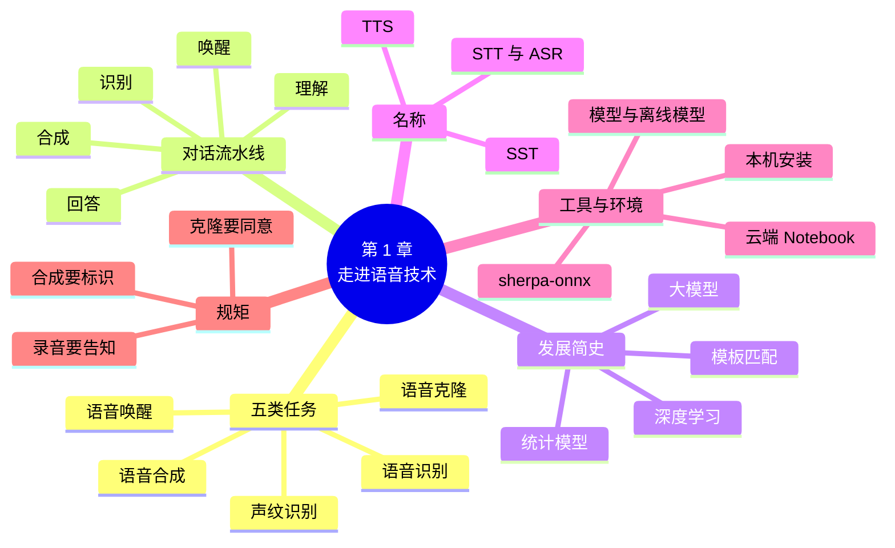

# 第 1 章 走进语音技术

!!! abstract "本章学时"
    理论 4 学时（其中线下 1 学时）· 实验 4 学时（本章共 4 个实验，教师可任选）

## 学习目标

学完本章，你应该能够：

1. **说出**语音识别、语音合成、语音克隆、声纹识别、语音唤醒五类任务分别做什么，各举一个生活中的例子（记忆）；
2. **解释**一次语音对话要经过唤醒、识别、理解、回答、合成五个环节，以及每个环节的输入和输出（理解）；
3. **区分** TTS、STT、ASR、SST 这几个名称，说出语音技术发展的几个阶段（理解）；
4. **运行**给定的代码，让电脑朗读一段文字、把一段录音转成文字，并修改文字和语速（应用）；
5. **判断**一个语音应用用到了哪几类语音任务，录别人的声音前需要做什么（分析）。

!!! info "先修要求"
    学习本章前，你需要：

    - 学过《Python 编程》前几章：会运行 `.py` 文件、知道变量、`print`、`import` 是什么（本书不再讲 Python 语法）；
    - 会在电脑上新建文件夹、解压文件、打开终端（命令行窗口）；
    - 不需要任何声学或人工智能基础，第一次接触“模型”这个词也没关系，1.5 节会讲清楚。

??? abstract "本章概念清单（9 个，点击查看定义和例子）"
    1. [语音识别](../../appendix/glossary.md#g-语音识别)
    2. [语音合成](../../appendix/glossary.md#g-语音合成)
    3. [语音克隆](../../appendix/glossary.md#g-语音克隆)
    4. [声纹识别](../../appendix/glossary.md#g-声纹识别)
    5. [语音唤醒](../../appendix/glossary.md#g-语音唤醒)
    6. [语音交互](../../appendix/glossary.md#g-语音交互)
    7. [语音大模型](../../appendix/glossary.md#g-语音大模型)
    8. [离线模型](../../appendix/glossary.md#g-离线模型)
    9. [sherpa-onnx](../../appendix/glossary.md#g-sherpa-onnx)

## 情景导入

城东街道的幸福里社区有 3000 多户居民，社区工作站只有 6 名工作人员。每天的电话一个接一个：“周六的活动几点开始？”“楼道灯坏了谁来修？”“老年食堂几点开饭？”同样的问题一天要回答几十遍。每周的社区通知要在小区广播里念一遍，再发到业主群；每月的居民议事会开两个小时，会后整理纪要又要花一个下午。

社区书记想建一个“社区语音服务站”：居民打电话或对着服务站的屏幕说话，机器自动听懂、自动回答常见问题；通知写好以后，机器自动念出来，还能换成老人更容易听清的语速；议事会的录音自动变成文字纪要，标出每一句是谁说的。社区里有一位热心的退休播音员林老师，愿意让机器“学会”自己的声音，以后广播都用这个大家熟悉的声音来念。

这些想法能实现吗？要用到哪些技术？机器“学”林老师的声音之前，要先办什么手续？本书就以这个“社区语音服务站”为贯穿项目，一章一章把它做出来。本章先认识语音技术的全貌，并且用几行代码让电脑说出第一句话、听写第一段录音。

## 1.1 身边的语音技术

### 1.1.1 一天里听到的“机器声音”

早上出门前问一句智能音箱“今天会下雨吗”，它用一个温和的女声回答；开车时导航提醒“前方 300 米右转”；在地铁上听不方便放声音，就把朋友发来的 60 秒语音“转文字”；上午开线上会议，屏幕下方实时滚动着字幕；中午刷短视频，很多视频的配音其实不是真人录的，而是用软件把文字念出来的；下午给银行打电话，电话那头说“请说出您要办理的业务”，你说一句“查余额”，它就转到了对应的服务；晚上给孩子放有声故事，讲故事的“声音”也可能是机器生成的。

这些场景背后，都是语音技术。它们可以分成两个方向：

- **从声音到文字**：机器“听”。语音转文字、会议字幕、电话客服听懂你说的业务，都属于这个方向。
- **从文字到声音**：机器“说”。导航播报、短视频配音、有声书，都属于这个方向。

再往细里分，还有“听出是谁在说话”“只在听到暗号时才开始工作”“用某个人的声音说话”等更具体的任务。

### 1.1.2 五类语音任务

本书把常见的语音技术归成五类任务，下表一次看清。

| 任务 | 做什么 | 输入 → 输出 | 生活中的例子 | 本书章节 |
|---|---|---|---|---|
| [**语音识别**](../../appendix/glossary.md#g-语音识别 "让计算机把人说的话转换成文字的技术，也叫语音转文字（STT）"){ .term } | 机器“听写” | 一段录音 → 文字 | 语音转文字、会议字幕、语音输入法 | 第 3、4 章 |
| [**语音合成**](../../appendix/glossary.md#g-语音合成 "让计算机把文字转换成自然语音的技术，也叫文语转换"){ .term } | 机器“朗读” | 文字 → 一段录音 | 导航播报、有声书、短视频配音 | 第 5、6 章 |
| [**声纹识别**](../../appendix/glossary.md#g-声纹识别 "根据声音判断说话人是谁或是不是某个人的技术，也叫说话人识别"){ .term } | 听出“是谁” | 一段录音 → 说话人是谁 / 是不是某人 | 电话银行核验身份、会议纪要标出发言人 | 第 7 章 |
| [**语音克隆**](../../appendix/glossary.md#g-语音克隆 "用某个人的少量录音，让机器用这个人的音色说出任意内容的技术"){ .term } | 模仿某个人的声音 | 某人的少量录音 + 新文字 → 用这个人的声音读出新文字 | 用已故亲人留下的录音“读”一封信（要取得授权）、虚拟主播 | 第 8 章 |
| [**语音唤醒**](../../appendix/glossary.md#g-语音唤醒 "设备持续监听，只在听到特定唤醒词时才开始工作的技术，也叫关键词检测"){ .term } | 听到暗号才开工 | 持续的声音 → 是否出现唤醒词 | 说“小爱同学”“小艺小艺”叫醒设备 | 第 4 章 |

几点说明：

1. **语音识别**是最常用的一类，英文缩写 ASR（Automatic Speech Recognition，自动语音识别）。它只管“说了什么字”，不管“是谁说的”。
2. **语音合成**的英文是 Text to Speech，缩写 TTS，直译就是“文字变语音”。今天好的合成语音已经很难和真人分辨，这既是优点，也带来了风险。
3. **声纹识别**和语音识别名字很像，但关注的东西正好相反：语音识别要忽略说话人的差别，只认内容；声纹识别要忽略内容，只认说话人。声纹就像“嗓子的指纹”，属于生物识别信息，受法律特别保护（第 7 章）。
4. **语音克隆**可以看成“带上指定音色的语音合成”。几年前要录几个小时的声音才能做，现在只要几秒钟的参考录音就能做到很像。正因为门槛低，**克隆别人的声音必须先取得本人同意**，这是第 8 章的重点。
5. **语音唤醒**本质上是一个只认几个词的、非常小的语音识别器。它一直开着，所以必须省电、必须在本机运行，不能把所有声音都传到网上。

!!! example "拆一拆：社区语音服务站要用到哪些任务"
    回到情景导入。居民打电话问问题：语音识别（听懂问题）+ 语音合成（念出回答）；服务站屏幕平时待机，有人说“你好小站”才亮起来：语音唤醒；议事会纪要要标出谁说了什么：语音识别 + 声纹识别；用林老师的声音念通知：语音克隆（先签授权书）。一个看起来简单的服务站，五类任务全用上了。

## 1.2 一次语音对话里发生了什么

我们对智能音箱说一句话，它回答一句话，这就是一次[**语音交互**](../../appendix/glossary.md#g-语音交互 "人和机器之间用说话和听声音来交流的方式，通常由唤醒、识别、理解、回答、合成几个环节组成"){ .term }。看起来只是“一问一答”，其实背后经过了一条流水线。下面以服务站接到居民提问为例：



1. **唤醒**：设备一直在“半睡半醒”地听，只认唤醒词。没听到唤醒词时，周围的声音不处理也不保存。
2. **识别**：听到唤醒词以后，把接下来的话录下来，交给语音识别模型变成文字。
3. **理解**：从文字里找出“用户想干什么”。简单的可以靠关键词（出现“几点”“活动”就是问活动时间），复杂的交给大语言模型。
4. **回答**：根据理解的结果查资料、组织一句回复。
5. **合成**：把回复的文字交给语音合成模型，变成声音播放出来。

这五个环节中，②和⑤是本书的主角；①在第 4 章，③④在第 9 章做一个简单版本，更复杂的理解和对话属于《自然语言处理导论》和《智能体开发》课程的内容。

用户最在意的是**等多久**：从说完话到听到回答，如果超过一两秒，就会觉得“反应慢”。下面的动画用本章实验 1-3 的实测数据，演示每一步花了多少时间。

<iframe class="sim-frame" src="../../sims/speech-pipeline/main.html" height="560" loading="lazy" title="语音对话流水线"></iframe>
动画：语音对话流水线。点击五个环节，看每一步的输入、输出和耗时；切换“理解”的做法，看总等待时间怎么变。[全屏打开](../../sims/speech-pipeline/main.html){ target=_blank }
{ .sim-caption }

从动画可以看到，在编者的笔记本电脑上，识别一段 7 秒的录音只要 0.39 秒，合成一段 7 秒的回复只要 0.53 秒，这些小模型已经足够快。如果把“理解”和“回答”交给联网的大模型，等待时间会明显变长。所以很多产品对常见问题用规则直接回答，遇到复杂问题才调用大模型。

!!! tip "流水线以外的另一条路"
    近两年出现了能直接“听”、直接“说”的[语音大模型](../../appendix/glossary.md#g-语音大模型 "能直接听懂语音并直接用语音回答的大模型，不必先转成文字"){ .term }：声音进去，声音出来，中间不必先变成文字。它反应更快，还能听出语气、被随时打断。1.7 节会介绍。但在识别会议录音、给视频配字幕、批量生成有声书这些场景，“识别 + 合成”的流水线仍然是主力，也更便宜、更容易控制。

## 1.3 语音技术简史

### 1.3.1 让机器听懂：语音识别七十年

**1952 年**，美国贝尔实验室的戴维斯（K. H. Davis）等人做出了一台叫 Audrey 的机器，能识别一个人说的 0 到 9 十个英文数字，准确率可以达到九成以上，但只认特定的说话人。<sup class="cite">[[1]](#ref1-1)</sup>它的思路很朴素：每个数字的声音在频率上有不同的“样子”，把听到的声音和事先存好的样子比一比，最像哪个就是哪个。这种“比模板”的思路一直用到 20 世纪 70 年代，第 3 章会亲手做一个。

**20 世纪 70—80 年代**，研究者开始用**统计**的方法：不再死记模板，而是用概率描述“这段声音像哪个音”“这几个字连在一起通不通顺”。其中最重要的是隐马尔可夫模型（HMM），它统治了语音识别三十年。

**2010 年前后**，深度神经网络被用到语音识别里，错误率一下子降了很多。2012 年，微软、谷歌、IBM 和多伦多大学的研究者联合发表文章，总结了深度神经网络在声学建模上的效果，这被看作语音识别进入深度学习时代的标志。<sup class="cite">[[2]](#ref1-2)</sup>手机语音输入从“能用”变成了“好用”。

**2020 年以后**，“端到端”模型成为主流：一个大的神经网络直接把声音变成文字，不再分成好几个零件。OpenAI 的 Whisper、阿里巴巴的 Paraformer 和 SenseVoice 都是这一类，SenseVoice 还能顺便听出说话人的情绪和录音里的掌声、笑声。<sup class="cite">[[3]](#ref1-3)</sup>

### 1.3.2 让机器开口：语音合成的四个阶段

让机器说话的尝试比识别还早。1939 年纽约世界博览会上，贝尔实验室展出了 Voder，由操作员用键盘和踏板“弹奏”出语音，像弹琴一样。之后语音合成大致经过四个阶段（第 5 章详细讲）：

| 阶段 | 大约年代 | 做法 | 听起来 |
|---|---|---|---|
| 拼接合成 | 20 世纪 80 年代起 | 先录好大量字、词的真人录音，用的时候剪下来拼在一起 | 字字清楚，但接缝处生硬，像“机器腔” |
| 统计参数合成 | 2000 年前后 | 用 HMM 等统计模型预测声音的参数，再用程序生成声音 | 很平滑，但发闷，像隔着一层布 |
| 深度学习合成 | 2016 年起 | 用神经网络预测声音，2016 年 WaveNet<sup class="cite">[[4]](#ref1-4)</sup>第一次合成出接近真人的声音 | 自然，接近真人 |
| 大模型合成 | 2023 年起 | 像大语言模型一样在海量语音上训练，能控制情感、方言，几秒钟就能模仿一个人 | 很难和真人分辨 |

本书第 1 章到第 6 章用到的合成模型 Matcha-TTS<sup class="cite">[[5]](#ref1-5)</sup>、Kokoro 属于第三阶段，第 8 章的语音克隆模型属于第四阶段。

## 1.4 TTS、STT、ASR、SST：几个名称 { #14 }

学语音技术，会遇到一堆缩写。本课程的名字叫“TTS、SST 与语音克隆的理论与应用”，先把这几个名称理清楚：

| 缩写 | 英文全称 | 中文 | 方向 |
|---|---|---|---|
| TTS | Text to Speech | 语音合成、文语转换 | 文字 → 声音 |
| STT | Speech to Text | 语音转文字 | 声音 → 文字 |
| ASR | Automatic Speech Recognition | 自动语音识别 | 声音 → 文字 |
| SST | 本课程方案中指 Speech Recognition and Synthesis（语音识别与合成） | 语音识别与合成 | 两个方向都有 |

STT 和 ASR 说的是同一件事：STT 是产品上的叫法（“转文字”），ASR 是学术上的叫法。本书正文统一叫“语音识别”。SST 在业内不是通用缩写，在本课程里指“语音识别与合成”两个方向合在一起，书名保留了人才培养方案的原文。

!!! note "两个容易混的词"
    - **语音识别 ≠ 声纹识别**：前者认“说了什么”，后者认“是谁说的”。
    - **语音合成 ≠ 语音克隆**：语音合成用模型自带的音色朗读；语音克隆是用某个特定的人的音色朗读。所有的克隆都是合成，但不是所有的合成都是克隆。

## 1.5 本书的工具与实验环境

### 1.5.1 模型是什么

前面一直在说“识别模型”“合成模型”。**模型**可以理解成一个已经学会了某种本领的“程序零件”：研究人员用成千上万小时的录音训练它，训练好以后把它保存成文件，我们下载下来就能用，不需要自己再训练。比如本书用的中文识别模型 SenseVoice 是在几十万小时的语音上训练出来的，文件大小约 230 MB，下载到电脑里，喂给它一段录音，它就把文字吐出来。

模型可以放在两个地方运行：

- **云端**：模型运行在服务商的服务器上，我们通过网络把录音发过去、把文字收回来。讯飞、阿里云、腾讯云、火山引擎等都提供这种服务，效果好，但要联网、按用量收费，录音要上传到别人的服务器。
- **本机**：模型下载到自己的电脑上运行，叫[**离线模型**](../../appendix/glossary.md#g-离线模型 "下载到本机运行、不需要联网调用云端服务的模型"){ .term }。不用联网、不花钱，录音不出电脑，适合学习和对隐私要求高的场合。

本书的实验以离线模型为主，云平台在第 4、6 章各介绍一次。

### 1.5.2 主力工具 sherpa-onnx { #152 }

本书几乎所有实验都用同一个工具：[**sherpa-onnx**](../../appendix/glossary.md#g-sherpa-onnx "新一代 Kaldi 团队开源的语音工具包，能在电脑和手机上离线运行识别、合成、唤醒、声纹等模型"){ .term }。它是“新一代 Kaldi”团队开源的语音工具包（Kaldi 是语音识别领域最有名的开源工具，这个团队的成员现在主要在小米），能在普通电脑、手机甚至树莓派上离线运行语音识别、语音合成、语音唤醒、声纹识别、说话人日志、零样本语音克隆等模型。<sup class="cite">[[6]](#ref1-6)</sup>选它有三个原因：

1. **一个工具管九章**。识别、合成、唤醒、声纹、克隆都是同一种写法：先写配置（告诉它模型文件在哪），再建一个识别器或合成器，然后把声音或文字喂进去。学一次，后面每章都能用。
2. **模型小、CPU 就能跑**。本书用的模型从 1 MB 到 230 MB 不等，全部下载约 1.6 GB，在 4 核笔记本上大多数实验几秒钟就出结果。
3. **模型多、国产模型多**。阿里巴巴的 SenseVoice、Paraformer，新一代 Kaldi 团队的 Zipformer、ZipVoice，都可以直接用。

除了 sherpa-onnx，本书还会用到几个辅助的库，用到时再介绍：

| 库 | 用来做什么 | 第几章 |
|---|---|---|
| soundfile、librosa | 读写音频、重采样、画语谱图、提取特征 | 2、3 |
| matplotlib | 画波形图、语谱图 | 2 起 |
| hmmlearn | 隐马尔可夫模型 | 3 |
| jieba、pypinyin | 中文分词、汉字转拼音 | 5 |
| Gradio | 做网页小工具 | 9 |

为了让前几章的代码更短，本书把常用的几行 sherpa-onnx 代码包装成了一个小工具文件 `voicelab.py`，里面有 `speak`（合成）、`transcribe`（识别）、`save_audio`（保存）等几个函数。前三章直接用它；第 4、6 章会把它打开，看看里面的 sherpa-onnx 代码是怎么写的。

### 1.5.3 两种实验环境

**方式一：云端 Notebook（推荐先用）**。魔搭社区、飞桨 AI Studio、阿里云 PAI-DSW 等平台都提供免费的在线 Notebook，打开浏览器就能写代码、运行代码，不用在自己电脑上装软件。在 Notebook 里运行合成代码，下方会出现一个播放条，点一下就能听；自己用手机录的语音，用页面上的“上传”按钮传上去就能识别。缺点是平台的界面会改版、免费时长有限，具体操作见附录 B。

**方式二：自己的电脑**。Windows、macOS、Linux 都可以。装好 Python 3.12（3.10—3.12 都行）以后，在 `labs` 文件夹里运行两条命令：

```bash
pip install -r requirements.txt -i https://pypi.tuna.tsinghua.edu.cn/simple
python models.py ch01
```

第一条安装本书用到的库（用清华大学的镜像，国内下载快）；第二条下载第 1 章要用的模型，第几章就写 `ch` 几，写 `all` 就下载全部。模型保存在 `labs/models/` 文件夹里，下载一次以后就不用再下了。运行实验时，**先进入这一章的文件夹**，再运行实验文件：

```bash
cd ch01
python lab1_1_first_voice.py
```

!!! warning "模型下载慢怎么办"
    模型放在 GitHub 上，国内有时下载很慢甚至中断。`models.py` 断了会自动接着下；还不行，可以从老师提供的网盘或魔搭社区的镜像下载，解压到 `labs/models/<模型名>/` 里，见附录 B。

## 1.6 先说规矩：声音也是个人信息

在动手之前，先说一条贯穿全书的规矩：**声音是个人信息，录别人、用别人的声音要先征得同意**。

- 录音里有说话人的声音、说的内容，常常还有姓名、住址、电话。把居民来电录下来做识别，要先告诉对方“本次通话将被录音”。
- 声纹可以用来识别一个人，属于生物识别信息，是《个人信息保护法》规定的敏感个人信息（第 7 章）。
- 用某个人的声音做语音克隆，必须取得本人的单独同意；我国《民法典》规定，自然人的声音参照肖像权受到保护（第 8 章）。
- 用 AI 合成的声音发布到网上，要按规定加上“AI 合成”的标识（第 6、8 章）。

所以本书实验用的“居民来电”“议事会录音”“志愿者声音”，全部是编者用合成模型生成的，不是真人录音；需要你自己录音的实验，录的是你自己的声音。

## 1.7 前沿视窗

**能边听边说的语音大模型**。2024 年 5 月，OpenAI 发布 GPT-4o，展示了接近真人反应速度的语音对话：用户可以随时打断它，它能听出语气，也能用不同的情绪回答。<sup class="cite">[[7]](#ref1-7)</sup>国内的大模型厂商也陆续推出了类似的实时语音对话功能。2025 年 3 月，阿里巴巴开源了 Qwen2.5-Omni，一个模型同时能看图、听声音、读文字，并且一边生成文字一边生成语音。<sup class="cite">[[8]](#ref1-8)</sup>

**那还要学“识别 + 合成”吗？**要。原因有三：第一，语音大模型需要很大的算力，大多只能在云端运行，而唤醒、离线识别、车载和手机上的语音功能仍然依靠小模型；第二，会议转写、字幕、有声书、电话质检这些“批量处理”的工作，不需要对话，用专门的识别、合成模型更快、更便宜、更容易检查对错；第三，语音大模型内部同样要处理“声音变成什么”“怎样把内容变回声音”这些问题，学懂了本书的流水线，才能看懂它。

截至 2026 年 10 月，语音技术的竞争点主要在三个方面：更低的延迟（几百毫秒内回应）、更像人（情感、语气、方言、笑声、停顿），以及更安全（防止被用来冒充他人、诈骗）。最后一点，正是第 8 章要讨论的。

## 本章实验

!!! abstract "实验总览"
    | 实验 | 类型 | 建议时长 | 内容 |
    |---|---|---|---|
    | 实验 1-1 | ★ 基础 | 45 分钟 | 用中文合成模型朗读一条社区通知，改文字和语速 |
    | 实验 1-2 | ★ 基础 | 45 分钟 | 把普通话、粤语、英语录音和自己的录音转成文字 |
    | 实验 1-3 | ★ 基础 | 45 分钟 | 识别居民来电 → 写回复 → 合成 → 再识别检查 |
    | 实验 1-4 | ☆ 拓展 | 45 分钟 | 在自己的电脑上安装环境，运行环境检查 |

    代码见配套资源 `labs/ch01/` 目录。运行前在 `labs` 文件夹里执行一次 `python models.py ch01`。

### 实验 1-1 ★ 让电脑说第一句话

**实验目的**

1. 会打开 Notebook 或终端，运行一个给定的实验文件；
2. 会用 `speak` 函数把文字合成为语音，保存成 WAV 文件并播放；
3. 会修改要说的文字和语速，观察语音时长的变化。

**实验环境**：本机 CPU 或云端 Notebook。**实验数据**：无，文字自己写。模型 `matcha-zh`（中文女声，约 125 MB）。

**实验步骤与代码**

第 1 步，按 1.5.3 节准备好环境，下载第 1 章的模型。

第 2 步，进入 `labs/ch01` 文件夹，运行 `lab1_1_first_voice.py`。代码只有十几行：

```python
import sys
import time

sys.path.append("..")                       # 让 Python 找到 labs 文件夹里的 voicelab.py
from voicelab import duration, play, save_audio, speak

text = "社区通知：本周六上午9点，在3号楼前举行垃圾分类宣传活动，欢迎居民参加。"   # ← 改这里
speed = 1.0                                 # ← 改这里：语速，0.8 慢一些，1.2 快一些

start = time.time()
samples, sr = speak(text, speed=speed)      # 合成：文字 → 声音（采样点 + 采样率）
used = time.time() - start

save_audio("notice.wav", samples, sr)       # 保存成 WAV 文件，双击就能听
play(samples, sr)                           # 在 Notebook 里会出现播放条
print(f"采样率：{sr} Hz，采样点：{len(samples)} 个")
print(f"语音时长：{duration(samples, sr):.2f} 秒，合成用时：{used:.2f} 秒")
```

`speak` 返回两样东西：`samples` 是一长串数字，就是声音本身（第 2 章会画出来看）；`sr` 是采样率，表示每秒有多少个数字。

第 3 步，双击 `notice.wav` 听一听（在 Notebook 里直接点播放条）。

第 4 步，**改一改**：把 `speed` 改成 0.8 和 1.2 各运行一次，记录语音时长；再把 `text` 换成你自己写的一条通知，注意里面要有数字、日期，听听读得对不对。

**运行结果**

```text
采样率：22050 Hz，采样点：161465 个
语音时长：7.32 秒，合成用时：2.46 秒
已保存 notice.wav
```

编者把语速改成 0.8 时，语音时长变成 9.19 秒；改成 1.2 时变成 6.09 秒。合成用时 2.46 秒里有将近 2 秒是第一次加载模型的时间，在同一个 Notebook 里第二次合成，7 秒的语音只要 0.5 秒左右。另外，这个模型每次合成的结果有细微的随机差别，所以你得到的采样点个数可能和书上差几十个，这是正常的。

**实验记录表**

| 语速 | 语音时长（秒） | 合成用时（秒） | 听感（快 / 正常 / 慢，清不清楚） |
|---|---|---|---|
| 0.8 | | | |
| 1.0 | | | |
| 1.2 | | | |
| 自己的文字：____ | | | 数字、日期读对了吗？ |

**常见问题排查**

| 现象 | 原因 | 解决办法 |
|---|---|---|
| `FileNotFoundError: 模型 matcha-zh 还没下载` | 没下载模型 | 回到 `labs` 文件夹运行 `python models.py ch01` |
| `ModuleNotFoundError: No module named 'voicelab'` | 没有在 `ch01` 文件夹里运行，`sys.path.append("..")` 找不到上一级 | 先 `cd ch01` 再运行；Notebook 要放在 `ch01` 文件夹里 |
| `ModuleNotFoundError: No module named 'sherpa_onnx'` | 库没装好 | 运行 `pip install -r requirements.txt` |
| 能运行，但双击 WAV 没声音 | 电脑音量或播放器的问题 | 换一个播放器，或在 Notebook 里用播放条 |

**思考与练习**

1. 语速从 1.0 改到 0.8，时长是不是正好变成原来的 1.25 倍？为什么可能不完全是？（提示：停顿是不是也按比例变长了）
2. 给老年居民听的通知，你会选什么语速？还要注意什么？

**实验报告要求**

提交实验记录表、你自己写的通知文字和合成出的 WAV 文件。

### 实验 1-2 ★ 让电脑听写

**实验目的**

1. 会用 `transcribe` 函数把录音转成文字；
2. 了解一个识别模型能识别多种语言和方言；
3. 会用手机录一段自己的语音并上传识别。

**实验环境**：本机 CPU 或云端 Notebook。**实验数据**：实验 1-1 生成的 `notice.wav`；SenseVoice 模型自带的普通话、粤语、英语测试录音；你自己的录音。模型 `sensevoice`（约 230 MB）。

**实验步骤与代码**

第 1 步，用手机录一句话（例如“我是某某班的同学，今天开始学习语音技术”），保存成 WAV 或 MP3。手机录音的格式五花八门，第 2 章会教统一格式；现在先试，识别不了就换成 WAV。

第 2 步，把录音放进 `ch01` 文件夹，命名为 `my_voice.wav`，去掉代码里那一行开头的 `#`，运行 `lab1_2_first_asr.py`：

```python
files = [
    "notice.wav",                                   # 实验 1-1 合成的通知
    "../models/sensevoice/test_wavs/zh.wav",        # 模型自带的普通话录音
    "../models/sensevoice/test_wavs/yue.wav",       # 粤语
    "../models/sensevoice/test_wavs/en.wav",        # 英语
    # "my_voice.wav",                               # ← 改这里：放进你自己用手机录的一句话
]

for f in files:
    start = time.time()
    text = transcribe(f)                            # 识别：声音 → 文字
    print(f"{f.split('/')[-1]:<12} 用时 {time.time() - start:.2f} 秒：{text}")
```

**运行结果**

```text
notice.wav   用时 2.69 秒：社区通知本周六上午9点在3号楼前举行垃圾分类宣传活动，欢迎居民参加。
zh.wav       用时 0.35 秒：开饭时间早上9点至下午5点。
yue.wav      用时 0.28 秒：呢几个字都表达唔到我想讲嘅意思。
en.wav       用时 0.38 秒：The tribal chieftain called for the boy and presented him with 50 pieces of code.
```

几个值得注意的地方：

- 第一行用时长，是因为要先加载模型；后面每段只要零点几秒。
- 识别结果自动加了标点，数字写成了“9点”“3号楼”这样的阿拉伯数字，第 4 章会讲这一步叫“逆文本正则化”。
- 粤语识别成了粤语用字（“呢几个字”“唔到”“嘅”），没有翻译成普通话。
- 英语那句出自小说《牧羊少年奇幻之旅》，原句最后一个词是 gold（金子），模型听成了 code。识别结果不一定全对，第 3 章会教怎样计算“错了多少”。
- 编者有一次运行时，实验 1-1 合成的通知被识别成“归营居民参加”，再合成一次又对了。合成和识别都可能出错，所以重要的场合要人工核对。

**实验记录表**

| 录音 | 识别结果 | 有没有错字？错在哪里 |
|---|---|---|
| notice.wav | | |
| zh.wav | | |
| yue.wav | | |
| en.wav | | |
| 我的录音 | | |

**常见问题排查**

| 现象 | 原因 | 解决办法 |
|---|---|---|
| 识别自己的 MP3、M4A 时报错 `Format not recognised` | 读音频的 soundfile 库不支持这种格式 | 用手机或电脑上的录音软件另存成 WAV；第 2 章介绍用 ffmpeg 转换 |
| 识别结果是空的 | 录音太小声、太短，或者录到的是静音 | 靠近手机重新录；听一下录音本身有没有声音 |
| 识别结果错字很多 | 环境嘈杂、说得太快、方言口音重 | 换安静的地方慢一点重录，第 4 章会比较不同的模型 |

**思考与练习**

1. 你自己的录音识别对了吗？哪种说法容易被识别错？（专有名词、人名、口头禅……）
2. 识别模型把“gold”听成“code”，你觉得原因可能是什么？

**实验报告要求**

提交实验记录表，以及你的录音文件和识别结果截图。

### 实验 1-3 ★ 一来一回

**实验目的**

1. 把识别和合成连起来，体验一次简单的“语音问答”；
2. 理解“理解”这一步可以用关键词规则来做；
3. 会用“合成后再识别”的方法检查合成得清不清楚。

**实验环境**：本机 CPU 或云端 Notebook。**实验数据**：`labs/data/calls/call_01.wav`（编者合成的“居民来电”，见 `labs/data/README.md`）。

**实验步骤与代码**

运行 `lab1_3_round_trip.py`：

```python
heard = transcribe("../data/calls/call_01.wav")          # 第 1 步：听写居民来电
print("居民说：", heard)

if "垃圾分类" in heard:                                   # 第 2 步：看看问的是什么
    reply = "您好，本周六的垃圾分类宣传活动上午9点开始，地点在3号楼前，欢迎参加。"
else:
    reply = "您好，您的问题我们已经记下了，工作人员会尽快回复您。"
print("回复：", reply)

samples, sr = speak(reply)                                # 第 3 步：把回复合成出来
save_audio("reply.wav", samples, sr)

check = transcribe("reply.wav")                           # 第 4 步：再识别一遍，看合成得清不清楚
print("回听：", check)
```

**运行结果**

```text
居民说： 你好，我想问一下这周六的垃圾分类宣传活动是几点开始？
回复： 您好，本周六的垃圾分类宣传活动上午9点开始，地点在3号楼前，欢迎参加。
回听： 您好，本周六的垃圾分类宣传活动上午9点开始，地点在3号楼前，欢迎参加。
```

回听结果和回复完全一样，说明合成得很清楚。这种“合成后再识别”的检查方法，第 5 章会用来给合成质量打分。

**改一改**：

1. 把第一行的 `call_01.wav` 换成 `call_03.wav`（问卫生服务站的），看程序走到了哪个分支；
2. 增加一个 `elif "卫生服务站" in heard:` 分支，写一句回复（例如“周日上午8点到12点开门”），再运行。

编者做第 2 步时，新分支没有生效：`call_03.wav` 的声音很小，被识别成了“请问社区**医生**服务站周日上午开门吗？”，关键词“卫生服务站”匹配不上。把关键词改成“服务站”就能匹配。这说明前一步的识别错误会一路传到后面，第 2 章学了音量归一化以后再试一次。

**实验记录表**

| 来电文件 | 识别结果 | 走了哪个分支 | 回听结果与回复是否一致 |
|---|---|---|---|
| call_01.wav | | | |
| call_03.wav（改前） | | | |
| call_03.wav（改后） | | | |

**常见问题排查**

| 现象 | 原因 | 解决办法 |
|---|---|---|
| `call_03.wav` 识别结果有错字 | 这段录音声音很小（编者故意做的，第 2 章会处理） | 先记录下来，第 2 章学了音量归一化再试 |
| 新加的 `elif` 分支没生效 | 关键词和识别结果里的字不一样（如“卫生站”和“卫生服务站”） | 关键词写短一点，或者用识别结果里真实出现的词 |
| `IndentationError` | `elif` 和下面一行的缩进不对 | 和 `if` 对齐，下一行缩进 4 个空格 |

**思考与练习**

1. 用关键词做“理解”有什么好处？居民换一种问法（如“周六那个活动啥时候”）还能答对吗？
2. 如果识别把“垃圾分类”听错了，后面会发生什么？由此说说流水线的“误差会传递”。

**实验报告要求**

提交改好的代码和实验记录表。

### 实验 1-4 ☆ 在自己的电脑上安装环境

**实验目的**：在自己的电脑上装好本书的实验环境，以后不依赖云端平台也能做实验。

**实验环境**：自己的电脑（Windows 10/11、macOS 或 Linux），硬盘至少留出 3 GB。**实验数据**：无。

**实验步骤与代码**

1. 按附录 B 安装 Python 3.12，安装时勾选“Add Python to PATH”。
2. 下载本书配套资源，解压后在 `labs` 文件夹里打开终端，运行 `pip install -r requirements.txt -i https://pypi.tuna.tsinghua.edu.cn/simple`。
3. 运行 `python models.py` 查看模型清单，再运行 `python models.py ch01` 下载第 1 章的模型。
4. 进入 `ch01`，运行 `python lab1_4_check_env.py`。

**运行结果**（编者的电脑）

```text
Python 3.12.3 | Linux
  [好] sherpa_onnx  2.0.1
  [好] numpy        2.5.4
  [好] soundfile    0.14.0
  [好] librosa      1.0.0
  [好] matplotlib   3.11.2
  [好] pandas       3.1.0
  [好] jieba        0.42.1
  [好] pypinyin     0.55.0
已下载模型 14 / 14 个：matcha-zh、hifigan、vits-aishell3、melo-zh-en、kokoro、zipvoice、sensevoice、paraformer-zh、whisper-tiny、streaming-zh、vad、kws、speaker、segmentation
```

你只下载了第 1 章的模型，最后一行会显示“已下载模型 2 / 14 个：matcha-zh、sensevoice”。

**实验记录表**

| 项目 | 你的结果 |
|---|---|
| 操作系统和 Python 版本 | |
| 显示“[缺]”的库 | |
| 已下载的模型 | |
| 遇到的问题和解决办法 | |

**常见问题排查**

| 现象 | 原因 | 解决办法 |
|---|---|---|
| `'python' 不是内部或外部命令` | 安装 Python 时没勾选加入 PATH | 重新运行安装程序，选“Modify”，勾选“Add Python to environment variables” |
| `pip install` 卡住或报网络错误 | 网络慢 | 确认命令里带了 `-i https://pypi.tuna.tsinghua.edu.cn/simple` |
| 运行时出现一串 `SyntaxWarning: invalid escape sequence` | jieba 库在新版 Python 上的提示，不是错误 | 不用管，不影响结果 |

**思考与练习**：离线模型和云端服务各有什么优缺点？如果社区服务站要处理居民的来电录音，你推荐哪一种？

**实验报告要求**：提交环境检查的运行结果截图。

## 本章小结

- 语音技术分两个方向：从声音到文字（机器“听”），从文字到声音（机器“说”）。本书讲五类任务：**语音识别**、**语音合成**、**声纹识别**、**语音克隆**、**语音唤醒**。
- 一次**语音交互**经过唤醒、识别、理解、回答、合成五个环节，用户在意的是总等待时间；识别和合成的小模型在普通 CPU 上已经足够快。
- 语音识别经历了模板匹配、统计模型（HMM）、深度学习、端到端模型几个阶段；语音合成经历了拼接、统计参数、深度学习、大模型四个阶段。
- TTS 是语音合成，STT 和 ASR 都是语音识别，SST 在本课程中指语音识别与合成。
- **模型**是训练好、保存成文件的“本领”；本书以**离线模型**为主，主力工具是 **sherpa-onnx**，公共工具 `voicelab.py` 里的 `speak`、`transcribe` 两个函数让前几章的代码很短。
- 声音是个人信息：录别人要告知，克隆别人要取得单独同意，AI 合成的声音要加标识。
- **语音大模型**能直接听、直接说，但“识别 + 合成”的流水线在批量处理和端侧设备上仍是主力。



**下一章预告**

实验 1-1 里，`speak` 返回的 `samples` 是一长串数字，`sr` 是 22050。声音怎么就变成了一串数字？22050 又是什么意思？为什么居民来电 `call_03.wav` 识别不好？下一章打开声音的“黑盒子”：看见波形和语谱图，学会剪辑、调音量、转格式，把一批乱七八糟的录音整理干净。

## 参考文献

正文中的上标编号（如<sup class="cite">[[1]](#ref1-1)</sup>）对应下面的文献。带链接的可以直接打开；书籍可在图书馆或电子书平台查阅。

<div class="refs" markdown>

**论文**

- <span id="ref1-1"></span>[1] DAVIS K H, BIDDULPH R, BALASHEK S. Automatic recognition of spoken digits[J]. The Journal of the Acoustical Society of America, 1952, 24(6): 637-642.
    <span class="ref-note">贝尔实验室 Audrey 系统的论文，通常被看作语音识别的起点，对应 1.3.1 节；第 3 章的模板匹配实验也源于这一思路。</span>
- <span id="ref1-2"></span>[2] HINTON G, DENG L, YU D, et al. Deep neural networks for acoustic modeling in speech recognition: the shared views of four research groups[J]. IEEE Signal Processing Magazine, 2012, 29(6): 82-97.
    <span class="ref-note">四个研究团队联合总结深度神经网络用于语音识别的效果，标志语音识别进入深度学习时代，对应 1.3.1 节。</span>
- <span id="ref1-3"></span>[3] FunAudioLLM Team, Tongyi Lab, Alibaba Group. FunAudioLLM: voice understanding and generation foundation models for natural interaction between humans and LLMs[EB/OL]. arXiv:2407.04051, 2024. https://arxiv.org/abs/2407.04051.
    <span class="ref-note">介绍阿里巴巴的 SenseVoice（识别、情绪和声音事件检测）和 CosyVoice（合成与克隆），本书第 1、4、8 章都会用到，对应 1.3.1 节。</span>
- <span id="ref1-4"></span>[4] VAN DEN OORD A, DIELEMAN S, ZEN H, et al. WaveNet: a generative model for raw audio[EB/OL]. arXiv:1609.03499, 2016. https://arxiv.org/abs/1609.03499.
    <span class="ref-note">第一次用神经网络直接生成接近真人的语音波形，是深度学习语音合成的起点，对应 1.3.2 节，第 5 章再讲。</span>
- <span id="ref1-5"></span>[5] MEHTA S, TU R, BESKOW J, et al. Matcha-TTS: a fast TTS architecture with conditional flow matching[C]//ICASSP 2024 - 2024 IEEE International Conference on Acoustics, Speech and Signal Processing. 2024: 11341-11345.
    <span class="ref-note">本书第 1—5 章中文合成所用模型的论文，对应 1.3.2 节，第 5 章再讲。</span>
- <span id="ref1-8"></span>[8] XU J, GUO Z, HE J, et al. Qwen2.5-Omni technical report[EB/OL]. arXiv:2503.20215, 2025. https://arxiv.org/abs/2503.20215.
    <span class="ref-note">阿里巴巴开源的全模态大模型，能听、能看，并能边生成文字边生成语音，对应 1.7 节。</span>

**在线资源**

- <span id="ref1-6"></span>[6] k2-fsa. sherpa-onnx[CP/OL]. [2026-11-01]. https://github.com/k2-fsa/sherpa-onnx.
    <span class="ref-note">本书主力工具的代码仓库和文档入口，支持识别、合成、唤醒、声纹、说话人日志等功能，模型在 Releases 页面下载，对应 1.5.2 节。</span>
- <span id="ref1-7"></span>[7] OpenAI. Hello GPT-4o[EB/OL]. (2024-05-13)[2026-11-01]. https://openai.com/index/hello-gpt-4o/.
    <span class="ref-note">GPT-4o 的发布说明，介绍了端到端语音对话、平均约 320 毫秒的语音响应时间，对应 1.7 节。</span>

</div>

## 课后练习

选择题和判断题可以直接点击选项作答，系统会马上告诉你对错，并展开答案与解析；多选题选好后点“提交答案”。简答和实操题请先自己作答，再点开“答案与解析”核对。每道题的解析下方都有“回看”链接，做错了可以直接跳回正文复习。

**一、单项选择题**

<div class="quiz" data-answer="B" markdown>

**1.** 把会议录音自动变成文字纪要，主要用到的是（　　）。

- A. 语音合成
- B. 语音识别
- C. 语音克隆
- D. 语音唤醒

</div>

??? tip "答案与解析"
    **答案：B**

    声音 → 文字是语音识别。语音合成方向相反（文字 → 声音）。

    考查：五类语音任务 · 认知层次：理解 · [回看 1.1.2](#112)
    { .quiz-meta }

<div class="quiz" data-answer="C" markdown>

**2.** 电话银行让客户说一句话来确认“是不是本人”，用到的是（　　）。

- A. 语音识别
- B. 语音合成
- C. 声纹识别
- D. 语音唤醒

</div>

??? tip "答案与解析"
    **答案：C**

    判断“是不是某个人”是声纹识别（说话人确认）。语音识别只关心说了什么，不关心是谁说的。

    考查：声纹识别与语音识别的区别 · 认知层次：理解 · [回看 1.1.2](#112)
    { .quiz-meta }

<div class="quiz" data-answer="A" markdown>

**3.** TTS 的意思是（　　）。

- A. 把文字转换成语音
- B. 把语音转换成文字
- C. 判断说话人是谁
- D. 检测唤醒词

</div>

??? tip "答案与解析"
    **答案：A**

    TTS 是 Text to Speech，文字变语音，即语音合成。B 是 STT / ASR。

    考查：名称辨析 · 认知层次：记忆 · [回看 1.4](#14)
    { .quiz-meta }

<div class="quiz" data-answer="D" markdown>

**4.** 智能音箱平时一直在听，但只有听到“小爱同学”才开始工作。这样设计的主要原因不包括（　　）。

- A. 省电
- B. 避免把家里的闲聊都上传，保护隐私
- C. 避免误把电视里的话当成指令
- D. 唤醒词能提高合成语音的音质

</div>

??? tip "答案与解析"
    **答案：D**

    唤醒和合成音质没有关系。唤醒的作用是省电、保护隐私、减少误操作。

    考查：语音唤醒 · 认知层次：理解 · [回看 1.2](#12)
    { .quiz-meta }

<div class="quiz" data-answer="B" markdown>

**5.** 在一次语音问答中，“从识别出的文字里判断用户想问活动时间”属于哪个环节？（　　）

- A. 唤醒
- B. 理解
- C. 识别
- D. 合成

</div>

??? tip "答案与解析"
    **答案：B**

    识别只负责把声音变成文字，判断“想干什么”是理解。实验 1-3 用关键词做了这一步。

    考查：语音对话流水线 · 认知层次：理解 · [回看 1.2](#12)
    { .quiz-meta }

<div class="quiz" data-answer="C" markdown>

**6.** 1952 年贝尔实验室的 Audrey 系统能做到（　　）。

- A. 听写任何人说的一整句英语
- B. 实时翻译电话
- C. 识别特定说话人说的 0—9 十个数字
- D. 用真人的声音朗读文章

</div>

??? tip "答案与解析"
    **答案：C**

    Audrey 只能识别特定说话人的十个数字，思路是和事先存好的模板比较。

    考查：语音识别简史 · 认知层次：记忆 · [回看 1.3.1](#131)
    { .quiz-meta }

<div class="quiz" data-answer="A" markdown>

**7.** 关于“离线模型”，下列说法正确的是（　　）。

- A. 下载到本机运行，录音不必上传到别人的服务器
- B. 必须联网才能使用
- C. 效果一定比云端服务好
- D. 每识别一次都要付费

</div>

??? tip "答案与解析"
    **答案：A**

    离线模型在本机运行，不用联网、不按次收费、录音不出电脑；效果不一定比大型云端服务好。

    考查：离线模型与云端服务 · 认知层次：理解 · [回看 1.5.1](#151)
    { .quiz-meta }

<div class="quiz" data-answer="D" markdown>

**8.** 实验 1-1 中，`samples, sr = speak(text)` 运行后，`sr` 等于 22050，它表示（　　）。

- A. 语音一共有 22050 个字
- B. 合成用了 22050 毫秒
- C. 语音一共有 22050 个采样点
- D. 每秒钟的声音用 22050 个数字表示

</div>

??? tip "答案与解析"
    **答案：D**

    `sr` 是采样率，即每秒有多少个采样点。总采样点数是 `len(samples)`，时长 = 采样点数 ÷ 采样率。第 2 章详细讲。

    考查：运行并读懂实验代码 · 认知层次：应用 · [回看实验 1-1](#1-1)
    { .quiz-meta }

**二、多项选择题**

<div class="quiz quiz-multi" data-answer="ABD" markdown>

**9.** “社区语音服务站”用退休播音员林老师的声音念通知，下列做法正确的有（　　）。

- A. 先请林老师签署书面授权，写清用途和期限
- B. 在发布的音频里标明“本音频由 AI 合成”
- C. 林老师是熟人，口头说一声就可以用在任何地方
- D. 林老师以后不想用了，应当可以撤回授权

</div>

??? tip "答案与解析"
    **答案：ABD**

    克隆声音要取得本人的单独同意，最好书面写清用途、范围、期限和撤回方式；AI 合成的内容要加标识。C 错在“口头”和“任何地方”。第 8 章详细讲。

    考查：声音的个人信息保护 · 认知层次：评价 · [回看 1.6](#16)
    { .quiz-meta }

<div class="quiz quiz-multi" data-answer="ACD" markdown>

**10.** 下列属于语音合成发展阶段的有（　　）。

- A. 拼接合成
- B. 模板匹配
- C. 统计参数合成
- D. 深度学习合成

</div>

??? tip "答案与解析"
    **答案：ACD**

    模板匹配是早期语音识别的方法，不是合成。合成的四个阶段是拼接、统计参数、深度学习、大模型。

    考查：语音合成简史 · 认知层次：记忆 · [回看 1.3.2](#132)
    { .quiz-meta }

<div class="quiz quiz-multi" data-answer="BC" markdown>

**11.** 关于 sherpa-onnx，下列说法正确的有（　　）。

- A. 只能做语音识别
- B. 可以在普通电脑的 CPU 上离线运行
- C. 识别、合成、唤醒、声纹都用类似的写法
- D. 必须有显卡才能运行

</div>

??? tip "答案与解析"
    **答案：BC**

    sherpa-onnx 支持识别、合成、唤醒、声纹、说话人日志、克隆等多种任务，CPU 就能运行。

    考查：本书的工具 · 认知层次：记忆 · [回看 1.5.2](#152)
    { .quiz-meta }

**三、判断题**

<div class="quiz quiz-judge" data-answer="×" markdown>

**12.** 语音识别和声纹识别是同一种技术的两种叫法。（　　）

</div>

??? tip "答案与解析"
    **答案：×**

    语音识别认“说了什么”，声纹识别认“是谁说的”，关注点正好相反。

    考查：语音识别与声纹识别 · 认知层次：理解 · [回看 1.4](#14)
    { .quiz-meta }

<div class="quiz quiz-judge" data-answer="√" markdown>

**13.** 所有的语音克隆都属于语音合成，但不是所有的语音合成都是语音克隆。（　　）

</div>

??? tip "答案与解析"
    **答案：√**

    语音克隆是“带上指定某个人音色的语音合成”。

    考查：语音合成与语音克隆 · 认知层次：理解 · [回看 1.4](#14)
    { .quiz-meta }

<div class="quiz quiz-judge" data-answer="×" markdown>

**14.** 有了能直接听、直接说的语音大模型，专门的语音识别和语音合成模型已经没有用处了。（　　）

</div>

??? tip "答案与解析"
    **答案：×**

    批量转写、字幕、有声书、端侧设备、唤醒等场景仍然依靠专门的小模型，它们更快、更便宜、更容易控制。

    考查：语音大模型 · 认知层次：评价 · [回看 1.7](#17)
    { .quiz-meta }

<div class="quiz quiz-judge" data-answer="√" markdown>

**15.** 实验 1-1 中第一次合成用时较长，主要是因为要先加载模型。（　　）

</div>

??? tip "答案与解析"
    **答案：√**

    第一次调用 `speak` 时要把模型文件读进内存，之后同一个程序里再合成就快多了。

    考查：运行结果分析 · 认知层次：分析 · [回看实验 1-1](#1-1)
    { .quiz-meta }

<div class="quiz quiz-judge" data-answer="×" markdown>

**16.** 识别模型给出的结果一定是对的，不需要人工核对。（　　）

</div>

??? tip "答案与解析"
    **答案：×**

    实验 1-2 中 SenseVoice 把 gold 识别成了 code；合成语音也可能读错。重要场合要人工核对。

    考查：识别结果的可靠性 · 认知层次：评价 · [回看实验 1-2](#1-2)
    { .quiz-meta }

**四、简答题**

**17.** 以“对智能音箱说‘明天早上七点叫我起床’”为例，说明一次语音交互经过的五个环节，以及每个环节的输入和输出。

??? tip "答案与解析"
    **参考答案**：① 唤醒：输入持续的声音，输出“检测到唤醒词”；② 识别：输入唤醒后录下的语音，输出文字“明天早上七点叫我起床”；③ 理解：输入文字，输出意图“设闹钟”和时间“明天 7:00”；④ 回答：设置闹钟，输出回复文字“好的，已为你设置明天早上 7 点的闹钟”；⑤ 合成：输入回复文字，输出语音并播放。

    考查：语音对话流水线 · 认知层次：理解 · [回看 1.2](#12)
    { .quiz-meta }

**18.** 社区要把居民来电录音转成文字存档。比较用云端识别服务和用离线模型各自的优缺点，并给出你的建议。

??? tip "答案与解析"
    **参考答案**：云端服务效果通常更好、不占本机资源，但要联网、按量收费，录音要上传到服务商；离线模型不花钱、不联网、录音不出本机，但需要自己维护电脑和模型，效果取决于选的模型。来电录音含居民的个人信息，建议优先用离线模型；如果用云端服务，要选正规服务商、签数据处理协议，并告知居民通话会被录音和转写。

    考查：离线模型与云端服务 · 认知层次：评价 · [回看 1.5.1](#151)
    { .quiz-meta }

**19.** 为什么说“声纹识别”和“语音识别”关注的东西正好相反？

??? tip "答案与解析"
    **参考答案**：语音识别要识别“说了什么”，所以要忽略不同说话人的嗓音差别，张三和李四说同一句话应该得到同样的文字；声纹识别要识别“是谁说的”，所以要忽略说话内容，张三说什么话都应该被认成张三。

    考查：五类语音任务 · 认知层次：理解 · [回看 1.1.2](#112)
    { .quiz-meta }

**五、实操题**

**20.** 修改实验 1-3 的代码：让程序依次处理 `call_01.wav`、`call_03.wav`、`call_07.wav` 三段来电（提示：用 `for` 循环），对“垃圾分类”“卫生服务站”“老年食堂”三类问题各写一句回复，其余问题用默认回复；把每段的回复保存成 `reply_01.wav` 这样的文件，打印每段的识别结果和回复。

??? tip "答案与解析"
    **参考做法**：

    ```python
    answers = {"垃圾分类": "本周六的垃圾分类宣传活动上午9点开始，地点在3号楼前。",
               "卫生服务站": "社区卫生服务站周日上午8点到12点开门。",
               "老年食堂": "老年食堂中午11点半开饭，套餐每份12元。"}
    for n in ["01", "03", "07"]:
        heard = transcribe(f"../data/calls/call_{n}.wav")
        reply = "您好，您的问题我们已经记下了，工作人员会尽快回复您。"
        for key, ans in answers.items():
            if key in heard:
                reply = "您好，" + ans
        samples, sr = speak(reply)
        save_audio(f"reply_{n}.wav", samples, sr)
        print(n, heard, "→", reply)
    ```

    注意：编者运行时，`call_03.wav` 因为声音太小被识别成“社区医生服务站”，关键词“卫生服务站”匹配不上，要改用“服务站”；`call_07.wav` 虽然是 8 kHz 电话录音，但识别正确。识别错误会传到后面的环节，第 2 章学习怎样先把录音整理好。

    考查：识别与合成的组合应用 · 认知层次：应用 · [回看实验 1-3](#1-3)
    { .quiz-meta }
