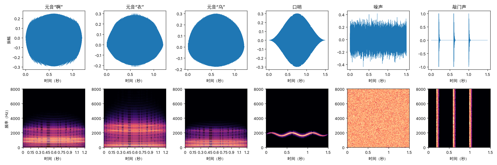
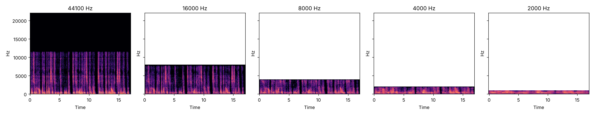
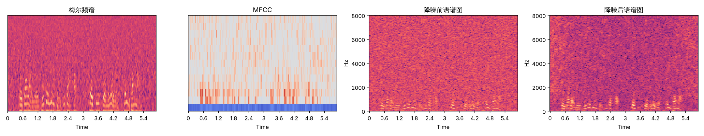
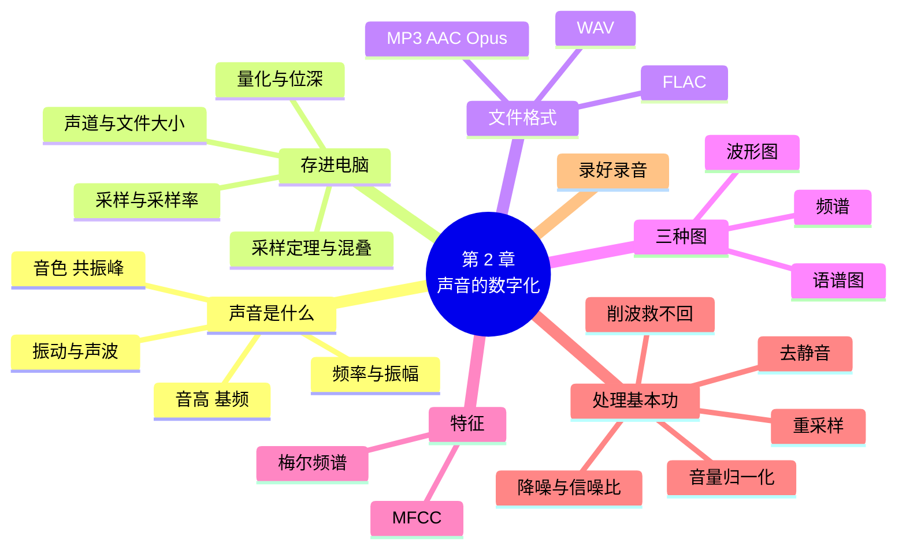

# 第 2 章 声音的数字化与音频处理

!!! abstract "本章学时"
    理论 4 学时（其中线下 1 学时）· 实验 4 学时（本章共 4 个实验，教师可任选）

## 学习目标

学完本章，你应该能够：

1. **说出**声音是怎样产生和传播的，音高、响度、音色分别由什么决定（记忆）；
2. **解释**采样率、位深、声道的含义，用采样定理判断一个采样率够不够用，并算出一段录音的文件大小（理解、应用）；
3. **读懂**波形图、频谱和语谱图，从图上认出静音、削波、噪声、元音的共振峰（理解）；
4. **说出**梅尔频谱和 MFCC 是什么、为什么语音模型用它们而不直接用采样点（理解）；
5. **运行并修改**代码，批量完成格式统一、去静音、音量归一化，用识别结果检查整理效果（应用）；
6. **判断**一段录音的毛病出在哪里、哪些毛病事后能补救、哪些只能重录（分析、评价）。

!!! info "先修要求"
    学习本章前，你需要：

    - 学完第 1 章，能运行 `labs` 里的实验文件，会用 `speak`、`transcribe`、`save_audio`；
    - 学过《Python 编程》中的列表、`for` 循环和函数调用；本章用到的 NumPy 数组可以先把它当成“一长串数字”；
    - 中学物理里“振动”“频率”的概念有印象更好，没有也不要紧，2.1 节从头讲。

??? abstract "本章概念清单（24 个，点击查看定义和例子）"
    1. [声波](../../appendix/glossary.md#g-声波)
    2. [频率](../../appendix/glossary.md#g-频率)
    3. [振幅](../../appendix/glossary.md#g-振幅)
    4. [基频](../../appendix/glossary.md#g-基频)
    5. [音色](../../appendix/glossary.md#g-音色)
    6. [共振峰](../../appendix/glossary.md#g-共振峰)
    7. [采样](../../appendix/glossary.md#g-采样)
    8. [采样率](../../appendix/glossary.md#g-采样率)
    9. [采样定理](../../appendix/glossary.md#g-采样定理)
    10. [混叠](../../appendix/glossary.md#g-混叠)
    11. [量化](../../appendix/glossary.md#g-量化)
    12. [位深](../../appendix/glossary.md#g-位深)
    13. [声道](../../appendix/glossary.md#g-声道)
    14. [波形图](../../appendix/glossary.md#g-波形图)
    15. [频谱](../../appendix/glossary.md#g-频谱)
    16. [语谱图](../../appendix/glossary.md#g-语谱图)
    17. [梅尔频谱](../../appendix/glossary.md#g-梅尔频谱)
    18. [MFCC](../../appendix/glossary.md#g-MFCC)
    19. [帧](../../appendix/glossary.md#g-帧)
    20. [重采样](../../appendix/glossary.md#g-重采样)
    21. [音量归一化](../../appendix/glossary.md#g-音量归一化)
    22. [削波](../../appendix/glossary.md#g-削波)
    23. [信噪比](../../appendix/glossary.md#g-信噪比)
    24. [降噪](../../appendix/glossary.md#g-降噪)

## 情景导入

社区语音服务站试运行了一周，工作人员小周把居民来电的录音导出来，准备批量转成文字存档，结果发现这批录音“五花八门”：有的是手机录的，有的是座机录的；有的文件很大，有的很小；有的听起来像在耳边，有的要把音量开到最大才听得清；还有一段，居民离话筒太近，声音破得厉害。第 1 章实验 1-3 里，`call_03.wav` 的“卫生服务站”被识别成了“医生服务站”，关键词没匹配上。

小周想知道：这些录音到底差在哪里？能不能用程序一次性把它们“整理干净”？哪些毛病整理不了，以后录音时要注意？

要回答这些问题，得先打开声音的“黑盒子”：声音在电脑里是什么样子？第 1 章 `speak` 返回的那一长串数字和 22050 是什么意思？本章先讲声音是怎么变成数字的，再学会“看”声音，最后动手把这批来电录音整理好。

## 2.1 声音是什么

### 2.1.1 振动和声波

用手指按住喉咙说“啊——”，能感觉到喉咙在微微振动。所有的声音都来自**振动**：说话时声带振动，敲门时门板振动，弹吉他时琴弦振动。

振动的物体会推动周围的空气：往外推时，空气被挤得密一些；往回缩时，空气变得疏一些。这种一疏一密的变化像水波一样一圈圈传出去，就是[**声波**](../../appendix/glossary.md#g-声波 "物体振动带动空气一疏一密地传播开去形成的波，传到耳朵就是声音"){ .term }。声波传到耳朵，推动鼓膜跟着振动，我们就听到了声音。话筒的原理和耳朵一样：里面有一片很薄的膜，跟着空气振动，再把振动变成电信号。

把空气在某一点的“疏密程度”随时间的变化画出来，就是一条上下起伏的曲线。描述这条曲线有两个最基本的量：

- [**频率**](../../appendix/glossary.md#g-频率 "每秒振动的次数，单位赫兹（Hz），频率越高听起来音越高"){ .term }：每秒钟振动多少次，单位是赫兹（Hz）。每秒振动 200 次就是 200 Hz。
- [**振幅**](../../appendix/glossary.md#g-振幅 "振动偏离平衡位置的大小，振幅越大声音越响"){ .term }：每次振动偏离平衡位置有多大，也就是曲线的“高度”。

人耳大约能听到 20 Hz 到 20000 Hz 的声音，年纪越大，高频听得越差。人说话的声音主要集中在 100 Hz 到 4000 Hz 之间，清辅音（比如“s”“x”）的能量可以到 8000 Hz 左右。记住这几个数字，2.2 节选采样率时要用。

### 2.1.2 音高、响度和音色

我们平时描述一个声音，会说它“高不高”“响不响”“好不好听”。这三种感觉分别对应声音的三个特性：

| 听起来 | 叫作 | 主要由什么决定 | 例子 |
|---|---|---|---|
| 高还是低 | 音高 | 频率：频率越高，音越高 | 女声一般比男声高；口哨比说话高得多 |
| 响还是轻 | 响度 | 振幅：振幅越大，越响 | 离话筒近、说话用力，录音的振幅就大 |
| 像谁、像什么 | 音色 | 声音里各种频率成分的搭配 | 闭着眼也能听出是妈妈还是爸爸在说话 |

说话时声带每秒振动的次数叫[**基频**](../../appendix/glossary.md#g-基频 "浊音中声带振动的频率，决定听到的音高"){ .term }，它决定了我们听到的音高。成年男性的基频大约在 100—150 Hz，成年女性大约在 200—250 Hz，儿童更高。说话时基频不停地起伏，就形成了语调；普通话的四个声调，就是基频在一个字里“平、升、降升、降”的变化。

[**音色**](../../appendix/glossary.md#g-音色 "让音高、响度相同的两个声音听起来仍然不同的特性，主要由谐波和共振峰决定"){ .term }要复杂一些。声带振动发出的声音不是单一频率，除了基频，还带着 2 倍、3 倍、4 倍……基频的“谐波”。这些声音经过喉咙、口腔、鼻腔时，有的频率被放大，有的被减弱，就像对着一个罐子说话，声音会变“嗡嗡”的。口腔、鼻腔放大的那几个频率区域叫[**共振峰**](../../appendix/glossary.md#g-共振峰 "口腔、鼻腔像共鸣箱一样放大的几个频率区域，决定发的是哪个元音"){ .term }。<sup class="cite">[[1]](#ref2-1)</sup>

共振峰决定了发的是哪个元音。试着连续说“啊—衣—乌”：音高可以不变，但嘴巴张开的大小、舌头的位置在变，口腔这个“共鸣箱”的形状变了，共振峰就跟着变。

| 元音 | 嘴型 | 第 1 共振峰 | 第 2 共振峰 |
|---|---|---|---|
| 啊（a） | 嘴张大，舌头放低 | 高，约 800 Hz | 约 1200 Hz |
| 衣（i） | 嘴角向两边，舌头抬高靠前 | 低，约 300 Hz | 很高，约 2300 Hz |
| 乌（u） | 嘴唇撮圆，舌头靠后 | 低，约 300 Hz | 低，约 800 Hz |

表中是大致数值，不同的人会有差别，但三个元音之间的相对关系是稳定的。本章实验数据里的三个元音就是按这张表“合成”出来的（`labs/data/make_audio.py`），实验 2-1 会把它们画出来。

!!! note "这对语音技术意味着什么"
    语音识别要认出“说了什么”，主要看共振峰的变化，要忽略基频（男女老少说“啊”都是“啊”）；声纹识别要认出“是谁”，就要抓住每个人嗓音里独特的部分；语音合成和克隆要做的，则是把基频、共振峰这些都“画”对。所以这一节的几个概念，后面每一章都会用到。

## 2.2 把声音存进电脑

话筒把声音变成了连续变化的电信号，但电脑只能保存一个个数字。从连续的声音到一串数字，要经过采样和量化两步。

### 2.2.1 采样：每秒记多少次

[**采样**](../../appendix/glossary.md#g-采样 "每隔相同的时间记下一次声波的高度，把连续的声音变成一串数字"){ .term }就是每隔相同的一小段时间，记下一次声波此刻的高度。就像拍电影：真实世界是连续的，电影每秒拍 24 张照片，连起来放，看起来就是连续的动作。

每秒记多少次，叫[**采样率**](../../appendix/glossary.md#g-采样率 "每秒采样的次数，单位 Hz"){ .term }，单位也是 Hz。第 1 章实验 1-1 里 `sr` 等于 22050，意思就是每秒记 22050 个数字；7.32 秒的语音一共 161465 个采样点，161465 ÷ 22050 ≈ 7.32，正好对上。

常见的采样率有这几种：

| 采样率 | 能记录的最高频率 | 常见用途 |
|---|---|---|
| 8000 Hz（8 kHz） | 4000 Hz | 固定电话、老式电话录音 |
| 16000 Hz（16 kHz） | 8000 Hz | 语音识别、声纹识别的标准输入，本书识别实验统一用它 |
| 22050 / 24000 Hz | 约 11—12 kHz | 很多语音合成模型的输出 |
| 44100 Hz（44.1 kHz） | 22050 Hz | CD、音乐、手机录音 |
| 48000 Hz（48 kHz） | 24000 Hz | 视频、专业录音 |

为什么“能记录的最高频率”正好是采样率的一半？这就是[**采样定理**](../../appendix/glossary.md#g-采样定理 "采样率至少是声音最高频率的 2 倍，才能把声音完整记录下来"){ .term }（也叫奈奎斯特定理）：<sup class="cite">[[2]](#ref2-2)</sup>

!!! tip "采样定理"
    要完整记录一个声音，采样率至少要是声音里最高频率的 **2 倍**。

    $$
    \text{采样率} \geq 2 \times \text{最高频率}
    $$

直观地想：一次振动有一“上”一“下”，每次振动至少要记两个点，一个落在上半段、一个落在下半段，才能知道“它振动了一次”。如果记得太稀，一个 6000 Hz 的声音用 8000 Hz 采样，采样点连起来会变成一个 2000 Hz 的假声音，这种现象叫[**混叠**](../../appendix/glossary.md#g-混叠 "声音频率超过采样率一半时，被错误地记成一个更低的频率"){ .term }。电影里飞速转动的车轮看起来像在倒着转，也是同样的道理。所以录音设备在采样之前，都会先把超过一半采样率的高频滤掉。

人说话的主要信息在 8000 Hz 以下，所以 16 kHz 对语音识别已经够用；电话只有 8 kHz，“s”“f”这些高频的清辅音就被削掉了，这就是电话里的声音听着发闷、容易把“四”和“十”听混的原因。

### 2.2.2 量化：每个点记多细

采样决定“多久记一次”，[**量化**](../../appendix/glossary.md#g-量化 "把每个采样点的高度四舍五入到有限个台阶上，变成整数保存"){ .term }决定“每次记得多细”。声波的高度是连续的，可以是 0.31415926……，但电脑存一个数要用固定的位数，只能把高度四舍五入到最近的一个“台阶”上。

每个采样点用多少位二进制数来存，叫[**位深**](../../appendix/glossary.md#g-位深 "每个采样点用多少位二进制数保存，位数越多越精细"){ .term }：

| 位深 | 台阶个数 | 听起来 |
|---|---|---|
| 8 位 | 2⁸ = 256 | 有明显的“沙沙”底噪，老式游戏机的声音 |
| 16 位 | 2¹⁶ = 65536 | 足够细，人耳听不出台阶，WAV 和 CD 的标准 |
| 24 位 | 约 1678 万 | 专业录音棚用，给后期处理留余量 |

在 Python 里，为了计算方便，通常把采样点换算成 −1 到 1 之间的小数：0 是平衡位置，1 和 −1 是能记录的最大值。第 1 章 `speak` 返回的 `samples` 就是这样一串小数。超过 1 的部分记不下来，只能记成 1，波峰就被“削平”了，这叫[**削波**](../../appendix/glossary.md#g-削波 "声音太大超过能记录的最大值，波峰被“削平”，听起来破音"){ .term }，听起来是刺耳的破音。2.6 节和实验 2-3 会遇到它。

下面的动画把采样和量化放在一起。拖动滑块，看采样点和还原出的波形怎样变化：

<iframe class="sim-frame" src="../../sims/sampling-quantization/main.html" height="560" loading="lazy" title="采样与量化"></iframe>
动画：采样与量化。调声音频率、采样率和位深，看采样点（蓝点）、还原出的台阶波形（红线）、混叠现象和 1 分钟录音的文件大小。[全屏打开](../../sims/sampling-quantization/main.html){ target=_blank }
{ .sim-caption }

试一试：采样率选 8000 Hz，把声音频率从 1000 Hz 慢慢调到 6000 Hz，红线从什么时候开始变得“不对劲”？再把位深调到 2 位，看看台阶有多粗。

### 2.2.3 声道和文件大小

[**声道**](../../appendix/glossary.md#g-声道 "同时录下的独立声音路数，单声道 1 路，立体声 2 路"){ .term }是同时录下的声音有几路。单声道只有 1 路；立体声有左、右 2 路，戴耳机听音乐时声音有“方位感”就靠它。语音识别只关心说了什么，不需要方位，所以识别前一般把立体声的两路取平均，合成单声道。本书的 `read_audio` 函数就是这样做的。

知道了采样率、位深和声道，就能算出一段没有压缩的录音有多大：

$$
\text{文件大小（字节）} = \text{采样率} \times \frac{\text{位深}}{8} \times \text{声道数} \times \text{时长（秒）}
$$

除以 8 是因为 8 位是 1 个字节。

!!! example "算一算"
    一段 1 分钟的居民来电，单声道、16 kHz、16 位：

    16000 × 16 ÷ 8 × 1 × 60 = 1 920 000 字节 ≈ 1875 KB ≈ **1.83 MB**（1 KB = 1024 字节，1 MB = 1024 KB）。

    同样 1 分钟，如果是手机录的立体声、44.1 kHz、16 位：44100 × 2 × 2 × 60 = 10 584 000 字节 ≈ **10.1 MB**，是前者的 5.5 倍，但对语音识别来说，多出来的信息几乎用不上。

    社区服务站每天 100 个电话、平均 2 分钟，按 16 kHz 单声道保存，一年大约是 1.83 × 2 × 100 × 365 ≈ 133 600 MB，约 130 GB。存档前把录音统一成 16 kHz 单声道，能省下不少硬盘。

## 2.3 音频文件格式：WAV、MP3、FLAC { #23 }

同样一段声音，可以存成不同格式的文件。格式分两大类：不压缩的，和压缩的。

| 格式 | 压缩方式 | 大小（1 分钟语音，大约） | 特点 | 本书怎么用 |
|---|---|---|---|---|
| WAV | 不压缩 | 1.83 MB（16 kHz 单声道） | 原原本本保存采样点，读写简单，几乎所有软件都支持 | 实验数据、模型输入输出都用它 |
| FLAC | 无损压缩 | 约为 WAV 的一半 | 像 zip 一样压缩，解压后和原来一模一样 | 需要省空间又不能丢信息时 |
| MP3 | 有损压缩 | 约 0.5 MB（64 kbps） | 去掉人耳不太听得出的部分，体积小，但还原不回原样 | 第 6 章有声书发布 |
| M4A / AAC | 有损压缩 | 比同音质的 MP3 更小 | 苹果手机录音、视频里的声音常用 | 手机录音上传前先转 WAV |
| AMR / SILK | 有损压缩（为语音设计） | 很小 | 早期手机录音、聊天软件的语音消息 | 遇到时先转 WAV |
| Opus | 有损压缩（为语音和网络通话设计） | 很小，低码率下音质好 | 网络通话、视频会议常用 | 了解即可 |

几点经验：

1. **处理用 WAV，发布用 MP3**。识别、合成、克隆的中间结果都存成 WAV，最后要发到群里、放到网上时再转成 MP3。
2. **有损压缩不要反复转**。MP3 每压缩一次就丢一点信息，“MP3 → WAV → MP3 → WAV”来回转几次，音质会越来越差。
3. **“码率”是有损格式的音质旋钮**。码率表示每秒的声音用多少千位（kbps）来存，语音用 32—64 kbps 就够，音乐一般用 128—320 kbps。
4. **文件扩展名不一定可信**。有的软件导出的 `.wav` 里面装的其实是压缩数据，读不出来时可以用 `soundfile.info` 或 `ffprobe` 看一下真实格式。

!!! note "用代码查看一个音频文件的“身份证”"
    ```python
    import soundfile as sf
    print(sf.info("../data/calls/call_02.wav"))
    ```
    会显示采样率（samplerate）、声道数（channels）、时长（duration）和编码（subtype，如 PCM_16 表示 16 位不压缩）。实验 2-3 用它批量检查来电录音。

## 2.4 看声音的三种图

声音看不见摸不着，但把它画成图，很多问题一眼就能看出来。语音工作者最常用三种图：波形图、频谱、语谱图。

### 2.4.1 波形图：声音的“心电图”

[**波形图**](../../appendix/glossary.md#g-波形图 "横轴是时间、纵轴是振幅的图，直接画出采样点"){ .term }就是把采样点直接画出来：横轴是时间，纵轴是振幅。它像心电图，能直接看出：

- **哪里有声音、哪里是静音**：静音段是一条贴着 0 的直线；
- **声音大不大**：波形越“胖”，声音越响；
- **有没有削波**：波峰被齐刷刷地切平，贴着 1 或 −1，就是削波；
- **有没有底噪**：静音的地方不是直线，而是一层毛茸茸的“草”，就是背景噪声。

但波形图看不出“是什么声音”：“啊”和“衣”的波形看起来都是一团密密的线。要看声音的内容，得看频率。

### 2.4.2 频谱：一小段声音由哪些频率组成

白光通过三棱镜，会分成红橙黄绿青蓝紫。一段声音也可以“分解”成不同频率的成分，每个频率有多强，画出来就是[**频谱**](../../appendix/glossary.md#g-频谱 "一小段声音里各个频率成分各有多强的图，横轴是频率"){ .term }：横轴是频率，纵轴是这个频率的强度。把声音分解成频率的数学方法叫“傅里叶变换”，程序里一行代码就能完成，我们只用它的结果。

- 口哨接近单一频率，频谱上只有一个尖尖的高峰；
- 元音的频谱是一排等间隔的尖峰（基频和它的谐波），尖峰的“包络”上有几个鼓起来的山包，就是共振峰；
- 噪声的频谱一片平坦，什么频率都有。

### 2.4.3 语谱图：把频谱按时间排起来

说话时声音在不停地变化，一张频谱只能表示很短的一小段（比如 25 毫秒）。把声音切成一小段一小段，每段叫一[**帧**](../../appendix/glossary.md#g-帧 "把声音切成的一小段（通常 20—30 毫秒），在一帧里认为声音基本不变"){ .term }，每帧算一张频谱，再把这些频谱竖起来按时间排好，用颜色深浅表示强弱，就得到了[**语谱图**](../../appendix/glossary.md#g-语谱图 "横轴时间、纵轴频率、颜色深浅表示能量强弱的图，把一段段频谱排起来得到"){ .term }（也叫声谱图）。

语谱图是语音技术里最重要的一张图：**横轴是时间，纵轴是频率，越亮表示这个时刻、这个频率的能量越强**。在语谱图上：

| 看到 | 说明 |
|---|---|
| 一条细细的横线 | 单一频率的声音，如口哨、蜂鸣 |
| 一排等间距的细横线 | 有音高的声音（元音、唱歌），最下面一条是基频，上面是谐波 |
| 几条粗而亮的横带 | 共振峰，不同元音的横带位置不同 |
| 从下到上一大片均匀的“雪花” | 噪声 |
| 一条竖直的亮线 | 短促的敲击、爆破音（如“b”“p”） |
| 高频处一片亮的“雾” | 清辅音“s”“sh”“x” |
| 整块暗的区域 | 静音 |

下面的动画可以切换几种声音，同时看波形图和语谱图，还能播放听一听：

<iframe class="sim-frame" src="../../sims/spectrogram-viewer/main.html" height="600" loading="lazy" title="看见声音"></iframe>
动画：看见声音。选择纯音、口哨、三个元音、男声、噪声、敲门声，对照波形图和语谱图，学会从语谱图上认出音高、谐波、共振峰、噪声和敲击声。[全屏打开](../../sims/spectrogram-viewer/main.html){ target=_blank }
{ .sim-caption }

实验 2-1 用 Python 把本书的六种示例声音画成了波形图（上排）和语谱图（下排）：



对照上图看：三个元音的波形几乎分不出来，但语谱图上亮带的位置明显不同，“衣”在 2300 Hz 附近有一条很高的亮带，“乌”的能量都挤在 1000 Hz 以下；口哨是一条上下起伏的细线；噪声是一整片雪花；敲门声是三条竖线。

## 2.5 梅尔频谱与 MFCC { #25 }

语谱图已经能看出很多东西了，为什么语音模型还要再加工一步？原因有二：一是语谱图的数字太多，16 kHz 的声音用 512 点算频谱，每帧有 257 个数，每秒 100 帧就是 25700 个数，其中很多对听懂话没有用；二是人耳对频率的感觉不是均匀的。

### 2.5.1 人耳的“刻度”：梅尔

人耳对低频的变化很敏感，对高频的变化很迟钝：100 Hz 和 200 Hz 听起来差别很大，但 8000 Hz 和 8100 Hz 几乎听不出差别。1937 年，心理学家史蒂文斯（S. S. Stevens）等人请听众比较音高，总结出一种“按人耳感觉划分”的音高刻度，叫梅尔（Mel）刻度：<sup class="cite">[[3]](#ref2-3)</sup>低频处划分得细，高频处划分得粗。

把语谱图的 257 个频率格子，按梅尔刻度重新合并成几十个频带（常用 80 个），低频的格子几乎不合并、高频的格子大把合并，再对强度取对数（人耳对响度的感觉也是“对数”的：能量变成 10 倍，听起来只是响了一截），就得到了[**梅尔频谱**](../../appendix/glossary.md#g-梅尔频谱 "按人耳对高低频敏感程度不同（梅尔刻度）重新划分频带的语谱图，语音模型最常用的输入"){ .term }。

梅尔频谱是今天语音模型最常用的“原料”：本书用到的识别模型 SenseVoice、Paraformer、Whisper，输入都是 80 个频带左右的梅尔频谱；合成模型 Matcha-TTS 先“画”出一张梅尔频谱，再交给声码器变成声音（第 5 章）。

### 2.5.2 MFCC：再压缩成十几个数 { #252 }

在梅尔频谱的基础上，再做一次数学变换（离散余弦变换），把每帧的几十个数进一步压缩，只保留前 13 个左右，就得到[**MFCC**](../../appendix/glossary.md#g-MFCC "在梅尔频谱基础上再压缩得到的十几个数，概括一帧声音的音色，传统语音识别的标准特征"){ .term }（梅尔频率倒谱系数）。这 13 个数概括了一帧声音“共振峰的大致形状”，而把基频的细节去掉了，正好是识别“说了什么”需要的。1980 年戴维斯（S. Davis）和默梅尔斯坦（P. Mermelstein）的实验表明 MFCC 比当时的其他特征识别效果更好，<sup class="cite">[[4]](#ref2-4)</sup>此后三十年它一直是语音识别的标准特征。第 3 章的模板匹配和 HMM 实验就用 MFCC。

把这几步串起来：


| 表示方法 | 每秒多少个数（16 kHz） | 谁在用 |
|---|---|---|
| 采样点 | 16000 | 存文件、播放 |
| 语谱图 | 约 25700 | 人看图分析 |
| 梅尔频谱 | 约 8000（80 × 100 帧） | 今天的识别、合成模型 |
| MFCC | 约 1300（13 × 100 帧） | 传统识别（DTW、HMM）、第 3 章实验 |

!!! tip "不必记公式"
    梅尔频谱和 MFCC 背后有一串数学步骤，本书不要求推导。会用 librosa 库<sup class="cite">[[5]](#ref2-5)</sup>的 `librosa.feature.melspectrogram` 和 `librosa.feature.mfcc` 两个函数算出来、知道它们是“压缩过的、像人耳一样的语谱图”就够了。实验 2-4 会画出来看。

## 2.6 音频处理基本功

拿到一批录音，在识别或合成之前，通常要先“整理”一下。下面这几步是最常用的，实验 2-3 会把它们写成一个批处理程序。

### 2.6.1 格式统一：单声道、16 kHz { #261 }

识别模型一般要求输入单声道、16 kHz。遇到立体声，就把两个声道取平均；遇到其他采样率，就做[**重采样**](../../appendix/glossary.md#g-重采样 "把音频从一种采样率转换成另一种采样率"){ .term }。

- **降采样**（如 44.1 kHz → 16 kHz）：先把 8000 Hz 以上的高频滤掉（否则会混叠），再隔一些点取一个。对语音识别几乎没有损失。
- **升采样**（如 8 kHz → 16 kHz）：在点和点之间插入新的点。注意，升采样**不能**找回丢掉的高频，8 kHz 的电话录音升到 16 kHz，4000 Hz 以上仍然是空的，只是格式对上了。

```python
import librosa
y16 = librosa.resample(y, orig_sr=44100, target_sr=16000)   # 44.1 kHz → 16 kHz
```

本书的 `read_audio(文件, sr=16000)` 已经把“取平均变单声道”和“重采样”包在一起，读进来就是 16 kHz 单声道。

### 2.6.2 剪掉首尾静音

很多录音开头和结尾有几秒钟的空白：按下录音键后过了一会儿才开口，说完了没有马上停。这些静音不但占地方，还会让识别变慢，在批量合成有声书时会造成忽长忽短的停顿。

最简单的办法是按音量判断：从开头往后找，第一个“够响”的地方之前都剪掉；结尾同理。`librosa.effects.trim(y, top_db=35)` 的意思是：比整段最响的地方低 35 分贝以上的部分，算作静音。`top_db` 越小，剪得越狠，太小会把轻声的字头字尾也剪掉。

句子中间的长停顿，用音量判断就不太可靠了（背景有噪声时，“静音”也不安静）。第 4 章会用专门的语音活动检测（VAD）模型来找“哪里有人在说话”。

### 2.6.3 音量归一化

同一批录音，有的很响，有的很轻。把它们统一调到相近的音量，叫[**音量归一化**](../../appendix/glossary.md#g-音量归一化 "把音频整体放大或缩小到统一的音量水平"){ .term }。最简单的是**峰值归一化**：把整段里最响的那个点调到一个固定值（比如 0.9），其他点按同样的比例放大或缩小。

```python
y = y / abs(y).max() * 0.9     # 最响处变成 0.9，留一点余量，不会削波
```

峰值归一化有个缺点：如果录音里有一声很响的咳嗽，整段都会以这声咳嗽为准，说话部分还是很轻。更讲究的做法是按整体响度（平均能量）来调，有声书和广播行业有专门的响度标准，第 6 章做有声书时再介绍。

!!! warning "削波是救不回来的"
    声音太轻，可以放大；声音太大造成了削波，被削平的波峰里本来是什么样，已经没有记录了，事后再怎么调小音量，破音还在。所以录音时宁可轻一点，也不要太响。实验 2-3 的 `call_06.wav` 会验证这一点。

### 2.6.4 噪声和降噪

录音里除了人声，常常还混着空调声、车流声、电流的嘶嘶声。人声和噪声的强弱之比叫[**信噪比**](../../appendix/glossary.md#g-信噪比 "有用声音和噪声的能量之比，常用分贝表示，越大越干净"){ .term }（SNR），用分贝（dB）表示：

| 信噪比 | 含义 | 听起来 |
|---|---|---|
| 30 dB 以上 | 人声能量是噪声的 1000 倍以上 | 很干净，安静房间里录的 |
| 10 dB | 人声是噪声的 10 倍 | 能听出背景有声音，但不影响听清 |
| 0 dB | 人声和噪声一样强 | 很吵，要仔细听 |
| 负数 | 噪声比人声还强 | 很难听清 |

[**降噪**](../../appendix/glossary.md#g-降噪 "估计并减去录音中的背景噪声，让人声更清楚"){ .term }的基本思路是：先找一段“只有噪声”的部分，算出噪声在各个频率上大概有多强，然后在整段录音的语谱图上，把每个频率减去这么多。这种方法叫“谱减法”，对空调、风扇这种稳定不变的噪声效果好，对突然的关门声、旁人说话就无能为力。本书用的 `noisereduce` 库就是在这个思路上改进的。<sup class="cite">[[6]](#ref2-6)</sup>

降噪不是越狠越好：减得太多，人声也会被减掉一部分，变得发“水”、发“闷”，还会出现像金属声一样的“音乐噪声”。今天的识别模型在训练时就见过大量带噪声的录音，对一般的噪声已经很“抗”，降噪有时反而会帮倒忙。实验 2-4 用数据说话。

## 2.7 录一段好录音

整理录音只能“补救”，最好的办法是一开始就录好。下面是给居民、志愿者和你自己录音时的检查表，实验和第 8 章录参考音都要用：

| 项目 | 要求 | 为什么 |
|---|---|---|
| 环境 | 安静的房间，关掉空调、风扇，远离马路；有窗帘、沙发的房间比空荡荡的房间好 | 减少噪声和回声 |
| 距离 | 嘴离手机话筒 15—30 厘米，正对或稍偏一点 | 太远声音小、回声大；太近容易削波、有“噗噗”的喷麦声 |
| 音量 | 正常说话的音量，录完看波形图，最响处在 0.3—0.8 之间 | 太小噪声相对大，太大会削波 |
| 首尾 | 按下录音后停 1 秒再说，说完停 1 秒再停止 | 防止字头字尾被切掉，事后再剪 |
| 格式 | 能选的话选 WAV、16 kHz 或以上；只能录 M4A 也可以，事后转换 | 有损压缩会丢细节 |
| 内容 | 照稿子读，记下读的原文 | 识别实验要用原文算字错率；克隆参考音也要对应的文字 |
| 告知 | 录别人之前说明用途，取得同意 | 声音是个人信息（1.6 节、第 8 章） |

!!! example "一分钟自查"
    录完先做三件事：① 听一遍，有没有杂音、破音；② 画一下波形图（实验 2-1 的代码改个文件名就行），有没有被削平；③ 用 `transcribe` 识别一遍，和原文对一对。三步都没问题，这段录音就可以用了。

## 2.8 前沿视窗

**神经网络音频编解码器：把声音变成“词”**。MP3、Opus 这些传统格式是工程师根据人耳的特点一点点设计出来的。2021 年起，谷歌的 SoundStream、Meta 的 EnCodec 等“神经网络编解码器”出现了：用神经网络学会怎样压缩声音，在每秒只有 1.5—6 千位（kbps）的极低码率下，音质仍然比同码率的传统格式好得多。<sup class="cite">[[7]](#ref2-7)</sup><sup class="cite">[[8]](#ref2-8)</sup>

更重要的是，这类编解码器把一段声音变成了一串整数编号，就像把一句话切成一个个“词”。有了“声音的词”，大语言模型就可以像续写文字一样“续写声音”：第 1 章提到的语音大模型、第 8 章的大模型语音克隆，很多都是这么做的。所以，“声音怎么变成数字”这个老问题，今天又有了新的答案：从采样点，到梅尔频谱，再到“声音的词”。

截至 2026 年 10 月，主流的语音识别模型仍以梅尔频谱为输入，而新一代的语音合成和语音大模型越来越多地使用这种“声音的词”。本书用到的模型两种都有，后面遇到时会指出来。

## 本章实验

!!! abstract "实验总览"
    | 实验 | 类型 | 建议时长 | 内容 |
    |---|---|---|---|
    | 实验 2-1 | ★ 基础 | 45 分钟 | 画出元音、口哨、噪声、敲门声的波形图和语谱图，算出音高 |
    | 实验 2-2 | ★ 基础 | 45 分钟 | 把一段 44.1 kHz 的讲话降到 16、8、4、2 kHz，比较大小、语谱图和识别结果 |
    | 实验 2-3 | ★ 基础 | 45 分钟 | 批量整理 8 段居民来电：统一格式、去静音、音量归一化，比较整理前后的识别 |
    | 实验 2-4 | ☆ 拓展 | 45 分钟 | 提取梅尔频谱和 MFCC；给噪声很大的来电降噪，看降噪对识别的影响 |

    代码见配套资源 `labs/ch02/` 目录，数据在 `labs/data/sounds/` 和 `labs/data/calls/`。运行前在 `labs` 文件夹里执行一次 `python models.py ch02`（本章只用到第 1 章已下载的识别模型 `sensevoice`，已下载的会自动跳过）。

!!! note "关于画图时的中文"
    本章代码用 matplotlib 画图，开头的 `plt.rcParams["font.sans-serif"] = [...]` 是让图上的中文正常显示。如果图上的中文变成了方框，说明电脑里没有列表中的任何一种中文字体，Windows 一般有 SimHei 和 Microsoft YaHei，Linux 可以装文泉驿字体（附录 B）。运行时出现的 `findfont` 提示不影响结果。

### 实验 2-1 ★ 看见声音

**实验目的**

1. 会读取音频文件，画出波形图和语谱图；
2. 能从图上区分有音高的声音、噪声和短促的敲击声，认出三个元音的共振峰差别；
3. 会用 `librosa.pyin` 估计音高。

**实验环境**：本机 CPU 或云端 Notebook。**实验数据**：`labs/data/sounds/` 里的 6 个声音：三个元音“啊”“衣”“乌”（按 2.1.2 节的共振峰合成）、口哨、噪声、敲门声。

**实验步骤与代码**

第 1 步，先分别双击听一听这 6 个文件，猜一猜它们的语谱图会是什么样。

第 2 步，进入 `labs/ch02`，运行 `lab2_1_see_sound.py`：

```python
import sys

import librosa
import librosa.display
import matplotlib.pyplot as plt
import numpy as np

sys.path.append("..")
from voicelab import read_audio

plt.rcParams["font.sans-serif"] = ["SimHei", "Microsoft YaHei", "WenQuanYi Zen Hei", "Noto Sans CJK SC"]  # 中文字体
plt.rcParams["axes.unicode_minus"] = False

names = {"vowel_a": "元音“啊”", "vowel_i": "元音“衣”", "vowel_u": "元音“乌”",
         "whistle": "口哨", "noise": "噪声", "knock": "敲门声"}

fig, axes = plt.subplots(2, len(names), figsize=(18, 6))
for col, (name, title) in enumerate(names.items()):
    samples, sr = read_audio(f"../data/sounds/{name}.wav")
    t = np.arange(len(samples)) / sr                          # 每个采样点对应的时间（秒）
    axes[0, col].plot(t, samples, linewidth=0.5)              # 上排：波形图
    axes[0, col].set_title(title)
    axes[0, col].set_xlabel("时间（秒）")
    spec = librosa.amplitude_to_db(np.abs(librosa.stft(samples, n_fft=512)), ref=np.max)
    librosa.display.specshow(spec, sr=sr, hop_length=128, x_axis="time", y_axis="hz", ax=axes[1, col])  # 下排：语谱图
    axes[1, col].set_xlabel("时间（秒）")
    axes[1, col].set_ylabel("")
    f0, voiced, _ = librosa.pyin(samples, fmin=60, fmax=2500, sr=sr)       # 估计音高（基频）
    pitch = f"{np.nanmedian(f0):.0f} Hz" if voiced.mean() > 0.3 else "没有明确音高"
    centroid = librosa.feature.spectral_centroid(y=samples, sr=sr).mean()   # 频谱重心：能量“平均”在多高的频率
    print(f"{title:<6} 时长 {len(samples) / sr:.2f} 秒，最大振幅 {np.abs(samples).max():.2f}，"
          f"音高 {pitch}，频谱重心 {centroid:.0f} Hz")
axes[0, 0].set_ylabel("振幅")
axes[1, 0].set_ylabel("频率（Hz）")
plt.tight_layout()
plt.savefig("see_sound.png", dpi=120)
print("已保存 see_sound.png")
```

代码里有三个新东西：`librosa.stft` 把声音切成帧、每帧算频谱，`amplitude_to_db` 把强度换成分贝，`specshow` 画出语谱图；`librosa.pyin` 是一种估计基频的方法，<sup class="cite">[[9]](#ref2-9)</sup>它还会判断每一帧“有没有音高”；频谱重心可以理解成能量的“平均频率”，越高声音越尖、越亮。

第 3 步，打开 `see_sound.png`，对照 2.4.3 节的表读图。

第 4 步，**改一改**：把 `names` 换成 `{"speech_44k": "讲话"}`（实验数据里一段 44.1 kHz 的讲话），看看真实语音的语谱图是什么样，找一找哪里是元音、哪里是“s”“x”这样的清辅音。

**运行结果**

```text
元音“啊”  时长 1.20 秒，最大振幅 0.30，音高 214 Hz，频谱重心 1052 Hz
元音“衣”  时长 1.20 秒，最大振幅 0.30，音高 214 Hz，频谱重心 1413 Hz
元音“乌”  时长 1.20 秒，最大振幅 0.30，音高 214 Hz，频谱重心 509 Hz
口哨     时长 1.50 秒，最大振幅 0.30，音高 1823 Hz，频谱重心 1813 Hz
噪声     时长 1.50 秒，最大振幅 0.44，音高 70 Hz，频谱重心 3980 Hz
敲门声    时长 1.50 秒，最大振幅 1.00，音高 没有明确音高，频谱重心 1371 Hz
已保存 see_sound.png
```

生成的图见 2.4.3 节。读结果：

- 三个元音的音高一样（都是 214 Hz，合成时音高设在 200—220 Hz 之间），但频谱重心不同：“衣”有一个 2300 Hz 的高共振峰，重心最高；“乌”的能量都在低频，重心最低。**音高相同、元音不同，区别在共振峰**。
- 口哨的音高约 1800 Hz，比说话高得多，在语谱图上是一条细线。
- 噪声的频谱重心接近 4000 Hz，正好是 0—8000 Hz 的中间，说明各个频率的能量差不多，是一片“雪花”。程序给噪声报了一个 70 Hz 的“音高”，这是 `pyin` 被随机起伏骗了，噪声其实没有音高。**程序算出来的数也要结合图和常识判断**。
- 敲门声最大振幅达到 1.00，在波形图上是三根尖刺，在语谱图上是三条竖线。

**实验记录表**

| 声音 | 波形图特点 | 语谱图特点 | 音高（Hz） | 频谱重心（Hz） |
|---|---|---|---|---|
| 元音“啊” | | | | |
| 元音“衣” | | | | |
| 元音“乌” | | | | |
| 口哨 | | | | |
| 噪声 | | | | |
| 敲门声 | | | | |
| 讲话（改一改） | | 元音、清辅音在哪里？ | — | — |

**常见问题排查**

| 现象 | 原因 | 解决办法 |
|---|---|---|
| 图上的中文是方框 | 没有中文字体 | 见本节开头“关于画图时的中文” |
| `ModuleNotFoundError: No module named 'librosa'` | 库没装 | 在 `labs` 里运行 `pip install -r requirements.txt` |
| 运行很慢，卡在 `pyin` | `pyin` 计算量大 | 正常，6 个声音约十几秒；可以先把 `pyin` 那两行注释掉 |
| 在 Notebook 里看不到图 | 只保存了文件 | 在最后加一行 `plt.show()`，或打开 `see_sound.png` |

**思考与练习**

1. 男声说“啊”和女声说“啊”，语谱图上什么相同、什么不同？（提示：用 2.4.3 节的动画对比“元音啊”和“男声啊”）
2. 为什么说波形图适合看“音量和静音”，语谱图适合看“内容”？

**实验报告要求**

提交 `see_sound.png`、填好的记录表，以及“改一改”中讲话的语谱图，并在图上标出至少两个元音和一个清辅音的位置。

### 实验 2-2 ★ 采样率听一听

**实验目的**

1. 会对音频做重采样，计算并比较不同采样率下的采样点数和文件大小；
2. 通过语谱图验证采样定理：采样率降低，能记录的最高频率也跟着降低；
3. 观察采样率对听感和识别结果的影响。

**实验环境**：本机 CPU 或云端 Notebook。**实验数据**：`labs/data/sounds/speech_44k.wav`，一段 8.51 秒、44.1 kHz 的讲话（Kokoro 合成的女声）。模型 `sensevoice`。

**实验步骤与代码**

第 1 步，运行 `lab2_2_sample_rate.py`：

```python
import os
import sys

import librosa
import librosa.display
import matplotlib.pyplot as plt
import numpy as np

sys.path.append("..")
from voicelab import read_audio, save_audio, transcribe

plt.rcParams["font.sans-serif"] = ["SimHei", "Microsoft YaHei", "WenQuanYi Zen Hei", "Noto Sans CJK SC"]

original, sr0 = read_audio("../data/sounds/speech_44k.wav", sr=None)   # sr=None：保持原来的采样率
rates = [44100, 16000, 8000, 4000, 2000]                                # ← 改这里：试试 1000、22050

fig, axes = plt.subplots(1, len(rates), figsize=(18, 3.5), sharey=True)
for ax, sr in zip(axes, rates):
    y = librosa.resample(original, orig_sr=sr0, target_sr=sr) if sr != sr0 else original
    file = f"speech_{sr // 1000}k.wav"
    save_audio(file, y, sr)
    kb = os.path.getsize(file) / 1024
    print(f"{sr:>6} Hz：{len(y):>7} 个采样点，文件 {kb:6.1f} KB，最高能表示 {sr // 2:>5} Hz 识别：{transcribe(y, sr)}")
    spec = librosa.amplitude_to_db(np.abs(librosa.stft(y, n_fft=1024)), ref=np.max)
    librosa.display.specshow(spec, sr=sr, x_axis="time", y_axis="hz", ax=ax)
    ax.set_ylim(0, 22050)
    ax.set_title(f"{sr} Hz")
plt.tight_layout()
plt.savefig("sample_rates.png", dpi=120)
print("已保存 sample_rates.png")
```

`transcribe(y, sr)` 收到不是 16 kHz 的声音时，识别模型会在内部先重采样到 16 kHz 再识别。

第 2 步，依次双击听 `speech_44k.wav`、`speech_16k.wav`、`speech_8k.wav`、`speech_4k.wav`、`speech_2k.wav`，记下听感。

第 3 步，**改一改**：把 `rates` 改成 `[22050, 1000]`，再运行一次。

**运行结果**

```text
 44100 Hz： 375117 个采样点，文件  732.7 KB，最高能表示 22050 Hz 识别：同学们好，欢迎来到社区语音服务站。今天我们一起看看声音在电脑里是什么样子。
 16000 Hz： 136097 个采样点，文件  265.9 KB，最高能表示  8000 Hz 识别：同学们好，欢迎来到社区语音服务站。今天我们一起看看声音在电脑里是什么样子。
  8000 Hz：  68049 个采样点，文件  133.0 KB，最高能表示  4000 Hz 识别：同学们好，欢迎来到社区语音服务站。今天我们一起看看声音在电脑里是什么样子。
  4000 Hz：  34025 个采样点，文件   66.5 KB，最高能表示  2000 Hz 识别：同学们好，欢迎来到社区语音服务站。今天我们一起看看声音在电脑里是什么样子。
  2000 Hz：  17013 个采样点，文件   33.3 KB，最高能表示  1000 Hz 识别：同学们好，欢迎来到社区语音服务站。今天我们一起看看声音再电脑里是什么样子。
已保存 sample_rates.png
```



读结果：

- **文件大小和采样率成正比**。375117 × 2 字节 ≈ 732.7 KB，和 2.2.3 节的公式一致；16 kHz 只有 44.1 kHz 的 36%。
- **语谱图的“天花板”就是采样率的一半**。上图中，16 kHz 的语谱图在 8000 Hz 以上全黑，8 kHz 在 4000 Hz 以上全黑，2 kHz 只剩 1000 Hz 以下的一窄条，验证了采样定理。
- **听感和识别不完全一样**。编者听下来，8 kHz 像打电话，4 kHz 已经很闷，2 kHz 像隔着墙说话；但识别模型直到 4 kHz 都完全正确，2 kHz 才出现一个错字（“在”→“再”）。这说明听懂中文最关键的信息在低频的共振峰里，而这段录音是安静环境下的清楚发音，模型“猜”得出来。真实的嘈杂录音降到这么低的采样率，识别会差得多。

**实验记录表**

| 采样率 | 采样点数 | 文件大小（KB） | 最高能表示（Hz） | 听感 | 识别结果对不对 |
|---|---|---|---|---|---|
| 44100 | | | | | |
| 16000 | | | | | |
| 8000 | | | | | |
| 4000 | | | | | |
| 2000 | | | | | |
| 1000（改一改） | | | | | |

**常见问题排查**

| 现象 | 原因 | 解决办法 |
|---|---|---|
| 2 kHz 的文件双击播放不了 | 有的播放器不支持这么低的采样率 | 换一个播放器，或在 Notebook 里用 `play` |
| 采样点个数和书上差几十个 | 不同版本的 librosa 重采样算法细节不同 | 正常，不影响结论 |

**思考与练习**

1. 用 8 kHz 采样的电话录音，能不能通过升采样到 16 kHz 让“s”“x”这些音变清楚？为什么？
2. 某平台要求上传的语音“采样率不低于 16 kHz”，你手上有一段 8 kHz 的录音，升采样以后上传算不算满足要求？

**实验报告要求**

提交记录表和 `sample_rates.png`，用一两句话说明采样定理在图上是怎么体现的。

### 实验 2-3 ★ 整理居民来电

**实验目的**

1. 会批量读取一个文件夹里的录音，检查声道、采样率、时长、峰值和削波；
2. 会批量完成单声道 16 kHz 转换、去首尾静音和峰值归一化；
3. 会用识别结果和字错率检查整理效果，判断哪些毛病能补救、哪些不能。

**实验环境**：本机 CPU 或云端 Notebook。**实验数据**：`labs/data/calls/` 里的 8 段居民来电和 `calls.csv`（每段的原文和“录音问题”）。8 段录音故意做成了各种毛病：双声道 44.1 kHz、声音太小、前后有 3 秒静音、有背景噪声、声音太大削波、8 kHz 电话录音，还有 2 段正常的作对照。模型 `sensevoice`。

**实验步骤与代码**

第 1 步，打开 `calls.csv` 看一看，再挑几段双击听听，特别是 `call_03`（太小）和 `call_06`（削波）。

第 2 步，运行 `lab2_3_clean_calls.py`：

```python
import sys
from pathlib import Path

import librosa
import numpy as np
import pandas as pd
import soundfile as sf

sys.path.append("..")
from voicelab import cer, read_audio, save_audio, transcribe

src = Path("../data/calls")
out = Path("calls_clean")
out.mkdir(exist_ok=True)
truth = pd.read_csv(src / "calls.csv")                     # 标准答案（每段来电的文字）

rows = []
for _, r in truth.iterrows():
    info = sf.info(src / r["文件"])                         # 先看原始格式
    raw, raw_sr = read_audio(src / r["文件"], sr=None)       # 原样读入（多声道已取平均）
    peak = np.abs(raw).max()
    clipped = np.mean(np.abs(raw) > 0.99)                    # 削波：贴着最大值的采样点比例

    y, sr = read_audio(src / r["文件"], sr=16000)            # ① 单声道 ② 16 kHz
    y, _ = librosa.effects.trim(y, top_db=35)                # ③ 去掉首尾比最响处低 35 分贝以上的部分
    y = y / np.abs(y).max() * 0.9                            # ④ 音量归一化：最响处调到 0.9
    save_audio(out / r["文件"], y, sr)

    before, after = transcribe(raw, raw_sr), transcribe(y, sr)
    rows.append({"文件": r["文件"], "问题": r["录音问题"], "声道": info.channels, "采样率": info.samplerate,
                 "原时长": round(info.duration, 2), "新时长": round(len(y) / sr, 2), "峰值": round(float(peak), 3),
                 "削波比例": f"{clipped:.1%}", "整理前字错率": f"{cer(r['文字'], before)[0]:.0%}",
                 "整理后字错率": f"{cer(r['文字'], after)[0]:.0%}", "整理后识别": after})

table = pd.DataFrame(rows)
table.to_csv("calls_check.csv", index=False, encoding="utf-8-sig")
pd.set_option("display.width", 200)
print(table.drop(columns="整理后识别").to_string(index=False))
for f in ["call_03.wav", "call_06.wav"]:
    print(f, "整理后识别：", table.set_index("文件").loc[f, "整理后识别"])
print("已保存 calls_clean/ 和 calls_check.csv")
```

代码里的 `cer` 是 `voicelab.py` 提供的**字错率**函数：识别结果和原文相比，错了几个字（多了、少了、换了都算），再除以原文的字数，越小越好，0% 表示全对。第 3 章会详细讲它怎么算。表格用的是 pandas 库，《Python 编程》和《人工智能数据分析与处理》里都学过，这里只用来打印和保存表格。

第 3 步，打开 `calls_clean/` 听一听整理后的录音，再用 Excel 或 WPS 打开 `calls_check.csv`。

**运行结果**

```text
       文件         问题  声道   采样率   原时长  新时长    峰值 削波比例 整理前字错率 整理后字错率
call_01.wav           正常   1 16000  6.98 6.27 0.487 0.0%     0%     0%
call_02.wav  双声道 44.1 kHz   2 44100  7.93 7.23 0.396 0.0%     4%     4%
call_03.wav         声音太小   1 16000  6.50 5.76 0.020 0.0%     4%     4%
call_04.wav    前后有 3 秒静音   1 16000 12.33 5.50 0.302 0.0%     5%     5%
call_05.wav        有背景噪声   1 16000  5.90 5.90 0.318 0.0%     0%     0%
call_06.wav       声音太大、削波   1 16000  7.01 6.27 1.000 0.1%     5%    10%
call_07.wav     8 kHz 电话录音   1  8000  6.81 5.95 0.293 0.0%     0%     0%
call_08.wav           正常   1 16000  8.29 7.42 0.462 0.0%     0%     0%
call_03.wav 整理后识别： 请问社区医生服务站周日上午开门吗？我想带孩子去打疫苗。
call_06.wav 整理后识别： 7号楼门口的快递柜坏了，取不出包裹，请景快处理。
已保存 calls_clean/ 和 calls_check.csv
```

（为了排版，上面的表格对齐做了少量调整。）

这个结果很“诚实”，值得仔细读：

1. **格式统一了，文件小了**。8 段录音全部变成单声道 16 kHz。`call_04` 前后 6 秒的静音被剪掉，从 12.33 秒变成 5.50 秒；其余几段也剪掉了零点几秒的首尾空白。只有 `call_05` 没剪，因为它从头到尾都有噪声，按音量判断“没有静音”。
2. **整理后识别没有变好**。8 段里有 7 段整理前后字错率一样。今天的识别模型自己就能处理双声道、各种采样率和音量差别，`call_03` 的音量只有 0.020（正常的 1/20），整理前后都被识别成“医生服务站”，说明这个错误不是音量造成的，而是这个声音读“卫生”时容易被听成“医生”。整理录音的主要好处是**存储统一、处理流程统一、听起来统一**，而不是“提高识别率”。
3. **削波救不回来，归一化还帮了倒忙**。`call_06` 的峰值是 1.000，有 0.1% 的采样点被削平。整理后它被识别成“请**景**快处理”，字错率从 5% 升到 10%。这验证了 2.6.3 节的提醒：被削掉的信息已经没有了。
4. **有些“错误”其实是写法不同**。`call_02` 的 4% 是因为模型把“五号楼”写成了“5号楼”，`call_06` 里也有“七”和“7”的差别。我们的简单字错率把它们算作错字。第 3 章会学习在计算字错率之前先“统一写法”。

**实验记录表**

| 文件 | 录音问题 | 整理前听感 | 整理后听感 | 整理前字错率 | 整理后字错率 | 毛病能补救吗？ |
|---|---|---|---|---|---|---|
| call_02 | 双声道 44.1 kHz | | | | | |
| call_03 | 声音太小 | | | | | |
| call_04 | 前后静音 | | | | | |
| call_06 | 削波 | | | | | |
| call_07 | 8 kHz | | | | | |

**常见问题排查**

| 现象 | 原因 | 解决办法 |
|---|---|---|
| `KeyError: '文件'` | CSV 用别的软件另存过，编码或表头变了 | 用实验数据里原来的 `calls.csv` |
| 用 Excel 打开 `calls_check.csv` 中文乱码 | 编码问题 | 代码已用 `utf-8-sig` 保存，一般不会乱码；仍然乱码时用 WPS 打开，或在 Excel 里“数据 → 从文本导入”选 UTF-8 |
| 整理后的录音字头被剪掉了 | `top_db` 太小 | 把 35 改成 40 或 45 |

**思考与练习**

1. 把 `top_db=35` 改成 20 和 60 各运行一次，`call_04` 的新时长分别是多少？听一听，哪个剪得太狠了？
2. 既然整理后识别没有变好，社区服务站还有必要整理录音吗？说出至少两条理由。
3. 如果你负责制定服务站的录音规范，为了避免 `call_06` 这种问题，你会写哪一条？

**实验报告要求**

提交 `calls_check.csv`、记录表和思考题第 2、3 题的回答。

### 实验 2-4 ☆ 梅尔频谱、MFCC 与降噪 { #2-4 }

**实验目的**

1. 会用 librosa 提取梅尔频谱和 MFCC，说出它们的形状（多少行、多少列）各表示什么；
2. 会按指定的信噪比给录音加噪声，用 noisereduce 降噪；
3. 能用识别结果评价降噪效果，认识到“降噪不一定帮助识别”。

**实验环境**：本机 CPU 或云端 Notebook。**实验数据**：`labs/data/calls/call_05.wav`（本来就有一点背景噪声）。模型 `sensevoice`。

**实验步骤与代码**

第 1 步，运行 `lab2_4_mfcc_denoise.py`：

```python
import sys

import librosa
import librosa.display
import matplotlib.pyplot as plt
import noisereduce as nr
import numpy as np
import pandas as pd

sys.path.append("..")
from voicelab import cer, read_audio, save_audio, transcribe

plt.rcParams["font.sans-serif"] = ["SimHei", "Microsoft YaHei", "WenQuanYi Zen Hei", "Noto Sans CJK SC"]

y, sr = read_audio("../data/calls/call_05.wav")             # 有背景噪声的那段
truth = pd.read_csv("../data/calls/calls.csv").set_index("文件").loc["call_05.wav", "文字"]
snr = 0  # ← 改这里：信噪比（分贝），越小噪声越大，试试 10、5、-5
rng = np.random.default_rng(0)
noise = rng.standard_normal(len(y)).astype(np.float32)
noise *= np.sqrt(np.mean(y ** 2) / np.mean(noise ** 2) / 10 ** (snr / 10))   # 按信噪比调整噪声的大小
y = y + noise                                               # 再加一层更大的噪声
save_audio("call_05_noisy.wav", y, sr)

mel = librosa.feature.melspectrogram(y=y, sr=sr, n_fft=400, hop_length=160, n_mels=80)   # 25 毫秒一帧，10 毫秒一步
mfcc = librosa.feature.mfcc(y=y, sr=sr, n_mfcc=13, n_fft=400, hop_length=160)
print("梅尔频谱：", mel.shape, "（80 个频带 × 帧数）")
print("MFCC：    ", mfcc.shape, "（13 个系数 × 帧数）")

clean = nr.reduce_noise(y=y, sr=sr, prop_decrease=0.9)     # ← 改这里：0.5 降一半噪声，1.0 尽量全降
save_audio("call_05_denoised.wav", clean, sr)
for name, x in [("降噪前", y), ("降噪后", clean)]:
    text = transcribe(x, sr)
    print(f"{name}：字错率 {cer(truth, text)[0]:.0%}  {text}")

fig, axes = plt.subplots(1, 4, figsize=(18, 3.5))
for ax, data, title in [(axes[0], librosa.power_to_db(mel, ref=np.max), "梅尔频谱"), (axes[1], mfcc, "MFCC")]:
    librosa.display.specshow(data, sr=sr, hop_length=160, x_axis="time", ax=ax)
    ax.set_title(title)
for ax, x, title in [(axes[2], y, "降噪前语谱图"), (axes[3], clean, "降噪后语谱图")]:
    librosa.display.specshow(librosa.amplitude_to_db(np.abs(librosa.stft(x)), ref=np.max), sr=sr,
                             x_axis="time", y_axis="hz", ax=ax)
    ax.set_title(title)
plt.tight_layout()
plt.savefig("mfcc_denoise.png", dpi=120)
print("已保存 mfcc_denoise.png")
```

`n_fft=400` 是 400 个采样点一帧，16 kHz 下正好 25 毫秒；`hop_length=160` 是每次往后移 160 个点，即 10 毫秒，所以每秒 100 帧。这是语音识别里最常用的设置。

第 2 步，听 `call_05_noisy.wav` 和 `call_05_denoised.wav`，对比降噪前后的听感。

第 3 步，**改一改**：把 `snr` 依次改成 10、5、−5，各运行一次，填写记录表。

**运行结果**（`snr = 0`）

```text
梅尔频谱： (80, 590) （80 个频带 × 帧数）
MFCC：     (13, 590) （13 个系数 × 帧数）
降噪前：字错率 19%  我家老油不会用手机账号，或知有没有人可以帮忙？
降噪后：字错率 5%  我家老人不会用手机挂号，过区有没有人可以帮忙？
已保存 mfcc_denoise.png
```



5.90 秒的录音，每秒 100 帧，一共 590 帧，所以梅尔频谱是 80 行 × 590 列，MFCC 是 13 行 × 590 列。从图上看，降噪后语谱图背景的“雪花”明显变暗，人声的横条露了出来。

编者把 4 种信噪比都试了一遍：

| 信噪比 | 降噪前字错率 | 降噪后字错率 | 结论 |
|---|---|---|---|
| 10 dB | 0% | 0% | 噪声不大，模型自己能应付，降不降都一样 |
| 5 dB | 5% | 10% | 降噪反而多错了一个字 |
| 0 dB | 19% | 5% | 噪声和人声一样强时，降噪明显有帮助 |
| −5 dB | 19% | 19% | 噪声太大，降噪也救不回来 |

结论是：**降噪只在“中等偏大”的噪声下对识别有帮助**；噪声小时，模型本身已经很“抗噪”，降噪带来的失真反而会帮倒忙；噪声太大时，人声已经被淹没，降噪也找不回来。实际工作中，要不要降噪，最好像这样用识别结果试一试再决定，不要想当然。

**实验记录表**

| 信噪比 | 降噪前听感 | 降噪后听感 | 降噪前字错率 | 降噪后字错率 |
|---|---|---|---|---|
| 10 dB | | | | |
| 5 dB | | | | |
| 0 dB | | | | |
| −5 dB | | | | |

**常见问题排查**

| 现象 | 原因 | 解决办法 |
|---|---|---|
| `ModuleNotFoundError: No module named 'noisereduce'` | 库没装 | `pip install noisereduce` |
| 字错率和书上略有不同 | 随机噪声相同（种子固定为 0），但不同版本的库计算细节不同 | 正常，看趋势 |
| 降噪后声音发“水”、有金属声 | `prop_decrease` 太大，人声也被减掉了 | 改成 0.5—0.7 |

**思考与练习**

1. MFCC 只有 13 行，梅尔频谱有 80 行，MFCC 丢掉了什么信息？为什么丢掉这些对识别“说了什么”影响不大？
2. 把 `prop_decrease` 改成 0.5 和 1.0，听感和识别结果有什么变化？

**实验报告要求**

提交记录表和 `mfcc_denoise.png`，写一段话回答：社区服务站要不要对所有来电录音都做降噪？

## 本章小结

- 声音是振动在空气中传播形成的**声波**，用**频率**和**振幅**描述；音高由**基频**决定，响度由振幅决定，**音色**由谐波和**共振峰**决定，元音的区别在共振峰。
- 声音进电脑要经过**采样**和**量化**：**采样率**是每秒记多少次，**位深**是每次记多细，**声道**是录几路。**采样定理**：采样率至少是最高频率的 2 倍，否则会**混叠**。语音识别用 16 kHz 单声道 16 位，1 分钟约 1.83 MB。
- WAV 不压缩，FLAC 无损压缩，MP3、AAC、Opus 有损压缩；处理用 WAV，发布用 MP3，有损格式不要反复转。
- **波形图**看音量、静音和**削波**；**频谱**看一小段声音的频率成分；**语谱图**把一**帧**一帧的频谱按时间排起来，是语音分析最重要的图。
- **梅尔频谱**按人耳的感觉合并频带，是今天识别和合成模型的标准输入；**MFCC** 再压缩到每帧十几个数，是传统识别的标准特征。
- 音频处理基本功：格式统一（**重采样**、转单声道）、去首尾静音、**音量归一化**、**降噪**。**信噪比**越高越干净。削波救不回来；今天的模型很“抗噪”，整理和降噪不一定提高识别率，要用数据检验。
- 最好的处理是一开始就录好：安静、距离合适、音量适中、首尾留白、记下原文、取得同意。



**下一章预告**

实验 2-3 里，识别模型把“卫生”听成了“医生”，把“充电桩”写成了“充电装”。机器到底是怎么从一串梅尔频谱、MFCC 里“听”出字来的？为什么会听错？下一章从 1952 年的“比模板”讲起，亲手用 MFCC 和模板匹配做一个能认 0—9 的小识别器，再看隐马尔可夫模型和深度学习是怎样一步步让机器听得越来越准的，还会学会规范地计算字错率。

## 参考文献

正文中的上标编号（如<sup class="cite">[[1]](#ref2-1)</sup>）对应下面的文献。带链接的可以直接打开；书籍可在图书馆或电子书平台查阅。

<div class="refs" markdown>

**书籍**

- <span id="ref2-1"></span>[1] FANT G. Acoustic theory of speech production[M]. The Hague: Mouton, 1960.
    <span class="ref-note">提出“声源—滤波器”模型：声带发出带谐波的声音，声道像滤波器一样形成共振峰。2.1.2 节的元音和本章实验数据里的元音都按这个思路生成。</span>

**论文**

- <span id="ref2-2"></span>[2] SHANNON C E. Communication in the presence of noise[J]. Proceedings of the IRE, 1949, 37(1): 10-21.
    <span class="ref-note">给出了采样定理的完整表述和证明（奈奎斯特 1928 年已指出“2 倍”关系），对应 2.2.1 节。</span>
- <span id="ref2-3"></span>[3] STEVENS S S, VOLKMANN J, NEWMAN E B. A scale for the measurement of the psychological magnitude pitch[J]. The Journal of the Acoustical Society of America, 1937, 8(3): 185-190.
    <span class="ref-note">梅尔刻度的出处：按听众的感觉给音高定刻度，对应 2.5.1 节。</span>
- <span id="ref2-4"></span>[4] DAVIS S, MERMELSTEIN P. Comparison of parametric representations for monosyllabic word recognition in continuously spoken sentences[J]. IEEE Transactions on Acoustics, Speech, and Signal Processing, 1980, 28(4): 357-366.
    <span class="ref-note">比较多种语音特征，MFCC 效果最好，此后成为语音识别的标准特征，对应 2.5.2 节，第 3 章实验会用到。</span>
- <span id="ref2-5"></span>[5] McFEE B, RAFFEL C, LIANG D, et al. librosa: audio and music signal analysis in Python[C]//Proceedings of the 14th Python in Science Conference. 2015: 18-25. https://librosa.org/.
    <span class="ref-note">本章读写、重采样、画语谱图、提取梅尔频谱和 MFCC 都用这个库，函数用法见附录 A。</span>
- <span id="ref2-7"></span>[7] ZEGHIDOUR N, LUEBS A, OMRAN A, et al. SoundStream: an end-to-end neural audio codec[J]. IEEE/ACM Transactions on Audio, Speech, and Language Processing, 2022, 30: 495-507.
    <span class="ref-note">谷歌的神经网络音频编解码器，3 kbps 下音质超过 12 kbps 的 Opus，对应 2.8 节。</span>
- <span id="ref2-8"></span>[8] DÉFOSSEZ A, COPET J, SYNNAEVE G, et al. High fidelity neural audio compression[EB/OL]. arXiv:2210.13438, 2022. https://arxiv.org/abs/2210.13438.
    <span class="ref-note">Meta 的 EnCodec，把声音编码成一串整数编号，后来被许多语音大模型和语音合成模型用作“声音的词”，对应 2.8 节。</span>
- <span id="ref2-9"></span>[9] MAUCH M, DIXON S. pYIN: a fundamental frequency estimator using probabilistic threshold distributions[C]//2014 IEEE International Conference on Acoustics, Speech and Signal Processing (ICASSP). 2014: 659-663.
    <span class="ref-note">实验 2-1 估计音高所用 `librosa.pyin` 的算法论文。</span>

**在线资源**

- <span id="ref2-6"></span>[6] SAINBURG T. noisereduce: noise reduction in Python using spectral gating[CP/OL]. [2026-11-01]. https://github.com/timsainb/noisereduce.
    <span class="ref-note">实验 2-4 所用的降噪库，基于“谱门限”方法，是 2.6.4 节谱减法思路的改进，对应 2.6.4 节。</span>

</div>

## 课后练习

选择题和判断题可以直接点击选项作答，系统会马上告诉你对错，并展开答案与解析；多选题选好后点“提交答案”。简答和实操题请先自己作答，再点开“答案与解析”核对。每道题的解析下方都有“回看”链接，做错了可以直接跳回正文复习。

**一、单项选择题**

<div class="quiz" data-answer="C" markdown>

**1.** 男声和女声说同一个“啊”，听起来女声更高，主要是因为女声的（　　）更高。

- A. 振幅
- B. 采样率
- C. 基频
- D. 位深

</div>

??? tip "答案与解析"
    **答案：C**

    音高由基频决定，女声基频约 200—250 Hz，男声约 100—150 Hz。振幅决定响度；采样率和位深是录音设备的参数，与说话人无关。

    考查：音高与基频 · 认知层次：理解 · [回看 2.1.2](#212)
    { .quiz-meta }

<div class="quiz" data-answer="B" markdown>

**2.** 同一个人用同样的音高先说“啊”再说“衣”，两段声音的主要区别在于（　　）。

- A. 基频不同
- B. 共振峰位置不同
- C. 采样率不同
- D. 声道数不同

</div>

??? tip "答案与解析"
    **答案：B**

    元音由口腔形状决定，口腔形状决定共振峰。实验 2-1 中三个元音的音高都是 214 Hz，区别在共振峰和频谱重心。

    考查：共振峰 · 认知层次：理解 · [回看 2.1.2](#212)
    { .quiz-meta }

<div class="quiz" data-answer="A" markdown>

**3.** 采样率为 16000 Hz 的录音，最高能记录的声音频率是（　　）。

- A. 8000 Hz
- B. 16000 Hz
- C. 32000 Hz
- D. 4000 Hz

</div>

??? tip "答案与解析"
    **答案：A**

    根据采样定理，能记录的最高频率是采样率的一半。

    考查：采样定理 · 认知层次：应用 · [回看 2.2.1](#221)
    { .quiz-meta }

<div class="quiz" data-answer="D" markdown>

**4.** 一段 2 分钟、单声道、8 kHz、16 位的 WAV 电话录音，大小约为（　　）。

- A. 0.23 MB
- B. 0.92 MB
- C. 3.66 MB
- D. 1.83 MB

</div>

??? tip "答案与解析"
    **答案：D**

    8000 × 16 ÷ 8 × 1 × 120 = 1 920 000 字节 ≈ 1.83 MB。和 16 kHz 1 分钟的大小正好一样：采样率减半、时长加倍。

    考查：文件大小计算 · 认知层次：应用 · [回看 2.2.3](#223)
    { .quiz-meta }

<div class="quiz" data-answer="C" markdown>

**5.** 在语谱图上，一条从下到上贯穿的竖直亮线，最可能是（　　）。

- A. 口哨声
- B. 持续的元音
- C. 敲门声这样短促的敲击
- D. 静音

</div>

??? tip "答案与解析"
    **答案：C**

    短促的敲击在极短时间内包含各种频率，在语谱图上是竖线。口哨是细横线，元音是一排横线和共振峰横带，静音是暗的。

    考查：读语谱图 · 认知层次：理解 · [回看 2.4.3](#243)
    { .quiz-meta }

<div class="quiz" data-answer="B" markdown>

**6.** 下列关于梅尔频谱的说法，正确的是（　　）。

- A. 它比语谱图包含更多的数字
- B. 它按人耳的感觉划分频带，低频分得细、高频分得粗
- C. 它只能用于语音合成，不能用于识别
- D. 它就是波形图换了一种颜色

</div>

??? tip "答案与解析"
    **答案：B**

    梅尔频谱按梅尔刻度合并频带，数字比语谱图少，是今天识别和合成模型的标准输入。

    考查：梅尔频谱 · 认知层次：理解 · [回看 2.5.1](#251)
    { .quiz-meta }

<div class="quiz" data-answer="A" markdown>

**7.** 把一段 8 kHz 的电话录音升采样到 16 kHz，下列说法正确的是（　　）。

- A. 文件变大了，但 4000 Hz 以上的高频并没有找回来
- B. 声音变得和 16 kHz 录的一样清楚
- C. 文件变小了
- D. 会产生削波

</div>

??? tip "答案与解析"
    **答案：A**

    升采样只是在点之间插值，格式对上了，但采样时丢掉的高频信息已经没有了。

    考查：重采样 · 认知层次：理解 · [回看 2.6.1](#261)
    { .quiz-meta }

<div class="quiz" data-answer="D" markdown>

**8.** 实验 2-4 中，梅尔频谱的形状是 (80, 590)，其中 590 表示（　　）。

- A. 590 个频带
- B. 采样率 590 Hz
- C. 590 个 MFCC 系数
- D. 590 帧，每 10 毫秒一帧，对应 5.90 秒

</div>

??? tip "答案与解析"
    **答案：D**

    80 是梅尔频带数，590 是帧数。`hop_length=160` 在 16 kHz 下是 10 毫秒，5.90 秒共 590 帧。

    考查：分帧与特征形状 · 认知层次：应用 · [回看实验 2-4](#2-4)
    { .quiz-meta }

**二、多项选择题**

<div class="quiz quiz-multi" data-answer="ABC" markdown>

**9.** 从波形图上能直接看出的有（　　）。

- A. 哪里是静音
- B. 有没有削波
- C. 声音大概有多响
- D. 说的是哪个元音

</div>

??? tip "答案与解析"
    **答案：ABC**

    波形图显示振幅随时间的变化，能看出静音、音量和削波；元音的区别在共振峰，要看语谱图。

    考查：波形图 · 认知层次：理解 · [回看 2.4.1](#241)
    { .quiz-meta }

<div class="quiz quiz-multi" data-answer="BD" markdown>

**10.** 下列录音毛病中，事后用程序**很难**补救的有（　　）。

- A. 前后有几秒静音
- B. 声音太大造成的削波
- C. 双声道、44.1 kHz，和其他录音格式不统一
- D. 8 kHz 采样丢掉的 4000 Hz 以上的高频

</div>

??? tip "答案与解析"
    **答案：BD**

    静音可以剪，格式可以转；削波和采样时丢掉的高频，信息已经没有记录，补不回来。

    考查：音频处理的能力边界 · 认知层次：评价 · [回看 2.6](#26)
    { .quiz-meta }

<div class="quiz quiz-multi" data-answer="ACD" markdown>

**11.** 给社区志愿者录一段高质量的参考录音，正确的做法有（　　）。

- A. 选安静的房间，关掉空调和风扇
- B. 嘴尽量贴近话筒，声音越大越好
- C. 按下录音后停 1 秒再开口
- D. 照稿子读，并保存稿子原文

</div>

??? tip "答案与解析"
    **答案：ACD**

    贴得太近、声音太大容易削波和喷麦，距离 15—30 厘米、正常音量最好。

    考查：录音规范 · 认知层次：应用 · [回看 2.7](#27)
    { .quiz-meta }

**三、判断题**

<div class="quiz quiz-judge" data-answer="×" markdown>

**12.** 采样率越高越好，所以语音识别应该用 48 kHz 的录音。（　　）

</div>

??? tip "答案与解析"
    **答案：×**

    人说话的主要信息在 8000 Hz 以下，16 kHz 已经够用；识别模型一般也按 16 kHz 训练，更高的采样率只会让文件更大。

    考查：采样率选择 · 认知层次：评价 · [回看 2.2.1](#221)
    { .quiz-meta }

<div class="quiz quiz-judge" data-answer="√" markdown>

**13.** MP3 是有损压缩格式，反复在 MP3 和 WAV 之间转换会让音质越来越差。（　　）

</div>

??? tip "答案与解析"
    **答案：√**

    每次压缩成 MP3 都会丢掉一部分信息，丢掉的不会因为转回 WAV 而恢复。

    考查：文件格式 · 认知层次：理解 · [回看 2.3](#23)
    { .quiz-meta }

<div class="quiz quiz-judge" data-answer="×" markdown>

**14.** 降噪总能提高语音识别的准确率。（　　）

</div>

??? tip "答案与解析"
    **答案：×**

    实验 2-4 中，5 dB 时降噪反而让字错率从 5% 升到 10%；只有 0 dB 左右时降噪明显有帮助，−5 dB 时也救不回来。

    考查：降噪的效果 · 认知层次：评价 · [回看实验 2-4](#2-4)
    { .quiz-meta }

<div class="quiz quiz-judge" data-answer="√" markdown>

**15.** 信噪比为 0 dB，表示人声和噪声的能量一样强。（　　）

</div>

??? tip "答案与解析"
    **答案：√**

    信噪比的分贝数 = 10 × log₁₀(人声能量 ÷ 噪声能量)，两者相等时比值为 1，对数为 0。

    考查：信噪比 · 认知层次：理解 · [回看 2.6.4](#264)
    { .quiz-meta }

<div class="quiz quiz-judge" data-answer="×" markdown>

**16.** 实验 2-3 中，`call_03.wav` 被识别成“医生服务站”是因为声音太小，音量归一化之后就识别对了。（　　）

</div>

??? tip "答案与解析"
    **答案：×**

    整理前后都识别成“医生服务站”，字错率都是 4%，说明这个错误不是音量造成的。

    考查：分析实验结果 · 认知层次：分析 · [回看实验 2-3](#2-3)
    { .quiz-meta }

**四、简答题**

**17.** 什么是采样定理？用它解释为什么电话里的“四”和“十”容易听混。

??? tip "答案与解析"
    **参考答案**：采样率至少要是声音最高频率的 2 倍，才能完整记录声音。电话用 8 kHz 采样，只能记录 4000 Hz 以下的声音；“四”（s）和“十”（sh）的区别主要在清辅音的高频部分，被削掉以后两个字就不容易分清了。

    考查：采样定理 · 认知层次：理解 · [回看 2.2.1](#221)
    { .quiz-meta }

**18.** 语音识别模型为什么一般不直接用采样点作为输入，而用梅尔频谱？

??? tip "答案与解析"
    **参考答案**：① 采样点只反映振幅随时间的变化，看不出频率成分，而区分字音主要靠共振峰等频率信息；② 梅尔频谱数字少得多（16 kHz 时每秒约 8000 个，且结构清楚），计算更快；③ 梅尔刻度和对数强度模仿人耳的感觉，把对听懂话不重要的高频细节合并了。

    考查：梅尔频谱 · 认知层次：理解 · [回看 2.5](#25)
    { .quiz-meta }

**19.** 实验 2-3 中，整理后 8 段录音有 7 段字错率没有变化，1 段反而变差。请分析原因，并说明整理录音还有什么意义。

??? tip "答案与解析"
    **参考答案**：今天的识别模型内部会自己重采样、对音量和声道差别不敏感，所以格式统一和归一化对识别影响不大；`call_06` 变差是因为削波已经造成了失真，归一化无法恢复。整理录音的意义在于：统一格式便于存档和后续批处理、剪掉静音节省存储和处理时间、统一音量便于人工回听和后续合成，还能在检查表中发现削波等问题，反过来改进录音规范。

    考查：分析实验结果 · 认知层次：评价 · [回看实验 2-3](#2-3)
    { .quiz-meta }

**五、实操题**

**20.** 用手机在两种环境下各录一段同样的话（例如“你好，我想报名参加社区志愿服务”）：一段在安静的房间、正常距离；一段在有噪声的地方（开着电视或在窗边），或者离手机很远。用实验 2-1 和 2-3 的代码，画出两段录音的波形图和语谱图，算出时长、峰值和字错率，写一段对比分析。

??? tip "答案与解析"
    **参考做法**：

    ```python
    import sys
    sys.path.append("..")
    from voicelab import cer, read_audio, transcribe
    import numpy as np

    text = "你好，我想报名参加社区志愿服务"
    for f in ["quiet.wav", "noisy.wav"]:          # 手机录音先转成 WAV，放在 ch02 文件夹里
        y, sr = read_audio(f)
        heard = transcribe(y, sr)
        print(f, f"时长 {len(y) / sr:.2f} 秒，峰值 {np.abs(y).max():.2f}，字错率 {cer(text, heard)[0]:.0%}", heard)
    ```

    画图部分把实验 2-1 的 `names` 改成 `{"quiet": "安静", "noisy": "嘈杂"}`，读取路径改成当前文件夹即可。分析时注意：嘈杂环境的语谱图背景是一层“雪花”，静音段不再是暗的；离得远时峰值小、回声多，高频变弱。手机录音多为 M4A 格式，可以用格式转换软件或 `ffmpeg -i quiet.m4a -ar 16000 -ac 1 quiet.wav` 转成 WAV。

    考查：录音质量分析 · 认知层次：应用 · [回看 2.7](#27)
    { .quiz-meta }
