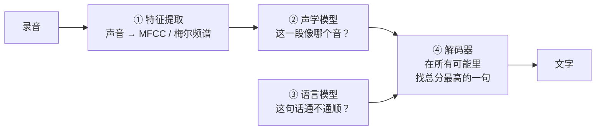
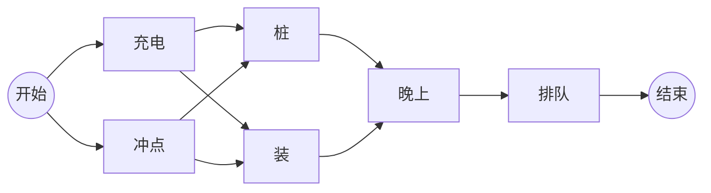
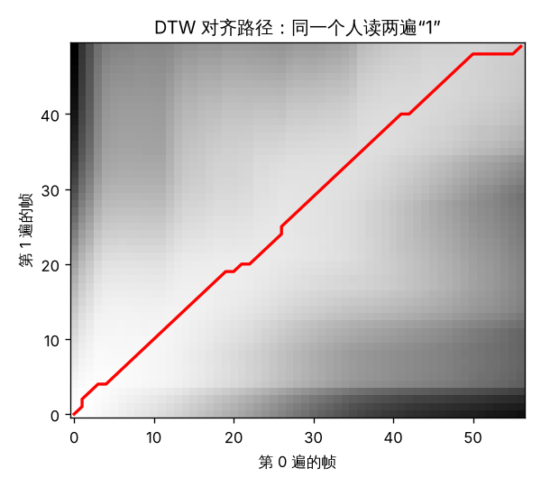
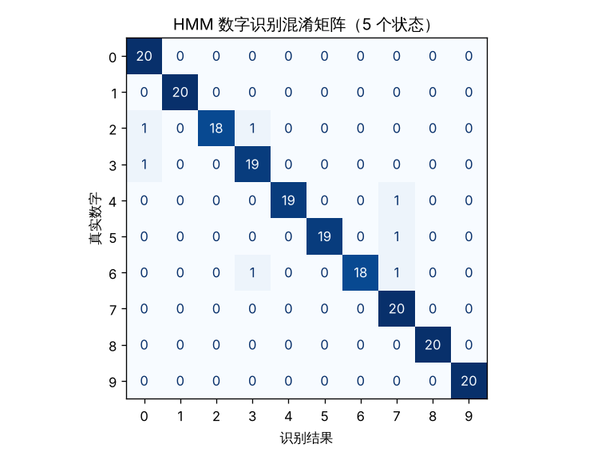
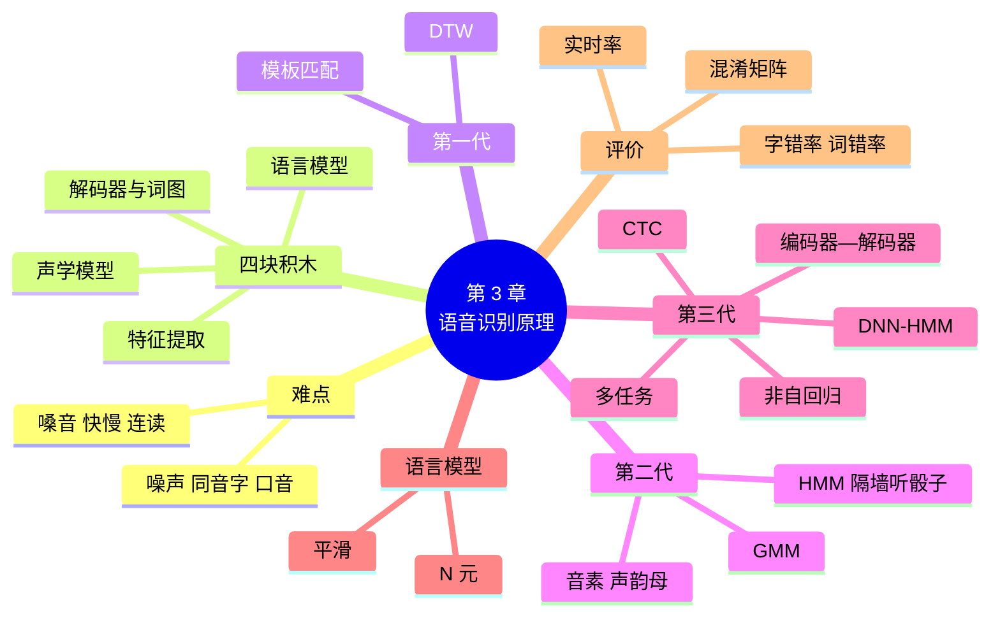

# 第 3 章 语音识别原理：从模板匹配到深度学习

!!! abstract "本章学时"
    理论 4 学时（其中线下 1 学时）· 实验 4 学时（本章共 4 个实验，教师可任选）

## 学习目标

学完本章，你应该能够：

1. **说出**语音识别要克服的几个难题，以及识别系统由哪四个部分组成、各管什么（记忆、理解）；
2. **解释**模板匹配和 DTW 的思路，能在小例子上找出两段快慢不同的序列怎样对齐（理解、应用）；
3. **用比喻说明**隐马尔可夫模型中“看不见的状态”和“听得到的声音”是什么关系（理解）；
4. **区分** CTC、编码器—解码器、非自回归几类端到端模型，能把一串逐帧输出折叠成文字（理解、应用）；
5. **手算并用代码算出**字错率、词错率和实时率，读懂混淆矩阵（应用、分析）；
6. **运行并修改**代码，做出一个能认 0—9 的数字识别器，用语言模型给同音候选句打分（应用）。

!!! info "先修要求"
    学习本章前，你需要：

    - 学完第 2 章，知道帧、语谱图、梅尔频谱和 MFCC 是什么；
    - 会运行 `labs` 里的实验文件，看得懂 `for` 循环和字典（《Python 编程》）；
    - 本章出现的“概率”“对数”只用到最直观的意思：概率是 0 到 1 之间表示可能性的数，对数可以把很多个小概率的乘积变成加法，不需要会推导。

??? abstract "本章概念清单（19 个，点击查看定义和例子）"
    1. [声学模型](../../appendix/glossary.md#g-声学模型)
    2. [语言模型](../../appendix/glossary.md#g-语言模型)
    3. [解码器](../../appendix/glossary.md#g-解码器)
    4. [词图](../../appendix/glossary.md#g-词图)
    5. [模板匹配](../../appendix/glossary.md#g-模板匹配)
    6. [动态时间规整](../../appendix/glossary.md#g-动态时间规整)
    7. [隐马尔可夫模型](../../appendix/glossary.md#g-隐马尔可夫模型)
    8. [高斯混合模型](../../appendix/glossary.md#g-高斯混合模型)
    9. [音素](../../appendix/glossary.md#g-音素)
    10. [声韵母](../../appendix/glossary.md#g-声韵母)
    11. [混淆矩阵](../../appendix/glossary.md#g-混淆矩阵)
    12. [端到端模型](../../appendix/glossary.md#g-端到端模型)
    13. [CTC](../../appendix/glossary.md#g-CTC)
    14. [编码器—解码器](../../appendix/glossary.md#g-编码器—解码器)
    15. [非自回归模型](../../appendix/glossary.md#g-非自回归模型)
    16. [N 元语言模型](../../appendix/glossary.md#g-N-元语言模型)
    17. [字错率](../../appendix/glossary.md#g-字错率)
    18. [词错率](../../appendix/glossary.md#g-词错率)
    19. [实时率](../../appendix/glossary.md#g-实时率)

## 情景导入

社区语音服务站上线一个月，小周统计了一下：大部分来电都能正确转成文字，但总有一些奇怪的错误。“充电桩”变成了“充电装”，“卫生服务站”变成了“医生服务站”，“请尽快处理”变成了“请景快处理”。小周有点想不通：这些字读音明明一样或者差不多，机器怎么就选错了？它到底是怎么“听”的？

再往前想一步：二十多年前的手机语音拨号，要先对着手机把每个联系人的名字录一遍，换个人说就不灵了；今天的识别模型谁说都能听懂，还能听懂方言和英语。这中间发生了什么？

本章顺着语音识别七十年的发展，把它的原理拆开来看：先亲手做一个 1950—1970 年代风格的“比模板”识别器，再做一个 1980—2000 年代风格的隐马尔可夫模型识别器，然后看今天的深度学习模型是怎样工作的；最后学会给识别结果“打分”，并用一个小小的语言模型把“充电装”纠正回“充电桩”。

## 3.1 语音识别难在哪里

人听懂别人说话毫不费力，但让机器做到，要克服好几个难题：

| 难题 | 例子 | 对机器意味着什么 |
|---|---|---|
| 每个人的嗓音不一样 | 男女老少说同一个“你好”，音高、音色差别很大 | 不能只认一个人的声音 |
| 快慢不一样 | 着急时一句话 2 秒说完，慢慢说要 4 秒 | 同一句话的帧数不一样，不能一帧对一帧地比 |
| 字和字连在一起 | 说话时字和字之间没有停顿，“西安”和“先”听起来很像 | 不知道一个字从哪里开始、到哪里结束 |
| 环境不一样 | 马路边、电话里、会议室回声 | 第 2 章看到的噪声、8 kHz、削波都会出现 |
| 同音字多 | 普通话约 400 个音节（不计声调），常用汉字几千个，“shì”就有“是、事、市、试、室……” | 光听声音不够，还得看上下文 |
| 口音和方言 | 南方口音 zh/z 不分、n/l 不分 | 同一个字的发音因人而异 |

前四个难题和“声音”有关，后两个和“语言”有关。所以一个识别系统既要懂声音，也要懂语言。

## 3.2 识别系统的四块积木

不管哪个年代的识别系统，都可以拆成四块积木：



1. **特征提取**：把采样点变成更适合识别的特征，就是第 2 章的 MFCC 或梅尔频谱。
2. [**声学模型**](../../appendix/glossary.md#g-声学模型 "识别系统中判断“这一小段声音像哪个音”的部分"){ .term }：判断“这一小段声音像哪个音”。比如某几帧，像“chong”的可能性是 0.6，像“zhong”的是 0.3。
3. [**语言模型**](../../appendix/glossary.md#g-语言模型 "判断一串文字通不通顺、出现的可能性有多大的模型"){ .term }：判断“这串文字通不通顺”。“充电桩”很常见，“充电装”几乎不会出现。
4. [**解码器**](../../appendix/glossary.md#g-解码器 "结合声学模型和语言模型的打分，在所有可能的文字中搜索最好的一句的部分"){ .term }：把声学模型和语言模型的打分综合起来，在成千上万种可能的文字组合里，找出总分最高的那一句。

解码时，所有候选的字词会连成一张网：每一段声音可能对应好几个词，这些词前后相连，从头到尾的每一条路径都是一个候选句子。这张网叫[**词图**](../../appendix/glossary.md#g-词图 "解码时把各种可能的词连成的网状图，每条从头到尾的路径是一种候选句子"){ .term }。下面是“充电桩晚上排队”的一个简化的词图，解码器要做的，就是在这张网里找出“声音像不像”和“话通不通顺”两项加起来得分最高的一条路：



在早期的系统里，这四块积木是分开做、分开训练的；今天的端到端模型把前三块合成了一个大神经网络，但“声音像不像”和“话通不通顺”这两件事，它仍然都要考虑。

## 3.3 第一代：模板匹配与 DTW { #33 }

### 3.3.1 比模板

最早的识别思路非常朴素：**先存模板，再比一比**。比如要识别 0—9 十个数字，就让使用者把每个数字各读一遍，算出 MFCC 存起来，这就是十个模板。识别时，把新录音的 MFCC 和十个模板一一比较，最像哪个，就是哪个数字。这种方法叫[**模板匹配**](../../appendix/glossary.md#g-模板匹配 "事先存好每个词的录音特征当模板，识别时和每个模板比较，最像的就是结果"){ .term }，第 1 章提到的 1952 年 Audrey 系统就是这个思路。

“比一比”听起来简单，难题出在快慢上：模板“3”有 50 帧，这次说的“3”只有 40 帧，第 1 帧和第 1 帧比、第 2 帧和第 2 帧比……比到后面就错位了。

### 3.3.2 DTW：允许一帧对多帧 { #332 }

1978 年，日本学者坂井（H. Sakoe）和千叶（S. Chiba）系统地提出了用[**动态时间规整**](../../appendix/glossary.md#g-动态时间规整 "允许一帧对多帧，自动对齐两段快慢不同的语音并算出距离的方法"){ .term }（DTW）来解决这个问题：<sup class="cite">[[1]](#ref3-1)</sup>不要求一帧对一帧，允许一帧对多帧（说得慢的那段，几帧对应说得快的一帧），只要顺序不乱，然后在所有合法的对法里，找出总距离最小的那一种。

!!! example "算一算：DTW 对齐"
    为了好算，假设每帧只用一个数表示（真实的 MFCC 每帧 13 个数）：

    - 模板 A（说得快，4 帧）：1　3　4　2
    - 新录音 B（说得慢，6 帧）：1　1　3　3　4　2

    **直接一帧对一帧**，只能比前 4 帧：|1−1| + |3−1| + |4−3| + |2−3| = 0 + 2 + 1 + 1 = 4，后面 2 帧还没地方放。

    **DTW 对齐**：A 的“1”对 B 的前两帧“1 1”，A 的“3”对 B 的“3 3”，A 的“4”对“4”，A 的“2”对“2”。每一对的距离都是 0，总距离为 **0**。

    DTW 找出了“B 只是把前两个音拖长了”，两段其实是同一个词。

DTW 用一种叫“动态规划”的方法，不用把所有对法都试一遍，就能很快找到最好的那一种。计算的结果可以画成一张表：横轴是模板的帧，纵轴是新录音的帧，每一格是这两帧的距离，最佳对齐就是从左下角走到右上角、经过的格子距离之和最小的一条路。实验 3-1 中，同一个人读两遍“1”，一遍 57 帧、一遍 50 帧，DTW 找到的路径是这样的：



红线越接近对角线，说明两遍的快慢越一致；红线出现水平或竖直的小段，就是某一边“拖长了”。

下面的动画可以拖动第 2 遍的语速和开头的停顿，比较“逐帧硬对比”和“DTW 对齐”的距离：

<iframe class="sim-frame" src="../../sims/dtw-align/main.html" height="560" loading="lazy" title="DTW 对齐"></iframe>
动画：DTW 对齐。调第 2 遍的语速和开头停顿，看两种对比方法的连线和距离怎样变化；切换“词 B”，看不同的词距离有多大。[全屏打开](../../sims/dtw-align/main.html){ target=_blank }
{ .sim-caption }

### 3.3.3 模板匹配的局限

实验 3-1 用 DTW 做了一个数字识别器，结果很能说明问题：用 george 一个人的录音做模板，识别 george 自己的录音准确率 91%，识别另外三个人的录音只有 44%—56%。模板匹配认的是“这个人的这种读法”，换个人就不灵了。每个人都录一遍模板可以缓解（实验 3-1 的“改一改”，准确率回到 87%—100%），但词一多就不现实了：要识别几万个词，总不能让用户把几万个词都读一遍。

这就是早期手机语音拨号要先录名字的原因，也是研究者转向统计方法的原因。

## 3.4 第二代：隐马尔可夫模型

### 3.4.1 隔墙听骰子

20 世纪 70 年代起，研究者开始用概率来描述语音，其中最重要的是[**隐马尔可夫模型**](../../appendix/glossary.md#g-隐马尔可夫模型 "用看不见的“状态”一步步转移、每个状态发出可观察的声音来描述语音的统计模型"){ .term }（HMM）。<sup class="cite">[[2]](#ref3-2)</sup>先看一个比喻：

!!! example "隔墙听骰子"
    隔壁房间里有人在掷骰子，他手里有两颗骰子：一颗是普通的，一颗做了手脚、总爱出 6。他每次掷之前会换不换骰子，有一定的规律（比如用普通骰子时，下一次有 90% 的可能还用它）。你看不见他用的是哪颗骰子，只能隔着墙听到他报出的点数：“3、1、6、6、6、2……”

    - 看不见的“用的是哪颗骰子”，叫**隐状态**；
    - 听得到的“点数”，叫**观察**；
    - “换不换骰子”的规律，叫**转移概率**；
    - “每颗骰子掷出各个点数的可能性”，叫**发射概率**。

    听到一串“6、6、6、6”，你会猜他这几次用的是做了手脚的骰子。HMM 做的就是这种“根据听到的，猜看不见的”推理。

语音和这个游戏很像。说“三”（sān）时，嘴巴先做出“s”的样子，然后过渡到“a”，最后收成“n”，这几个**发音阶段**我们看不见，就是隐状态；每一帧录到的 MFCC 我们看得见，就是观察。每个阶段会持续好几帧（停在同一个状态），然后进入下一个阶段（转移到下一个状态）。说得快，每个状态停的帧数少；说得慢，停的帧数多。**快慢问题就这样被“状态可以停留几帧”自然地解决了**，不需要再做 DTW。

每个状态会发出什么样的 MFCC，用[**高斯混合模型**](../../appendix/glossary.md#g-高斯混合模型 "用几个“钟形曲线”叠加来描述一个状态会发出什么样的声音特征"){ .term }（GMM）来描述：可以把它想象成几座“小山”叠在一起，MFCC 落在山顶附近的可能性大、落在山脚的可能性小。把很多人的录音拿来训练，小山的形状就能覆盖不同人的发音，这正是它比模板匹配强的地方。

### 3.4.2 用 HMM 识别 { #342 }

用 HMM 识别 0—9，做法是：

1. **训练**：每个数字训练一个 HMM。把很多人读“3”的录音都交给“3”号 HMM，它自己学会“3”大概分几个阶段、每个阶段的 MFCC 是什么样、每个阶段一般停多久。
2. **识别**：来一段新录音，让 10 个 HMM 各自算一下“这段声音是我发出来的可能性有多大”，可能性最大的那个就是答案。

实验 3-2 用 4 个人的录音训练 10 个 HMM（每个 5 个状态），在没见过的 200 段录音上测试，准确率 96.5%，训练只用了不到 4 秒。不过要注意，测试录音的说话人在训练时都出现过；如果拿一个完全没见过的人来测，只用 3 个人训练的 HMM 准确率只有 27%—56%（编者实测）。统计方法要“见多识广”，真实的识别系统要用几千人、几千小时的录音来训练。

### 3.4.3 音素和声韵母

给每个数字训练一个 HMM，只适合词很少的情况。要识别任意的句子，就要换一种积木：不以“词”为单位，而以更小的发音单位为单位，再把它们拼成词。

语言中能区分意思的最小语音单位叫[**音素**](../../appendix/glossary.md#g-音素 "语言中能区分意思的最小语音单位"){ .term }，比如“bā”（八）和“pā”（趴）的区别就在音素 b 和 p 上。中文识别常用[**声韵母**](../../appendix/glossary.md#g-声韵母 "汉语音节的声母和韵母，中文识别常用的建模单位"){ .term }做单位：每个音节拆成声母和韵母，“中”= zh + ong，“国”= g + uo。普通话只有 20 多个声母、30 多个韵母，组合起来就能覆盖所有的字。

用 HMM 识别连续的句子时，系统里有三样东西：

- 每个声母、韵母一个 HMM（**声学模型**）；
- 一本发音词典，写着每个词由哪些声韵母组成：“充电”= ch + ong + d + ian；
- 一个**语言模型**，管“哪些词经常连在一起”。

解码器把这三样东西编织成一张巨大的网，在里面找最好的路径（3.2 节的词图）。这套“HMM + GMM + 发音词典 + 语言模型”的方案统治了语音识别三十年，著名的开源工具 Kaldi 就是这一代技术的集大成者。

## 3.5 第三代：深度学习与端到端模型

### 3.5.1 用神经网络当声学模型

2010 年前后，研究者用深度神经网络（DNN）替换了 HMM 里的 GMM，由神经网络来判断“这一帧像哪个状态”，识别错误率一下子降了很多（第 1 章 1.3.1 节）。这种做法叫 DNN-HMM，“混合系统”，它保留了 HMM、发音词典和解码器，只换掉了打分的部分。

神经网络在这里的作用，可以理解成一个“更会打分的评委”：GMM 只能看一帧，判断能力有限；神经网络可以同时看前后十几帧，还能从海量数据里学到更细的规律。

### 3.5.2 端到端：一个网络从声音直接到文字

再往后，研究者干脆把发音词典、HMM 都去掉了，用一个大神经网络直接把梅尔频谱变成文字，这就是[**端到端模型**](../../appendix/glossary.md#g-端到端模型 "一个神经网络直接把声音变成文字，不再分成声学模型、发音词典、语言模型几个部件"){ .term }。它省去了“写发音词典”“对齐每个状态”这些麻烦的工作，只需要“录音 + 对应的文字”就能训练。今天主流的识别模型都是端到端模型，按“怎样把很多帧变成少量文字”分为几类。

**第一类：CTC**。端到端模型面临的第一个问题是：1 秒的声音有 100 帧，但只对应三四个字，帧和字怎么对上？2006 年，格雷夫斯（A. Graves）等人提出了 [**CTC**](../../appendix/glossary.md#g-CTC "让模型逐帧输出字或空白，再合并重复、删掉空白得到文字的训练和解码方法"){ .term }（连接时序分类）：<sup class="cite">[[3]](#ref3-3)</sup>让模型在每一帧输出一个字或者一个特殊的“空白”（下面用 _ 表示），然后按两条规则折叠：

1. 合并连续重复的字；
2. 删掉空白。

例如逐帧输出“\_\_你你你\_好好\_\_”，合并重复得到“\_你\_好\_”，删掉空白得到“你好”。空白有两个作用：一是表示“这一帧没有新字”（停顿、拖音）；二是隔开两个相同的字，“谢\_谢”才能折叠成“谢谢”，否则“谢谢谢谢”会被合并成一个“谢”。

<iframe class="sim-frame" src="../../sims/ctc-collapse/main.html" height="520" loading="lazy" title="CTC 折叠"></iframe>
动画：CTC 折叠。选一个例子或自己输入逐帧输出，按“下一步”看合并重复、删掉空白的过程。[全屏打开](../../sims/ctc-collapse/main.html){ target=_blank }
{ .sim-caption }

CTC 的优点是快，可以边听边出字，第 4 章的流式识别（边说边出字幕）用的就是 CTC 模型。缺点是每一帧的输出是各自独立决定的，不太考虑前后文，所以容易出同音字错误，常常要再配一个语言模型。

**第二类：编码器—解码器**。像人做听写一样：先把整段话听完（编码器把整段梅尔频谱“读懂”，变成一串内部表示），再一个字一个字地写下来（解码器每写一个字，都会回头看一看声音的哪一部分最相关，这叫“注意力”，同时也看看自己前面已经写了哪些字）。因为写每个字时都参考了前面的字，它自带了一定的语言知识。OpenAI 的 Whisper 就是这一类，它用 68 万小时、多种语言的网络音频训练，能识别近百种语言，还能直接翻译成英文。<sup class="cite">[[4]](#ref3-4)</sup>缺点是要一个字一个字地写，句子越长越慢，偶尔还会“编”出录音里没有的话（第 4 章会遇到）。

**第三类：非自回归模型**。“一个字一个字地写”叫自回归。阿里巴巴达摩院 2022 年提出的 Paraformer 换了个思路：先估计这段话有几个字，然后一次性把所有字同时写出来，所以叫[**非自回归模型**](../../appendix/glossary.md#g-非自回归模型 "一次同时输出所有字，而不是一个接一个地输出，因此速度快"){ .term }。<sup class="cite">[[5]](#ref3-5)</sup>它的速度比[编码器—解码器](../../appendix/glossary.md#g-编码器—解码器 "先由编码器把整段声音“读懂”，再由解码器一个字一个字地写出文字的模型结构"){ .term }模型快很多倍，准确率又不输，是中文识别里常用的模型，第 4 章会用它。

**第四类：多任务模型**。阿里巴巴通义实验室 2024 年开源的 SenseVoice 在一个模型里同时完成好几件事：识别文字、判断语种、听出说话人的情绪（高兴、生气、悲伤……）、检测声音事件（掌声、笑声、咳嗽、背景音乐），并加上标点、把“五号楼”写成“5号楼”（这叫逆文本正则化）。<sup class="cite">[[6]](#ref3-6)</sup>它也是非自回归的，速度很快，本书前几章的 `transcribe` 默认用的就是它。

| 类型 | 怎样输出文字 | 速度 | 代表模型 | 本书用在 |
|---|---|---|---|---|
| CTC | 逐帧输出，再折叠 | 快，能边说边出字 | Zipformer CTC | 第 4 章流式识别 |
| 编码器—解码器 | 听完整段，一个字一个字写 | 较慢 | Whisper | 第 4 章多语种 |
| 非自回归 | 听完整段，所有字同时写 | 快 | Paraformer | 第 4 章 |
| 多任务 | 非自回归，同时输出语种、情绪、事件、标点 | 快 | SenseVoice | 全书默认 |

!!! note "深度学习部分本书不训练"
    训练一个可用的识别模型需要几千到几十万小时的录音和大量的显卡时间，本书只使用别人训练好的模型。用神经网络训练一个小型语音指令识别器的过程，在《人工智能开发框架技术》第 10 章已经做过。本章动手的部分（DTW、HMM）都只用 CPU，几秒钟就能跑完，目的是看懂“机器是怎样从声音里认出字的”。

## 3.6 语言模型：同音字靠上下文选

### 3.6.1 语言模型做什么

听到“qī zhōng kǎo shì”，是“期中考试”还是“其中考试”？光听声音分不出来，但人一下子就知道是“期中考试”，因为“期中”和“考试”经常一起出现，“其中考试”这种说法几乎没有。**语言模型**做的就是这件事：给一串文字打分，越常见、越通顺的得分越高。

在识别系统里，声学模型给出几种“读音差不多”的候选，语言模型从中选出最通顺的那一个。今天的端到端模型虽然没有单独的语言模型，但它在几十万小时的录音和文字上训练过，也学会了很多语言知识；遇到专业词、本地地名、新词，仍然可能出错，这时可以再加一个领域语言模型或者“热词”（第 4 章）。

### 3.6.2 最简单的语言模型：数一数

最经典的语言模型是 [**N 元语言模型**](../../appendix/glossary.md#g-N-元语言模型 "只看前面 N−1 个字（或词）来估计下一个字概率的语言模型"){ .term }：只看前面几个字，估计下一个字出现的概率。以二元（N = 2）为例，只看前一个字：

- 在大量文字里，“充电”的“电”后面跟“桩”出现了很多次，跟“装”几乎没有；
- 那么“电”后面是“桩”的概率就大，是“装”的概率就小。

一句话的得分，就是每个字“跟在前一个字后面”的概率连乘起来。很多个小于 1 的数连乘，结果会小得没法写，所以实际计算时取对数，把乘法变成加法，得分是一个负数，越接近 0 越通顺。

没见过的字对怎么办？如果概率直接算成 0，整句话就被“一票否决”了。常用的办法是**平滑**：给所有字对的次数都先加上 1，没见过的也有一点点概率。

实验 3-4 用 47 句社区通知（约 1200 字）训练了一个二元语言模型。这么小的模型，已经能把“充电装”纠正成“充电桩”、把“请景快处理”纠正成“请尽快处理”；但它从没见过学校的文字，对“期中考试 / 期终考试 / 其中考试”三句打出了一模一样的分数。**语言模型只懂它见过的文字**，这是理解语言模型最重要的一点。更大的语言模型、今天的大语言模型，本质上都是在更多的文字上学习“下一个字是什么”，详见《自然语言处理导论》。

## 3.7 怎样评价识别得好不好

### 3.7.1 字错率和词错率

识别结果和标准答案（参考文本）对比，错误分三种：

| 错误 | 意思 | 例子（参考 → 识别） |
|---|---|---|
| 替换 S | 一个字被认成了另一个字 | 请**尽**快处理 → 请**景**快处理 |
| 删除 D | 漏了一个字 | 楼道**里**的灯 → 楼道的灯 |
| 插入 I | 多出一个字 | 灯坏了 → 灯坏了**了** |

[**字错率**](../../appendix/glossary.md#g-字错率 "(替换 + 删除 + 插入) ÷ 参考文本字数，中文识别的主要评价指标"){ .term }（CER）的计算方法是：

$$
\text{字错率} = \frac{\text{替换数 } S + \text{删除数 } D + \text{插入数 } I}{\text{参考文本的字数 } N}
$$

计算前要先把识别结果和参考文本“对齐”，找出改动最少的对法，这和 DTW 是同一类方法（编辑距离）。

!!! example "算一算：三个字错率"
    1. 参考“请尽快处理”（5 字），识别“请景快处理”：替换 1 个，字错率 = 1 ÷ 5 = **20%**。
    2. 参考“楼道里的灯坏了”（7 字），识别“楼道的灯坏了了”：删除“里”1 个，插入“了”1 个，字错率 = 2 ÷ 7 ≈ **29%**。注意不要按位置一个个比（那样会得出 5 处不同），要先对齐。
    3. 参考“电动车充电桩”（6 字），识别“电动车充电装晚上”：替换 1 个，插入 2 个，字错率 = 3 ÷ 6 = **50%**。

    第 3 题说明：插入可以无限多，所以字错率可能超过 100%。“准确率 = 1 − 字错率”的说法，只在错误不多时才有意义。

英文等用空格分词的语言，按词计算，叫[**词错率**](../../appendix/glossary.md#g-词错率 "按词计算的错误率，英文等用空格分词的语言常用"){ .term }（WER），算法完全一样，只是把“字”换成“词”。中文用字错率，是因为中文分词本身就有不同的切法，按字算更客观。

有两点要特别注意：

1. **一批录音的总字错率，要用“总错误数 ÷ 总字数”**，不能把每段的字错率简单平均，否则一段只有 2 个字、错了 1 个的录音（50%）会把平均值拉得很高。
2. **先统一写法再算**。“五号楼”和“5号楼”、“百分之十”和“10%”意思一样，但字不同。正式评测前要把参考文本和识别结果都转换成同一种写法，实验 3-3 用最简单的办法把中文数字都换成阿拉伯数字。

<iframe class="sim-frame" src="../../sims/cer-calculator/main.html" height="480" loading="lazy" title="字错率计算器"></iframe>
动画：字错率计算器。输入参考答案和识别结果，看替换、删除、插入怎样对齐和计数；勾选“统一数字写法”，看“五号楼”和“5号楼”还算不算错。[全屏打开](../../sims/cer-calculator/main.html){ target=_blank }
{ .sim-caption }

### 3.7.2 实时率

光准还不够，还要快。[**实时率**](../../appendix/glossary.md#g-实时率 "处理用时 ÷ 音频时长，小于 1 表示比说话还快"){ .term }（RTF）衡量识别速度：

$$
\text{实时率} = \frac{\text{处理用时}}{\text{音频时长}}
$$

RTF = 0.1 表示 10 秒的录音 1 秒就识别完了；RTF 大于 1 表示比说话还慢，没法做实时字幕。实验 3-3 中，SenseVoice 在编者的笔记本电脑上识别 8 段共 61.8 秒的来电只用了 3.5 秒左右，RTF 约 0.05。

### 3.7.3 混淆矩阵

识别的类别不多时（如 0—9），还可以画一张[**混淆矩阵**](../../appendix/glossary.md#g-混淆矩阵 "行是真实类别、列是识别结果的表格，对角线是认对的，其他格子显示谁被认成了谁"){ .term }：每一行是真实的数字，每一列是识别结果，格子里是次数。对角线上是认对的，对角线以外的格子告诉我们“谁容易被认成谁”。实验 3-2 的混淆矩阵会显示，HMM 识别器的 7 个错误分散在 2、3、4、5、6 几个数字上。

!!! tip "字错率多少才算好"
    没有统一的标准，要看场景和数据。安静环境的普通话朗读，好的模型字错率在 2%—5%；电话录音、会议多人讨论、方言、专业术语多的场景，10%—20% 也很常见。比较两个模型时，一定要在**同一批录音、同一种写法规则**下比较，别人报告的数字只能参考。

## 3.8 前沿视窗

**让大语言模型来“听”**。近两年，一种新的识别方案越来越流行：用一个语音编码器把声音变成一串向量，再交给大语言模型，由大语言模型“写”出文字。大语言模型读过海量的文字，语言知识远远超过传统的语言模型，同音字、专业术语、上下文相关的词都更容易选对。字节跳动的 Seed-ASR、小红书开源的 FireRedASR 都采用了这种思路，在多个中文测试集上刷新了纪录。<sup class="cite">[[7]](#ref3-7)</sup>

代价是模型很大、算得慢，需要显卡。所以截至 2026 年 10 月，在手机、电脑上离线运行、要求实时出字的场景，主流仍然是 CTC、非自回归这类几十到几百兆的小模型；在云端批量转写、对准确率要求很高的场景，大语言模型方案越来越多。两条路线各有用武之地。

## 本章实验

!!! abstract "实验总览"
    | 实验 | 类型 | 建议时长 | 内容 |
    |---|---|---|---|
    | 实验 3-1 | ★ 基础 | 45 分钟 | 用 DTW 比较 MFCC，做一个模板匹配的数字识别器，看换个人还灵不灵 |
    | 实验 3-2 | ★ 基础 | 45 分钟 | 每个数字训练一个 HMM，测试准确率，画混淆矩阵 |
    | 实验 3-3 | ★ 基础 | 45 分钟 | 手算 3 句字错率并用代码验算；批量识别 8 段来电，算总字错率和实时率 |
    | 实验 3-4 | ☆ 拓展 | 45 分钟 | 用社区通知训练二元语言模型，给同音候选句打分 |

    代码见配套资源 `labs/ch03/` 目录。实验 3-1、3-2 用的是 Free Spoken Digit Dataset 中 4 个人读英文数字 0—9 的 400 段录音（每人每个数字读 10 遍，8 kHz，CC BY-SA 4.0 许可），<sup class="cite">[[8]](#ref3-8)</sup>已经放在 `labs/data/fsdd/` 里；文件名 `3_george_7.wav` 表示 george 第 7 遍读的“3”。实验 3-3 用到第 1 章下载的 `sensevoice` 模型；实验 3-1、3-2、3-4 不需要模型。

### 实验 3-1 ★ 模板匹配认数字

**实验目的**

1. 会提取一段录音的 MFCC，用 DTW 计算两段录音的距离；
2. 会用“和每个模板比、取距离最小”的方法做一个数字识别器；
3. 通过“换人测试”理解模板匹配的局限。

**实验环境**：本机 CPU 或云端 Notebook。**实验数据**：`labs/data/fsdd/`。

**实验步骤与代码**

第 1 步，听几段录音，比如 `3_george_0.wav` 和 `3_nicolas_0.wav`，感受不同人读同一个数字的差别。

第 2 步，进入 `labs/ch03`，运行 `lab3_1_dtw_digits.py`：

```python
import sys
import time

import librosa
import numpy as np

sys.path.append("..")
from voicelab import read_audio

DATA = "../data/fsdd"                       # Free Spoken Digit Dataset：4 个人，每人把 0—9 各读 10 遍


def mfcc_of(digit, speaker, rep):
    """读一段数字录音，返回它的 MFCC（13 行 × 帧数）"""
    y, sr = read_audio(f"{DATA}/{digit}_{speaker}_{rep}.wav", sr=8000)   # 这套数据是 8 kHz 电话音质
    y, _ = librosa.effects.trim(y, top_db=30)                            # 去掉首尾静音
    return librosa.feature.mfcc(y=y, sr=sr, n_mfcc=13, n_fft=256, hop_length=80)   # 32 毫秒一帧，10 毫秒一步


def dtw_distance(a, b):
    """用 DTW 对齐两段 MFCC，返回对齐后的平均距离（越小越像）"""
    cost, path = librosa.sequence.dtw(X=a, Y=b, metric="euclidean")
    return cost[-1, -1] / len(path)


template_speakers = ["george"]             # ← 改这里：用谁的录音做模板，试试 ["george", "jackson", "lucas", "nicolas"]
templates = {(d, s): mfcc_of(d, s, 0) for d in range(10) for s in template_speakers}   # 每人每个数字存 1 个模板：第 0 遍
print(f"模板：{len(templates)} 个（{'、'.join(template_speakers)} 读的第 0 遍）")

start = time.time()
for speaker in ["george", "jackson", "lucas", "nicolas"]:
    reps = range(1, 10) if speaker in template_speakers else range(0, 10)   # 模板那一遍不拿来测
    right, wrong = 0, []
    for d in range(10):
        for rep in reps:
            test = mfcc_of(d, speaker, rep)
            scores = {k: dtw_distance(test, t) for k, t in templates.items()}
            guess = min(scores, key=scores.get)[0]      # 距离最小的模板是哪个数字，答案就是它
            if guess == d:
                right += 1
            else:
                wrong.append(f"{d}→{guess}")
    total = 10 * len(reps)
    tag = "（有模板）" if speaker in template_speakers else "（没有模板）"
    print(f"{speaker:<8}{tag:<8} 正确 {right:>3}/{total}，准确率 {right / total:.0%}  认错的例子：{' '.join(wrong[:6])}")
print(f"用时 {time.time() - start:.1f} 秒")

# 看一个对齐的例子：同一个人读两遍“1”，帧数不一样，DTW 怎样把它们对上
a, b = mfcc_of(1, "george", 0), mfcc_of(1, "george", 1)
cost, path = librosa.sequence.dtw(X=a, Y=b, metric="euclidean")
print(f"“1”第 0 遍 {a.shape[1]} 帧，第 1 遍 {b.shape[1]} 帧，对齐路径 {len(path)} 步")

import matplotlib.pyplot as plt                     # 把对齐路径画出来

plt.rcParams["font.sans-serif"] = ["SimHei", "Microsoft YaHei", "WenQuanYi Zen Hei", "Noto Sans CJK SC"]
plt.figure(figsize=(5, 4.5))
plt.imshow(cost.T, origin="lower", cmap="gray_r", aspect="auto")   # 底色：累计距离，越深越大
plt.plot(path[:, 0], path[:, 1], color="red", linewidth=2)          # 红线：DTW 找到的最佳对齐路径
plt.xlabel("第 0 遍的帧")
plt.ylabel("第 1 遍的帧")
plt.title("DTW 对齐路径：同一个人读两遍“1”")
plt.tight_layout()
plt.savefig("dtw_path.png", dpi=120)
print("已保存 dtw_path.png")
```

`librosa.sequence.dtw` 返回两样东西：`cost` 是累计距离表，`path` 是最佳对齐路径（每一步是一对帧号）。累计距离除以路径的步数，得到平均距离，这样长短不同的录音也能公平比较。`min(scores, key=scores.get)` 的意思是“找出 `scores` 里值最小的那个键”。

第 3 步，打开 `dtw_path.png`，对照 3.3.2 节读图。

第 4 步，**改一改**：把 `template_speakers` 改成 `["george", "jackson", "lucas", "nicolas"]`，即每个人都留一套模板（共 40 个），再运行一次。

**运行结果**

```text
模板：10 个（george 读的第 0 遍）
george  （有模板）    正确  82/90，准确率 91%  认错的例子：0→9 0→9 0→2 0→3 0→2 0→9
jackson （没有模板）   正确  44/100，准确率 44%  认错的例子：0→9 0→2 0→2 0→9 0→2 0→4
lucas   （没有模板）   正确  56/100，准确率 56%  认错的例子：0→9 0→4 0→4 0→7 0→7 0→7
nicolas （没有模板）   正确  46/100，准确率 46%  认错的例子：0→2 0→2 0→2 0→2 0→2 0→2
用时 1.5 秒
“1”第 0 遍 57 帧，第 1 遍 50 帧，对齐路径 59 步
已保存 dtw_path.png
```

“改一改”之后（每人一套模板）：

```text
模板：40 个（george、jackson、lucas、nicolas 读的第 0 遍）
george  （有模板）    正确  82/90，准确率 91%  认错的例子：0→9 0→9 0→2 0→3 0→2 0→9
jackson （有模板）    正确  79/90，准确率 88%  认错的例子：2→8 4→1 4→1 4→1 4→1 4→1
lucas   （有模板）    正确  90/90，准确率 100%  认错的例子：
nicolas （有模板）    正确  78/90，准确率 87%  认错的例子：2→0 2→0 3→0 3→2 3→2 6→3
用时 2.1 秒
```

读结果：

- **只有一套模板时，同一个人 91%，换个人只有 44%—56%**，比瞎猜（10%）好，但远远不够用。每个人都留模板以后，准确率回到 87%—100%。模板匹配认的是“这个人的读法”。
- **认错最多的是“0”**。仔细看，george 的第 0 遍“0”只有 30 帧，比他其他几遍（60 帧左右）短了一半，可能读得特别急或者被剪掉了一部分。**模板本身质量不好，所有和它比较的结果都会受影响**。这也说明只存一个模板很脆弱。
- 识别 390 段录音只用了 1 秒左右，DTW 计算量很小。

**实验记录表**

| 模板 | george | jackson | lucas | nicolas | 认错最多的数字 |
|---|---|---|---|---|---|
| 只用 george | | | | | |
| 四人各一套 | | | | | |
| 只用 ____（自己选一个人） | | | | | |

**常见问题排查**

| 现象 | 原因 | 解决办法 |
|---|---|---|
| `FileNotFoundError: ../data/fsdd/...` | 没有在 `ch03` 文件夹里运行 | 先 `cd ch03` |
| 准确率和书上差一两个百分点 | librosa 版本不同，MFCC 计算细节略有差别 | 正常，看趋势 |
| 运行时打印 `n_fft=256 is too large` 一类的提示 | 个别录音去掉静音后很短 | 不影响结果 |

**思考与练习**

1. 如果要让模板匹配识别器“谁说都能认”，你能想到哪些办法？它们各有什么代价？
2. 把 `top_db=30` 改成 20，george 的“0”认对的次数有变化吗？为什么？

**实验报告要求**

提交记录表和 `dtw_path.png`，用两三句话总结模板匹配的优点和局限。

### 实验 3-2 ★ HMM 数字识别器 { #3-2 }

**实验目的**

1. 会用 hmmlearn 给每个数字训练一个高斯 HMM；
2. 会用“哪个模型给出的概率最大”的方法识别，计算准确率；
3. 会画并读懂混淆矩阵；了解状态个数对结果的影响。

**实验环境**：本机 CPU 或云端 Notebook，运行约 10 秒。**实验数据**：`labs/data/fsdd/`。每人每个数字的第 5—9 遍用来训练（共 200 段），第 0—4 遍用来测试（共 200 段）。

**实验步骤与代码**

运行 `lab3_2_hmm_digits.py`：

```python
import sys
import time
import warnings

import librosa
import matplotlib.pyplot as plt
import numpy as np
from hmmlearn import hmm
from sklearn.metrics import ConfusionMatrixDisplay, confusion_matrix

sys.path.append("..")
from voicelab import read_audio

warnings.filterwarnings("ignore")              # hmmlearn 训练时会打印一些收敛提示，先关掉
plt.rcParams["font.sans-serif"] = ["SimHei", "Microsoft YaHei", "WenQuanYi Zen Hei", "Noto Sans CJK SC"]
DATA = "../data/fsdd"
SPEAKERS = ["george", "jackson", "lucas", "nicolas"]


def features(digit, speaker, rep):
    """MFCC 再加上它的变化量（一阶差分），每帧 26 个数；转置成“帧数 × 26”，hmmlearn 要求每行一帧"""
    y, sr = read_audio(f"{DATA}/{digit}_{speaker}_{rep}.wav", sr=8000)
    y, _ = librosa.effects.trim(y, top_db=30)
    m = librosa.feature.mfcc(y=y, sr=sr, n_mfcc=13, n_fft=256, hop_length=80)
    return np.vstack([m, librosa.feature.delta(m)]).T


n_states = 5                                    # ← 改这里：每个数字的隐状态个数，试试 2、3、8
train_reps, test_reps = range(5, 10), range(0, 5)   # 每人每个数字：后 5 遍训练，前 5 遍测试

start = time.time()
models = {}
for d in range(10):
    X = [features(d, s, r) for s in SPEAKERS for r in train_reps]      # 这个数字的 20 段训练录音
    model = hmm.GaussianHMM(n_components=n_states, covariance_type="diag", n_iter=20, random_state=0)
    model.fit(np.vstack(X), lengths=[len(x) for x in X])                # 多段录音拼在一起，lengths 告诉它每段多长
    models[d] = model
print(f"训练完成：10 个 HMM，每个 {n_states} 个状态，用时 {time.time() - start:.1f} 秒")

truth, guess = [], []
for s in SPEAKERS:
    for d in range(10):
        for r in test_reps:
            x = features(d, s, r)
            scores = {k: m.score(x) for k, m in models.items()}     # 每个模型给出“这段声音由我产生”的对数概率
            truth.append(d)
            guess.append(max(scores, key=scores.get))               # 概率最大的那个数字就是答案
truth, guess = np.array(truth), np.array(guess)
print(f"测试 {len(truth)} 段，准确率 {np.mean(truth == guess):.1%}")
for s, i in zip(SPEAKERS, range(0, len(truth), 50)):
    print(f"  {s:<8} {np.mean(truth[i:i + 50] == guess[i:i + 50]):.0%}")

cm = confusion_matrix(truth, guess)
ConfusionMatrixDisplay(cm, display_labels=range(10)).plot(cmap="Blues", colorbar=False)
plt.xlabel("识别结果")
plt.ylabel("真实数字")
plt.title(f"HMM 数字识别混淆矩阵（{n_states} 个状态）")
plt.tight_layout()
plt.savefig("hmm_confusion.png", dpi=120)
print("已保存 hmm_confusion.png")
```

几点说明：

- 特征除了 13 个 MFCC，还加上了它们的变化量（`librosa.feature.delta`，可以理解为“这一帧比上一帧变了多少”），每帧 26 个数。传统识别系统都会加变化量，因为声音“怎么变”和“是什么”一样重要。
- `GaussianHMM(n_components=5, ...)`：hmmlearn 库<sup class="cite">[[9]](#ref3-9)</sup>里的高斯 HMM，5 个隐状态，每个状态发出的特征用“钟形曲线”（高斯分布）描述。`covariance_type="diag"` 是一种简化，让训练更快、需要的数据更少。
- `model.score(x)` 返回这段录音由该模型产生的**对数概率**，是一个负数，越大越可能。

**改一改**：把 `n_states` 改成 2、3、8，各运行一次。

**运行结果**

```text
训练完成：10 个 HMM，每个 5 个状态，用时 3.5 秒
测试 200 段，准确率 96.5%
  george   100%
  jackson  98%
  lucas    100%
  nicolas  88%
已保存 hmm_confusion.png
```



读结果：

- 200 段测试录音认对 193 段，准确率 96.5%，比实验 3-1 只用一套模板时高得多。因为每个 HMM 是用 4 个人、20 段录音训练出来的，它学到的是“这个数字的各种读法”。
- 混淆矩阵中 7 个错误分散在几个数字上（2 认成 0 和 3、3 认成 0、4 和 5 认成 7、6 认成 3 和 7）；按人看，nicolas 的准确率最低（88%）。
- 编者试了不同的状态个数：2 个状态 94.5%，3 个状态 94.0%，5 个状态 96.5%，8 个状态 97.5%。状态多一些能描述更细的发音阶段，但训练数据少时太多状态也会学不好，要用实验来选。
- 再强调一次：测试录音的 4 个人训练时都见过。编者另外试了“用 3 个人训练、拿第 4 个人测试”，准确率只有 27%—56%。只用 3 个人的录音，HMM 也见识不够，这正是今天的模型要用几十万小时录音训练的原因。

**实验记录表**

| 状态个数 | 训练用时（秒） | 准确率 | 最容易认错的一对数字 |
|---|---|---|---|
| 2 | | | |
| 3 | | | |
| 5 | | | |
| 8 | | | |

**常见问题排查**

| 现象 | 原因 | 解决办法 |
|---|---|---|
| `ModuleNotFoundError: No module named 'hmmlearn'` | 库没装 | `pip install hmmlearn` |
| 打印很多 `Model is not converging` | 训练的迭代次数不够，提示而已 | 代码已经关掉了这类提示；不影响结果 |
| 准确率和书上略有不同 | 不同版本的库随机初始化、计算细节不同 | 正常 |

**思考与练习**

1. 实验 3-1 和实验 3-2 都是“和 10 个东西比，取最好的”，它们比的东西有什么不同？
2. 如果想让识别器认出“社区”“物业”“停水”等 20 个中文词，用这个方法需要准备什么数据？

**实验报告要求**

提交记录表和混淆矩阵图，指出最容易混淆的一对数字，听一听它们的录音，说说你认为它们为什么容易混淆。

### 实验 3-3 ★ 算一算字错率

**实验目的**

1. 会手算替换、删除、插入的个数和字错率，并用代码验算；
2. 会批量计算一组录音的总字错率和实时率；
3. 理解“先统一写法再算”的必要性。

**实验环境**：本机 CPU 或云端 Notebook。**实验数据**：`labs/data/calls/` 的 8 段来电和 `calls.csv`。模型 `sensevoice`。

**实验步骤与代码**

第 1 步，**先手算**：不看代码，按 3.7.1 节的方法算出下面 3 组的替换、删除、插入和字错率，写在记录表里。

| 参考 | 识别 |
|---|---|
| 请尽快处理 | 请景快处理 |
| 楼道里的灯坏了 | 楼道的灯坏了了 |
| 电动车充电桩 | 电动车充电装晚上 |

第 2 步，运行 `lab3_3_cer.py` 验算，并批量识别 8 段来电：

```python
import sys
import time

import pandas as pd

sys.path.append("..")
from voicelab import PUNCT, cer, duration, read_audio, transcribe

# ---------- 第一部分：验算手算的 3 个例子 ----------
examples = [("请尽快处理", "请景快处理"),
            ("楼道里的灯坏了", "楼道的灯坏了了"),
            ("电动车充电桩", "电动车充电装晚上")]
for ref, hyp in examples:
    rate, s, d, i = cer(ref, hyp)
    print(f"参考：{ref}  识别：{hyp}  替换 {s}、删除 {d}、插入 {i}，字错率 {rate:.0%}")

# 英文按“词”算，叫词错率（WER）：把句子按空格切成词的列表，再交给同一个函数
rate, s, d, i = cer("turn on the light please".split(), "turn of the light".split())
print(f"英文词错率：替换 {s}、删除 {d}、插入 {i}，词错率 {rate:.0%}")

# ---------- 第二部分：批量识别 8 段来电 ----------
DIGITS = str.maketrans("零一二三四五六七八九", "0123456789")


def normalize(text):
    """统一写法：把中文数字换成阿拉伯数字（参考答案和识别结果都换，写法就一致了）"""
    return text.translate(DIGITS)


truth = pd.read_csv("../data/calls/calls.csv")
model = "sensevoice"                          # ← 改这里：试试 "paraformer-zh"（第 4 章详细比较）
transcribe("../data/calls/call_01.wav", model=model)    # 先识别一次，把模型加载好，不算进用时

rows, total_err, total_err_norm, total_chars, total_audio, total_time = [], 0, 0, 0, 0.0, 0.0
for _, r in truth.iterrows():
    y, sr = read_audio(f"../data/calls/{r['文件']}")
    start = time.time()
    hyp = transcribe(y, sr, model=model)
    used = time.time() - start
    rate, s, d, i = cer(r["文字"], hyp)
    rate_n, s_n, d_n, i_n = cer(normalize(r["文字"]), normalize(hyp))
    n_chars = len([c for c in r["文字"] if c not in PUNCT])    # 参考文本的字数（不算标点）
    total_err += s + d + i
    total_err_norm += s_n + d_n + i_n
    total_chars += n_chars
    total_audio += duration(y, sr)
    total_time += used
    rows.append([r["文件"], n_chars, s, d, i, f"{rate:.0%}", f"{rate_n:.0%}", hyp])

table = pd.DataFrame(rows, columns=["文件", "字数", "替换", "删除", "插入", "字错率", "统一写法后", "识别结果"])
pd.set_option("display.width", 200)
print(table.to_string(index=False))
print(f"总字错率 = 错误总数 {total_err} ÷ 总字数 {total_chars} = {total_err / total_chars:.1%}")
print(f"统一写法后总字错率 = {total_err_norm} ÷ {total_chars} = {total_err_norm / total_chars:.1%}")
print(f"实时率 RTF = 识别用时 {total_time:.2f} 秒 ÷ 音频时长 {total_audio:.1f} 秒 = {total_time / total_audio:.3f}")
table.to_csv("cer_report.csv", index=False, encoding="utf-8-sig")
print("已保存 cer_report.csv")
```

`str.maketrans` 和 `translate` 是 Python 字符串“按表替换字符”的方法，这里用来把“零一二……九”换成“0 1 2……9”。注意“一下”也会被换成“1下”，但参考文本和识别结果同时换，写法仍然一致，不影响字错率。

**运行结果**

```text
参考：请尽快处理  识别：请景快处理  替换 1、删除 0、插入 0，字错率 20%
参考：楼道里的灯坏了  识别：楼道的灯坏了了  替换 0、删除 1、插入 1，字错率 29%
参考：电动车充电桩  识别：电动车充电装晚上  替换 1、删除 0、插入 2，字错率 50%
英文词错率：替换 1、删除 1、插入 0，词错率 40%
         文件  字数  替换  删除  插入 字错率 统一写法后                            识别结果
call_01.wav  24   0   0   0  0%    0%      你好，我想问一下这周六的垃圾分类宣传活动是几点开始？
call_02.wav  27   1   0   0  4%    0%  我是5号楼的住户，楼道里的灯坏了好几天了，麻烦物业来修一下。
call_03.wav  25   1   0   0  4%    4%     请问社区医生服务站周日上午开门吗？我想带孩子去打疫苗。
call_04.wav  20   1   0   0  5%    5%          电动车充电装晚上总是排队，能不能再多装几个？
call_05.wav  21   0   0   0  0%    0%         我家老人不会用手机挂号，社区有没有人可以帮忙？
call_06.wav  21   1   0   0  5%    0%        7号楼门口的快递柜坏了，取不出包裹，请尽快处理。
call_07.wav  22   0   0   0  0%    0%       你好，社区的老年食堂中午几点开饭，一份套餐多少钱？
call_08.wav  29   0   0   0  0%    0% 下周的议事会我想提一个建议，能不能在小区里多装几个休息的长椅？
总字错率 = 错误总数 4 ÷ 总字数 189 = 2.1%
统一写法后总字错率 = 2 ÷ 189 = 1.1%
实时率 RTF = 识别用时 3.48 秒 ÷ 音频时长 61.8 秒 = 0.056
已保存 cer_report.csv
```

读结果：

- 手算的 3 组和代码结果一致：20%、29%、50%。英文例子中 “on → of” 是替换、“please” 被漏掉是删除，5 个词错 2 个，词错率 40%。
- 8 段来电共 189 个字，错了 4 个，总字错率 2.1%；统一数字写法后，“五号楼 → 5号楼”“七号楼 → 7号楼”不再算错，只剩下“医生服务站”和“充电装”2 个真正的错误，字错率 1.1%。**同样的识别结果，算法不同，字错率差了一倍**，所以报告字错率时要说明是怎么算的。
- 这一次 `call_06` 的“请尽快处理”识别对了（第 2 章实验中被识别成“请景快处理”）：录音本身没有变，但第 2 章那次是整理之后的录音，说明削波后再调整音量，确实会让结果变得不稳定。
- 实时率约 0.05，61.8 秒的录音 3 秒多就识别完了（每次运行的用时会有小的波动）。

**实验记录表**

| 参考 | 识别 | 手算 S/D/I | 手算字错率 | 代码结果 | 一致吗 |
|---|---|---|---|---|---|
| 请尽快处理 | 请景快处理 | | | | |
| 楼道里的灯坏了 | 楼道的灯坏了了 | | | | |
| 电动车充电桩 | 电动车充电装晚上 | | | | |

| 模型 | 总字错率 | 统一写法后 | 实时率 |
|---|---|---|---|
| sensevoice | | | |
| paraformer-zh（改一改，需先 `python models.py paraformer-zh`） | | | |

**常见问题排查**

| 现象 | 原因 | 解决办法 |
|---|---|---|
| 实时率比书上大很多 | 电脑较慢，或第一次运行时模型加载的时间被算进去了 | 代码已先识别一次再计时；可把 `voicelab.py` 里的 `THREADS` 改大 |
| `FileNotFoundError: 模型 paraformer-zh 还没下载` | 改一改用的模型没下载 | 在 `labs` 里运行 `python models.py paraformer-zh` |

**思考与练习**

1. 如果把 8 段录音各自的字错率简单平均，结果是多少？和“总错误数 ÷ 总字数”比，哪个更合理？
2. “百分之十”和“10%”、“二〇二六年”和“2026年”，现在的 `normalize` 能统一吗？你会怎样改进？

**实验报告要求**

提交两张记录表和 `cer_report.csv`，回答思考题第 1 题。

### 实验 3-4 ☆ 语言模型来纠错

**实验目的**

1. 理解二元语言模型的原理：数一数相邻两个字出现的次数；
2. 会用语言模型给几个读音相同的候选句打分，选出最通顺的一句；
3. 认识到语言模型的能力取决于训练文字。

**实验环境**：本机 CPU 或云端 Notebook。**实验数据**：`labs/data/corpus/community.txt`，编者编写的 47 句社区通知和服务用语。

**实验步骤与代码**

运行 `lab3_4_language_model.py`：

```python
import math
from collections import Counter

from pypinyin import lazy_pinyin

# ---------- 第 1 步：训练。数一数每个字、每两个相邻的字各出现几次 ----------
text = open("../data/corpus/community.txt", encoding="utf-8").read()    # 47 句社区通知和服务用语
extra = []          # ← 改这里：加几句别的文字再训练，如 ["下周举行期中考试，请同学们认真复习。"]
lines = ["^" + line.strip() + "$" for line in text.splitlines() + extra if line.strip()]   # ^ 和 $ 表示句首、句尾
one = Counter(c for line in lines for c in line)                                  # 单个字的次数
two = Counter(line[i:i + 2] for line in lines for i in range(len(line) - 1))      # 相邻两个字的次数
V = len(one)                                                                      # 一共见过多少种字
print(f"训练文字 {len(lines)} 句、{sum(one.values()) - 2 * len(lines)} 个字，{V} 种字，{len(two)} 种相邻字对")


def lm_score(sentence):
    """句子得分 = 每个字“跟在前一个字后面”的对数概率之和，越大（越接近 0）越通顺"""
    s = "^" + sentence + "$"
    score = 0.0
    for a, b in zip(s, s[1:]):
        p = (two[a + b] + 1) / (one[a] + V)          # 加 1 平滑：没见过的字对也给一点点概率，不至于是 0
        score += math.log(p)
    return score


# ---------- 第 2 步：给候选句打分 ----------
groups = [  # 每组候选句读音相同（声调可以不同），模拟识别模型“听”到的几种可能
    ["电动车充电桩晚上总是排队", "电动车充电装晚上总是排队", "电动车冲点桩晚上总是排队"],
    ["七号楼门口的快递柜坏了请尽快处理", "七号楼门口的快递柜坏了请景快处理", "七号楼门口的快递贵坏了请尽快处理"],
    ["请问社区卫生服务站周日开门吗", "请问社区医生服务站周日开门吗"],        # 读音不同，看语言模型能不能帮上忙
    ["我想报名参加志愿服务", "我想报名参加自愿服务", "我想报名参加志愿伏乌"],
    ["下周举行期中考试", "下周举行期终考试", "下周举行其中考试"],           # ← 改这里：自己加一组
]

for group in groups:
    print("读音：", " ".join(lazy_pinyin(group[0])))
    for rank, (score, s) in enumerate(sorted(((lm_score(s), s) for s in group), reverse=True), 1):
        print(f"  {score:7.1f}  {s}{'  ← 选它' if rank == 1 else ''}")
```

`Counter` 是 Python 自带的“计数器”，把一串东西放进去，它会数出每样东西出现了几次。`two["电桩"]` 就是“电桩”这两个字挨在一起出现的次数。`lazy_pinyin` 把汉字转成拼音，用来显示每组候选句的读音。

**改一改**：把 `extra` 改成 `["下周举行期中考试，请同学们认真复习。"]`，再运行一次，看最后一组的结果。

**运行结果**

```text
训练文字 47 句、1184 个字，357 种字，830 种相邻字对
读音： dian dong che chong dian zhuang wan shang zong shi pai dui
    -66.7  电动车充电桩晚上总是排队  ← 选它
    -68.7  电动车充电装晚上总是排队
    -71.0  电动车冲点桩晚上总是排队
读音： qi hao lou men kou de kuai di gui huai le qing jin kuai chu li
    -87.4  七号楼门口的快递柜坏了请尽快处理  ← 选它
    -88.5  七号楼门口的快递贵坏了请尽快处理
    -89.0  七号楼门口的快递柜坏了请景快处理
读音： qing wen she qu wei sheng fu wu zhan zhou ri kai men ma
    -72.2  请问社区卫生服务站周日开门吗  ← 选它
    -74.4  请问社区医生服务站周日开门吗
读音： wo xiang bao ming can jia zhi yuan fu wu
    -54.4  我想报名参加志愿服务  ← 选它
    -57.0  我想报名参加自愿服务
    -58.4  我想报名参加志愿伏乌
读音： xia zhou ju xing qi zhong kao shi
    -50.2  下周举行期终考试  ← 选它
    -50.2  下周举行期中考试
    -50.2  下周举行其中考试
```

“改一改”之后，最后一组变成：

```text
    -45.9  下周举行期中考试  ← 选它
    -47.3  下周举行期终考试
    -47.3  下周举行其中考试
```

读结果：

- 前四组，语言模型都选对了。只用 1200 字训练的小模型，就能把“充电装”“请景快处理”“快递贵”“自愿服务”纠正过来，因为训练文字里有“充电桩”“尽快”“快递柜”“志愿服务”。
- 第三组“卫生 / 医生”读音不同，语言模型同样更偏向“卫生服务站”。在真实的识别系统里，声学模型和语言模型的分数会加在一起，语言模型能把这类“声音上有点像”的错误也拉回来一部分。
- 最后一组三句话得分完全相同（−50.2），因为训练文字里根本没有“期中”“期终”“其中”这几个字对，只能平分。加上一句学校通知后，“期中考试”立刻胜出。**语言模型只懂它见过的文字**：给社区服务站用的识别系统，最好用社区的文字来补充语言模型；第 4 章的“热词”也是同样的思路。

**实验记录表**

| 组 | 读音 | 语言模型选了 | 选对了吗 | 原因 |
|---|---|---|---|---|
| 1 | | | | |
| 2 | | | | |
| 3 | | | | |
| 4 | | | | |
| 5 | | | | |
| 6（自己加的） | | | | |

**常见问题排查**

| 现象 | 原因 | 解决办法 |
|---|---|---|
| `UnicodeDecodeError` | 用记事本修改 `community.txt` 后存成了其他编码 | 另存为时选 UTF-8 |
| 自己加的一组得分都一样 | 训练文字里没有这些字对 | 在 `extra` 里加几句相关的文字 |

**思考与练习**

1. 去掉“加 1 平滑”（把 `+ 1` 和 `+ V` 删掉），运行会出现什么问题？为什么？
2. 二元语言模型只看前一个字。举一个例子，说明只看前一个字不够，要看更远的上下文才能选对。

**实验报告要求**

提交记录表，并设计一组自己的同音候选句（至少 3 句），说明你怎样修改训练文字让语言模型选对。

## 本章小结

- 语音识别的难点：嗓音不同、快慢不同、字字相连、环境噪声、同音字多、口音方言。前几个靠“懂声音”，后几个靠“懂语言”。
- 识别系统的四块积木：特征提取、**声学模型**（像哪个音）、**语言模型**（通不通顺）、**解码器**（在**词图**里找总分最高的一句）。
- 第一代**模板匹配**：存模板、比距离，用**动态时间规整**（DTW）解决快慢不同的问题；换个人就不灵。
- 第二代**隐马尔可夫模型**（HMM）：看不见的发音阶段是隐状态，听得到的 MFCC 是观察，用**高斯混合模型**描述每个状态发出的声音；以**音素**或**声韵母**为单位，加上发音词典和语言模型识别连续语音。
- 第三代深度学习：先用神经网络替换 GMM，再发展为**端到端模型**：**CTC**（逐帧输出、合并重复、删掉空白）、**编码器—解码器**（Whisper）、**非自回归模型**（Paraformer）、多任务模型（SenseVoice）。
- **N 元语言模型**数一数相邻的字出现了几次，用平滑处理没见过的组合；语言模型只懂它见过的文字。
- 评价：**字错率** =（替换 + 删除 + 插入）÷ 参考字数，英文用**词错率**；总字错率用总错误数除以总字数，要先统一写法；**实时率** = 处理用时 ÷ 音频时长；**混淆矩阵**看谁容易被认成谁。



**下一章预告**

原理清楚了，下一章回到“社区语音服务站”的实际任务：比较 SenseVoice、Paraformer、Whisper 三个模型谁更适合社区的来电和方言；把 50 秒的议事会录音按句子切开，生成带时间轴的字幕文件；让服务站听到“你好小站”才醒来；还要拆开 `voicelab.py`，看看 `transcribe` 背后的 sherpa-onnx 代码。

## 参考文献

正文中的上标编号（如<sup class="cite">[[1]](#ref3-1)</sup>）对应下面的文献。带链接的可以直接打开；书籍可在图书馆或电子书平台查阅。

<div class="refs" markdown>

**论文**

- <span id="ref3-1"></span>[1] SAKOE H, CHIBA S. Dynamic programming algorithm optimization for spoken word recognition[J]. IEEE Transactions on Acoustics, Speech, and Signal Processing, 1978, 26(1): 43-49.
    <span class="ref-note">DTW 用于孤立词识别的经典论文，对应 3.3.2 节和实验 3-1。</span>
- <span id="ref3-2"></span>[2] RABINER L R. A tutorial on hidden Markov models and selected applications in speech recognition[J]. Proceedings of the IEEE, 1989, 77(2): 257-286.
    <span class="ref-note">介绍 HMM 及其在语音识别中应用的经典教程，对应 3.4 节和实验 3-2。</span>
- <span id="ref3-3"></span>[3] GRAVES A, FERNÁNDEZ S, GOMEZ F, et al. Connectionist temporal classification: labelling unsegmented sequence data with recurrent neural networks[C]//Proceedings of the 23rd International Conference on Machine Learning. 2006: 369-376.
    <span class="ref-note">CTC 的原始论文，提出用“空白”和折叠规则解决帧和字对不上的问题，对应 3.5.2 节。</span>
- <span id="ref3-4"></span>[4] RADFORD A, KIM J W, XU T, et al. Robust speech recognition via large-scale weak supervision[C]//Proceedings of the 40th International Conference on Machine Learning. PMLR 202, 2023: 28492-28518.
    <span class="ref-note">Whisper 的论文，用 68 万小时多语种网络音频训练编码器—解码器模型，对应 3.5.2 节，第 4 章实验会用到。</span>
- <span id="ref3-5"></span>[5] GAO Z, ZHANG S, MCLOUGHLIN I, et al. Paraformer: fast and accurate parallel transformer for non-autoregressive end-to-end speech recognition[C]//Interspeech 2022. 2022: 2063-2067.
    <span class="ref-note">阿里巴巴达摩院的非自回归识别模型，一次同时输出所有字，对应 3.5.2 节，第 4 章实验会用到。</span>
- <span id="ref3-6"></span>[6] FunAudioLLM Team, Tongyi Lab, Alibaba Group. FunAudioLLM: voice understanding and generation foundation models for natural interaction between humans and LLMs[EB/OL]. arXiv:2407.04051, 2024. https://arxiv.org/abs/2407.04051.
    <span class="ref-note">SenseVoice 多任务识别模型的技术报告（第 1 章文献 [3]），对应 3.5.2 节。</span>
- <span id="ref3-7"></span>[7] XU K-T, XIE F-L, TANG X, et al. FireRedASR: open-source industrial-grade Mandarin speech recognition models from encoder-decoder to LLM integration[EB/OL]. arXiv:2501.14350, 2025. https://arxiv.org/abs/2501.14350.
    <span class="ref-note">小红书开源的中文识别模型，同时提供编码器—解码器版本和接入大语言模型的版本，对应 3.8 节。</span>

**数据与软件**

- <span id="ref3-8"></span>[8] JACKSON Z, et al. Free Spoken Digit Dataset (FSDD)[DS/OL]. [2026-11-01]. https://github.com/Jakobovski/free-spoken-digit-dataset.
    <span class="ref-note">实验 3-1、3-2 所用的英文数字录音数据集，CC BY-SA 4.0 许可，本书只取其中 4 人各 100 段。</span>
- <span id="ref3-9"></span>[9] hmmlearn developers. hmmlearn: hidden Markov models in Python[CP/OL]. [2026-11-01]. https://github.com/hmmlearn/hmmlearn.
    <span class="ref-note">实验 3-2 所用的 HMM 库，接口与 scikit-learn 类似，对应 3.4.2 节。</span>

</div>

## 课后练习

选择题和判断题可以直接点击选项作答，系统会马上告诉你对错，并展开答案与解析；多选题选好后点“提交答案”。简答和实操题请先自己作答，再点开“答案与解析”核对。每道题的解析下方都有“回看”链接，做错了可以直接跳回正文复习。

**一、单项选择题**

<div class="quiz" data-answer="B" markdown>

**1.** 在识别系统的四块积木中，负责判断“这串文字通不通顺”的是（　　）。

- A. 特征提取
- B. 语言模型
- C. 声学模型
- D. 声码器

</div>

??? tip "答案与解析"
    **答案：B**

    声学模型管“声音像哪个音”，语言模型管“文字通不通顺”。声码器是语音合成里的部件（第 5 章）。

    考查：识别系统的组成 · 认知层次：记忆 · [回看 3.2](#32)
    { .quiz-meta }

<div class="quiz" data-answer="C" markdown>

**2.** DTW 主要解决的问题是（　　）。

- A. 录音里有噪声
- B. 同音字太多
- C. 同一个词说得快慢不同，帧数不一样
- D. 录音的采样率不同

</div>

??? tip "答案与解析"
    **答案：C**

    DTW 允许一帧对多帧，把快慢不同的两段语音对齐后再算距离。

    考查：DTW · 认知层次：理解 · [回看 3.3.2](#332)
    { .quiz-meta }

<div class="quiz" data-answer="A" markdown>

**3.** 实验 3-1 中，只用 george 的录音做模板，识别其他三个人的录音准确率只有 44%—56%，主要说明（　　）。

- A. 模板匹配认的是特定人的读法，换人效果差
- B. DTW 算法写错了
- C. 其他三个人的录音都是噪声
- D. MFCC 不能用来识别数字

</div>

??? tip "答案与解析"
    **答案：A**

    同一个人 91%，换人后大幅下降，每人都留模板后回到 87%—100%，说明问题出在“说话人不同”。

    考查：模板匹配的局限 · 认知层次：分析 · [回看实验 3-1](#3-1)
    { .quiz-meta }

<div class="quiz" data-answer="D" markdown>

**4.** 在“隔墙听骰子”的比喻中，对应语音识别里“每一帧录到的 MFCC”的是（　　）。

- A. 用的是哪颗骰子
- B. 换不换骰子的规律
- C. 每颗骰子的形状
- D. 听到的点数

</div>

??? tip "答案与解析"
    **答案：D**

    听得到的点数是观察，对应每帧的 MFCC；用哪颗骰子是隐状态，对应看不见的发音阶段。

    考查：HMM 的基本概念 · 认知层次：理解 · [回看 3.4.1](#341)
    { .quiz-meta }

<div class="quiz" data-answer="B" markdown>

**5.** CTC 逐帧输出“\_好好\_\_好\_的的\_”（\_ 表示空白），折叠后的结果是（　　）。

- A. 好的
- B. 好好的
- C. 好好好的的
- D. 好\_好\_的

</div>

??? tip "答案与解析"
    **答案：B**

    先合并连续重复：\_ 好 \_ 好 \_ 的 \_；再删掉空白：好好的。两个“好”之间有空白隔开，所以保留两个。

    考查：CTC 折叠规则 · 认知层次：应用 · [回看 3.5.2](#352)
    { .quiz-meta }

<div class="quiz" data-answer="C" markdown>

**6.** “先估计有几个字，再一次性同时输出所有字”的识别模型属于（　　）。

- A. 模板匹配
- B. 编码器—解码器（自回归）
- C. 非自回归模型
- D. 高斯混合模型

</div>

??? tip "答案与解析"
    **答案：C**

    这是 Paraformer 等非自回归模型的做法，速度快。Whisper 是一个字一个字输出的自回归模型。

    考查：端到端模型的类型 · 认知层次：理解 · [回看 3.5.2](#352)
    { .quiz-meta }

<div class="quiz" data-answer="A" markdown>

**7.** 参考文本“社区服务站”（5 字），识别结果“设区服务站站”，字错率是（　　）。

- A. 40%
- B. 20%
- C. 33%
- D. 60%

</div>

??? tip "答案与解析"
    **答案：A**

    “社 → 设”替换 1 个，多了一个“站”插入 1 个，(1 + 0 + 1) ÷ 5 = 40%。

    考查：字错率计算 · 认知层次：应用 · [回看 3.7.1](#371)
    { .quiz-meta }

<div class="quiz" data-answer="D" markdown>

**8.** 一段 20 秒的录音识别用了 5 秒，实时率是（　　）。

- A. 4
- B. 0.4
- C. 15
- D. 0.25

</div>

??? tip "答案与解析"
    **答案：D**

    实时率 = 处理用时 ÷ 音频时长 = 5 ÷ 20 = 0.25，小于 1，比说话快。

    考查：实时率 · 认知层次：应用 · [回看 3.7.2](#372)
    { .quiz-meta }

**二、多项选择题**

<div class="quiz quiz-multi" data-answer="ABD" markdown>

**9.** 下列属于端到端识别模型的有（　　）。

- A. Whisper
- B. Paraformer
- C. 实验 3-1 的 DTW 模板匹配
- D. SenseVoice

</div>

??? tip "答案与解析"
    **答案：ABD**

    三者都是一个神经网络直接从声音到文字。DTW 模板匹配是第一代方法。

    考查：端到端模型 · 认知层次：记忆 · [回看 3.5.2](#352)
    { .quiz-meta }

<div class="quiz quiz-multi" data-answer="AC" markdown>

**10.** 关于语言模型，下列说法正确的有（　　）。

- A. 能帮助识别系统在同音字中选出通顺的一句
- B. 训练文字越少，效果越好
- C. 对训练文字里没出现过的说法，帮不上什么忙
- D. 加 1 平滑的目的是让常见的字对得分更高

</div>

??? tip "答案与解析"
    **答案：AC**

    实验 3-4 中“期中考试”一组得分相同，就是因为训练文字里没有。平滑的目的是让没见过的字对也有一点概率，避免整句被“一票否决”。

    考查：语言模型 · 认知层次：理解 · [回看 3.6.2](#362)
    { .quiz-meta }

<div class="quiz quiz-multi" data-answer="ABC" markdown>

**11.** 比较两个识别模型的字错率时，应当注意（　　）。

- A. 用同一批录音
- B. 用同样的写法统一规则（如数字写法）
- C. 用总错误数除以总字数，而不是把每段的字错率简单平均
- D. 只要比较厂商公布的字错率数字就够了

</div>

??? tip "答案与解析"
    **答案：ABC**

    实验 3-3 中统一写法前后字错率差了一倍。不同数据、不同规则下的数字不能直接比较。

    考查：评价方法 · 认知层次：评价 · [回看 3.7.1](#371)
    { .quiz-meta }

**三、判断题**

<div class="quiz quiz-judge" data-answer="√" markdown>

**12.** 在 HMM 中，说话快慢不同可以用“每个状态停留的帧数不同”来自然地表示。（　　）

</div>

??? tip "答案与解析"
    **答案：√**

    说得慢，每个发音阶段停留的帧数多；说得快，停留的帧数少，不需要另做 DTW。

    考查：HMM · 认知层次：理解 · [回看 3.4.1](#341)
    { .quiz-meta }

<div class="quiz quiz-judge" data-answer="×" markdown>

**13.** 字错率不可能超过 100%。（　　）

</div>

??? tip "答案与解析"
    **答案：×**

    插入的字可以无限多，参考“你好”识别成“你好你好你好”，字错率为 200%。

    考查：字错率 · 认知层次：理解 · [回看 3.7.1](#371)
    { .quiz-meta }

<div class="quiz quiz-judge" data-answer="×" markdown>

**14.** CTC 中的“空白”只表示静音，没有其他作用。（　　）

</div>

??? tip "答案与解析"
    **答案：×**

    空白还用来隔开两个相同的字，否则“谢谢”会被合并成“谢”。

    考查：CTC · 认知层次：理解 · [回看 3.5.2](#352)
    { .quiz-meta }

<div class="quiz quiz-judge" data-answer="√" markdown>

**15.** 实验 3-2 中，HMM 识别器的测试录音的说话人在训练时都出现过，所以 96.5% 的准确率不能代表它识别陌生人的能力。（　　）

</div>

??? tip "答案与解析"
    **答案：√**

    编者用“3 人训练、第 4 人测试”的方式实测，准确率只有 27%—56%。评价模型时要注意测试数据和训练数据的关系。

    考查：实验结果分析 · 认知层次：评价 · [回看实验 3-2](#3-2)
    { .quiz-meta }

<div class="quiz quiz-judge" data-answer="×" markdown>

**16.** 有了端到端模型，识别结果就不会再出现同音字错误。（　　）

</div>

??? tip "答案与解析"
    **答案：×**

    第 1—3 章的实验中，SenseVoice 仍然把“充电桩”识别成了“充电装”。遇到少见的词，可以用领域语言模型或热词补充。

    考查：端到端模型与语言模型 · 认知层次：评价 · [回看 3.6.1](#361)
    { .quiz-meta }

**四、简答题**

**17.** 用自己的话说明模板匹配、HMM、端到端模型三代识别方法各自的基本思路，以及后一代解决了前一代的什么问题。

??? tip "答案与解析"
    **参考答案**：模板匹配为每个词存一个录音模板，用 DTW 对齐后比较距离，最像的就是结果，但只认特定人的读法、词多了无法录模板。HMM 用概率描述“看不见的发音阶段”和“听得到的声音特征”，用很多人的录音训练，能适应不同的人；以声韵母为单位，配合发音词典和语言模型，可以识别任意句子，但系统部件多、搭建复杂。端到端模型用一个神经网络直接从声音到文字，只要“录音 + 文字”就能训练，借助海量数据大幅提高了准确率，也简化了系统。

    考查：识别方法的发展 · 认知层次：理解 · [回看 3.3](#33)
    { .quiz-meta }

**18.** 为什么一批录音的总字错率要用“总错误数 ÷ 总字数”计算，而不是把每段的字错率求平均？举例说明。

??? tip "答案与解析"
    **参考答案**：每段录音的长短不同，简单平均会让短录音的影响过大。例如一段 2 个字的录音错 1 个（50%），另一段 100 个字的录音全对（0%）。简单平均是 25%，但实际上 102 个字只错了 1 个，总字错率约 1%。

    考查：字错率计算 · 认知层次：分析 · [回看 3.7.1](#371)
    { .quiz-meta }

**19.** 社区服务站的识别系统经常把本小区的名字“幸福里”识别成“幸福利”。根据本章知识，提出两种改进办法。

??? tip "答案与解析"
    **参考答案**：① 补充语言模型：用社区的通知、来电记录等文字训练或补充语言模型，让“幸福里”这个组合得分更高（实验 3-4 的思路）；② 使用热词：很多识别工具支持给定一组需要优先识别的词（第 4 章）；③ 识别后处理：用一张“常见错误 → 正确写法”的替换表做纠正。答出两种即可。

    考查：语言模型的应用 · 认知层次：应用 · [回看 3.6](#36)
    { .quiz-meta }

**五、实操题**

**20.** 修改实验 3-2 的代码，做一个“说话人无关”的测试：用 george、jackson、lucas 三个人的全部录音训练，用 nicolas 的全部录音测试，记录准确率；再分别把其他三个人轮流作为测试人，比较 4 次的结果，写一段分析。

??? tip "答案与解析"
    **参考做法**：把训练和测试的循环改成按人划分：

    ```python
    test_speaker = "nicolas"                                    # 轮流改成另外三个人
    train_speakers = [s for s in SPEAKERS if s != test_speaker]
    models = {}
    for d in range(10):
        X = [features(d, s, r) for s in train_speakers for r in range(10)]
        model = hmm.GaussianHMM(n_components=5, covariance_type="diag", n_iter=20, random_state=0)
        model.fit(np.vstack(X), lengths=[len(x) for x in X])
        models[d] = model
    right = 0
    for d in range(10):
        for r in range(10):
            scores = {k: m.score(features(d, test_speaker, r)) for k, m in models.items()}
            right += max(scores, key=scores.get) == d
    print(test_speaker, right, "/ 100")
    ```

    编者的运行结果：george 27/100，jackson 56/100，lucas 39/100，nicolas 56/100，远低于说话人都见过时的 96.5%。分析要点：只有 3 个训练说话人，模型没有见过足够多样的嗓音和读法；说明训练数据的“说话人多样性”很重要，也说明评价时测试集要包含训练中没见过的说话人，才能反映真实使用的效果。

    考查：实验设计与结果分析 · 认知层次：分析 · [回看实验 3-2](#3-2)
    { .quiz-meta }
