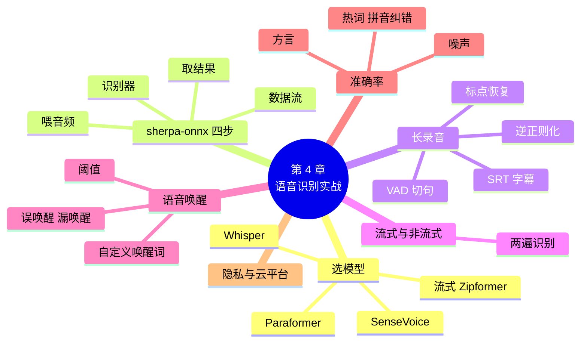

# 第 4 章 语音识别实战：转写、字幕与唤醒

!!! abstract "本章学时"
    理论 4 学时（其中线下 1 学时）· 实验 4 学时（本章共 4 个实验，教师可任选）

## 学习目标

学完本章，你应该能够：

1. **说出**本书用到的几个识别模型各自的特点，能根据场景（语种、速度、是否实时、能否联网）选择模型（理解、评价）；
2. **写出**用 sherpa-onnx 识别一段录音的四个步骤，处理好采样率和声道（应用）；
3. **解释**语音活动检测、标点恢复、逆正则化的作用，能把一段长录音做成 SRT 字幕（理解、应用）；
4. **区分**流式和非流式识别，说出语音唤醒中误唤醒和漏唤醒的取舍（理解、分析）；
5. **分析**噪声、方言、专有名词对识别的影响，会用热词和拼音纠错改进专有名词（分析、应用）；
6. **遵守**录音告知和妥善保存的要求（评价）。

!!! info "先修要求"
    学习本章前，你需要：

    - 学完第 3 章，知道字错率、实时率怎么算，知道 CTC、编码器—解码器、非自回归模型的区别；
    - 会运行 `labs` 里的实验文件；本章的代码比前几章长一些，但每一步都有注释；
    - 下载本章模型：在 `labs` 文件夹里运行 `python models.py ch04`（约 500 MB，第 1 章已下载的会自动跳过）。

??? abstract "本章概念清单（13 个，点击查看定义和例子）"
    1. [识别器](../../appendix/glossary.md#g-识别器)
    2. [数据流](../../appendix/glossary.md#g-数据流)
    3. [语音活动检测](../../appendix/glossary.md#g-语音活动检测)
    4. [时间戳](../../appendix/glossary.md#g-时间戳)
    5. [SRT 字幕](../../appendix/glossary.md#g-SRT-字幕)
    6. [文本逆正则化](../../appendix/glossary.md#g-文本逆正则化)
    7. [标点恢复](../../appendix/glossary.md#g-标点恢复)
    8. [非流式识别](../../appendix/glossary.md#g-非流式识别)
    9. [流式识别](../../appendix/glossary.md#g-流式识别)
    10. [唤醒词](../../appendix/glossary.md#g-唤醒词)
    11. [误唤醒](../../appendix/glossary.md#g-误唤醒)
    12. [漏唤醒](../../appendix/glossary.md#g-漏唤醒)
    13. [热词](../../appendix/glossary.md#g-热词)

## 情景导入

“社区语音服务站”要正式上线了，书记给小周列了一张任务单：

1. 居民来电要自动转成文字存档，要选一个又准又快的识别模型，最好能听懂几句方言；
2. 每月议事会的录音要自动做成带时间的文字记录，最好能直接当视频字幕用；
3. 服务站的大屏平时待机，居民说“你好小站”才亮起来，但别人随口说“你好小张”时不要乱亮；
4. 本小区的地名“樟树苑”、志愿者的名字“韦嘉怡”老是被认错，想想办法。

第 3 章弄懂了原理，本章就来一项一项完成这张任务单。我们会第一次打开 `voicelab.py`，直接用 sherpa-onnx 写识别代码。

## 4.1 现成的识别模型怎么选

本书用到的识别模型都来自 sherpa-onnx 的模型库，下载后在 CPU 上离线运行：

| 模型 | 出品 | 类型 | 语种 | 大小 | 特点 | 本书用在 |
|---|---|---|---|---|---|---|
| SenseVoice | 阿里巴巴通义实验室 | 非自回归、多任务 | 中、英、日、韩、粤 | 约 230 MB（int8） | 自带标点和逆正则化，还能识别情绪和声音事件，速度快 | 全书默认 |
| Paraformer | 阿里巴巴达摩院 | 非自回归 | 中文（含少量英文） | 约 80 MB（small） | 速度很快，对多种方言口音有一定适应能力，不带标点 | 实验 4-1 |
| Whisper | OpenAI | 编码器—解码器 | 近百种语言 | tiny 约 110 MB，large 约 3 GB | 语种最多；小版本中文效果差，输出常是繁体字；可能“编”出录音里没有的话 | 实验 4-1 |
| Zipformer 流式模型 | 新一代 Kaldi | 流式转换器 | 中文 | 约 70 MB（14M 参数） | 边说边出字，支持热词，准确率不如大的非流式模型 | 4.5 节、实验 4-4 |

**按场景选模型**，可以问自己四个问题：

1. **说的是什么语言？** 普通话为主选 SenseVoice 或 Paraformer；有粤语、英语、日语、韩语选 SenseVoice；其他语种选 Whisper。
2. **要不要边说边出字？** 实时字幕、语音输入法要流式模型（4.5 节）；录音文件转写用非流式模型，更准。
3. **在哪里运行？** 手机、嵌入式设备选小模型；有显卡的服务器可以选大模型，甚至第 3 章前沿视窗里的大模型识别。
4. **能不能把录音传到网上？** 不能就只能用离线模型；能的话也可以用云平台（4.8 节）。

实验 4-1 用社区的 8 段来电比较了三个模型，结果是 SenseVoice 总字错率 1.1%、Paraformer 2.1%、Whisper tiny 31.2%；Paraformer 最快，实时率约 0.02。**不要只看别人的评测，在自己的数据上试一试**，几十段录音就能看出差别。

## 4.2 用 sherpa-onnx 识别：四步走 { #42 }

前三章一直在用 `voicelab.py` 里的 `transcribe` 函数。现在把它打开，看看里面是怎么写的。直接用 sherpa-onnx 识别一段录音，只要四步（各个函数的说明见 sherpa-onnx 文档<sup class="cite">[[1]](#ref4-1)</sup>）：

```python
import sys

import soundfile as sf
import sherpa_onnx

sys.path.append("..")
from models import path as model_path

d = model_path("sensevoice")

# 第 1 步：建识别器（告诉它模型文件在哪里）。整个程序只需要建一次
recognizer = sherpa_onnx.OfflineRecognizer.from_sense_voice(
    model=str(d / "model.int8.onnx"),
    tokens=str(d / "tokens.txt"),
    use_itn=True,              # ← 改这里：False 关掉逆正则化，试试有什么不同。逆正则化：“五号楼”写成“5号楼”，并加标点
    num_threads=2,
)

# 读录音：sherpa-onnx 要的是 float32 的单声道采样点，数值在 -1 到 1 之间
samples, sr = sf.read("../data/calls/call_02.wav", dtype="float32")
print("原始形状：", samples.shape, "采样率：", sr)
if samples.ndim == 2:          # 双声道：每一行是一个时刻的左右两个值，取平均变成单声道
    samples = samples.mean(axis=1)

stream = recognizer.create_stream()          # 第 2 步：建一个数据流（每段录音一个）
stream.accept_waveform(sr, samples)          # 第 3 步：把采样点和采样率喂进去（采样率不是 16000 会自动转换）
recognizer.decode_stream(stream)             # 识别
print(stream.result.text)                    # 第 4 步：取结果
print(stream.result.lang, stream.result.emotion, stream.result.event)   # SenseVoice 还能给出语种、情绪、声音事件
```

运行结果（`labs/ch04/demo4_sherpa_asr.py`）：

```text
原始形状： (349642, 2) 采样率： 44100
/project/sherpa-onnx/csrc/offline-stream.cc:AcceptWaveformImpl:151 Creating a resampler:
   in_sample_rate: 44100
   output_sample_rate: 16000
我是5号楼的住户，楼道里的灯坏了好几天了，麻烦物业来修一下。
<|zh|> <|NEUTRAL|> <|Speech|>
```

四步的意思是：

1. **建识别器**（[**识别器**](../../appendix/glossary.md#g-识别器 "sherpa-onnx 中加载了识别模型、负责识别的对象，一个程序通常只建一次"){ .term }是加载了模型的“听写员”）：`OfflineRecognizer.from_sense_voice(...)` 告诉它模型文件在哪里、用几个 CPU 线程。加载模型要一两秒，所以一个程序里只建一次，反复使用。换模型只需换一个函数：Paraformer 用 `from_paraformer`，Whisper 用 `from_whisper`，参数是各自的模型文件。
2. **建数据流**：[**数据流**](../../appendix/glossary.md#g-数据流 "sherpa-onnx 中装一段待识别音频的“容器”，每段录音建一个"){ .term }是装一段录音的“篮子”，每段录音建一个。
3. **喂音频**：`accept_waveform(采样率, 采样点)`。
4. **识别并取结果**：`decode_stream` 识别，`stream.result.text` 是文字。SenseVoice 还会给出语种（`<|zh|>` 中文）、情绪（`<|NEUTRAL|>` 平静）和声音事件（`<|Speech|>` 说话）。

“Offline”在这里是“非流式”的意思（录音完整以后整体识别），不是“不联网”；4.5 节的流式识别器叫 `OnlineRecognizer`。

!!! warning "采样率和声道的坑"
    - **双声道要先变单声道**。`soundfile` 读双声道文件得到的是“采样点数 × 2”的表格，直接喂进去会报错或者识别出乱码。上面的代码用 `mean(axis=1)` 取平均。
    - **采样率要如实告诉它**。`accept_waveform` 的第一个参数必须是录音真实的采样率；模型内部会自动转成 16 kHz，运行时打印的 `Creating a resampler` 就是在做这件事。如果把 44.1 kHz 的录音谎报成 16000，声音会被当成慢放了近 3 倍，识别结果完全不对。
    - **数值范围要在 −1 到 1 之间**。用 `dtype="float32"` 读文件就是这个范围；如果从别的工具拿到的是 −32768 到 32767 的整数，要先除以 32768。

## 4.3 长录音：切句、标点和字幕

### 4.3.1 为什么要切句

一段 2 小时的会议录音，能不能直接交给识别模型？不行。识别模型训练时见到的大多是几秒到二三十秒的句子，太长的录音会让内存吃紧、速度变慢，准确率也会下降；而且做字幕、做纪要都需要知道“每句话在什么时候说的”。

所以处理长录音的第一步，是用[**语音活动检测**](../../appendix/glossary.md#g-语音活动检测 "判断一段声音里哪些时间有人在说话、哪些是静音或噪声的技术"){ .term }（VAD）找出哪些时间有人在说话，把录音切成一句一句。本书用的 Silero VAD 是一个只有 2 MB 左右的小神经网络，每 32 毫秒判断一次“这一小段是不是人声”，<sup class="cite">[[2]](#ref4-2)</sup>它有几个关键参数：

| 参数 | 意思 | 调大 | 调小 |
|---|---|---|---|
| 阈值 threshold | “像人声”的概率超过它才算有人说话 | 漏掉轻声的部分 | 把噪声当成说话 |
| 最短静音 min_silence_duration | 静音持续超过它，才算一句话结束 | 几句话被合成一段 | 一句话被切成几截 |
| 最短语音 min_speech_duration | 短于它的声音不算一句 | 丢掉很短的回答（“好”“对”） | 咳嗽、敲桌子也被当成一句 |

实验 4-2 中，议事会录音标准答案是 7 句：最短静音设 0.5 秒，正好切出 7 句；设 0.2 秒，句中的短停顿也被切开，变成 10 句；设 1.0 秒，有的发言人之间的停顿不够长，被合并成 5 句。下面的动画可以自己试一试：

<iframe class="sim-frame" src="../../sims/vad-segment/main.html" height="520" loading="lazy" title="VAD 切句"></iframe>
动画：VAD 切句。拖动音量门槛、最短静音和最短语音，看议事会录音被切成几段，和底部蓝色的标准答案对比。[全屏打开](../../sims/vad-segment/main.html){ target=_blank }
{ .sim-caption }

### 4.3.2 加标点

人说话时不会把标点“说”出来，很多识别模型输出的是一长串没有标点的文字（实验 4-1 中 Paraformer 就是这样）。给识别结果加上逗号、句号、问号，叫[**标点恢复**](../../appendix/glossary.md#g-标点恢复 "给没有标点的识别结果加上逗号、句号、问号"){ .term }。做法有两种：一是用模型自带的标点功能（SenseVoice 自带）；二是在识别之后再接一个专门的标点模型（sherpa-onnx 的模型库里也有）。

### 4.3.3 时间戳和 SRT 字幕 { #433 }

VAD 切出来的每一句都知道自己从第几秒开始、第几秒结束，这就是[**时间戳**](../../appendix/glossary.md#g-时间戳 "每句话（或每个字）在录音中开始和结束的时间"){ .term }。有了时间戳，就能做字幕。最常用的字幕格式是 [**SRT 字幕**](../../appendix/glossary.md#g-SRT-字幕 "最常见的字幕文件格式，每条字幕由序号、起止时间和文字组成"){ .term }，它是一个普通的文本文件，每条字幕三行，条与条之间空一行：

```text
1
00:00:00,518 --> 00:00:09,196
大家晚上好，今天议事会讨论两件事，第一是电动车充电桩，第二是垃圾分类。

2
00:00:10,182 --> 00:00:17,100
我先说充电桩，楼下现在只有4个桩，晚上经常排队。
```

第一行是序号，第二行是“开始 --> 结束”（时:分:秒,毫秒），第三行是文字。把 `meeting.srt` 和同名的视频文件放在同一个文件夹里，用常见的视频播放器打开视频，字幕就会自动显示；剪映等剪辑软件也可以导入 SRT。

??? microvideo "思维工具微课｜转写得又快又全，可以直接发出去吗？　4 分 08 秒"

    <video class="mv-video" controls preload="none" playsinline poster="../../assets/video/s3.jpg">
      <source src="../../assets/video/s3.mp4" type="video/mp4">
    </video>

    **这一集的思维工具：AI 起草、我来验证。** 什么时候用：转写的文字要发给别人。怎么用：数字、名字、专业词，对着录音听。局限：听不清的地方，人也会错。

    **看完选两件做：**

    - 玩一玩：转写一段五分钟的录音，圈出四类易错处并核对。
    - 审一审 AI：让它总结转写稿，看数字有没有被改。
    - 想一想自己：哪次你把机器给的文字直接发了。

    <p class="mv-note">本片配音和部分画面由 AI 生成。</p>

## 4.4 文本逆正则化：把“说法”变成“写法”

人说“二零二六年五月一号下午三点半”，记录时我们写成“2026年5月1日下午3:30”。把口语的说法转换成书面的写法，叫[**文本逆正则化**](../../appendix/glossary.md#g-文本逆正则化 "把识别出的口语化写法转换成书面写法，如数字、日期、金额"){ .term }（ITN）。（“正则化”是反方向：语音合成时要把“2026年”变成“二零二六年”才能读出来，第 5 章会讲。）

| 说法（识别模型直接输出） | 写法（逆正则化之后） |
|---|---|
| 五号楼 | 5号楼 |
| 百分之十五 | 15% |
| 一百二十八块五 | 128.5元 |
| 幺三九幺二三四五六七八 | 13912345678 |

4.2 节的例子把 `use_itn` 改成 `False` 后，结果变成了“我是五号楼的住户楼道里的灯坏了好几天了麻烦物业来修一下”：数字变回汉字，标点也没有了（SenseVoice 的标点和逆正则化是同一个开关）。

逆正则化让文字更好读，但也给评测带来了麻烦：标准答案写“五号楼”，识别出“5号楼”，算不算错？第 3 章已经看到，算字错率之前要先统一写法。

## 4.5 非流式与流式识别

[**非流式识别**](../../appendix/glossary.md#g-非流式识别 "一段话说完、录音完整以后再整体识别"){ .term }是“说完再识别”：等一句话（或一段录音）完整了，再整体送进模型。它能看到整句话的前后文，所以更准。录音文件转写、议事会字幕都用它。

[**流式识别**](../../appendix/glossary.md#g-流式识别 "一边接收声音一边输出文字，不用等说完"){ .term }是“边说边识别”：声音每到一小段（比如 0.1—0.5 秒），模型就更新一次结果，文字一个个冒出来。会议实时字幕、语音输入法、语音助手都需要它，因为用户等不了。下面是用 14M 参数的中文流式 Zipformer 模型<sup class="cite">[[3]](#ref4-3)</sup>“边听边写”议事会的第一句话（`labs/ch04/demo4_streaming.py`）：

```python
import sys

import sherpa_onnx

sys.path.append("..")
from models import path as model_path
from voicelab import read_audio

d = model_path("streaming-zh")                             # 一个 14M 参数的中文流式模型（实验 4-4 也用它）
recognizer = sherpa_onnx.OnlineRecognizer.from_transducer(
    tokens=f"{d}/tokens.txt", encoder=f"{d}/encoder-epoch-99-avg-1.int8.onnx",
    decoder=f"{d}/decoder-epoch-99-avg-1.onnx", joiner=f"{d}/joiner-epoch-99-avg-1.int8.onnx", num_threads=2)

samples, sr = read_audio("../data/meeting/meeting.wav")
samples = samples[:int(9.5 * sr)]                       # 只取主持人的第一句话
stream = recognizer.create_stream()
last = ""
for start in range(0, len(samples), sr // 2):           # 每次喂 0.5 秒，模拟麦克风
    stream.accept_waveform(sr, samples[start:start + sr // 2])
    while recognizer.is_ready(stream):
        recognizer.decode_stream(stream)
    text = recognizer.get_result(stream)
    if text != last:
        print(f"{(start + sr // 2) / sr:4.1f} 秒：{text}")
        last = text
```

```text
 1.5 秒：代家
 2.0 秒：代家晚上
 2.5 秒：代家晚上喉
 3.0 秒：代家晚上喉今天
 3.5 秒：代家晚上喉今天议事
 4.0 秒：代家晚上喉今天议事为
 4.5 秒：代家晚上喉今天议事为讨论
 5.0 秒：代家晚上喉今天议事为讨论两件事
 6.0 秒：代家晚上喉今天议事为讨论两件事第一试
 6.5 秒：代家晚上喉今天议事为讨论两件事第一试电动物
 7.0 秒：代家晚上喉今天议事为讨论两件事第一试电动物车充
 7.5 秒：代家晚上喉今天议事为讨论两件事第一试电动物车充电桩
 8.0 秒：代家晚上喉今天议事为讨论两件事第一试电动物车充电桩第
 8.5 秒：代家晚上喉今天议事为讨论两件事第一试电动物车充电桩第二是
 9.0 秒：代家晚上喉今天议事为讨论两件事第一试电动物车充电桩第二是垃
 9.5 秒：代家晚上喉今天议事为讨论两件事第一试电动物车充电桩第二是垃圾分类
```

可以看到，字是一点一点出来的，说话人说到第 7.5 秒，屏幕上已经出现了“充电桩”。代价是准确率：这个小模型把“大家晚上好”听成了“代家晚上喉”，“电动车”听成了“电动物车”；而实验 4-2 中非流式的 SenseVoice 把这句话识别得一字不差。

实际产品常把两者结合起来，叫“两遍识别”：说话时用流式模型实时显示，让用户觉得“很快”；一句话结束后，再用非流式的大模型把这句重新识别一遍，替换掉屏幕上的文字。你在视频会议的实时字幕里，常能看到一句话说完后文字“跳”了一下，就是这个原因。

| | 非流式识别 | 流式识别 |
|---|---|---|
| 什么时候出结果 | 说完以后 | 边说边出 |
| 准确率 | 高（能看到整句话） | 稍低（只能看到已经说过的部分） |
| sherpa-onnx 中 | `OfflineRecognizer` | `OnlineRecognizer` |
| 适合 | 录音转写、字幕、质检 | 实时字幕、输入法、语音助手 |

## 4.6 语音唤醒

### 4.6.1 关键词检测

第 1 章说过，语音唤醒本质上是一个只认几个词的小识别器，它一直开着，听到[**唤醒词**](../../appendix/glossary.md#g-唤醒词 "让设备从待机状态开始工作的特定词语"){ .term }才让设备开始工作。技术上叫“关键词检测”（KWS）。本书用的唤醒模型是新一代 Kaldi 团队用 WenetSpeech（1 万多小时的中文语音数据）训练的流式模型，<sup class="cite">[[4]](#ref4-4)</sup>只有 3.3M 个参数。

它最方便的地方是**唤醒词可以自己定**，不需要重新训练：把唤醒词转成拼音的声韵母，写进一个关键词文件就行。

```text
n ǐ h ǎo x iǎo zh àn @你好小站
x iǎo zh àn x iǎo zh àn @小站小站
```

`@` 前面是声韵母（带声调），后面是检测到时显示的文字。sherpa-onnx 提供了 `text2token` 函数自动完成转换（实验 4-3）。

**选唤醒词有讲究**：

- 3—5 个字为宜，太短容易被日常说话误触发，太长用户嫌麻烦；
- 选不常连在一起说的字，“你好”“谢谢”这种天天说的词不行；
- 避开读音相近的常用词，“你好小站”和“你好小张”只差一个韵母，就容易出问题（实验 4-3 会看到）；
- 叠词（“小站小站”）和品牌名（“小爱同学”）是常见的选择。

### 4.6.2 误唤醒和漏唤醒

唤醒有两种错误：

- [**误唤醒**](../../appendix/glossary.md#g-误唤醒 "没有说唤醒词，设备却被唤醒"){ .term }：没说唤醒词，设备却醒了。半夜智能音箱突然说话，就是误唤醒，它让人觉得“被偷听”。
- [**漏唤醒**](../../appendix/glossary.md#g-漏唤醒 "说了唤醒词，设备却没有反应"){ .term }：说了唤醒词，设备却没反应，要喊好几遍，让人觉得“不好用”。

这两种错误此消彼长，靠一个**阈值**来调：阈值高，检测器更“谨慎”，误唤醒少了，但漏唤醒多了；阈值低则相反。实验 4-3 中，阈值从 0.1 到 0.6，9 段含唤醒词的录音全部唤醒正确，但有 1 段“你好小张”被误唤醒；阈值调到 0.7，误唤醒没有了，却有 2 段漏唤醒；调到 0.9，全部叫不醒。产品上通常用“每 24 小时误唤醒次数”和“唤醒率”两个指标来定阈值。

## 4.7 影响准确率的因素

| 因素 | 实验中看到的 | 对策 |
|---|---|---|
| 噪声 | 实验 4-4：信噪比从 30 dB 降到 0 dB，SenseVoice 的字错率从 1.6% 升到 17.5%，−5 dB 时达到 35.4% | 改善录音环境（第 2 章 2.7 节）；选抗噪的模型；必要时降噪并用数据检验 |
| 电话、低采样率 | 第 2 章：8 kHz 的 `call_07` 仍然识别正确 | 现代模型对电话音质适应较好；尽量用 16 kHz 录音 |
| 口音和方言 | 实验 4-1：四川话、天津话、河南话三段，SenseVoice 和 Paraformer 基本都能识别，Whisper tiny 错得多；粤语只有 SenseVoice 识别正确 | 选支持该方言的模型；方言很重时考虑专门的方言模型或云平台 |
| 专有名词 | 实验 4-4：“樟树苑”被识别成“樟树院”、“韦嘉怡”被识别成“为加以” | 热词、拼音纠错、补充语言模型 |
| 说话方式 | 多人抢话、自言自语、离话筒远 | 每人一个话筒；会议用阵列麦克风 |

### 4.7.1 热词和拼音纠错

本地的地名、人名、新词，识别模型训练时很可能没见过，就算“听”对了读音，也会写成常见的同音字。解决办法主要有两种：

1. [**热词**](../../appendix/glossary.md#g-热词 "预先告诉识别系统、让它在识别时优先考虑的词，常用于人名、地名、专业术语"){ .term }：识别时预先告诉模型“这些词可能出现，请优先考虑”。模型在搜索候选句子时，遇到热词就给它加分。sherpa-onnx 中只有部分模型（转换器类模型，如本章的 Zipformer 流式模型）支持热词，用法是写一个热词文件，建识别器时传进去。热词的加分不能太高，否则会把不相干的读音也“拉”成热词。
2. **识别后纠错**：识别完以后，在结果里找“读音和热词一样”的几个字，替换成热词。这种方法适用于任何模型，实现也简单（实验 4-4 用 `pypinyin` 不到 10 行代码实现），缺点是读音必须完全一致，听错一个音就纠不回来。

实验 4-4 的结果很典型：热词功能把“陆搬陆”纠正成了“鲁班路”，但对“韦嘉怡”“栖霞书屋”无能为力，因为这个小模型连读音都没听对；SenseVoice 加拼音纠错后，“邻里会 → 邻里汇”“为加以 → 韦嘉怡”“樟树院 → 樟树苑”都纠正过来了。**两种办法都不是万能的，最终要用数据检验**。

### 4.7.2 录音的隐私

社区来电、议事会录音里有居民的声音、姓名、住址、电话，属于个人信息，处理时要遵守《个人信息保护法》：<sup class="cite">[[5]](#ref4-5)</sup>

- **告知**：录音前告诉对方“本次通话将被录音”，说明用途（如“用于改进服务”）；
- **最少**：只录需要的内容，转成文字后，不再需要的原始录音按规定期限删除；
- **安全**：录音和文字存放在有权限控制的地方，不随手发到群里、不拷到个人 U 盘；
- **慎用云端**：用云平台识别等于把录音交给服务商处理，要选正规平台、看清隐私条款；含敏感信息的录音优先用离线模型。

??? microvideo "思维工具微课｜机器听不懂他说话，是他的问题吗？　4 分 33 秒"

    <video class="mv-video" controls preload="none" playsinline poster="../../assets/video/s1.jpg">
      <source src="../../assets/video/s1.mp4" type="video/mp4">
    </video>

    **这一集的思维工具：换位思考。** 什么时候用：做给很多人用的东西。怎么用：找几位和你不一样的人，真的试。局限：总有没想到的人。

    **看完选两件做：**

    - 玩一玩：请三位口音不同的人读同一段话，比较转写结果。
    - 审一审 AI：用方言对语音助手说话，看它听懂多少。
    - 想一想自己：你做的哪样东西，没想到某一类人。

    <p class="mv-note">本片配音和部分画面由 AI 生成。</p>

## 4.8 国产语音云平台

除了离线模型，国内几家云服务商都提供语音识别服务，效果好、支持的方言和场景多，按调用量收费，通常有一定的免费额度：

| 平台 | 识别服务 | 特点（了解即可） |
|---|---|---|
| 科大讯飞 讯飞开放平台 | 语音听写、录音文件转写、实时语音转写 | 老牌语音公司，方言和少数民族语言种类多 |
| 阿里云 智能语音交互 | 一句话识别、实时语音识别、录音文件识别 | 背后是 Paraformer、SenseVoice 一系的技术 |
| 腾讯云 语音识别 | 一句话识别、实时语音识别、录音文件识别 | 与微信生态结合紧密 |
| 火山引擎 豆包语音 | 流式语音识别、录音文件识别 | 字节跳动的技术，Seed-ASR 等大模型方案 |

使用云平台的一般步骤是：注册账号并实名认证 → 在控制台开通语音识别服务 → 创建应用，拿到 AppID 和密钥 → 按平台文档安装 SDK 或调用网络接口，把录音发过去，收回文字。各平台的接口差别很大、更新也快，本书不在正文给出代码，附录 A 给出调用的一般方法和注意事项。**密钥不要写在代码里、不要上传到网上**，一旦泄露别人就能用你的账号计费。

!!! tip "离线还是云端"
    学习和处理含个人信息的录音，优先用离线模型；需要识别大量方言、追求最高准确率，且录音可以上传时，可以考虑云平台。两者也可以结合：先用离线模型处理，识别不好的再交给云平台。

## 4.9 前沿视窗

**更快的“大”模型**。Whisper 最大的版本有 15 亿个参数，准确率高但很慢。2024 年 10 月，OpenAI 发布了 Whisper large-v3-turbo，把解码器从 32 层减到 4 层，参数降到约 8 亿，速度提高了数倍，准确率只略有下降。<sup class="cite">[[6]](#ref4-6)</sup>这说明在编码器—解码器模型中，“听懂声音”的编码器是关键，“写字”的解码器可以大幅精简。非自回归的 Paraformer、SenseVoice 走的是另一条提速的路。

**识别之后交给大模型**。越来越多的产品不再满足于“转文字”：会议软件识别完会议录音，再交给大语言模型生成摘要、待办事项；客服系统识别完通话，再让大模型判断客户情绪、检查客服有没有说错话。识别模型负责“听清”，大语言模型负责“听懂”，第 9 章的综合项目就会用到这个思路。截至 2026 年 10 月，这种“识别 + 大模型”的组合已经是会议纪要、客服质检类产品的标准做法。

## 本章实验

!!! abstract "实验总览"
    | 实验 | 类型 | 建议时长 | 内容 |
    |---|---|---|---|
    | 实验 4-1 | ★ 基础 | 45 分钟 | SenseVoice、Paraformer、Whisper 识别同一批来电，比较字错率和速度；试试方言和外语 |
    | 实验 4-2 | ★ 基础 | 45 分钟 | VAD 切分议事会录音，逐句识别，生成 SRT 字幕 |
    | 实验 4-3 | ★ 基础 | 45 分钟 | 设置“你好小站”唤醒词，测试 18 段录音的漏唤醒和误唤醒 |
    | 实验 4-4 | ☆ 拓展 | 45 分钟 | 不同信噪比下的字错率；热词和拼音纠错改进地名、人名 |

    代码见配套资源 `labs/ch04/` 目录。运行前在 `labs` 文件夹里执行 `python models.py ch04`。

### 实验 4-1 ★ 三个模型比一比

**实验目的**

1. 会用同一批数据比较几个识别模型的字错率和实时率；
2. 会在算字错率前统一写法（繁体转简体、数字写法）；
3. 了解各模型对方言、粤语、英语的识别能力。

**实验环境**：本机 CPU 或云端 Notebook，运行约 1 分钟。**实验数据**：`labs/data/calls/` 的 8 段来电；模型自带的四川话、天津话、河南话、粤语、英语测试录音。模型 `sensevoice`、`paraformer-zh`、`whisper-tiny`。

**实验步骤与代码**

运行 `lab4_1_compare_models.py`：

```python
import sys
import time

import pandas as pd
import zhconv                                                     # 繁体字转简体字

sys.path.append("..")
from voicelab import PUNCT, cer, duration, read_audio, transcribe

DIGITS = str.maketrans("零一二三四五六七八九", "0123456789")


def normalize(text):
    """统一写法：繁体转简体，中文数字转阿拉伯数字（第 3 章实验 3-3）"""
    return zhconv.convert(text, "zh-cn").translate(DIGITS)


models = ["sensevoice", "paraformer-zh", "whisper-tiny"]           # ← 改这里：可以只比其中两个
truth = pd.read_csv("../data/calls/calls.csv")
audios = {r["文件"]: read_audio(f"../data/calls/{r['文件']}") for _, r in truth.iterrows()}
total_audio = sum(duration(y, sr) for y, sr in audios.values())

summary = []
for model in models:
    transcribe(*audios["call_01.wav"], model=model)                  # 先识别一次，把模型加载好
    errors = chars = 0
    used = 0.0
    for _, r in truth.iterrows():
        start = time.time()
        hyp = transcribe(*audios[r["文件"]], model=model)
        used += time.time() - start
        rate, s, d, i = cer(normalize(r["文字"]), normalize(hyp))
        errors += s + d + i
        chars += len([c for c in r["文字"] if c not in PUNCT])
        if r["文件"] in ("call_03.wav", "call_07.wav"):                # 打印两段看看
            print(f"{model:<14}{r['文件']}  {hyp}")
    summary.append([model, f"{errors / chars:.1%}", f"{used:.2f}", f"{used / total_audio:.3f}"])

print(pd.DataFrame(summary, columns=["模型", "总字错率", "识别用时（秒）", "实时率"]).to_string(index=False))

# 方言和外语：模型自带的测试录音（没有标准答案，听一听再判断对不对）
tests = {"四川话": "../models/paraformer-zh/test_wavs/3-sichuan.wav",
         "天津话": "../models/paraformer-zh/test_wavs/4-tianjin.wav",
         "河南话": "../models/paraformer-zh/test_wavs/5-henan.wav",
         "粤语": "../models/sensevoice/test_wavs/yue.wav",
         "英语": "../models/sensevoice/test_wavs/en.wav"}
for name, file in tests.items():
    y, sr = read_audio(file)
    print(f"【{name}】{duration(y, sr):.1f} 秒")
    for model in models:
        print(f"  {model:<14}{transcribe(y, sr, model=model)}")
```

`transcribe(*audios[...], model=model)` 里的星号把 `(采样点, 采样率)` 这一对拆开，作为两个参数传进去。`zhconv.convert(text, "zh-cn")` 把繁体字转成简体字，因为 Whisper 的中文输出常常是繁体。

**运行结果**

```text
sensevoice    call_03.wav  请问社区医生服务站周日上午开门吗？我想带孩子去打疫苗。
sensevoice    call_07.wav  你好，社区的老年食堂中午几点开饭，一份套餐多少钱？
paraformer-zh call_03.wav  请问社区医生服务战州日上午开门吗我想带孩子去打疫苗
paraformer-zh call_07.wav  你好社区的老年食堂中午几点开饭一份套餐多少钱
whisper-tiny  call_03.wav  請問社區以生服務戰爭日上午開門嗎?我想帶孩子去打疫苗
whisper-tiny  call_07.wav  以後設計的老年學同中午幾點開飯以份透參多少錢
           模型  总字错率 识别用时（秒）   实时率
   sensevoice  1.1%    3.56 0.058
paraformer-zh  2.1%    1.18 0.019
 whisper-tiny 31.2%    5.70 0.092
【四川话】7.8 秒
  sensevoice    自己就是在那个在那个就是在情节里面就是感觉是演的特别好，就是好像很真实一样，你知道吧？
  paraformer-zh 自己就是在那个在那个就是在情节里面就是感觉是演的特别好就是好像很真实一样你知道吧
  whisper-tiny  此之就在那边在亲节里面就是感觉是烟的特别好就是好像很整式一样你知道吧
【天津话】7.8 秒
  sensevoice    其实他就是话每个人都会守法，就这意思，法律意识太单薄了，而且就是嗯也不顾及到别人的感受。
  paraformer-zh 其实他就是怕每个人就可以守法就这意思法律意识太单薄了而且就是也不顾及到别人的感受
  whisper-tiny  其实他就是他每个人都会说法就这意思法律愿意识太弹果了而且就是你不故意到别人的感受
【河南话】8.0 秒
  sensevoice    他这个管一向都通到，有时候都通到七八层楼高，然后他这管一向就可以浇到那个那柱子上。
  paraformer-zh 他这个管一向都通到有时候都通到七八层楼高然后他这管一向就可以浇到那个那柱子上
  whisper-tiny  他这个闺印象都通到U-S,通到7806港他这个闺印象就可以找到那种字上
【粤语】5.1 秒
  sensevoice    呢几个字都表达唔到我想讲嘅意思。
  paraformer-zh 你给个制度表达恩度二成岗的颜色
  whisper-tiny  這幾個字都表達不到我想講的意思
【英语】7.2 秒
  sensevoice    The tribal chieftain called for the boy and presented him with 50 pieces of code.
  paraformer-zh the driver chieed him called for the boy and presented him at fifty pieces of good
  whisper-tiny  "Drival 310""""""""""""""""""""""""""""""""""""
```

读结果：

- **来电**：SenseVoice 最准（1.1%），Paraformer 稍差（2.1%）但最快（实时率 0.019），Whisper tiny 的字错率高达 31.2%。看 `call_07` 就明白了：“你好，社区的老年食堂”被 Whisper tiny 听成了“以后设计的老年学同”。tiny 是 Whisper 最小的版本，只有 3900 万个参数，中文不是它的强项；Whisper 的大版本中文效果好得多，但在 CPU 上很慢。
- **方言**：三段方言录音，SenseVoice 和 Paraformer 的结果几乎一样，基本能看懂说的是什么（编者听原录音核对过，个别字有出入，如天津话的“怕每个人”）；Whisper tiny 错得多。
- **粤语和英语**：只有 SenseVoice 都识别对了（粤语用粤语用字“呢几个字都表达唔到”）；Paraformer 是中文模型，把粤语和英语硬当成普通话来听；Whisper tiny 把粤语“翻译”成了繁体书面语，而英语输出一串乱码，因为 `voicelab.py` 里把它的语言固定成了中文（`language="zh"`），**告诉模型错误的语种，结果会非常糟糕**。
- 结论：社区来电以普通话为主、偶有方言和粤语，选 SenseVoice 最合适；如果对速度要求极高，Paraformer 也不错。

**实验记录表**

| 模型 | 总字错率 | 实时率 | 方言识别（好 / 一般 / 差） | 粤语 | 英语 |
|---|---|---|---|---|---|
| sensevoice | | | | | |
| paraformer-zh | | | | | |
| whisper-tiny | | | | | |

**常见问题排查**

| 现象 | 原因 | 解决办法 |
|---|---|---|
| `FileNotFoundError: 模型 paraformer-zh 还没下载` | 没下载本章模型 | `python models.py ch04` |
| `ModuleNotFoundError: No module named 'zhconv'` | 库没装 | `pip install zhconv` |
| 用时比书上长得多 | CPU 较慢或线程数少 | 正常；比较时只看几个模型之间的相对快慢 |

**思考与练习**

1. 如果不把 Whisper 的繁体输出转成简体，它的字错率会是多少？（提示：把 `normalize` 里的 `zhconv.convert` 去掉再运行）这说明了什么？
2. 用手机录 3 句自己的话（可以用家乡话），加进测试，哪个模型最好？

**实验报告要求**

提交记录表，并为社区服务站写一段 100 字左右的“选型建议”。

### 实验 4-2 ★ 议事会录音做字幕

**实验目的**

1. 会用 sherpa-onnx 的 VAD 把长录音切成句子；
2. 会逐句识别并生成 SRT 字幕文件；
3. 会调整 VAD 参数，并用标准答案检查切分和识别效果。

**实验环境**：本机 CPU 或云端 Notebook。**实验数据**：`labs/data/meeting/meeting.wav`（51.26 秒，主持人、老王、李阿姨三人轮流发言 7 句）和 `meeting_truth.csv`。模型 `vad`、`sensevoice`。

**实验步骤与代码**

运行 `lab4_2_meeting_srt.py`：

```python
import sys

import numpy as np
import pandas as pd
import sherpa_onnx

sys.path.append("..")
from models import path as model_path
from voicelab import cer, read_audio, transcribe

samples, sr = read_audio("../data/meeting/meeting.wav")          # 约 51 秒、三个人轮流发言
print(f"录音时长 {len(samples) / sr:.2f} 秒")

# ---------- 第 1 步：VAD 找出“哪里有人在说话” ----------
config = sherpa_onnx.VadModelConfig()
config.silero_vad.model = str(model_path("vad") / "silero_vad.onnx")
config.silero_vad.threshold = 0.5             # 每一小段“像人声”的概率超过它，就算有人说话
config.silero_vad.min_silence_duration = 0.5  # ← 改这里：静音超过这么多秒才算一句话结束，试试 0.2、1.0
config.silero_vad.min_speech_duration = 0.25  # 短于这么多秒的声音不算一句（过滤咳嗽、敲桌子）
config.sample_rate = sr
vad = sherpa_onnx.VoiceActivityDetector(config, buffer_size_in_seconds=60)

window = config.silero_vad.window_size        # VAD 每次看 512 个采样点（32 毫秒）
segments = []
for start in range(0, len(samples), window):
    vad.accept_waveform(samples[start:start + window])
    while not vad.empty():                    # 每检测到一句完整的话，就取出来
        seg = vad.front
        segments.append((seg.start / sr, np.array(seg.samples)))
        vad.pop()
vad.flush()                                   # 录音结束，把最后一句也取出来
while not vad.empty():
    segments.append((vad.front.start / sr, np.array(vad.front.samples)))
    vad.pop()
print(f"VAD 切出 {len(segments)} 句")


# ---------- 第 2 步：逐句识别，写成 SRT 字幕 ----------
def srt_time(t):
    """秒 → SRT 的时间格式 时:分:秒,毫秒"""
    ms = int(round(t * 1000))
    return f"{ms // 3600000:02d}:{ms // 60000 % 60:02d}:{ms // 1000 % 60:02d},{ms % 1000:03d}"


lines = []
for k, (begin, seg) in enumerate(segments, 1):
    end = begin + len(seg) / sr
    text = transcribe(seg, sr)
    lines.append(f"{k}\n{srt_time(begin)} --> {srt_time(end)}\n{text}\n")
    print(f"{k:>2}  {begin:6.2f}–{end:6.2f} 秒  {text}")
with open("meeting.srt", "w", encoding="utf-8") as f:
    f.write("\n".join(lines))
print("已保存 meeting.srt")

# ---------- 第 3 步：和标准答案对比 ----------
truth = pd.read_csv("../data/meeting/meeting_truth.csv")
ref = "".join(truth["文字"])
hyp = "".join(transcribe(seg, sr) for _, seg in segments)
rate, s, d, i = cer(ref, hyp)
print(f"标准答案 {len(truth)} 句；整场字错率 {rate:.1%}（替换 {s}、删除 {d}、插入 {i}）")
```

VAD 是“流式”工作的：录音被一小块一小块（512 个采样点，32 毫秒）喂进去，每当它确认一句话结束（后面跟着足够长的静音），就把这句话放进队列。`while not vad.empty()` 把队列里已经完成的句子取出来；`vad.flush()` 告诉它“录音结束了”，把最后一句也交出来。`seg.start` 是这句话从第几个采样点开始，除以采样率就是秒。

**改一改**：把 `min_silence_duration` 改成 0.2 和 1.0，各运行一次，看切出几句。

**运行结果**

```text
录音时长 51.26 秒
VAD 切出 7 句
 1    0.52–  9.20 秒  大家晚上好，今天议事会讨论两件事，第一是电动车充电桩，第二是垃圾分类。
 2   10.18– 17.10 秒  我先说充电桩，楼下现在只有4个桩，晚上经常排队。
 3   18.09– 24.46 秒  我同意多装几个，不过要注意消防安全，不能在楼刀里充电。
 4   25.48– 29.10 秒  好的，那我们下周请物业来现场看一看。
 5   30.05– 36.56 秒  垃圾分类这边，我建议在每栋楼前增加一个厨余垃圾桶。
 6   37.64– 44.01 秒  还要安排志愿者在早上7点到9点值班，提醒大家分好累再扔。
 7   44.97– 50.38 秒  这两个建议我都记下了，会后整理成纪要发到业主群。
已保存 meeting.srt
标准答案 7 句；整场字错率 3.1%（替换 5、删除 0、插入 0）
```

读结果：

- VAD 切出 7 句，和标准答案的 7 句完全对应；每句的起止时间和标准答案相差不到 0.2 秒（对照 `meeting_truth.csv`）。
- 整场字错率 3.1%：5 个替换中，“四 → 4”“七 → 7”“九 → 9”是写法不同，真正听错的只有“楼道 → 楼刀”和“分好类 → 分好累”两处。
- 编者把最短静音改成 0.2 秒时切出 10 句，改成 1.0 秒时切出 5 句，字错率都是 3.7%，略高于 7 句时。句子切得太碎或太长，都会让识别模型少了一些上下文或多了一些干扰。
- 字幕里没有标出“谁在说话”。第 7 章会用声纹技术给每一句标上发言人，做出真正的会议纪要。

第 2 步，用记事本打开 `meeting.srt` 看看格式；如果有视频剪辑软件（如剪映），可以新建一个项目，导入 `meeting.wav` 和 `meeting.srt`，看字幕是否对得上。

**实验记录表**

| 最短静音（秒） | 切出几句 | 和标准答案一致吗 | 整场字错率 |
|---|---|---|---|
| 0.2 | | | |
| 0.5 | | | |
| 1.0 | | | |

**常见问题排查**

| 现象 | 原因 | 解决办法 |
|---|---|---|
| 一句也没切出来 | VAD 模型的采样率要求 16 kHz，录音没有转换 | 用 `read_audio` 读入（默认转 16 kHz），`config.sample_rate` 设为 16000 |
| 字幕在播放器里显示乱码 | 文件编码不是 UTF-8 | 代码已用 UTF-8 保存；个别老播放器需要另存为 UTF-8 BOM |
| 字幕和声音对不上 | 视频和录音不是同一个起点 | 确认用的是同一段录音 |

**思考与练习**

1. 如果议事会中有人说了很长一段话（2 分钟不停顿），VAD 会切出一个 2 分钟的段落，可能有什么问题？怎么解决？（提示：sherpa-onnx 的 VAD 有 `max_speech_duration` 参数）
2. 字幕一行太长不好看，你会怎样把一句 30 多个字的话拆成两条字幕？

**实验报告要求**

提交 `meeting.srt` 和记录表，说明你为议事会录音选的 VAD 参数和理由。

### 实验 4-3 ★ 自定义唤醒词

**实验目的**

1. 会把自定义唤醒词转成关键词文件，建关键词检测器；
2. 会用一批录音测试唤醒效果，统计漏唤醒和误唤醒；
3. 理解阈值对两种错误的影响。

**实验环境**：本机 CPU 或云端 Notebook。**实验数据**：`labs/data/kws/` 的 18 段录音：6 句话，每句用 3 种音色合成。前 3 句含唤醒词（“你好小站……”“小站小站……”），后 3 句不含，其中“你好小张”和“你好，小朋友们在站台等车”是故意设计的“陷阱”。模型 `kws`。

**实验步骤与代码**

运行 `lab4_3_wake_word.py`：

```python
import sys

import pandas as pd
import sherpa_onnx

sys.path.append("..")
from models import path as model_path
from voicelab import read_audio

d = model_path("kws")
wake_words = ["你好小站", "小站小站"]          # ← 改这里：换成你自己的唤醒词（建议 4 个字左右、不常见的组合）
threshold = 0.25                              # ← 改这里：越大越“严格”，误唤醒少、漏唤醒多；试试 0.1、0.4

# 第 1 步：唤醒词 → 拼音声韵母，写成模型认识的关键词文件（每行“声韵母 @原文”）
tokens = sherpa_onnx.text2token(wake_words, tokens=str(d / "tokens.txt"), tokens_type="ppinyin")
with open("my_keywords.txt", "w", encoding="utf-8") as f:
    for word, tok in zip(wake_words, tokens):
        f.write(" ".join(tok) + " @" + word + "\n")
print(open("my_keywords.txt", encoding="utf-8").read())

# 第 2 步：建关键词检测器
kws = sherpa_onnx.KeywordSpotter(
    tokens=str(d / "tokens.txt"),
    encoder=str(d / "encoder-epoch-12-avg-2-chunk-16-left-64.int8.onnx"),
    decoder=str(d / "decoder-epoch-12-avg-2-chunk-16-left-64.int8.onnx"),
    joiner=str(d / "joiner-epoch-12-avg-2-chunk-16-left-64.int8.onnx"),
    keywords_file="my_keywords.txt",
    keywords_threshold=threshold,
    num_threads=2,
)


def detect(file):
    """把一段录音一点一点“喂”给检测器（模拟麦克风），返回检测到的唤醒词列表"""
    samples, sr = read_audio(file)
    stream = kws.create_stream()
    found = []
    for start in range(0, len(samples), 1600):                  # 每次喂 0.1 秒
        stream.accept_waveform(sr, samples[start:start + 1600])
        while kws.is_ready(stream):
            kws.decode_stream(stream)
            word = kws.get_result(stream)
            if word:
                found.append(word)
                kws.reset_stream(stream)                        # 检测到以后重新开始听
    return found


# 第 3 步：测试 18 段录音（6 句话 × 3 种音色），统计
table = pd.read_csv("../data/kws/kws.csv")
rows = []
for _, r in table.iterrows():
    found = detect(f"../data/kws/{r['文件']}")
    should = r["含唤醒词"] == "是"
    result = ("唤醒正确" if found else "漏唤醒") if should else ("误唤醒" if found else "正确不响应")
    rows.append([r["文件"], r["文字"], r["含唤醒词"], "、".join(found) or "-", result])
out = pd.DataFrame(rows, columns=["文件", "文字", "含唤醒词", "检测到", "结果"])
pd.set_option("display.width", 200)
print(out.to_string(index=False))
n_pos, n_neg = (table["含唤醒词"] == "是").sum(), (table["含唤醒词"] == "否").sum()
miss, false = (out["结果"] == "漏唤醒").sum(), (out["结果"] == "误唤醒").sum()
print(f"阈值 {threshold}：漏唤醒 {miss}/{n_pos}，误唤醒 {false}/{n_neg}")
```

检测器是流式的：录音每次喂 0.1 秒（1600 个采样点），模拟麦克风源源不断地送来声音；`is_ready` 表示攒够了一小段可以计算了；检测到唤醒词后 `reset_stream` 清空，重新开始听。

**改一改**：把 `threshold` 依次改成 0.1、0.4、0.6、0.7、0.8、0.9，记录漏唤醒和误唤醒的次数。

**运行结果**（阈值 0.25）

```text
n ǐ h ǎo x iǎo zh àn @你好小站
x iǎo zh àn x iǎo zh àn @小站小站
          文件                文字 含唤醒词  检测到    结果
kws_1_20.wav 你好小站，帮我查一下垃圾分类时间。    是 你好小站  唤醒正确
kws_1_60.wav 你好小站，帮我查一下垃圾分类时间。    是 你好小站  唤醒正确
kws_1_90.wav 你好小站，帮我查一下垃圾分类时间。    是 你好小站  唤醒正确
kws_2_20.wav      你好小站，明天会下雨吗？    是 你好小站  唤醒正确
kws_2_60.wav      你好小站，明天会下雨吗？    是 你好小站  唤醒正确
kws_2_90.wav      你好小站，明天会下雨吗？    是 你好小站  唤醒正确
kws_3_20.wav      小站小站，播放社区通知。    是 小站小站  唤醒正确
kws_3_60.wav      小站小站，播放社区通知。    是 小站小站  唤醒正确
kws_3_90.wav      小站小站，播放社区通知。    是 小站小站  唤醒正确
kws_4_20.wav      你好小张，今天天气不错。    否 你好小站   误唤醒
kws_4_60.wav      你好小张，今天天气不错。    否    - 正确不响应
kws_4_90.wav      你好小张，今天天气不错。    否    - 正确不响应
kws_5_20.wav     你好，小朋友们在站台等车。    否    - 正确不响应
kws_5_60.wav     你好，小朋友们在站台等车。    否    - 正确不响应
kws_5_90.wav     你好，小朋友们在站台等车。    否    - 正确不响应
kws_6_20.wav          今天去超市买菜。    否    - 正确不响应
kws_6_60.wav          今天去超市买菜。    否    - 正确不响应
kws_6_90.wav          今天去超市买菜。    否    - 正确不响应
阈值 0.25：漏唤醒 0/9，误唤醒 1/9
```

读结果：

- 9 段含唤醒词的录音全部唤醒正确，没有漏唤醒。
- “你好小站”和“你好小张”只差一个韵母（àn / āng），音色 20 读“你好小张”时被误唤醒了；另外两种音色没有。“你好，小朋友们在站台等车”虽然“你好”“小”“站”都有，但字不挨着，没有误唤醒。
- 编者把阈值从 0.1 调到 0.9，结果如下：

| 阈值 | 0.1—0.6 | 0.7 | 0.8 | 0.9 |
|---|---|---|---|---|
| 漏唤醒（共 9 段） | 0 | 2 | 7 | 9 |
| 误唤醒（共 9 段） | 1 | 0 | 0 | 0 |

阈值 0.7 时误唤醒消失，但开始漏唤醒；再高就几乎叫不醒了。这批录音太少，只能说明趋势；真实产品要用几百小时的日常录音测误唤醒、用几千次真人唤醒测唤醒率，才能定阈值。更根本的办法是**换一个不容易混淆的唤醒词**。

**实验记录表**

| 阈值 | 漏唤醒 | 误唤醒 | 被误唤醒的是哪句 |
|---|---|---|---|
| 0.1 | | | |
| 0.25 | | | |
| 0.7 | | | |
| 0.9 | | | |
| 自己的唤醒词：____ | | | |

**常见问题排查**

| 现象 | 原因 | 解决办法 |
|---|---|---|
| `text2token` 报错，提到 `sentencepiece` 或 `pypinyin` | 库没装 | `pip install sentencepiece pypinyin` |
| 自己的唤醒词完全检测不到 | 唤醒词里有生僻字或多音字，转出的拼音不对 | 打开 `my_keywords.txt` 检查拼音，手动改正 |
| 运行时打印一些 `Warning` | 模型加载时的提示 | 不影响结果 |

**思考与练习**

1. 给社区服务站另选一个唤醒词，说明理由，用自己的声音录 5 遍唤醒词、5 句日常的话测试一下。
2. 智能音箱厂商为什么更在意误唤醒？从用户感受和隐私两方面说明。

**实验报告要求**

提交记录表和自选唤醒词的测试结果。

### 实验 4-4 ☆ 噪声和热词

**实验目的**

1. 会按指定信噪比加噪声，画出（或列出）字错率随噪声变化的曲线；
2. 会使用 sherpa-onnx 的热词功能；
3. 会用拼音做识别后纠错，比较两种改进专有名词的方法。

**实验环境**：本机 CPU 或云端 Notebook，运行约 40 秒。**实验数据**：`labs/data/calls/` 的 8 段来电；`labs/data/hotwords/` 的 3 段含本地地名、人名的录音（地名、人名都是虚构的）。模型 `sensevoice`、`paraformer-zh`、`streaming-zh`。

**实验步骤与代码**

运行 `lab4_4_noise_hotwords.py`：

```python
import sys

import numpy as np
import pandas as pd
import sherpa_onnx
from pypinyin import lazy_pinyin

sys.path.append("..")
from models import path as model_path
from voicelab import PUNCT, cer, read_audio, transcribe

# ================= 第一部分：噪声 =================
DIGITS = str.maketrans("零一二三四五六七八九", "0123456789")
truth = pd.read_csv("../data/calls/calls.csv")
audios = [read_audio(f"../data/calls/{f}") for f in truth["文件"]]
rng = np.random.default_rng(0)
rows = []
for snr in [30, 20, 10, 5, 0, -5]:                      # ← 改这里：信噪比（分贝）
    row = [f"{snr} dB"]
    for model in ["sensevoice", "paraformer-zh"]:
        errors = chars = 0
        for (y, sr), ref in zip(audios, truth["文字"]):
            noise = rng.standard_normal(len(y)).astype(np.float32)
            noise *= np.sqrt(np.mean(y ** 2) / np.mean(noise ** 2) / 10 ** (snr / 10))
            hyp = transcribe(y + noise, sr, model=model)
            rate, s, d, i = cer(ref.translate(DIGITS), hyp.translate(DIGITS))
            errors += s + d + i
            chars += len([c for c in ref if c not in PUNCT])
        row.append(f"{errors / chars:.1%}")
    rows.append(row)
print(pd.DataFrame(rows, columns=["信噪比", "sensevoice", "paraformer-zh"]).to_string(index=False))

# ================= 第二部分：热词 =================
hotwords = ["幸福里", "邻里汇", "韦嘉怡", "鲁班路", "樟树苑", "栖霞书屋"]     # ← 改这里：本社区的地名、人名
tests = pd.read_csv("../data/hotwords/hotwords.csv")

# 办法一：识别模型自带的热词功能（只有一部分模型支持，这里用一个支持热词的小型流式模型）
d = model_path("streaming-zh")
with open("my_hotwords.txt", "w", encoding="utf-8") as f:
    f.write("\n".join(" ".join(w) for w in hotwords))        # 每行一个热词，字和字之间用空格隔开


def make_recognizer(use_hotwords):
    extra = dict(hotwords_file="my_hotwords.txt", hotwords_score=1.5) if use_hotwords else {}
    return sherpa_onnx.OnlineRecognizer.from_transducer(
        tokens=f"{d}/tokens.txt", encoder=f"{d}/encoder-epoch-99-avg-1.int8.onnx",
        decoder=f"{d}/decoder-epoch-99-avg-1.onnx", joiner=f"{d}/joiner-epoch-99-avg-1.int8.onnx",
        decoding_method="modified_beam_search", max_active_paths=10, num_threads=2, **extra)


def run(recognizer, y, sr):
    stream = recognizer.create_stream()
    stream.accept_waveform(sr, y)
    stream.accept_waveform(sr, np.zeros(sr // 2, dtype=np.float32))   # 结尾补 0.5 秒静音，让最后几个字出来
    stream.input_finished()
    while recognizer.is_ready(stream):
        recognizer.decode_stream(stream)
    return recognizer.get_result(stream)


# 办法二：识别后按拼音纠错——在识别结果里找“读音和热词一样”的几个字，换成热词
def pinyin_fix(text):
    for word in hotwords:
        target, n = lazy_pinyin(word), len(word)
        for i in range(len(text) - n + 1):
            if lazy_pinyin(text[i:i + n]) == target:
                text = text[:i] + word + text[i + n:]
    return text


plain, boosted = make_recognizer(False), make_recognizer(True)
for _, r in tests.iterrows():
    y, sr = read_audio(f"../data/hotwords/{r['文件']}")
    sv = transcribe(y, sr)
    results = {"小模型": run(plain, y, sr), "小模型+热词": run(boosted, y, sr),
               "SenseVoice": sv, "SenseVoice+拼音纠错": pinyin_fix(sv)}
    print(f"\n标准答案：{r['文字']}")
    for name, text in results.items():
        print(f"  {name:<16}{cer(r['文字'], text)[0]:>5.0%}  {text}")
```

热词文件每行一个词，字和字之间用空格隔开（这个模型以“字”为单位）。`hotwords_score=1.5` 是给热词加的分，越大越“偏向”热词。`pinyin_fix` 在识别结果里滑动查找：每一段和热词等长的文字，如果拼音（不带声调）和热词一样，就替换掉。

**运行结果**

```text
  信噪比 sensevoice paraformer-zh
30 dB       1.6%          4.2%
20 dB       4.2%          7.4%
10 dB       5.8%          9.0%
 5 dB       9.0%         13.8%
 0 dB      17.5%         20.1%
-5 dB      35.4%         40.2%
标准答案：请到幸福里社区邻里汇找韦嘉怡登记。
  小模型               25%  请到幸福里社区邻里会找为加以登记
  小模型+热词            25%  请到幸福里社区邻里会找为加以登记
  SenseVoice        25%  请到幸福里社区邻里会找为加以登记。
  SenseVoice+拼音纠错    0%  请到幸福里社区邻里汇找韦嘉怡登记。
标准答案：鲁班路三十七弄的居民请到樟树苑集合。
  小模型               29%  陆搬陆三十七弄的居民请到张树院集合
  小模型+热词            12%  鲁班路三十七弄的居民请到张树院集合
  SenseVoice        29%  路班路37弄的居民请到樟树院集合。
  SenseVoice+拼音纠错   18%  鲁班路37弄的居民请到樟树苑集合。
标准答案：社区新开了一家栖霞书屋，欢迎大家去看书。
  小模型               22%  社区新开了一家七小数物欢迎大家去看书
  小模型+热词            22%  社区新开了一家七小数物欢迎大家去看书
  SenseVoice         0%  社区新开了一家栖霞书屋，欢迎大家去看书。
  SenseVoice+拼音纠错    0%  社区新开了一家栖霞书屋，欢迎大家去看书。
```

读结果：

- **噪声**：信噪比越低，字错率越高，两个模型都一样；SenseVoice 在各种噪声下都比 Paraformer 好一些。10 dB 以上（人声明显比噪声大）字错率还在 6% 以内，0 dB 以下急剧变差。所以“录音环境”比“选模型”更重要。
- **热词**：小模型加热词后，“陆搬陆”被纠正成“鲁班路”，第 2 句字错率从 29% 降到 12%；但“韦嘉怡”“栖霞书屋”没有变化，因为模型连读音都没听对，热词“拉”不回来。编者试过把加分调到 3.0、5.0，反而让旁边的“找”字也被改错了。
- **拼音纠错**：SenseVoice 本身就认对了“栖霞书屋”；加上拼音纠错后，“邻里会 → 邻里汇”“为加以 → 韦嘉怡”“樟树院 → 樟树苑”也都改对了，第 1 句字错率从 25% 降到 0%。第 2 句剩下的 18% 是“三十七 → 37”的写法差别。
- 结论：好的基础模型 + 识别后纠错，是改进专有名词最简单有效的办法；但拼音纠错要求读音完全一致，热词太多时也可能把别的词误改成热词，上线前要用真实数据测试。

**实验记录表**

| 信噪比 | 30 dB | 20 dB | 10 dB | 5 dB | 0 dB | −5 dB |
|---|---|---|---|---|---|---|
| sensevoice 字错率 | | | | | | |
| paraformer-zh 字错率 | | | | | | |

| 句子 | 小模型 | 小模型 + 热词 | SenseVoice | SenseVoice + 拼音纠错 |
|---|---|---|---|---|
| 1 | | | | |
| 2 | | | | |
| 3 | | | | |

**常见问题排查**

| 现象 | 原因 | 解决办法 |
|---|---|---|
| `FileNotFoundError: 模型 streaming-zh 还没下载` | 没下载 | `python models.py streaming-zh` |
| 热词好像没起作用 | 模型连读音都没听对，或者加分太低 | 适当调高 `hotwords_score`（1.5—3），并检查是否有副作用 |
| 拼音纠错改错了别的词 | 有别的词和热词同音 | 热词尽量用三个字以上的完整名称 |

**思考与练习**

1. 用 matplotlib 把第一部分的结果画成折线图（横轴信噪比，纵轴字错率，两条线）。
2. 拼音纠错要求拼音完全相同。如果想让“为押以”（wei ya yi）也能纠正成“韦嘉怡”（wei jia yi），你有什么思路？这样做有什么风险？

**实验报告要求**

提交两张记录表和折线图，写一段话比较热词和拼音纠错两种方法。

## 本章小结

- 选模型看四个问题：什么语言、要不要实时、在哪里运行、能不能联网。社区来电选 SenseVoice；要极快选 Paraformer；多语种选 Whisper 的大版本；实时字幕选流式模型。一定要在自己的数据上比较。
- sherpa-onnx 识别四步：建**识别器** → 建**数据流** → 喂音频（如实给出采样率，双声道先变单声道）→ 取结果。
- 长录音先用**语音活动检测**（VAD）切句，调好最短静音等参数；再逐句识别，加上**标点恢复**和**文本逆正则化**，用**时间戳**生成 **SRT 字幕**。
- **非流式识别**说完再识别，更准；**流式识别**边说边出字，用于实时场景；产品常用“两遍识别”结合两者。
- 语音唤醒是检测**唤醒词**的小模型，唤醒词可以自定义；阈值决定**误唤醒**和**漏唤醒**的取舍，选一个不容易混淆的唤醒词最重要。
- 噪声、方言、专有名词影响准确率；专有名词可用**热词**和拼音纠错改进。录音是个人信息：告知、最少、安全、慎用云端。
- 国产云平台（讯飞、阿里云、腾讯云、火山引擎）方言多、效果好，按量收费；密钥要保管好。



**下一章预告**

识别做完了，服务站已经能“听”了。接下来要让它“说”：第 1 章里 `speak` 一行代码就把文字变成了声音，这中间发生了什么？“2026年”为什么能读成“二零二六年”，“银行”的“行”怎么知道读 háng？从 1939 年的 Voder，到拼接合成、统计参数合成，再到今天的神经网络，下一章打开语音合成的黑盒子。

## 参考文献

正文中的上标编号（如<sup class="cite">[[1]](#ref4-1)</sup>）对应下面的文献。带链接的可以直接打开。

<div class="refs" markdown>

**论文**

- <span id="ref4-3"></span>[3] YAO Z, GUO L, YANG X, et al. Zipformer: a faster and better encoder for automatic speech recognition[C]//The Twelfth International Conference on Learning Representations (ICLR). 2024. arXiv:2310.11230.
    <span class="ref-note">新一代 Kaldi 团队提出的编码器结构，本章的流式识别模型和唤醒模型都基于它，对应 4.1 节。</span>
- <span id="ref4-4"></span>[4] ZHANG B, LV H, GUO P, et al. WenetSpeech: a 10000+ hours multi-domain Mandarin corpus for speech recognition[C]//2022 IEEE International Conference on Acoustics, Speech and Signal Processing (ICASSP). 2022: 6182-6186.
    <span class="ref-note">1 万多小时的中文语音数据集，本章唤醒模型用它训练，对应 4.6.1 节。</span>

**法规**

- <span id="ref4-5"></span>[5] 中华人民共和国个人信息保护法[Z]. 2021-08-20 通过，2021-11-01 施行.
    <span class="ref-note">规定处理个人信息应当告知、取得同意、遵循最小必要原则，对应 4.7.2 节；第 7、8 章还会讲生物识别信息的特别规定。</span>

**在线资源**

- <span id="ref4-1"></span>[1] k2-fsa. sherpa-onnx 文档：关键词检测、语音活动检测与热词[EB/OL]. [2026-11-01]. https://k2-fsa.github.io/sherpa/onnx/.
    <span class="ref-note">本章 VAD、唤醒、热词、流式识别各段代码的官方说明，模型下载页也在这里，对应 4.2—4.7 节。</span>
- <span id="ref4-2"></span>[2] Silero Team. Silero VAD: pre-trained enterprise-grade voice activity detector[CP/OL]. [2026-11-01]. https://github.com/snakers4/silero-vad.
    <span class="ref-note">实验 4-2 所用的语音活动检测模型，对应 4.3.1 节。</span>
- <span id="ref4-6"></span>[6] OpenAI. Whisper[CP/OL]. [2026-11-01]. https://github.com/openai/whisper.
    <span class="ref-note">Whisper 的代码仓库，列出了 tiny 到 large-v3-turbo 各个版本的参数量和速度，对应 4.1 节和 4.9 节。</span>

</div>

## 课后练习

选择题和判断题可以直接点击选项作答，系统会马上告诉你对错，并展开答案与解析；多选题选好后点“提交答案”。简答和实操题请先自己作答，再点开“答案与解析”核对。每道题的解析下方都有“回看”链接，做错了可以直接跳回正文复习。

**一、单项选择题**

<div class="quiz" data-answer="C" markdown>

**1.** 社区来电以普通话为主，偶尔有粤语和英语，根据实验 4-1，最合适的识别模型是（　　）。

- A. Whisper tiny
- B. Paraformer
- C. SenseVoice
- D. 唤醒模型

</div>

??? tip "答案与解析"
    **答案：C**

    实验 4-1 中只有 SenseVoice 把普通话、粤语、英语都识别对了，来电的字错率也最低。

    考查：按场景选模型 · 认知层次：评价 · [回看 4.1](#41)
    { .quiz-meta }

<div class="quiz" data-answer="B" markdown>

**2.** 用 sherpa-onnx 识别时，把一段 44.1 kHz 的录音谎报成 16000 Hz 喂给模型，会出现（　　）。

- A. 识别结果完全一样
- B. 声音被当成慢放，识别结果完全不对
- C. 识别速度变快，结果更准
- D. 自动报错并提示正确的采样率

</div>

??? tip "答案与解析"
    **答案：B**

    `accept_waveform` 的采样率必须如实填写，模型才能正确转换。谎报后每秒的采样点被当成近 3 秒，相当于慢放。

    考查：采样率的坑 · 认知层次：理解 · [回看 4.2](#42)
    { .quiz-meta }

<div class="quiz" data-answer="A" markdown>

**3.** VAD 的主要作用是（　　）。

- A. 找出录音中哪些时间有人在说话
- B. 判断说话人是谁
- C. 把文字转成声音
- D. 给识别结果加标点

</div>

??? tip "答案与解析"
    **答案：A**

    语音活动检测（VAD）判断有没有人在说话，用来把长录音切成句子。判断是谁说的是声纹识别（第 7 章）。

    考查：语音活动检测 · 认知层次：记忆 · [回看 4.3.1](#431)
    { .quiz-meta }

<div class="quiz" data-answer="D" markdown>

**4.** 用 VAD 切分会议录音，发现一句话经常被切成两三截，应该（　　）。

- A. 调小最短静音
- B. 调大最短语音
- C. 降低阈值
- D. 调大最短静音

</div>

??? tip "答案与解析"
    **答案：D**

    一句话被切断，说明句中的短停顿被当成了句子结束，要把“最短静音”调大，静音更长才算结束。

    考查：VAD 参数 · 认知层次：应用 · [回看 4.3.1](#431)
    { .quiz-meta }

<div class="quiz" data-answer="C" markdown>

**5.** 把识别结果“百分之十五”转换成“15%”，叫（　　）。

- A. 标点恢复
- B. 文本正则化
- C. 文本逆正则化
- D. 热词

</div>

??? tip "答案与解析"
    **答案：C**

    把口语说法变成书面写法是逆正则化（ITN）；反过来把写法变成说法是正则化，用在语音合成中。

    考查：文本逆正则化 · 认知层次：理解 · [回看 4.4](#44)
    { .quiz-meta }

<div class="quiz" data-answer="B" markdown>

**6.** 下列场景中，必须使用流式识别的是（　　）。

- A. 把一年的来电录音转成文字存档
- B. 线上讲座的实时字幕
- C. 给一部已经剪好的视频配字幕
- D. 统计一批录音的字错率

</div>

??? tip "答案与解析"
    **答案：B**

    实时字幕要边说边出字，只能用流式识别；其他场景录音是完整的，用非流式识别更准。

    考查：流式与非流式 · 认知层次：应用 · [回看 4.5](#45)
    { .quiz-meta }

<div class="quiz" data-answer="A" markdown>

**7.** 把唤醒检测的阈值调高，通常会（　　）。

- A. 误唤醒减少，漏唤醒增多
- B. 误唤醒增多，漏唤醒减少
- C. 两种错误都减少
- D. 两种错误都增多

</div>

??? tip "答案与解析"
    **答案：A**

    阈值高，检测器更谨慎。实验 4-3 中阈值 0.7 时误唤醒消失，但出现了 2 次漏唤醒。

    考查：误唤醒与漏唤醒 · 认知层次：理解 · [回看 4.6.2](#462)
    { .quiz-meta }

<div class="quiz" data-answer="D" markdown>

**8.** 下列 SRT 字幕时间写法正确的是（　　）。

- A. 0:10.18 - 0:17.10
- B. 10.18 秒 --> 17.10 秒
- C. 00:00:10.182 -> 00:00:17.100
- D. 00:00:10,182 --> 00:00:17,100

</div>

??? tip "答案与解析"
    **答案：D**

    SRT 的时间格式是“时:分:秒,毫秒”，毫秒前是逗号，中间用 `-->` 连接。

    考查：SRT 字幕 · 认知层次：记忆 · [回看 4.3.3](#433)
    { .quiz-meta }

**二、多项选择题**

<div class="quiz quiz-multi" data-answer="ABD" markdown>

**9.** 选择唤醒词时，比较好的做法有（　　）。

- A. 选 3—5 个字
- B. 选不常连在一起说的字
- C. 选“你好”这样天天说的词，方便记忆
- D. 避开和常用词读音相近的组合

</div>

??? tip "答案与解析"
    **答案：ABD**

    天天说的词会造成大量误唤醒。实验 4-3 中“你好小张”就误唤醒了“你好小站”。

    考查：唤醒词选择 · 认知层次：应用 · [回看 4.6.1](#461)
    { .quiz-meta }

<div class="quiz quiz-multi" data-answer="ACD" markdown>

**10.** 社区服务站处理居民来电录音时，符合个人信息保护要求的做法有（　　）。

- A. 通话开始时告知“本次通话将被录音”
- B. 把录音发到志愿者群里，方便大家一起听写
- C. 不再需要的原始录音按规定期限删除
- D. 含敏感信息的录音优先用离线模型识别

</div>

??? tip "答案与解析"
    **答案：ACD**

    录音含个人信息，要告知、最少、安全，发到群里会造成泄露。

    考查：录音隐私 · 认知层次：评价 · [回看 4.7.2](#472)
    { .quiz-meta }

<div class="quiz quiz-multi" data-answer="BC" markdown>

**11.** 关于热词和拼音纠错，下列说法正确的有（　　）。

- A. 所有识别模型都支持热词
- B. 热词加分太高可能把不相干的字也改错
- C. 拼音纠错可以用在任何识别模型的结果上
- D. 拼音纠错能纠正读音听错的情况

</div>

??? tip "答案与解析"
    **答案：BC**

    sherpa-onnx 中只有部分模型支持热词；拼音纠错要求读音完全一致，读音听错就纠不回来。

    考查：热词与拼音纠错 · 认知层次：理解 · [回看 4.7.1](#471)
    { .quiz-meta }

**三、判断题**

<div class="quiz quiz-judge" data-answer="×" markdown>

**12.** sherpa-onnx 中的 `OfflineRecognizer` 表示这个识别器不能联网。（　　）

</div>

??? tip "答案与解析"
    **答案：×**

    这里的 Offline 指“非流式”（录音完整后整体识别），流式识别器叫 `OnlineRecognizer`。两者都在本机运行。

    考查：sherpa-onnx 识别器 · 认知层次：理解 · [回看 4.2](#42)
    { .quiz-meta }

<div class="quiz quiz-judge" data-answer="√" markdown>

**13.** 流式识别一般比非流式识别的准确率低，因为它只能看到已经说过的部分。（　　）

</div>

??? tip "答案与解析"
    **答案：√**

    4.5 节的示例中，流式小模型把“大家晚上好”听成了“代家晚上喉”，非流式的 SenseVoice 一字不差。

    考查：流式与非流式 · 认知层次：理解 · [回看 4.5](#45)
    { .quiz-meta }

<div class="quiz quiz-judge" data-answer="×" markdown>

**14.** 使用 Whisper 时，把语种设置成中文去识别英文录音，模型会自动发现并改用英文识别。（　　）

</div>

??? tip "答案与解析"
    **答案：×**

    实验 4-1 中，语种固定为中文的 Whisper tiny 识别英文录音输出了乱码。要告诉模型正确的语种，或者让它自动检测。

    考查：实验结果分析 · 认知层次：分析 · [回看实验 4-1](#4-1)
    { .quiz-meta }

<div class="quiz quiz-judge" data-answer="√" markdown>

**15.** 云平台的密钥一旦泄露，别人就能用你的账号调用服务并产生费用。（　　）

</div>

??? tip "答案与解析"
    **答案：√**

    密钥不要写在代码里，更不要上传到网上，可以放在环境变量或单独的配置文件中。

    考查：云平台使用 · 认知层次：理解 · [回看 4.8](#48)
    { .quiz-meta }

<div class="quiz quiz-judge" data-answer="×" markdown>

**16.** 实验 4-4 说明，只要选对了模型，录音环境的噪声大小就无所谓了。（　　）

</div>

??? tip "答案与解析"
    **答案：×**

    两个模型在 0 dB 时字错率都超过 17%，−5 dB 时超过 35%。录音环境比选模型更重要。

    考查：噪声的影响 · 认知层次：评价 · [回看实验 4-4](#4-4)
    { .quiz-meta }

**四、简答题**

**17.** 写出用 sherpa-onnx 识别一段录音的四个步骤，并说明处理双声道、44.1 kHz 录音时要注意什么。

??? tip "答案与解析"
    **参考答案**：① 建识别器（如 `OfflineRecognizer.from_sense_voice`，指定模型文件和线程数）；② 用 `create_stream` 建数据流；③ 用 `accept_waveform(采样率, 采样点)` 喂音频，再 `decode_stream` 识别；④ 从 `stream.result.text` 取结果。双声道要先取平均变成单声道；采样率要如实填写 44100，模型会自动转成 16 kHz；采样点要是 −1 到 1 之间的 float32。

    考查：sherpa-onnx 识别流程 · 认知层次：应用 · [回看 4.2](#42)
    { .quiz-meta }

**18.** 什么是“两遍识别”？它解决了什么问题？

??? tip "答案与解析"
    **参考答案**：说话时用流式模型实时显示文字，一句话结束后再用非流式的大模型重新识别这一句，替换掉屏幕上的文字。它兼顾了流式识别“快”（用户马上看到文字）和非流式识别“准”（最终结果准确）两个优点。

    考查：流式与非流式 · 认知层次：理解 · [回看 4.5](#45)
    { .quiz-meta }

**19.** 社区服务站的大屏被说“你好小张”的居民误唤醒了好几次。请从至少两个方面提出改进办法，并说明各自的代价。

??? tip "答案与解析"
    **参考答案**：① 调高阈值：误唤醒减少，但漏唤醒会增多，居民可能要喊几遍；② 换一个不容易混淆的唤醒词，如“小站小站”或更少见的组合：效果最根本，但要重新告知居民；③ 唤醒后再用识别模型确认一遍（二次确认）：更准确，但多花一点时间和计算；④ 在服务站附近张贴说明，引导居民使用正确的唤醒词。答出两点并说明代价即可。

    考查：误唤醒与漏唤醒 · 认知层次：评价 · [回看 4.6.2](#462)
    { .quiz-meta }

**五、实操题**

**20.** 把实验 4-2 改造成一个“录音转文字小工具”：给定任意一个 WAV 文件路径，自动 VAD 切句、逐句识别，输出同名的 `.srt` 字幕和 `.txt` 文字稿（每行一句，前面加上 `[开始秒]`）。用你自己录的一段 1 分钟左右的录音测试。

??? tip "答案与解析"
    **参考做法**：把实验 4-2 中切句和识别的部分写成一个函数，文件名作为参数：

    ```python
    def to_subtitles(wav_file):
        samples, sr = read_audio(wav_file)
        # ……这里放实验 4-2 第 1 步的 VAD 代码，得到 segments……
        srt, txt = [], []
        for k, (begin, seg) in enumerate(segments, 1):
            end = begin + len(seg) / sr
            text = transcribe(seg, sr)
            srt.append(f"{k}\n{srt_time(begin)} --> {srt_time(end)}\n{text}\n")
            txt.append(f"[{begin:.1f}] {text}")
        base = wav_file.rsplit(".", 1)[0]
        open(base + ".srt", "w", encoding="utf-8").write("\n".join(srt))
        open(base + ".txt", "w", encoding="utf-8").write("\n".join(txt))

    to_subtitles("my_talk.wav")      # 手机录音先转成 WAV
    ```

    注意每次调用都要新建一个 VAD（或调用 `vad.reset()`），否则上一个文件的内容会残留。自己的录音如果有较长的思考停顿，可以适当调大最短静音。

    考查：VAD 与字幕的综合应用 · 认知层次：应用 · [回看实验 4-2](#4-2)
    { .quiz-meta }
