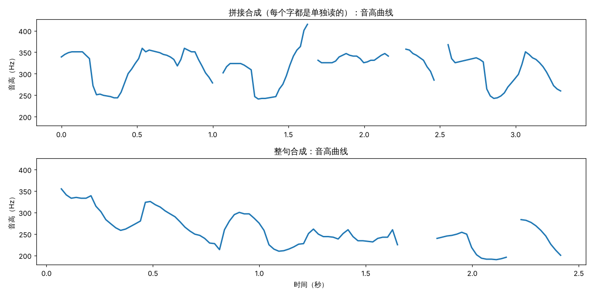
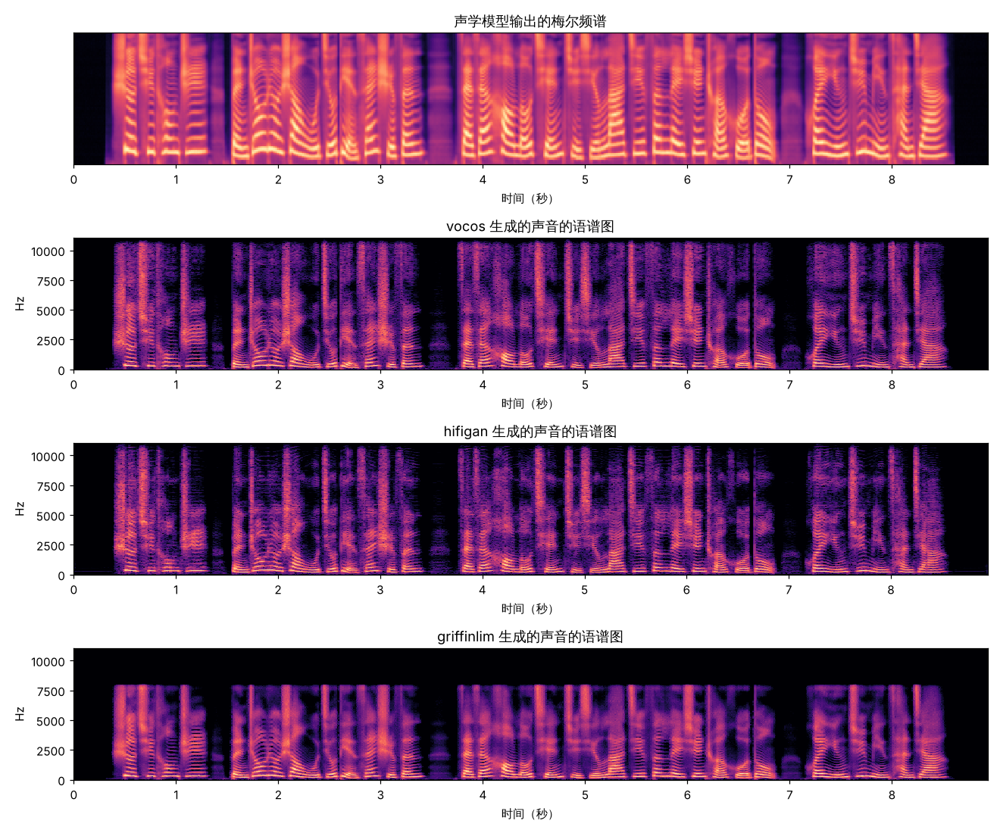
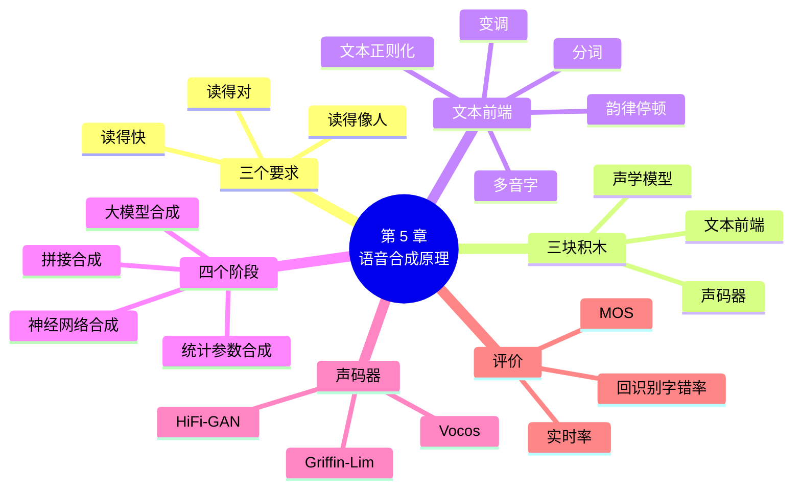

# 第 5 章 语音合成原理：从文字到声音

!!! abstract "本章学时"
    理论 4 学时（其中线下 2 学时）· 实验 4 学时（本章共 4 个实验，教师可任选）

## 学习目标

学完本章，你应该能够：

1. **说出**语音合成要解决的三个问题，以及合成系统三块积木各自的输入和输出（记忆、理解）；
2. **解释**文本正则化、分词、多音字、变调、韵律停顿在文本前端中的作用，能指出一句话里哪些地方容易读错（理解、分析）；
3. **比较**拼接合成、统计参数合成、神经网络合成、大模型合成四个阶段的做法和听感（理解）；
4. **说出**声码器的作用，从音质和速度两方面比较几种声码器（理解、分析）；
5. **运行并修改**代码，做一个能处理数字和多音字的文本前端，把它和声学模型、声码器连起来合成语音（应用）；
6. **组织**一次小组 MOS 打分，结合回识别字错率评出最好的合成版本（应用、评价）。

!!! info "先修要求"
    学习本章前，你需要：

    - 学完第 2 章，知道梅尔频谱、语谱图、基频（音高）是什么；
    - 学完第 3 章，知道“声学模型”“语言模型”的意思、会算字错率和实时率；
    - 会用 Python 的字符串和正则表达式做简单替换（《Python 编程》），看不懂正则表达式也不要紧，实验 5-1 每条规则都有说明。

??? abstract "本章概念清单（12 个，点击查看定义和例子）"
    1. [文本前端](../../appendix/glossary.md#g-文本前端)
    2. [文本正则化](../../appendix/glossary.md#g-文本正则化)
    3. [分词](../../appendix/glossary.md#g-分词)
    4. [多音字](../../appendix/glossary.md#g-多音字)
    5. [变调](../../appendix/glossary.md#g-变调)
    6. [韵律](../../appendix/glossary.md#g-韵律)
    7. [声码器](../../appendix/glossary.md#g-声码器)
    8. [拼接合成](../../appendix/glossary.md#g-拼接合成)
    9. [统计参数合成](../../appendix/glossary.md#g-统计参数合成)
    10. [神经网络语音合成](../../appendix/glossary.md#g-神经网络语音合成)
    11. [平均意见分](../../appendix/glossary.md#g-平均意见分)
    12. [回识别字错率](../../appendix/glossary.md#g-回识别字错率)

## 情景导入

服务站的广播一直用 Matcha 模型播报社区通知，大部分时候都挺好，但居民反映过几次问题：“2026-11-08”被念成了一串奇怪的数字；“请到一楼找王大夫”，大夫念成了“大 fū”；还有人说，同样的通知，换了一段文字之后就“像机器人一样一个字一个字往外蹦”。

小周决定搞清楚：机器是怎样“读”文字的？它怎么知道“2026”在“2026年”里要一个数字一个数字地读，在“2026人”里要读“两千零二十六”？“银行”的“行”和“行走”的“行”是怎么区分的？为什么有的合成声音像人，有的像机器？

本章打开 `speak` 这个“黑盒子”：它里面分为三块积木，我们亲手做第一块（文本前端），再把 Matcha 模型拆成两半，看清楚第二块（声学模型）和第三块（声码器）各做了什么。

## 5.1 语音合成要解决什么

好的合成语音，要做到三点：

| 要求 | 具体是什么 | 做不好会怎样 |
|---|---|---|
| **读得对** | 数字、日期、金额、符号读法正确；多音字读对；声调和变调正确 | “¥1500”读成“人民币符号一五零零”；“银行”读成“银 xíng” |
| **读得像人** | 停顿的位置和长短合适，语调有起伏，轻重快慢自然，有情感 | 一字一顿、没有起伏，像“机器腔” |
| **读得快** | 生成速度比说话快（实时率小于 1），最好能边生成边播放 | 用户等待太久；不能用在实时对话里 |

第一点主要靠“文本前端”，第二点主要靠“声学模型”，第三点靠整个系统的设计，尤其是“声码器”。

## 5.2 合成系统的三块积木

和识别系统一样，合成系统也可以拆成几块积木，只是方向反过来：


1. [**文本前端**](../../appendix/glossary.md#g-文本前端 "语音合成中把文字转换成发音信息（读法、拼音、停顿）的部分"){ .term }：把文字变成“发音说明书”：每个字怎么读、声调是什么、哪里停顿。它要处理的全是“语言”问题，和声音本身无关。
2. **声学模型**：根据发音说明书，“画”出一张梅尔频谱（第 2 章）。每个音持续多久、音高怎么起伏、音色是什么样，都在这一步决定。
3. [**声码器**](../../appendix/glossary.md#g-声码器 "把梅尔频谱等声学特征转换成声音波形的模块"){ .term }：把梅尔频谱“演奏”成声音波形。梅尔频谱只记录了每个频带有多强，丢掉了很多细节，声码器要把这些细节补回来。

第 1 章实验里的 `speak` 函数，内部就是这三步：sherpa-onnx 先用词典和规则做文本前端，再运行 Matcha 声学模型，最后运行 Vocos 声码器。实验 5-3 会把后两步拆开来分别运行。

## 5.3 文本前端：读得对

### 5.3.1 文本正则化

通知里经常有数字和符号，它们怎么读，取决于是什么意思：

| 写法 | 意思 | 应该读成 |
|---|---|---|
| 2026年 | 年份 | 二零二六年（逐位读） |
| 2026人 | 数量 | 两千零二十六人（按数值读） |
| 13912345678 | 电话号码 | 幺三九幺二三四五六七八（逐位读，1 读“幺”） |
| 9:30 | 时刻 | 九点三十分 |
| 12.5% | 百分数 | 百分之十二点五 |
| ¥1500 | 金额 | 一千五百元 |
| 2026-11-08 | 日期 | 二零二六年十一月八日 |
| −3℃ | 温度 | 零下三摄氏度 |

把这些写法转换成实际读法，叫[**文本正则化**](../../appendix/glossary.md#g-文本正则化 "把数字、日期、符号等非汉字写法转换成实际的读法"){ .term }（和第 4 章的逆正则化方向相反）。最常用的做法是**写规则**：用正则表达式找出“4 位数字后面跟着‘年’”这样的模式，再按对应的方法读出来。规则的顺序很重要，越具体的规则要越先用：先找电话号码，再找日期，再找普通数字，否则电话号码会被当成一个大数读出来。

规则的好处是可控、出错了好改；缺点是写不完，总有规则没想到的情况。比如“3-5 人”是“三到五人”，“3-5 号楼”可能是“三号楼五单元”。所以大公司的前端会把规则和模型结合起来，先用模型判断“这个数字是什么类型”，再用规则读。

### 5.3.2 分词和多音字

中文的字和字之间没有空格，很多读音问题要先切出词才能解决。把句子切成词，叫[**分词**](../../appendix/glossary.md#g-分词 "把连续的汉字句子切分成一个个词"){ .term }。本书用 jieba 分词：

> 请到 / 一楼 / 大厅 / 找 / 王大夫 / ， / 银行 / 的 / 工作人员 / 也 / 会 / 到场

分词以后，[**多音字**](../../appendix/glossary.md#g-多音字 "有两个或更多读音、要根据词语和上下文确定读音的字"){ .term }的读音大部分就能确定了：“银行”里的“行”读 háng，“行走”里的读 xíng；“重庆”的“重”读 chóng，“重量”的读 zhòng。常用的注音工具 pypinyin 内置了一个大词典，按词查读音。<sup class="cite">[[1]](#ref5-1)</sup>但词典总有漏网之鱼，实验 5-1 中，“大夫”被读成了 dà fū，“单县”被读成了 dān xiàn，都要手动加进自定义词典修正。

还有一些多音字，同一个词在不同的句子里读音也不同，比如“还”（“还钱”huán 和“还有”hái）、“了”（“了解”liǎo 和“好了”le）、“得”（“得到”dé、“跑得快”de、“得去”děi），要看整句话的意思，这时就需要用模型来判断。

### 5.3.3 声调和变调

普通话有四个声调和轻声。注音时用数字表示声调：mā 写成 ma1，má 写成 ma2，轻声不写数字。合成模型对声调非常敏感，声调错了，听起来就是另一个字。

更麻烦的是[**变调**](../../appendix/glossary.md#g-变调 "字的声调在连读时发生变化的现象"){ .term }，字在连读时声调会变：

| 变调规则 | 例子 |
|---|---|
| 两个第三声连读，前一个变成第二声 | 你好 nǐ hǎo → ní hǎo；水果、老虎 |
| “一”在第四声前读第二声 | 一个 yí gè、一样 yí yàng |
| “一”在第一、二、三声前读第四声 | 一天 yì tiān、一年 yì nián、一起 yì qǐ |
| “一”单用、在词尾、表示序数时读原调 | 第一 dì yī、统一、一楼（第一层）yī lóu |
| “不”在第四声前读第二声 | 不对 bú duì、不是 bú shì |

实验 5-1 用几行规则实现了“一”“不”的变调，同时也暴露了规则的局限：“一楼”指第一层时应读原调 yī lóu，但规则看到后面的“楼”是第二声，就把它改成了 yì。规则改起来容易，难的是想全所有情况。

### 5.3.4 韵律：在哪里停、停多久

读得像人，很大程度上靠[**韵律**](../../appendix/glossary.md#g-韵律 "说话时的停顿、轻重、快慢和语调，决定听起来自然不自然"){ .term }：停顿、轻重、快慢和语调。文本前端要给出停顿的位置，常用几级标记：

> 社区#1 通知#3 本#1 周六#1 上午#1 九点#1 三十分#3 在#1 三号#1 楼前#1 举行#1 活动#4

`#1` 是词和词之间几乎听不出的小停顿，`#2` 是短语之间稍长的停顿，`#3` 是逗号处的停顿，`#4` 是句末的长停顿。标准的韵律标注还会区分更多层级，需要专门训练的韵律预测模型；简单的系统只按标点停顿。Matcha 等神经网络模型能从大量录音中学到“在哪里停”，所以本书的模型只需要标点就能读得比较自然。

下面的动画把文本前端的四步串起来：

<iframe class="sim-frame" src="../../sims/frontend-pipeline/main.html" height="560" loading="lazy" title="文本前端流水线"></iframe>
动画：文本前端流水线。选一个例句，按“下一步”看正则化、分词、注音和韵律停顿；橙色是多音字或变调的字。[全屏打开](../../sims/frontend-pipeline/main.html){ target=_blank }
{ .sim-caption }

## 5.4 语音合成的四个阶段

第 1 章简单介绍过语音合成的四个阶段，这里详细看看每个阶段的做法。

### 5.4.1 拼接合成：剪录音拼起来

最直观的想法：请一位播音员把所有的字、词都录下来，合成时把需要的片段剪出来，按顺序拼在一起。这就是[**拼接合成**](../../appendix/glossary.md#g-拼接合成 "事先录好大量语音片段，合成时挑选合适的片段拼接起来的方法"){ .term }。

最简单的拼接以“字”为单位，结果听起来一字一顿，因为每个字都是单独录的，带着自己完整的声调，字和字之间的音高跳来跳去。1990 年代发展出的“单元挑选”方法改进了这一点：<sup class="cite">[[2]](#ref5-2)</sup>播音员朗读几十个小时的句子，建成一个大语音库；合成时从库里挑选“前后文最合适”的片段，尽量挑连在一起录的长片段，让接缝最少。好的单元挑选系统，播报火车站、银行叫号这种固定格式的句子时非常自然。

拼接合成的问题是：要录的东西太多，换一个声音就要重新录几十个小时；遇到库里没有的组合，接缝就很明显；想让它换个语气、快慢，也很难做到。

实验 5-2 用“单字录音库”拼出了一句话：拼接版的音高在 241—415 Hz 之间上下跳动，时长 3.32 秒；神经网络整句合成的音高在 190—355 Hz 之间平滑地下降（句末降调），只用了 2.46 秒。



### 5.4.2 统计参数合成：用模型预测参数

2000 年前后出现了[**统计参数合成**](../../appendix/glossary.md#g-统计参数合成 "用 HMM 等统计模型预测声音参数，再用程序生成声音的方法"){ .term }：<sup class="cite">[[3]](#ref5-3)</sup>不再直接拼录音，而是用 HMM 等统计模型从录音中学习“每个音的参数（基频、频谱）大概是什么样、持续多久”，合成时先预测参数，再用一个叫“声码器”的程序根据参数生成声音（声码器这个词就是从这里来的）。

它的好处是模型小（几兆字节）、能调节音高和语速、换声音只需要少量录音；缺点是统计模型预测出来的参数都是“平均值”，细节被抹平了，听起来发闷、像隔着一层布，俗称“机器味”。

### 5.4.3 神经网络合成

2016 年 WaveNet 第一次用神经网络合成出接近真人的声音（第 1 章）。此后，[**神经网络语音合成**](../../appendix/glossary.md#g-神经网络语音合成 "用神经网络预测梅尔频谱并生成波形的合成方法"){ .term }迅速成为主流，几个代表模型的思路如下：

| 模型 | 年份 | 做法（简化） | 特点 |
|---|---|---|---|
| Tacotron 2<sup class="cite">[[4]](#ref5-4)</sup> | 2017 | 像编码器—解码器识别模型反过来：一帧一帧地“写”出梅尔频谱，再交给声码器 | 第一次达到接近真人的自然度，但一帧一帧生成，慢，偶尔会跳字、重复 |
| FastSpeech 2<sup class="cite">[[5]](#ref5-5)</sup> | 2020 | 先预测每个音持续几帧、音高和能量，再一次性生成所有帧 | 非自回归，快很多，不会跳字 |
| VITS<sup class="cite">[[6]](#ref5-6)</sup> | 2021 | 声学模型和声码器合成一个网络，从拼音直接到波形 | 端到端，音质好；第 6 章的 AISHELL-3、MeloTTS 模型属于这一类 |
| Matcha-TTS<sup class="cite">[[7]](#ref5-7)</sup> | 2024 | 用“流匹配”方法，从随机噪声出发，几步就“修”出梅尔频谱 | 快、小，音质好；本书第 1—5 章用的中文模型 |

这些模型的共同点是：从大量“录音 + 文字”中**自己学会**每个音怎么发、在哪里停、语调怎么起伏，不再需要人写规则或挑片段。它们仍然需要文本前端提供拼音（Matcha 中文模型的输入就是带声调的拼音），但“读得像人”这件事交给了神经网络。

Matcha-TTS 的“流匹配”可以这样理解：先在纸上随手撒一把噪点，然后按照模型学到的“方向”，一步步把噪点挪到该在的位置上，最后变成一张清晰的梅尔频谱。本书用的版本只走 3 步（模型文件名里的 `steps-3`），所以很快；每次撒的噪点不同，所以每次合成的结果都有细微的差别，第 1 章实验中采样点个数每次略有不同就是这个原因。

### 5.4.4 大模型语音合成

2023 年起，语音合成进入了“大模型”阶段。思路和大语言模型一样：先用第 2 章前沿视窗里的神经网络编解码器把声音变成一串“声音的词”，再用一个大的语言模型，根据文字一个个“续写”出声音的词，最后还原成声音。阿里巴巴的 CosyVoice 就是这一类，<sup class="cite">[[8]](#ref5-8)</sup>它在几十万小时的录音上训练，能做到：

- **零样本克隆**：给几秒钟某人的录音，就能用这个人的音色说任意内容（第 8 章）；
- **用指令控制**：用文字描述“用高兴的语气”“用四川话”“说得慢一点”，模型照着做；
- **多语言、多方言**：一个模型说普通话、粤语、英语、日语等。

代价是模型大（几亿到几十亿参数），一般需要显卡才能流畅运行。

| 阶段 | 做法 | 听起来 | 优点 | 缺点 |
|---|---|---|---|---|
| 拼接合成 | 剪录音拼起来 | 字字清楚，接缝生硬 | 固定句式很自然，计算量小 | 要录几十小时，换声音难，语气难变 |
| 统计参数合成 | 统计模型预测参数，程序生成声音 | 平滑，发闷 | 模型小，可调音高语速 | 细节被抹平，“机器味” |
| 神经网络合成 | 神经网络预测梅尔频谱，声码器生成 | 自然，接近真人 | 质量高，CPU 也能跑 | 需要大量录音训练，个别字仍可能读错 |
| 大模型合成 | 大模型续写“声音的词” | 很难和真人分辨，有情感 | 零样本克隆、指令控制、多语言 | 模型大，要显卡，可能被滥用 |

## 5.5 声码器：把频谱“演奏”成声音

声学模型画出的梅尔频谱，只告诉我们“每一帧、每个频带有多强”，就像一份只写了“每个音有多响”的乐谱；而真正的声音还需要知道每个频率成分的“相位”（波峰波谷的位置）和梅尔频谱合并掉的细节。**声码器**的任务，就是根据梅尔频谱把完整的声音波形“演奏”出来。

| 声码器 | 年份 | 做法 | 速度和音质 |
|---|---|---|---|
| Griffin-Lim<sup class="cite">[[9]](#ref5-9)</sup> | 1984 | 传统算法，不需要训练，反复迭代“猜”出相位 | 慢，声音发虚、有金属感 |
| WaveNet | 2016 | 神经网络一个采样点一个采样点地生成（每秒 2 万多个） | 音质好，但极慢 |
| HiFi-GAN<sup class="cite">[[10]](#ref5-10)</sup> | 2020 | 神经网络一次性生成整段波形，用“对抗训练”让声音更逼真 | 快，音质好，应用最广 |
| Vocos<sup class="cite">[[11]](#ref5-11)</sup> | 2023 | 神经网络预测每一帧的频谱和相位，再用逆傅里叶变换一次性变回波形 | 比 HiFi-GAN 还快，音质相当 |

实验 5-3 把 Matcha 声学模型生成的同一张梅尔频谱，分别交给 Vocos、HiFi-GAN 和 Griffin-Lim，生成 8.9 秒的语音，在编者的笔记本电脑上分别用了 0.09 秒、0.23 秒和 1.09 秒。下面的动画可以听一听三者的区别：

<iframe class="sim-frame" src="../../sims/vocoder-compare/main.html" height="620" loading="lazy" title="从频谱到声音"></iframe>
动画：从频谱到声音。同一张梅尔频谱交给三种声码器，播放比较音质，查看语谱图和生成速度。[全屏打开](../../sims/vocoder-compare/main.html){ target=_blank }
{ .sim-caption }

在第 6 章会看到，VITS、MeloTTS 这类模型把声码器“藏”在了模型内部，用户看不到单独的声码器；但它们内部同样有一块负责“演奏”的网络。

## 5.6 怎么评价合成得好不好

### 5.6.1 平均意见分 MOS { #561 }

合成语音好不好听，最终要由人来判断。最常用的方法是[**平均意见分**](../../appendix/glossary.md#g-平均意见分 "请多人给语音按 1—5 分打分后取平均，评价合成语音自然度的主观指标"){ .term }（MOS）：请一组听众（专业评测通常要 20 人以上）听一段段语音，按 5 分制打分，再求平均。<sup class="cite">[[12]](#ref5-12)</sup>

| 分数 | 自然度 |
|---|---|
| 5 | 非常好，和真人一样自然 |
| 4 | 好，偶尔有不自然的地方 |
| 3 | 一般，能听出是机器，但不影响理解 |
| 2 | 差，不自然的地方很多 |
| 1 | 很差，难以听懂 |

打分时要注意三点：一是**盲听**，听众不知道每段是哪个模型合成的，避免先入为主；二是**打乱顺序**，避免“先听的总觉得新鲜”；三是**放几段真人录音进去**做参照。好的神经网络合成模型 MOS 一般在 4 分以上，真人录音约 4.5 分。

### 5.6.2 回识别字错率

MOS 要组织很多人，费时费力。“读得对不对”可以交给机器检查：把合成的语音交给识别模型，看识别结果和原文差多少，叫[**回识别字错率**](../../appendix/glossary.md#g-回识别字错率 "把合成的语音交给识别模型，看识别结果和原文的字错率，用来检查读得对不对"){ .term }。它能自动发现读错的字、漏掉的字，适合每次修改后快速检查。

但要注意，回识别的错误不全是合成的错。实验 5-4 中，Matcha 合成的“请提前储水”被识别成了“请提前出水”。编者查了 Matcha 的词典，“储”的读音是 chǔ，没有标错；“储水”两个第三声连读，前一个变成第二声，听起来像“除水”，识别模型再结合上下文猜成了“出水”。所以回识别字错率高的地方，**最后要用耳朵确认**。

### 5.6.3 实时率

和识别一样，合成也用实时率衡量速度：合成用时 ÷ 语音时长。实时率小于 1 才能“说得比生成得慢”，做到边生成边播放。实验 5-4 中，Matcha 的实时率约 0.07，Kokoro 在编者的笔记本电脑上超过了 1，后者音质好但模型更大，在 CPU 上就显得慢了。

## 5.7 前沿视窗

**能“边想边说”的合成**。语音助手要像人一样对话，合成必须够快：大语言模型写出第一句话，合成就要马上开口，而不是等整段回复写完。2024 年 12 月，阿里巴巴发布 CosyVoice 2，把“流式合成”做进了大模型合成：文字一边进来，声音一边出来，首包延迟（从收到文字到发出第一段声音）可以低到 150 毫秒左右，同时保留了零样本克隆和指令控制的能力。<sup class="cite">[[13]](#ref5-13)</sup>

**合成也开始“懂意思”**。传统的文本前端靠规则和词典决定读音和停顿；大模型合成直接读文字，能根据上下文判断“还”读 huán 还是 hái，根据句子意思决定语气。截至 2026 年 10 月，主流的商用合成服务大多已经是大模型方案，而在手机、车机、离线设备上，Matcha、VITS 这类小模型加文本前端的方案仍然是主力。

## 本章实验

!!! abstract "实验总览"
    | 实验 | 类型 | 建议时长 | 内容 |
    |---|---|---|---|
    | 实验 5-1 | ★ 基础 | 45 分钟 | 用 jieba + pypinyin 做一个文本前端，处理数字、多音字和变调 |
    | 实验 5-2 | ★ 基础 | 45 分钟 | 用单字录音拼出一句话，和神经网络整句合成对比，看音高曲线 |
    | 实验 5-3 | ★ 基础 | 45 分钟 | 把前端、声学模型、声码器连起来，画出梅尔频谱，比较三种声码器 |
    | 实验 5-4 | ☆ 拓展 | 45 分钟 | 5 个版本盲听 MOS 打分，加上回识别字错率和实时率，评出最好的一版 |

    代码见配套资源 `labs/ch05/` 目录。`frontend.py`（文本前端）和 `tts_parts.py`（声学模型、声码器）是本章自己的小工具，实验文件会调用它们。运行前在 `labs` 文件夹里执行 `python models.py ch05`；实验 5-3 还需要 `pip install onnxruntime`。

!!! warning "关于模型的许可"
    Matcha 中文模型是用标贝科技公开的中文女声数据集训练的，数据集只允许非商业使用，所以这个模型**只能用于学习和研究**，不能用在商业产品里。这是使用开源模型时容易忽略的一点：不但要看模型代码的许可，还要看训练数据的许可。第 6 章的 Kokoro 模型采用 Apache-2.0 许可，可以商用。

### 实验 5-1 ★ 做一个文本前端

**实验目的**

1. 会用正则表达式写文本正则化规则，把数字、日期、电话、金额、百分数转换成读法；
2. 会用 jieba 分词、用 pypinyin 注音，会用自定义词典修正多音字；
3. 会写“一”“不”的变调规则，并发现规则的局限。

**实验环境**：本机 CPU 或云端 Notebook。**实验数据**：一条编者编写的社区通知。不需要模型。

**实验步骤与代码**

第 1 步，打开 `frontend.py`，读一读三个部分。核心是正则化规则表 `RULES`，每一行是“规则名、要找的模式、怎么读”：

```python
RULES = [  # (规则说明, 正则表达式, 怎么读)；按顺序替换，越具体的规则越靠前
    ("手机号", r"1\d{10}", lambda m: read_digits(m.group(), one="幺")),
    ("日期", r"(\d{4})[-/年](\d{1,2})[-/月](\d{1,2})日?",
     lambda m: f"{read_digits(m[1])}年{read_number(m[2])}月{read_number(m[3])}日"),
    ("年份", r"(\d{4})年", lambda m: read_digits(m[1]) + "年"),
    ("时刻", r"(\d{1,2}):(\d{2})", lambda m: read_number(m[1]) + "点" + (read_number(m[2]) + "分" if m[2] != "00" else "")),
    ("百分数", r"(\d+(?:\.\d+)?)%", lambda m: "百分之" + read_decimal(m[1])),
    ("人民币", r"[¥￥](\d+(?:\.\d+)?)", lambda m: read_decimal(m[1]) + "元"),
    ("几号楼", r"(\d+)(号|栋|单元|室|楼)", lambda m: (read_digits(m[1]) if len(m[1]) > 2 else read_number(m[1])) + m[2]),
    ("负数", r"(?<![\d\w])-(\d+(?:\.\d+)?)", lambda m: "负" + read_decimal(m[1])),
    ("小数和整数", r"\d+(?:\.\d+)?", lambda m: read_decimal(m.group())),
]
```

`r"1\d{10}"` 的意思是“1 后面跟着 10 个数字”，即手机号；`(\d{4})年` 是“4 个数字后面跟着‘年’”。`lambda m: ...` 是一个小函数，`m` 是找到的那一段，`m[1]` 是第一对括号里的内容。规则从上往下依次使用，所以手机号、日期这些“长的”规则放在前面。

注音和变调部分：

```python
# pypinyin 自带的词典读错的词，在这里补上正确读音（← 改这里：发现读错的词就加进来）
load_phrases_dict({"大夫": [["dài"], ["fu"]], "单县": [["shàn"], ["xiàn"]],
                   "一样": [["yí"], ["yàng"]], "一天": [["yì"], ["tiān"]]})


def to_pinyin(text):
    """返回 [(字, 拼音), ...]，拼音用数字表示声调（轻声不带数字），标点原样保留"""
    pys = lazy_pinyin(text, style=Style.TONE3, tone_sandhi=True, errors=lambda s: list(s))
    pairs = list(zip(text, pys))
    # “一”“不”的变调：在第四声前读第二声；“一”在第一、二、三声前读第四声；“第一”“十一”和句末不变
    for i, (ch, py) in enumerate(pairs):
        if ch not in "一不" or i + 1 >= len(pairs) or not pairs[i + 1][1][-1:].isdigit():
            continue
        if i > 0 and pairs[i - 1][0] in "第十" + DIGIT:
            continue
        nxt = pairs[i + 1][1][-1]
        if nxt == "4":
            pairs[i] = (ch, py[:-1] + "2")
        elif ch == "一":
            pairs[i] = (ch, "yi4")
    return pairs
```

第 2 步，运行 `lab5_1_frontend.py`：

```python
from frontend import frontend, normalize, to_pinyin

notice = ("社区通知：2026-11-08（周六）9:30，在3号楼前举行垃圾分类宣传活动，预计参加约120人。"
          "报名电话13912345678，活动经费¥1500，比去年增加12.5%。"
          "请到一楼大厅找王大夫领取材料，银行的工作人员也会到场，介绍重新办理社保卡的流程。")  # ← 改这里

print("========== 完整的前端 ==========")
pinyin = frontend(notice)

print("\n========== 逐项检查 ==========")
cases = ["2026-11-08", "9:30", "3号楼", "120人", "13912345678", "¥1500", "12.5%", "-3度",   # 数字
         "银行", "行走", "重庆", "重新", "大夫", "单县",                                     # 多音字
         "一个", "一天", "第一", "一楼", "不对", "不好", "你好"]                              # 变调
for c in cases:
    spoken = normalize(c)
    print(f"{c:<12}→ {spoken:<14} {' '.join(p for _, p in to_pinyin(spoken))}")

with open("notice_pinyin.txt", "w", encoding="utf-8") as f:
    f.write(" ".join(pinyin))
print("\n已保存 notice_pinyin.txt（实验 5-3 会把它交给声学模型）")
```

**运行结果**

```text
========== 完整的前端 ==========
原文： 社区通知：2026-11-08（周六）9:30，在3号楼前举行垃圾分类宣传活动，预计参加约120人。报名电话13912345678，活动经费¥1500，比去年增加12.5%。请到一楼大厅找王大夫领取材料，银行的工作人员也会到场，介绍重新办理社保卡的流程。
  [手机号] 13912345678 → 幺三九幺二三四五六七八
  [日期] 2026-11-08 → 二零二六年十一月八日
  [时刻] 9:30 → 九点三十分
  [百分数] 12.5% → 百分之十二点五
  [人民币] ¥1500 → 一千五百元
  [几号楼] 3号 → 三号
  [小数和整数] 120 → 一百二十
分词： 社区 / 通知 / ： / 二零二 / 六年 / 十一月 / 八日 / （ / 周六 / ） / 九点 / 三十分 / ， / 在 / 三号 / 楼前 / 举行 / 垃圾 / 分类 / 宣传 / 活动 / ， / 预计 / 参加 / 约 / 一百二十 / 人 / 。 / 报名 / 电话 / 幺 / 三九 / 幺 / 二 / 三四 / 五六 / 七八 / ， / 活动 / 经费 / 一千五百元 / ， / 比 / 去年 / 增加 / 百分之十 / 二点五 / 。 / 请 / 到 / 一楼 / 大厅 / 找 / 王大夫 / 领取 / 材料 / ， / 银行 / 的 / 工作人员 / 也 / 会 / 到场 / ， / 介绍 / 重新 / 办理 / 社保卡 / 的 / 流程 / 。
拼音： she4 qu1 tong1 zhi1 ： er4 ling2 er4 liu4 nian2 shi2 yi1 yue4 ba1 ri4 （ zhou1 liu4 ） jiu3 dian3 san1 shi2 fen1 ， zai4 san1 hao4 lou2 qian2 ju3 xing2 la1 ji1 fen1 lei4 xuan1 chuan2 huo2 dong4 ， yu4 ji4 can1 jia1 yue1 yi4 bai3 er4 shi2 ren2 。 bao4 ming2 dian4 hua4 yao1 san1 jiu3 yao1 er4 san1 si4 wu3 liu4 qi1 ba1 ， huo2 dong4 jing1 fei4 yi4 qian1 wu3 bai3 yuan2 ， bi3 qu4 nian2 zeng1 jia1 bai3 fen1 zhi1 shi2 er4 dian3 wu3 。 qing3 dao4 yi4 lou2 da4 ting1 zhao3 wang2 dai4 fu ling3 qu3 cai2 liao4 ， yin2 hang2 de gong1 zuo4 ren2 yuan2 ye3 hui4 dao4 chang3 ， jie4 shao4 chong2 xin1 ban4 li3 she4 bao3 ka3 de liu2 cheng2 。
========== 逐项检查 ==========
2026-11-08  → 二零二六年十一月八日     er4 ling2 er4 liu4 nian2 shi2 yi1 yue4 ba1 ri4
9:30        → 九点三十分          jiu3 dian3 san1 shi2 fen1
3号楼         → 三号楼            san1 hao4 lou2
120人        → 一百二十人          yi4 bai3 er4 shi2 ren2
13912345678 → 幺三九幺二三四五六七八    yao1 san1 jiu3 yao1 er4 san1 si4 wu3 liu4 qi1 ba1
¥1500       → 一千五百元          yi4 qian1 wu3 bai3 yuan2
12.5%       → 百分之十二点五        bai3 fen1 zhi1 shi2 er4 dian3 wu3
-3度         → 负三度            fu4 san1 du4
银行          → 银行             yin2 hang2
行走          → 行走             xing2 zou3
重庆          → 重庆             chong2 qing4
重新          → 重新             chong2 xin1
大夫          → 大夫             dai4 fu
单县          → 单县             shan4 xian4
一个          → 一个             yi2 ge4
一天          → 一天             yi4 tian1
第一          → 第一             di4 yi1
一楼          → 一楼             yi4 lou2
不对          → 不对             bu2 dui4
不好          → 不好             bu4 hao3
你好          → 你好             ni2 hao3
已保存 notice_pinyin.txt（实验 5-3 会把它交给声学模型）
```

读结果：

- **正则化**：7 条规则依次生效，电话号码逐位读且 1 读“幺”，日期、时刻、金额、百分数都读对了。
- **分词**：总体正确，但“二零二 / 六年”“百分之十 / 二点五”切得不对，因为分词词典里没有这些“数字读法”的词；好在分词错误没有影响注音。
- **多音字**：“银行”háng、“重庆”chóng、“行走”xíng 都对；“大夫”dài fu、“单县”shàn xiàn 是靠 `load_phrases_dict` 加进去的自定义读音修正的。
- **变调**：“一个”yí、“一天”yì、“不对”bú、“你好”ní（第三声变调由 pypinyin 的 `tone_sandhi=True` 完成）都对了；但“一楼”被改成了 yì lóu，这是规则的错误，应该读 yī lóu。

**改一改**：修改 `to_pinyin` 中的规则，让“一楼”“一号”“一单元”这类表示序号的“一”保持第一声。（提示：在“第十”和数字的判断后面，再加一个“后面是楼、号、单元”的判断。）

**实验记录表**

| 类型 | 写法 | 前端输出的读法 | 对不对 | 如果不对，怎么改 |
|---|---|---|---|---|
| 数字 | 2026-11-08 | | | |
| 数字 | 13912345678 | | | |
| 多音字 | 大夫 | | | |
| 变调 | 一楼 | | | |
| 自己找的 | | | | |

**常见问题排查**

| 现象 | 原因 | 解决办法 |
|---|---|---|
| `ModuleNotFoundError: No module named 'frontend'` | 没有在 `ch05` 文件夹里运行 | 先 `cd ch05` |
| `TypeError: lazy_pinyin() got an unexpected keyword argument 'tone_sandhi'` | pypinyin 版本太旧 | `pip install -U pypinyin`（0.48 以上） |
| 自己加的规则没有生效 | 前面的规则已经把这段文字改掉了 | 调整 `RULES` 里规则的顺序 |

**思考与练习**

1. 在通知里加上“3-5人一组”“温度-3℃”“第2026号文件”，前端能读对吗？分别应该怎样修改规则？
2. 为什么文本前端里规则的顺序很重要？举一个顺序错了会读错的例子。

**实验报告要求**

提交记录表、修改后的 `frontend.py`，以及修改前后“一楼”的注音结果。

### 实验 5-2 ★ 拼接合成听“机器腔”

**实验目的**

1. 理解拼接合成的原理：录好单元，按顺序拼接；
2. 通过听感和音高曲线，体会拼接合成“一字一顿”的原因；
3. 理解神经网络整句合成在韵律上的优势。

**实验环境**：本机 CPU 或云端 Notebook。**实验数据**：无，单字和整句都用 Matcha 模型现场合成。模型 `matcha-zh`、`sensevoice`。

**实验步骤与代码**

运行 `lab5_2_concatenative.py`：

```python
import sys

import librosa
import matplotlib.pyplot as plt
import numpy as np

sys.path.append("..")
from voicelab import cer, save_audio, speak, transcribe

plt.rcParams["font.sans-serif"] = ["SimHei", "Microsoft YaHei", "WenQuanYi Zen Hei", "Noto Sans CJK SC"]
plt.rcParams["axes.unicode_minus"] = False
sentence = "欢迎各位居民参加社区活动"            # ← 改这里：换一句话（不要标点）

# 第 1 步：建“单字录音库”——每个字单独读一遍，剪掉前后的静音
library = {}
for ch in sorted(set(sentence)):
    samples, sr = speak(ch)
    samples, _ = librosa.effects.trim(samples, top_db=30)
    library[ch] = samples
print(f"单字录音库：{len(library)} 个字，采样率 {sr} Hz")

# 第 2 步：拼接——按顺序把单字接起来，接缝处用 10 毫秒淡入淡出，减少“咔哒”声
fade = int(0.01 * sr)
pieces = []
for ch in sentence:
    piece = library[ch].copy()
    piece[:fade] *= np.linspace(0, 1, fade)
    piece[-fade:] *= np.linspace(1, 0, fade)
    pieces.append(piece)
concat = np.concatenate(pieces)
save_audio("concat.wav", concat, sr)

# 第 3 步：神经网络整句合成
whole, _ = speak(sentence)
save_audio("whole.wav", whole, sr)

# 第 4 步：比较
for name, audio in [("拼接合成", concat), ("整句合成", whole)]:
    heard = transcribe(audio, sr)
    f0, voiced, _ = librosa.pyin(audio, fmin=80, fmax=500, sr=sr)
    print(f"{name}：时长 {len(audio) / sr:.2f} 秒，回识别 {heard}（字错率 {cer(sentence, heard)[0]:.0%}），"
          f"音高 {np.nanmin(f0):.0f}—{np.nanmax(f0):.0f} Hz")

fig, axes = plt.subplots(2, 1, figsize=(12, 6), sharey=True)
for ax, (name, audio) in zip(axes, [("拼接合成（每个字都是单独读的）", concat), ("整句合成", whole)]):
    f0, _, _ = librosa.pyin(audio, fmin=80, fmax=500, sr=sr)
    t = librosa.times_like(f0, sr=sr)
    ax.plot(t, f0, linewidth=2)
    ax.set_title(name + "：音高曲线")
    ax.set_ylabel("音高（Hz）")
axes[1].set_xlabel("时间（秒）")
plt.tight_layout()
plt.savefig("concat_pitch.png", dpi=110)
print("已保存 concat.wav、whole.wav、concat_pitch.png")
```

真实的拼接系统要请播音员录音，这里用合成模型逐字朗读来代替“播音员录单字”，只为体会原理。`np.linspace(0, 1, fade)` 生成从 0 到 1 均匀增长的一串数，乘到开头就是“淡入”。

听一听 `concat.wav` 和 `whole.wav`，再打开 `concat_pitch.png`。

**运行结果**

```text
单字录音库：12 个字，采样率 22050 Hz
拼接合成：时长 3.32 秒，回识别 欢迎各位居民参加社区活动。（字错率 0%），音高 241—415 Hz
整句合成：时长 2.46 秒，回识别 欢迎各位居民参加社区活动。（字错率 0%），音高 190—355 Hz
已保存 concat.wav、whole.wav、concat_pitch.png
```

音高曲线见 5.4.1 节。读结果：

- 两个版本都能被正确识别，“读得对”上没有区别；差别在“读得像不像人”。
- 拼接版比整句版长了将近 1 秒，因为每个字单独读时都读得完整饱满，不会像连读时那样缩短、弱化。
- 拼接版的音高曲线每个字都“从头来一遍”，整体停在较高的位置（241—415 Hz）；整句版的音高有一个从高到低的总体趋势（句末下降），这是陈述句的自然语调。**语调是整句的，不是一个个字的**，这正是拼接合成难以做好的地方。

**改一改**：把淡入淡出 `fade` 改成 0（不做淡入淡出），再听一听接缝处有什么不同。

**实验记录表**

| 版本 | 时长（秒） | 音高范围（Hz） | 回识别对不对 | 听感描述 |
|---|---|---|---|---|
| 拼接合成 | | | | |
| 整句合成 | | | | |
| 拼接合成（不淡入淡出） | | | | |

**常见问题排查**

| 现象 | 原因 | 解决办法 |
|---|---|---|
| 运行较慢 | 每个字都要单独合成一次，`pyin` 估计音高也较慢 | 正常，约 20 秒 |
| 音高曲线断断续续 | 清辅音和停顿处没有音高 | 正常，`pyin` 在这些地方返回空值 |

**思考与练习**

1. 如果改成以“词”为单位拼接（“欢迎”“各位”“居民”……），效果会变好还是变差？为什么？
2. 火车站、银行叫号系统为什么至今还常用拼接的方法？

**实验报告要求**

提交记录表和音高曲线图，用自己的话说明拼接合成为什么听起来像“机器腔”。

### 实验 5-3 ★ 拆开看声学模型和声码器

**实验目的**

1. 会把实验 5-1 的前端输出转换成模型能用的编号，运行声学模型得到梅尔频谱；
2. 会把同一张梅尔频谱交给不同的声码器，比较音质和速度；
3. 理解合成系统三块积木之间“传递”的是什么。

**实验环境**：本机 CPU 或云端 Notebook，需要 `pip install onnxruntime`。**实验数据**：无。模型 `matcha-zh`（声学模型和 Vocos 声码器）、`hifigan`。

**实验步骤与代码**

第 1 步，打开 `tts_parts.py` 看看两个函数。`acoustic_model` 把拼音换成编号，每个音后面插一个“间隔”符号（这个模型训练时就是这样做的），交给 Matcha 声学模型，得到梅尔频谱；`vocoder` 把梅尔频谱交给声码器：

```python
def vocoder(mel, name="vocos"):
    """梅尔频谱 → 声音采样点。name 可选 "vocos"、"hifigan"（神经网络声码器）或 "griffinlim"（传统算法，不用模型）"""
    if name == "griffinlim":                     # Griffin-Lim：反复猜测相位，迭代 32 次
        return librosa.feature.inverse.mel_to_audio(np.exp(mel), sr=SR, n_fft=1024, hop_length=256,
                                                    power=1.0, n_iter=32, fmin=0, fmax=8000)
    if name == "hifigan":                        # HiFi-GAN：直接输出波形
        return _session(model_path("hifigan") / "hifigan_v2.onnx").run(None, {"mel": mel[None]})[0][0]
    mag, x, y = _session(model_path("matcha-zh") / "vocos-22khz-univ.onnx").run(None, {"mels": mel[None]})
    spec = mag[0] * (x[0] + 1j * y[0])           # Vocos：输出每一帧的频谱，再用逆傅里叶变换变回波形
    return librosa.istft(spec, hop_length=256, win_length=1024, n_fft=1024, window="hann", center=True)
```

第 2 步，运行 `lab5_3_acoustic_vocoder.py`：

```python
import sys
import time

import librosa.display
import matplotlib.pyplot as plt
import numpy as np

sys.path.append("..")
from frontend import frontend
from tts_parts import SR, acoustic_model, vocoder
from voicelab import cer, save_audio, transcribe

plt.rcParams["font.sans-serif"] = ["SimHei", "Microsoft YaHei", "WenQuanYi Zen Hei", "Noto Sans CJK SC"]
text = "社区通知：本周六上午9:30，在3号楼前举行垃圾分类宣传活动，欢迎居民参加。"    # ← 改这里

# 第 1 步：文本前端（实验 5-1）
pinyin = frontend(text)
answer = "社区通知：本周六上午9点30分，在3号楼前举行垃圾分类宣传活动，欢迎居民参加。"   # 回识别的标准答案（按识别模型的写法）

# 第 2 步：声学模型 → 梅尔频谱
acoustic_model(pinyin)                                   # 先运行一次，把模型加载好
start = time.time()
mel = acoustic_model(pinyin)
t_am = time.time() - start
print(f"\n梅尔频谱：{mel.shape}（80 个频带 × {mel.shape[1]} 帧），声学模型用时 {t_am:.2f} 秒")

# 第 3 步：同一张频谱交给三个声码器
fig, axes = plt.subplots(4, 1, figsize=(12, 10))
librosa.display.specshow(mel, sr=SR, hop_length=256, x_axis="time", ax=axes[0])
axes[0].set_title("声学模型输出的梅尔频谱")
axes[0].set_xlabel("时间（秒）")
for k, name in enumerate(["vocos", "hifigan", "griffinlim"], 1):
    vocoder(mel, name)                                   # 先运行一次，把模型加载好
    start = time.time()
    audio = vocoder(mel, name)
    used = time.time() - start
    audio = audio / np.abs(audio).max() * 0.9            # 统一音量，方便比较
    save_audio(f"notice_{name}.wav", audio, SR)
    dur = len(audio) / SR
    heard = transcribe(audio, SR)
    print(f"{name:<8} 时长 {dur:.2f} 秒，声码器用时 {used:.3f} 秒（实时率 {used / dur:.3f}），"
          f"回识别字错率 {cer(answer, heard)[0]:.0%}：{heard}")
    S = librosa.amplitude_to_db(np.abs(librosa.stft(audio, n_fft=1024, hop_length=256)), ref=np.max)
    librosa.display.specshow(S, sr=SR, hop_length=256, x_axis="time", y_axis="hz", ax=axes[k])
    axes[k].set_title(f"{name} 生成的声音的语谱图")
    axes[k].set_xlabel("时间（秒）")
plt.tight_layout()
plt.savefig("mel_vocoder.png", dpi=110)
print("已保存 mel_vocoder.png 和三个 notice_*.wav")
```

**运行结果**

```text
原文： 社区通知：本周六上午9:30，在3号楼前举行垃圾分类宣传活动，欢迎居民参加。
  [时刻] 9:30 → 九点三十分
  [几号楼] 3号 → 三号
分词： 社区 / 通知 / ： / 本 / 周六 / 上午 / 九点 / 三十分 / ， / 在 / 三号 / 楼前 / 举行 / 垃圾 / 分类 / 宣传 / 活动 / ， / 欢迎 / 居民 / 参加 / 。
拼音： she4 qu1 tong1 zhi1 ： ben3 zhou1 liu4 shang4 wu3 jiu3 dian3 san1 shi2 fen1 ， zai4 san1 hao4 lou2 qian2 ju3 xing2 la1 ji1 fen1 lei4 xuan1 chuan2 huo2 dong4 ， huan1 ying2 ju1 min2 can1 jia1 。

梅尔频谱：(80, 770)（80 个频带 × 770 帧），声学模型用时 0.23 秒
vocos    时长 8.93 秒，声码器用时 0.091 秒（实时率 0.010），回识别字错率 0%：社区通知本周六上午9点30分，在3号楼前举行垃圾分类宣传活动，欢迎居民参加。
hifigan  时长 8.94 秒，声码器用时 0.233 秒（实时率 0.026），回识别字错率 3%：社区通知本周日上午9点30分，在3号楼前举行垃圾分类宣传活动，欢迎居民参加。
griffinlim 时长 8.93 秒，声码器用时 1.090 秒（实时率 0.122），回识别字错率 0%：社区通知本周六上午9点30分，在3号楼前举行垃圾分类宣传活动，欢迎居民参加。
已保存 mel_vocoder.png 和三个 notice_*.wav
```



读结果：

- 我们自己做的前端 + Matcha 声学模型 + 声码器，合成出了正确的语音。这说明三块积木之间传递的就是两样东西：**拼音编号**（前端 → 声学模型）和**梅尔频谱**（声学模型 → 声码器）。
- 声学模型把 8.9 秒的语音“画”成了 770 帧的梅尔频谱，用了约 0.2 秒；Vocos 声码器只用了 0.09 秒，HiFi-GAN 0.23 秒，Griffin-Lim 1.09 秒。
- 在图上，三种声码器生成的声音语谱图大体相同（因为来自同一张梅尔频谱），但 Griffin-Lim 的谐波横线比较模糊；听起来 Griffin-Lim 发虚、带金属感。
- HiFi-GAN 这一次把“周六”识别成了“周日”。这个 HiFi-GAN 是用英文数据训练的，对中文的个别音还原得不够好；编者多次运行，HiFi-GAN 版本偶尔出现个别字识别错误，Vocos 版本都正确。Matcha 每次合成有随机性，你的结果可能略有不同。

**改一改**：把 `acoustic_model(pinyin)` 改成 `acoustic_model(pinyin, speed=0.8)` 和 `speed=1.3`，看梅尔频谱的帧数怎样变化；再把实验 5-1 中故意保留的错误（“一楼”读 yì）放进 `text` 里，听一听合成出的效果。

**实验记录表**

| 声码器 | 声码器用时（秒） | 实时率 | 回识别字错率 | 听感（清楚 / 发虚 / 有杂音） |
|---|---|---|---|---|
| vocos | | | | |
| hifigan | | | | |
| griffinlim | | | | |

**常见问题排查**

| 现象 | 原因 | 解决办法 |
|---|---|---|
| `ModuleNotFoundError: No module named 'onnxruntime'` | 没装 | `pip install onnxruntime` |
| 合成出的声音全是乱码 | 拼音编号之间没有插“间隔”符号，或拼音写法和词典不一致 | 用 `tts_parts.py` 里的 `acoustic_model`，不要自己拼编号 |
| 某些字没有声音 | 拼音不在模型的 `tokens.txt` 里（如生僻读音、英文字母） | 检查前端输出；这个模型只认中文拼音和几个标点 |

**思考与练习**

1. 为什么 Vocos 比 HiFi-GAN 快？（提示：一个预测的是频谱，一个直接生成每一个采样点）
2. 如果想让合成的声音换一个人，需要换掉三块积木中的哪一块？

**实验报告要求**

提交记录表和 `mel_vocoder.png`，用一张图（可以手画）画出三块积木和它们之间传递的东西。

### 实验 5-4 ☆ 给合成打分

**实验目的**

1. 会组织一次盲听 MOS 打分，计算平均分；
2. 会用回识别字错率和实时率做客观评价；
3. 能综合主观和客观指标，为社区广播选出最合适的合成方案。

**实验环境**：本机 CPU 或云端 Notebook，4—6 人一组，每人准备耳机。**实验数据**：无。模型 `matcha-zh`、`kokoro`、`vits-aishell3`、`sensevoice`。

**实验步骤与代码**

第 1 步，由一位组员运行 `lab5_4_mos.py`，生成 5 个随机编号的音频、一张打分表 `mos_sheet.csv` 和一份答案 `answer_key.csv`：

```python
import csv
import random
import sys
import time

import numpy as np

sys.path.append("..")
from voicelab import cer, save_audio, speak, transcribe

text = "各位居民请注意，明天上午9点到11点小区停水，请提前储水，给您带来不便，敬请谅解。"   # ← 改这里
versions = [  # (说明, 模型, 说话人编号, 语速)
    ("Matcha 正常语速", "matcha-zh", 0, 1.0),
    ("Matcha 加快 1.4 倍", "matcha-zh", 0, 1.4),
    ("Kokoro 女声", "kokoro", 45, 1.0),
    ("Kokoro 男声", "kokoro", 65, 1.0),
    ("VITS AISHELL-3 第 10 号音色", "vits-aishell3", 10, 1.0),
]
random.seed(2026)
codes = random.sample(range(101, 200), len(versions))       # 随机编号，打分时不知道哪个是哪个（“盲听”）

rows = []
for (desc, model, sid, speed), code in zip(versions, codes):
    speak("预热", model=model, sid=sid)                     # 先合成一次，把模型加载好
    start = time.time()
    audio, sr = speak(text, model=model, sid=sid, speed=speed)
    used = time.time() - start
    save_audio(f"sample_{code}.wav", audio, sr)
    heard = transcribe(audio, sr)
    dur = len(audio) / sr
    rows.append([code, desc, sr, f"{dur:.2f}", f"{used / dur:.3f}", f"{cer(text, heard)[0]:.0%}", heard])
    print(f"sample_{code}.wav  {desc:<22} 采样率 {sr:>5}  时长 {dur:5.2f} 秒  实时率 {used / dur:.3f}  "
          f"字错率 {cer(text, heard)[0]:>4.0%}  {heard}")

with open("answer_key.csv", "w", newline="", encoding="utf-8-sig") as f:      # 答案（打完分再看）
    csv.writer(f).writerows([["编号", "版本", "采样率", "时长", "实时率", "回识别字错率", "回识别结果"]] + rows)
with open("mos_sheet.csv", "w", newline="", encoding="utf-8-sig") as f:       # 打分表（发给每个组员）
    w = csv.writer(f)
    w.writerow(["编号", "自然度（1—5 分）", "清晰度（1—5 分）", "备注"])
    for code in sorted(codes):
        w.writerow([code, "", "", ""])
print("已保存 sample_*.wav、mos_sheet.csv（打分表）和 answer_key.csv（答案，打完分再打开）")
```

第 2 步，把 5 个 `sample_*.wav` 和 `mos_sheet.csv` 发给每位组员（不要发 `answer_key.csv`）。每人戴耳机独立听，给每段的自然度和清晰度各打 1—5 分。

第 3 步，收齐打分表，算出每段的平均分，最后再打开 `answer_key.csv` 揭晓答案。

**运行结果**（编者运行，MOS 打分要由你们小组完成）

```text
sample_116.wav  Matcha 正常语速            采样率 22050  时长  8.49 秒  实时率 0.068  字错率   3%  各位居民请注意，明天上午9点到11点小区停水，请提前出水，给您带来不便，敬请谅解。
sample_141.wav  Matcha 加快 1.4 倍        采样率 22050  时长  6.44 秒  实时率 0.065  字错率   3%  各位居民请注意，明天上午9点到11点小区停水，请提前出水，给您带来不便，敬请谅解。
sample_165.wav  Kokoro 女声              采样率 24000  时长 11.33 秒  实时率 1.310  字错率   0%  各位居民请注意，明天上午9点到11点小区停水，请提前储水给您带来不便，敬请谅解。
sample_166.wav  Kokoro 男声              采样率 24000  时长 11.03 秒  实时率 1.127  字错率   0%  各位居民请注意，明天上午9点到11点小区停水，请提前储水，给您带来不便，敬请谅解。
sample_183.wav  VITS AISHELL-3 第 10 号音色 采样率  8000  时长  7.45 秒  实时率 0.064  字错率  22%  各位经民请注意，明天上午就点到11点小需请水请提前主持给您带来不便性等谅解。
已保存 sample_*.wav、mos_sheet.csv（打分表）和 answer_key.csv（答案，打完分再打开）
```

读客观指标：

- Kokoro 两个声音回识别全对，但在编者的笔记本电脑上实时率超过 1（合成 11 秒的语音要 12—15 秒），不适合实时播报，提前生成广播文件则没有问题。
- Matcha 两个版本都把“储水”读得像“出水”（5.6.2 节分析过原因）；加快 1.4 倍后时长从 8.49 秒缩短到 6.44 秒。
- VITS AISHELL-3 的输出只有 8 kHz，回识别字错率 22%，错得最多。这个模型用 174 个说话人的数据训练，每人数据较少，音质也受到了影响。第 6 章会更多地使用它的多音色能力。
- **客观指标不能代替耳朵**：回识别全对的版本，自然度不一定最高。请把你们小组的 MOS 结果和上面的客观指标放在一起，再做选择。

**实验记录表**

| 编号 | 版本（揭晓后填） | 自然度 MOS | 清晰度 MOS | 回识别字错率 | 实时率 |
|---|---|---|---|---|---|
| | | | | | |
| | | | | | |
| | | | | | |
| | | | | | |
| | | | | | |

**常见问题排查**

| 现象 | 原因 | 解决办法 |
|---|---|---|
| `FileNotFoundError: 模型 kokoro 还没下载` | 本章需要的模型没下载 | `python models.py ch05`，或单独 `python models.py kokoro` |
| 每次运行编号都一样 | 用了固定的随机种子 2026 | 想换编号就改 `random.seed` 里的数字 |
| 组员打分差别很大 | 每个人的标准不同 | 正常，这正是要多人打分取平均的原因；可以先一起听一段“参考样例”统一标准 |

**思考与练习**

1. 为什么 MOS 打分要“盲听”和“打乱顺序”？
2. 给社区的老年居民播报通知，你认为 MOS 打分时还应该加上什么评价维度？

**实验报告要求**

提交填好的记录表和小组讨论结论：社区广播应该选哪个版本，理由是什么。

## 本章小结

- 语音合成要做到读得对、读得像人、读得快。合成系统有三块积木：**文本前端**（文字 → 发音说明书）、声学模型（说明书 → 梅尔频谱）、**声码器**（梅尔频谱 → 声音）。
- 文本前端包括：**文本正则化**（数字、符号 → 读法，规则顺序很重要）、**分词**、注音（按词确定**多音字**读音，词典不全时用自定义词典）、**变调**（第三声连读、“一”“不”）和**韵律**停顿。规则可控但写不完。
- 合成方法的四个阶段：**拼接合成**（剪录音拼起来，接缝和语调是难点）、**统计参数合成**（统计模型预测参数，发闷）、**神经网络语音合成**（Tacotron 2、FastSpeech 2、VITS、Matcha-TTS，自然）、大模型合成（CosyVoice，零样本克隆、指令控制）。
- 声码器从 Griffin-Lim、WaveNet 发展到 HiFi-GAN、Vocos，越来越快、越来越好。
- 评价合成：**平均意见分**（MOS，盲听、打乱、多人）、**回识别字错率**（自动检查读得对不对，但要人耳确认）、实时率。
- 使用开源模型要看模型和训练数据的许可。



**下一章预告**

原理拆开看完了，下一章回到实战：一个模型怎样说出几十上百种声音？中英文混在一起的句子（“请连接 Community-5G 的 WiFi”）怎么读？怎样把一篇 1500 字的社区通知做成带片头、有停顿、能发到业主群的 MP3 有声书？合成的声音发布出去，还要加上什么标识？

## 参考文献

正文中的上标编号（如<sup class="cite">[[1]](#ref5-1)</sup>）对应下面的文献。带链接的可以直接打开。

<div class="refs" markdown>

**论文**

- <span id="ref5-2"></span>[2] HUNT A J, BLACK A W. Unit selection in a concatenative speech synthesis system using a large speech database[C]//1996 IEEE International Conference on Acoustics, Speech, and Signal Processing (ICASSP). 1996: 373-376.
    <span class="ref-note">提出单元挑选拼接合成，是拼接合成走向实用的关键论文，对应 5.4.1 节。</span>
- <span id="ref5-3"></span>[3] ZEN H, TOKUDA K, BLACK A W. Statistical parametric speech synthesis[J]. Speech Communication, 2009, 51(11): 1039-1064.
    <span class="ref-note">统计参数合成的综述，对应 5.4.2 节。</span>
- <span id="ref5-4"></span>[4] SHEN J, PANG R, WEISS R J, et al. Natural TTS synthesis by conditioning WaveNet on mel spectrogram predictions[C]//2018 IEEE International Conference on Acoustics, Speech and Signal Processing (ICASSP). 2018: 4779-4783.
    <span class="ref-note">Tacotron 2 的论文，“声学模型画梅尔频谱 + 神经网络声码器”两段式结构从此成为标准，对应 5.4.3 节。</span>
- <span id="ref5-5"></span>[5] REN Y, HU C, TAN X, et al. FastSpeech 2: fast and high-quality end-to-end text to speech[C]//International Conference on Learning Representations (ICLR). 2021. arXiv:2006.04558.
    <span class="ref-note">非自回归合成的代表，先预测时长、音高、能量再一次性生成，对应 5.4.3 节。</span>
- <span id="ref5-6"></span>[6] KIM J, KONG J, SON J. Conditional variational autoencoder with adversarial learning for end-to-end text-to-speech[C]//Proceedings of the 38th International Conference on Machine Learning. PMLR 139, 2021: 5530-5540.
    <span class="ref-note">VITS 的论文，把声学模型和声码器合成一个网络，对应 5.4.3 节，第 6 章的多个模型基于它。</span>
- <span id="ref5-7"></span>[7] MEHTA S, TU R, BESKOW J, et al. Matcha-TTS: a fast TTS architecture with conditional flow matching[C]//ICASSP 2024 - 2024 IEEE International Conference on Acoustics, Speech and Signal Processing. 2024: 11341-11345.
    <span class="ref-note">本书中文合成模型的论文（第 1 章文献 [5]），对应 5.4.3 节和实验 5-3。</span>
- <span id="ref5-8"></span>[8] DU Z, CHEN Q, ZHANG S, et al. CosyVoice: a scalable multilingual zero-shot text-to-speech synthesizer based on supervised semantic tokens[EB/OL]. arXiv:2407.05407, 2024. https://arxiv.org/abs/2407.05407.
    <span class="ref-note">阿里巴巴的大模型语音合成，支持零样本克隆和指令控制，对应 5.4.4 节，第 8 章再讲。</span>
- <span id="ref5-9"></span>[9] GRIFFIN D, LIM J. Signal estimation from modified short-time Fourier transform[J]. IEEE Transactions on Acoustics, Speech, and Signal Processing, 1984, 32(2): 236-243.
    <span class="ref-note">Griffin-Lim 算法的论文，对应 5.5 节和实验 5-3。</span>
- <span id="ref5-10"></span>[10] KONG J, KIM J, BAE J. HiFi-GAN: generative adversarial networks for efficient and high fidelity speech synthesis[C]//Advances in Neural Information Processing Systems 33 (NeurIPS 2020). 2020: 17022-17033.
    <span class="ref-note">应用最广的神经网络声码器，对应 5.5 节和实验 5-3。</span>
- <span id="ref5-11"></span>[11] SIUZDAK H. Vocos: closing the gap between time-domain and Fourier-based neural vocoders for high-quality audio synthesis[C]//The Twelfth International Conference on Learning Representations (ICLR). 2024. arXiv:2306.00814.
    <span class="ref-note">本书 Matcha 模型默认使用的声码器，对应 5.5 节和实验 5-3。</span>
- <span id="ref5-13"></span>[13] DU Z, WANG Y, CHEN Q, et al. CosyVoice 2: scalable streaming speech synthesis with large language models[EB/OL]. arXiv:2412.10117, 2024. https://arxiv.org/abs/2412.10117.
    <span class="ref-note">把流式合成做进大模型语音合成，对应 5.7 节。</span>

**标准**

- <span id="ref5-12"></span>[12] ITU-T. Recommendation P.800: methods for subjective determination of transmission quality[S]. Geneva: International Telecommunication Union, 1996.
    <span class="ref-note">国际电信联盟关于主观打分（包括 MOS 五级评分）的标准，对应 5.6.1 节和实验 5-4。</span>

**在线资源**

- <span id="ref5-1"></span>[1] mozillazg. pypinyin: 汉字转拼音[CP/OL]. [2026-11-01]. https://github.com/mozillazg/python-pinyin.
    <span class="ref-note">实验 5-1 所用的注音库，支持多音字词典、自定义读音和变调，对应 5.3.2 节。</span>

</div>

## 课后练习

选择题和判断题可以直接点击选项作答，系统会马上告诉你对错，并展开答案与解析；多选题选好后点“提交答案”。简答和实操题请先自己作答，再点开“答案与解析”核对。每道题的解析下方都有“回看”链接，做错了可以直接跳回正文复习。

**一、单项选择题**

<div class="quiz" data-answer="B" markdown>

**1.** 在语音合成系统中，把梅尔频谱转换成声音波形的是（　　）。

- A. 文本前端
- B. 声码器
- C. 语言模型
- D. 分词器

</div>

??? tip "答案与解析"
    **答案：B**

    文本前端把文字变成发音说明书，声学模型画出梅尔频谱，声码器把梅尔频谱变成声音。

    考查：合成系统的组成 · 认知层次：记忆 · [回看 5.2](#52)
    { .quiz-meta }

<div class="quiz" data-answer="C" markdown>

**2.** 把“¥1500”转换成“一千五百元”，属于文本前端中的（　　）。

- A. 分词
- B. 变调
- C. 文本正则化
- D. 韵律预测

</div>

??? tip "答案与解析"
    **答案：C**

    把数字、符号等写法转换成读法，是文本正则化。

    考查：文本正则化 · 认知层次：理解 · [回看 5.3.1](#531)
    { .quiz-meta }

<div class="quiz" data-answer="A" markdown>

**3.** “2026年”和“2026人”中的“2026”读法不同，说明文本正则化需要（　　）。

- A. 根据上下文判断数字的类型
- B. 把所有数字都逐位读
- C. 把所有数字都按数值读
- D. 删除所有数字

</div>

??? tip "答案与解析"
    **答案：A**

    年份逐位读，数量按数值读，要看数字后面的字（上下文）判断类型。

    考查：文本正则化 · 认知层次：理解 · [回看 5.3.1](#531)
    { .quiz-meta }

<div class="quiz" data-answer="D" markdown>

**4.** “一个”的“一”读 yí，依据的是（　　）。

- A. 两个第三声连读
- B. “一”在第一声前读第四声
- C. “一”在词尾读原调
- D. “一”在第四声前读第二声

</div>

??? tip "答案与解析"
    **答案：D**

    “个”是第四声，“一”在第四声前变为第二声。

    考查：变调 · 认知层次：应用 · [回看 5.3.3](#533)
    { .quiz-meta }

<div class="quiz" data-answer="B" markdown>

**5.** 实验 5-2 中，拼接合成听起来“一字一顿”，主要原因是（　　）。

- A. 采样率太低
- B. 每个字都是单独读的，带着完整的声调，没有整句的语调
- C. 声码器太慢
- D. 识别模型识别错了

</div>

??? tip "答案与解析"
    **答案：B**

    拼接版的音高曲线每个字都“从头来一遍”，没有整句话从高到低的语调。

    考查：拼接合成 · 认知层次：分析 · [回看 5.4.1](#541)
    { .quiz-meta }

<div class="quiz" data-answer="C" markdown>

**6.** 统计参数合成听起来“发闷、像隔着一层布”，主要原因是（　　）。

- A. 用了太多录音
- B. 拼接处有接缝
- C. 统计模型预测的是“平均值”，细节被抹平了
- D. 声音的采样率太高

</div>

??? tip "答案与解析"
    **答案：C**

    统计模型预测出的参数趋于平均，高频细节和变化被平滑掉，听起来发闷。

    考查：统计参数合成 · 认知层次：理解 · [回看 5.4.2](#542)
    { .quiz-meta }

<div class="quiz" data-answer="A" markdown>

**7.** 下列声码器中，不需要训练、靠反复迭代估计相位的是（　　）。

- A. Griffin-Lim
- B. HiFi-GAN
- C. Vocos
- D. WaveNet

</div>

??? tip "答案与解析"
    **答案：A**

    Griffin-Lim 是 1984 年的传统算法；其他三个都是神经网络声码器。

    考查：声码器 · 认知层次：记忆 · [回看 5.5](#55)
    { .quiz-meta }

<div class="quiz" data-answer="D" markdown>

**8.** 组织 MOS 打分时，下列做法不正确的是（　　）。

- A. 听众不知道每段是哪个模型合成的
- B. 打乱播放顺序
- C. 放几段真人录音作参照
- D. 先告诉听众哪个是最新的模型，方便比较

</div>

??? tip "答案与解析"
    **答案：D**

    告诉听众模型名称会造成先入为主，MOS 要盲听。

    考查：MOS · 认知层次：应用 · [回看 5.6.1](#561)
    { .quiz-meta }

**二、多项选择题**

<div class="quiz quiz-multi" data-answer="ABD" markdown>

**9.** 下列属于文本前端工作的有（　　）。

- A. 确定“银行”中“行”的读音
- B. 把“9:30”转换成“九点三十分”
- C. 把梅尔频谱转换成声音
- D. 标出逗号处的停顿

</div>

??? tip "答案与解析"
    **答案：ABD**

    C 是声码器的工作。

    考查：文本前端 · 认知层次：理解 · [回看 5.3](#53)
    { .quiz-meta }

<div class="quiz quiz-multi" data-answer="ACD" markdown>

**10.** 关于大模型语音合成（如 CosyVoice），下列说法正确的有（　　）。

- A. 能用几秒钟的录音模仿某人的音色
- B. 模型很小，适合在任何手机上离线运行
- C. 能根据文字指令改变语气、方言
- D. 先把声音变成“声音的词”，再由大模型续写

</div>

??? tip "答案与解析"
    **答案：ACD**

    大模型合成参数量大，一般需要显卡，B 错。

    考查：大模型语音合成 · 认知层次：理解 · [回看 5.4.4](#544)
    { .quiz-meta }

<div class="quiz quiz-multi" data-answer="BC" markdown>

**11.** 实验 5-4 中“请提前储水”被回识别成“请提前出水”，下列分析合理的有（　　）。

- A. 说明 Matcha 的词典把“储”标错了
- B. 两个第三声连读的变调让“储”听起来接近其他读音
- C. 识别模型结合上下文选了更常见的“出水”
- D. 说明回识别字错率完全不可信

</div>

??? tip "答案与解析"
    **答案：BC**

    编者查过词典，“储”标的是 chǔ，没有标错。回识别字错率是有用的参考，但错误不全是合成造成的，最后要人耳确认。

    考查：回识别字错率 · 认知层次：分析 · [回看 5.6.2](#562)
    { .quiz-meta }

**三、判断题**

<div class="quiz quiz-judge" data-answer="√" markdown>

**12.** 文本正则化规则的顺序很重要，手机号规则应该放在普通数字规则之前。（　　）

</div>

??? tip "答案与解析"
    **答案：√**

    否则手机号会先被普通数字规则按数值读出来。

    考查：文本正则化 · 认知层次：理解 · [回看 5.3.1](#531)
    { .quiz-meta }

<div class="quiz quiz-judge" data-answer="×" markdown>

**13.** Matcha 模型每次合成同一句话，输出的采样点完全相同。（　　）

</div>

??? tip "答案与解析"
    **答案：×**

    Matcha 从随机噪声出发生成梅尔频谱，每次结果有细微差别。

    考查：神经网络合成 · 认知层次：理解 · [回看 5.4.3](#543)
    { .quiz-meta }

<div class="quiz quiz-judge" data-answer="×" markdown>

**14.** 只要模型代码是开源的，就可以把它用在商业产品里。（　　）

</div>

??? tip "答案与解析"
    **答案：×**

    还要看训练数据的许可。本书的 Matcha 中文模型训练数据只允许非商业使用。

    考查：模型许可 · 认知层次：评价 · [回看本章实验](#5-4)
    { .quiz-meta }

<div class="quiz quiz-judge" data-answer="√" markdown>

**15.** 实验 5-3 说明，合成系统中前端传给声学模型的是拼音编号，声学模型传给声码器的是梅尔频谱。（　　）

</div>

??? tip "答案与解析"
    **答案：√**

    这正是实验 5-3 把三块积木拆开后看到的。

    考查：合成系统的组成 · 认知层次：理解 · [回看实验 5-3](#5-3)
    { .quiz-meta }

<div class="quiz quiz-judge" data-answer="×" markdown>

**16.** 回识别字错率为 0，就说明合成语音的自然度一定最高。（　　）

</div>

??? tip "答案与解析"
    **答案：×**

    回识别只检查“读得对不对”，自然度要靠 MOS 等主观评价。

    考查：评价方法 · 认知层次：评价 · [回看 5.6](#56)
    { .quiz-meta }

**四、简答题**

**17.** 以“请到3号楼找王大夫，电话13912345678”为例，说明文本前端要做哪些处理，每一步的结果是什么。

??? tip "答案与解析"
    **参考答案**：① 文本正则化：“3号楼”→“三号楼”，“13912345678”→“幺三九幺二三四五六七八”；② 分词：请 / 到 / 三号 / 楼 / 找 / 王大夫 / ， / 电话 / ……；③ 注音：qing3 dao4 san1 hao4 lou2 zhao3 wang2 dai4 fu ……，其中“大夫”是多音字，要读 dài fu；④ 韵律：在逗号处加停顿（#3），句末加长停顿（#4）。

    考查：文本前端 · 认知层次：应用 · [回看 5.3](#53)
    { .quiz-meta }

**18.** 比较拼接合成和神经网络合成的优缺点，说明为什么神经网络合成成为主流。

??? tip "答案与解析"
    **参考答案**：拼接合成直接使用真人录音片段，固定句式自然、计算量小，但需要录制几十小时的语音库，换声音很难，接缝明显，整句语调难以控制。神经网络合成从“录音 + 文字”中自动学会发音、停顿和语调，自然度接近真人，换声音只需要重新训练或微调，模型也能在 CPU 上运行。它在自然度和灵活性上全面超过了拼接合成，所以成为主流。

    考查：合成方法比较 · 认知层次：分析 · [回看 5.4](#54)
    { .quiz-meta }

**19.** 为什么评价合成语音既要用 MOS，又要用回识别字错率？两者各有什么局限？

??? tip "答案与解析"
    **参考答案**：MOS 直接反映人对自然度的感受，是最终标准，但需要组织多人打分，费时费力，结果也受听众影响；回识别字错率可以自动、快速地检查“读得对不对”，适合频繁使用，但它不能评价自然度，而且识别模型本身也会出错。两者结合，既能快速发现读错的地方，又能保证最终听感。

    考查：评价方法 · 认知层次：评价 · [回看 5.6](#56)
    { .quiz-meta }

**五、实操题**

**20.** 给 `frontend.py` 增加两条正则化规则：“3-5人”读成“三到五人”，“-3℃”读成“零下三摄氏度”。修改后用实验 5-3 的流程合成“今天最低气温-3℃，请3-5人一组参加活动”，并用回识别检查。

??? tip "答案与解析"
    **参考做法**：在 `RULES` 里，“负数”规则之前加上两条：

    ```python
    ("温度", r"-(\d+(?:\.\d+)?)℃", lambda m: "零下" + read_decimal(m[1]) + "摄氏度"),
    ("温度", r"(\d+(?:\.\d+)?)℃", lambda m: read_decimal(m[1]) + "摄氏度"),
    ("范围", r"(\d+)-(\d+)(?=人|个|天|号)", lambda m: read_number(m[1]) + "到" + read_number(m[2])),
    ```

    然后把实验 5-3 的 `text` 换成新的句子运行。注意规则顺序：温度规则要放在“负数”规则之前，否则“-3”会先被读成“负三”；范围规则要放在“小数和整数”之前。回识别结果一般会写成“-3℃”或“零下3摄氏度”，比较时注意写法差别。

    考查：文本正则化规则 · 认知层次：应用 · [回看实验 5-1](#5-1)
    { .quiz-meta }
