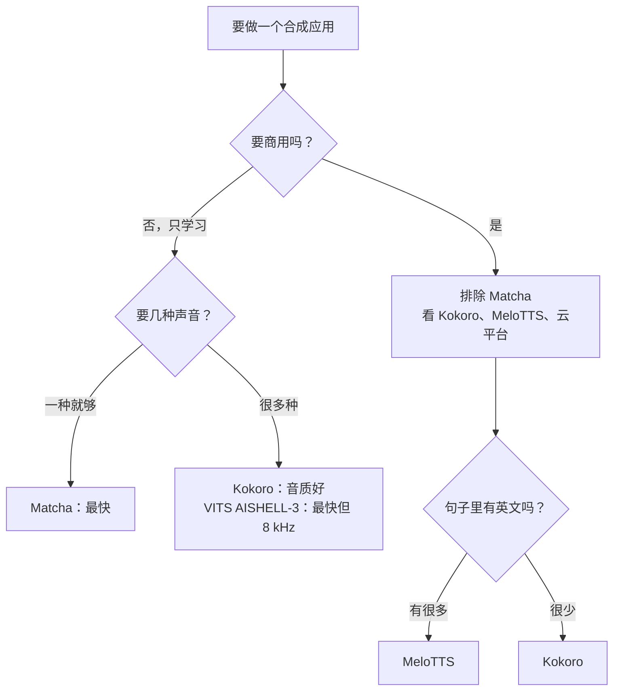
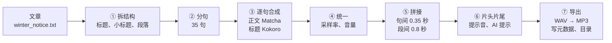
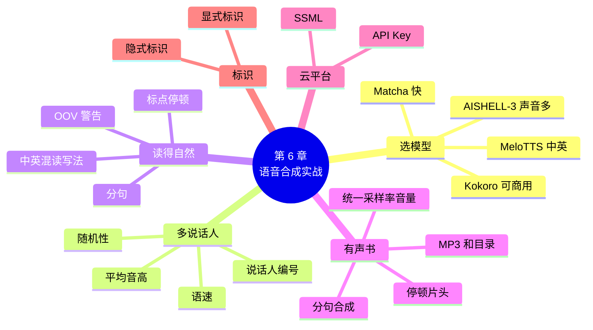

# 第 6 章 语音合成实战：多音色与有声书

!!! abstract "本章学时"
    理论 4 学时（其中线下 2 学时）· 实验 4 学时（本章共 4 个实验，教师可任选）

## 学习目标

学完本章，你应该能够：

1. **说出**本书四个中文合成模型（Matcha、VITS AISHELL-3、MeloTTS、Kokoro）的特点，按需求选出合适的模型（记忆、评价）；
2. **解释**多说话人合成中说话人编号和语速两个参数的作用，能用时长和平均音高验证（理解、应用）；
3. **运用**标点、分句、句间停顿和改写英文写法，让合成读得更自然（应用）；
4. **实现**一条有声书流水线：分句、批量合成、统一音量、加停顿和片头、导出 MP3 和目录（应用）；
5. **读懂**简单的 SSML，说出云平台合成和本地模型各自的优缺点（理解、分析）；
6. **说出**《人工智能生成合成内容标识办法》对音频的显式标识和隐式标识要求，并在自己的作品里加上标识（理解、应用）。

!!! info "先修要求"
    学习本章前，你需要：

    - 学完第 5 章，知道文本前端、声学模型、声码器各做什么，会用回识别字错率和实时率评价合成；
    - 学完第 2 章，知道采样率、语谱图、基频（音高）是什么，会用 `librosa` 重采样；
    - 会用 Python 读文本文件、写循环和列表（《Python 编程》）。

??? abstract "本章概念清单（8 个，点击查看定义和例子）"
    1. [多说话人合成](../../appendix/glossary.md#g-多说话人合成)
    2. [说话人编号](../../appendix/glossary.md#g-说话人编号)
    3. [语速](../../appendix/glossary.md#g-语速)
    4. [中英混读](../../appendix/glossary.md#g-中英混读)
    5. [有声书](../../appendix/glossary.md#g-有声书)
    6. [SSML](../../appendix/glossary.md#g-SSML)
    7. [显式标识](../../appendix/glossary.md#g-显式标识)
    8. [隐式标识](../../appendix/glossary.md#g-隐式标识)

## 情景导入

上一章小周弄清了合成的原理，社区书记马上布置了新任务：

> 冬天到了，居委会、物业和卫生服务站写了一份 1500 字的《冬季安全与便民服务告居民书》。很多老人不看业主群里的长文字，你能不能把它做成一段“广播”，发到群里大家点开就能听？最好男声女声都有，别像机器人念经；里面有“Wi-Fi”“App”这些英文，也要读对。

小周算了一下：1500 字，正常语速大约要读 5 分钟。如果自己录，一遍读错就要重来；用合成模型，改一个字只要重新合成一句。但问题也不少：用哪个模型？怎么换男声女声？长文章一口气塞给模型，停顿会不会乱？英文怎么办？做好以后，居民怎么知道这是机器读的？

本章就来完成这个任务。学完以后，你会得到一个约 5 分半钟、带片头提示音、AI 提示语、分节目录的 MP3 有声书。

## 6.1 四个中文合成模型怎么选

本书用 sherpa-onnx 运行四个可以离线使用的合成模型。下面的数据是编者在笔记本电脑 CPU 上实测的（实时率来自实验 5-4 和实验 6-2）：

| 模型 | 声音 | 语言 | 输出采样率 | 模型大小 | 实时率（越小越快） | 许可 | 适合做什么 |
|---|---|---|---|---|---|---|---|
| Matcha 中文 | 1 种女声 | 中文 | 22050 Hz | 约 125 MB | 约 0.06 | 代码 MIT；训练数据只允许非商业使用 | 学习、快速出声、长文章 |
| VITS AISHELL-3 | 174 种 | 中文 | 8000 Hz | 约 30 MB | 约 0.06 | Apache-2.0 | 体验多音色，对音质要求不高的场合 |
| MeloTTS 中英 | 1 种女声 | 中文、英文 | 44100 Hz | 约 175 MB | 约 0.4 | MIT | 中英混读 |
| Kokoro（v1.1 中文版） | 103 种（中文女声 55、男声 45，英文 3） | 中文为主，能读部分英文 | 24000 Hz | 约 140 MB | 约 1.3 | Apache-2.0 | 多音色、可商用、提前生成的广播 |

几点说明：

- **没有哪个模型样样最好。** Matcha 最快但只有一种声音，而且只能用于学习研究（第 5 章讲过训练数据的许可）；VITS AISHELL-3 声音最多，但只输出 8000 Hz，按第 2 章的[采样定理](../02-audio/index.md#221)，4000 Hz 以上的声音全部丢失，听起来像打电话；Kokoro 声音好、能商用，但在普通笔记本上比说话还慢。
- **实时率大于 1 不等于不能用。** 有声书、广播这类“提前做好再播放”的场合，慢一点没关系；只有实时对话（第 9 章）才要求实时率远小于 1。
- **模型更新很快。** 本书写作时（2026 年 11 月），这几个模型在 sherpa-onnx 里都有现成的转换版本<sup class="cite">[[1]](#ref6-1)</sup>，下载方法见附录 B。

选模型可以按下面三个问题来想：要不要商用？要几种声音？要不要实时？



## 6.2 一个模型，多种声音 { #62 }

### 6.2.1 说话人编号

Matcha 只用一个人的录音训练，所以只会一种声音。如果用很多人的录音训练一个模型，并且训练时告诉模型“这段录音是第几号人说的”，模型就能学会每个人的嗓音特点。合成时，我们给它一个编号，它就用这个人的声音说话。这就是[**多说话人合成**](../../appendix/glossary.md#g-多说话人合成 "用很多人的录音训练一个合成模型，用说话人编号选择用谁的声音说话"){ .term }，那个编号叫[**说话人编号**](../../appendix/glossary.md#g-说话人编号 "多说话人合成模型里代表某一种声音的整数，换编号就换声音"){ .term }（sid）。

打个比方：多说话人模型像一位会模仿 174 个人的配音演员，说话人编号就是你递给他的“角色卡”。角色卡上写的不是文字，而是一串数字（第 7 章会看到，这串数字叫声纹向量），记录了这个人嗓音的特点。

本书的两个多说话人模型：

- **VITS AISHELL-3**：用 AISHELL-3 数据集训练。这个数据集有 218 位说话人、约 85 小时的中文录音<sup class="cite">[[2]](#ref6-2)</sup>，模型用了其中 174 位，编号 0—173。编号和男女没有固定关系，要听一听，或者像实验 6-1 那样测一测平均音高。
- **Kokoro v1.1 中文版**：103 个音色。0—2 号是英文音色，3—57 号是中文女声，58—102 号是中文男声<sup class="cite">[[1]](#ref6-1)</sup><sup class="cite">[[3]](#ref6-3)</sup>。第 2 章以来的“居民”“志愿者”声音都是用它生成的。

在代码里换声音，只要改 `sid`：

```python
audio, sr = speak("欢迎大家参加消防演练。", model="kokoro", sid=20)   # 20 号：中文女声
audio, sr = speak("欢迎大家参加消防演练。", model="kokoro", sid=65)   # 65 号：中文男声
```

**怎样不靠耳朵判断男声女声？** 第 2 章讲过，[基频](../../appendix/glossary.md#g-基频)就是音高。成年女性说话的平均基频一般在 180—300 Hz，男性一般在 90—160 Hz。实验 6-1 用 `librosa.pyin` 估计平均音高，编者实测：AISHELL-3 的 10 号、100 号约 130—140 Hz（男声），其他几个都在 210—250 Hz（女声）；Kokoro 的 20 号、45 号是 255 Hz、220 Hz，65 号、85 号是 154 Hz、171 Hz。

### 6.2.2 语速

`speed` 参数控制[**语速**](../../appendix/glossary.md#g-语速 "说话的快慢；合成模型里通常用一个倍数控制，1.0 是正常速度"){ .term }，1.0 是正常速度，大于 1 变快，小于 1 变慢。它改变的是声学模型预测的“每个音持续多少帧”，所以只改快慢，不改音调。实验 6-1 里 10 号说话人的结果：

| 语速 | 0.8 | 1.0 | 1.2 | 1.5 |
|---|---|---|---|---|
| 时长（秒） | 8.11 | 6.85 | 6.36 | 5.26 |
| 平均音高（Hz） | 135 | 135 | 136 | 135 |

平均音高基本不变，时长随语速变化。但时长并不是严格按倍数变化：语速 1.5 时，时长是正常的 77%，而不是 67%（1 ÷ 1.5）。这是因为句子里的停顿、模型内部的取整等不完全受语速控制。

!!! tip "给老年人播报，语速选多少？"
    语速太快，老年人听不清；太慢，又显得拖沓。社区广播可以先用 0.9 左右试听，再请几位老人听一听，就像第 5 章的 MOS 打分一样。下面的动画“音色与语速调台”，可以直接比较 6 种声音、3 种语速。

<iframe class="sim-frame" src="../../sims/voice-speed/main.html" height="600" loading="lazy" title="音色与语速调台"></iframe>
动画：音色与语速调台。选一种声音和语速播放，看时长和平均音高的变化。[全屏打开](../../sims/voice-speed/main.html){ target=_blank }
{ .sim-caption }

### 6.2.3 每次合成都不太一样

细心的同学会发现：同一个说话人、同样的语速，运行两次，时长不一样。编者用 AISHELL-3 的 10 号说话人连续合成三次同一句话，时长分别是 7.29 秒、7.43 秒、6.82 秒。

原因是 VITS 这一类模型在生成时故意加入了一点随机性（第 5 章讲 Matcha 时也提到过“噪声”参数），这样每次读出来的节奏有些变化，听起来更像真人。代价是结果不能完全重复。做有声书时，如果某句读得不满意，可以只重新合成这一句，再听一遍。

## 6.3 用 sherpa-onnx 合成：三步 { #63 }

本书的 `voicelab.speak()` 把合成包装成了一行。打开 `labs/voicelab.py` 可以看到，里面其实只有三步：

```python
import sherpa_onnx as so

# 第 1 步：建合成器（告诉它模型文件在哪）—— 很慢，只做一次
config = so.OfflineTtsConfig(model=so.OfflineTtsModelConfig(
    kokoro=so.OfflineTtsKokoroModelConfig(model="model.int8.onnx", voices="voices.bin",
                                          tokens="tokens.txt", ...)))     # 省略号处是词典等文件
tts = so.OfflineTts(config)

# 第 2 步：生成（sid 选声音，speed 调语速）—— 每句话做一次
audio = tts.generate("欢迎大家参加消防演练。", sid=20, speed=1.0)

# 第 3 步：保存（audio.samples 是采样点，audio.sample_rate 是采样率）
import soundfile as sf
sf.write("hello.wav", audio.samples, audio.sample_rate)
```

要点：

1. **建合成器很慢，生成很快。** 建合成器要把上百 MB 的模型读进内存，可能要几秒。所以 `voicelab` 用 `lru_cache` 把建好的合成器“记住”，第二次调用直接用。自己写程序时，也要把第 1 步放在循环外面。
2. **不同模型的配置类不同。** Matcha 用 `OfflineTtsMatchaModelConfig`，VITS 和 MeloTTS 用 `OfflineTtsVitsModelConfig`，Kokoro 用 `OfflineTtsKokoroModelConfig`。每个模型下载包里的 `README` 写了需要哪些文件。
3. **采样率跟着模型走。** 保存时一定用 `audio.sample_rate`，不要自己写一个数。把两个模型的声音拼在一起之前，要先[重采样](../../appendix/glossary.md#g-重采样)成同一个采样率（实验 6-3）。

## 6.4 读得更自然

同样的模型，文字怎么写，读出来的效果差别很大。下面几条是编者做实验时总结的经验。

### 6.4.1 标点就是停顿

合成模型主要靠标点决定停顿：逗号停得短，句号停得长，没有标点就一口气读下去。所以：

- 长句子要加逗号。“请大家在下周六上午九点到中心广场参加消防演练并带上孩子”读起来很累，改成“请大家在下周六上午九点，到中心广场参加消防演练，可以带上孩子”就自然了。
- 顿号、括号、破折号等标点，不同模型处理不一样，必要时改成逗号。
- 想要更长的停顿，不要连写几个句号，而是在拼接时插入静音（6.5 节）。

### 6.4.2 长文本要先分句

sherpa-onnx 可以一次合成很长的文字，但长文本一次合成有三个问题：一句读坏就要整段重来；看不到进度；模型对特别长的输入，节奏容易变差。做法是先按句号、问号、感叹号、分号切成句子，逐句合成，再拼起来。

```python
import re
paragraph = "冬天到了，天气越来越冷。请大家注意防火！有问题吗？"
sentences = [s for s in re.split(r"(?<=[。！？；])", paragraph) if s.strip()]
print(sentences)       # ['冬天到了，天气越来越冷。', '请大家注意防火！', '有问题吗？']
```

`(?<=[。！？；])` 的意思是“在这几个标点的后面切开”，这样标点留在句子末尾，模型还能根据它决定语调（问号结尾会读出疑问的语气）。

### 6.4.3 数字、生僻字和英文

- **数字**：本书的模型都带有文本正则化规则（第 5 章的 FST 文件），“9点”“15日”一般能读对；电话、门牌这类要逐位读的，最好直接写成汉字，或者在数字之间加空格。
- **词典里没有的字**：实验 6-3 中，Matcha 运行时打印了一行警告 `OOV character skipped: '〇'`，意思是“〇”这个字不在它的词典里（OOV 是 out of vocabulary，“词表外”），直接被跳过了，“二〇二六年”就读成了“二二六年”。看到这种警告，要把字换成模型认识的写法（“零”）。**合成时的警告要认真看。**
- **英文**：见下一节。

### 6.4.4 中英混读

社区通知里常有“Wi-Fi”“App”“AI”这样的英文。一句话里中英文都能读对，叫[**中英混读**](../../appendix/glossary.md#g-中英混读 "一句话里既有中文又有英文时，两种语言都能读对的合成能力"){ .term }。实验 6-2 用三个模型合成了四句中英混合的话，再用 SenseVoice 回识别（SenseVoice 能识别英文）：

| 原文 | Matcha | MeloTTS | Kokoro |
|---|---|---|---|
| 请在WiFi设置里选择Community-5G | 请在设置里选择5 | 请在WfiI设置里选择community5G | 请在设这里选择可名的礼G |
| 下载社区App以后 | 下载社区以后 | 但在社区IP以后 | 下载社区阿痞后 |
| 我们的AI助手支持中文和English | 我们的助手支持中文和两种语言 | 我们的爱助手支持中文和英贵是两种语言 | 我们的A爱数手支持中文和english |

可以看出：

1. **Matcha 完全不读英文**，直接跳过，只适合纯中文。
2. **MeloTTS 能读出大部分英文**，但“App”“AI”这样的大写缩写读得不准。
3. **Kokoro 中文版的英文能力有限**，但对写法很敏感。

同一个模型，换一种写法，效果就不一样。实验 6-2 第 2 步把英文改写了一下：

| 改写后的写法 | Kokoro 回识别 |
|---|---|
| 请在**Wi-Fi**设置里选择**Community 5 G** | 请在wifi设置里选择community5G ✓ |
| 下载社区**A P P**以后 | 下载社区APP以后 ✓ |
| 我们的**A I**助手 | 我们的id住手 ✗ |

经验是：**常见单词按标准写法写**（Wi-Fi 加连字符）；**要逐个字母读的缩写，字母之间加空格**；**字母和数字之间加空格**。改完一定要听一遍，也可以用回识别检查。实在读不好的，换成中文说法（“无线网络”“手机应用”“人工智能助手”），对老年听众反而更友好。

## 6.5 有声书流水线

把一篇长文章做成可以连续收听的音频，就是[**有声书**](../../appendix/glossary.md#g-有声书 "把一篇较长的文字朗读成可以连续收听的音频作品，通常带片头、章节和停顿"){ .term }。社区的告居民书有 1469 个字，分成标题、5 个部分和结束语。流水线是这样的：



每一步要注意的地方：

- **① 拆结构**：文章里用 `#` 标标题、`##` 标小标题（和本书网页的写法一样），程序一看就知道哪行是标题。
- **③ 两种声音**：正文用 Matcha（快），标题和提示语用 Kokoro 的男声，听的人能分出层次。Kokoro 慢，但标题只有 7 句，不影响总时间。
- **④ 统一**：Matcha 输出 22050 Hz，Kokoro 输出 24000 Hz，拼接前都[重采样](../../appendix/glossary.md#g-重采样)到 24000 Hz。两个模型的音量也不一样，要按第 2 章的[音量归一化](../../appendix/glossary.md#g-音量归一化)方法，把每句话调到差不多的响度，否则听的人要不停地调音量。
- **⑤ 停顿**：句与句之间 0.35 秒、段与段之间 0.8 秒、标题后 1 秒。停顿用全是 0 的数组（静音）表示，`np.zeros(int(秒数 * 采样率))`。
- **⑥ 片头片尾**：片头先响三声提示音（用 numpy 生成的 do、mi、sol，没有版权问题），再说“本音频由人工智能语音合成”，然后读标题。片尾再响一次提示音。
- **⑦ 导出**：WAV 是无损的，5 分半钟约 15 MB；转成 64 kbps 的 MP3 只有 2.5 MB，适合发到业主群（第 2 章算过文件大小）。转换用 ffmpeg，同时把标题、作者和“AI生成”说明写进 MP3 的**元数据**（文件里描述文件本身的信息）。另外生成一份目录，写上每个部分从第几分第几秒开始。

编者实测：35 句话合成用时 47 秒，得到 5 分 28 秒的有声书，实时率 0.14。如果正文也用 Kokoro，按实时率 1.3 估算，要七八分钟才能做完。

!!! warning "做出来以后，一定要从头到尾听一遍"
    回识别检查可以帮你找到明显读错的地方，但停顿是否自然、音量是否忽大忽小、有没有怪声，只有耳朵能发现。编者第一次做时，用 Kokoro 65 号音色读“本音频由人工智能语音合成”，回识别成了“但音频由人攻制，能语音合成”，换成 58 号音色才清楚。AI 提示语是给居民看的“说明书”，必须让人一听就懂。

## 6.6 云平台语音合成与 SSML { #66 }

### 6.6.1 云平台合成

除了在自己电脑上运行开源模型，还可以调用云平台的合成服务。国内主要有讯飞开放平台、阿里云百炼（CosyVoice 系列）、火山引擎（豆包语音）、百度智能云等。流程大致相同：

1. 注册账号，实名认证，开通语音合成服务；
2. 在控制台创建 **API Key**（相当于调用服务的“钥匙”），**不要把它写进代码或发给别人**，放在环境变量里；
3. 安装平台的 Python 工具包，按文档调用：传入文字、模型名、音色名，得到 MP3 或 WAV。

| 对比 | 本地开源模型 | 云平台 |
|---|---|---|
| 音质和音色 | 够用，音色有限 | 一般更好，音色多，有情感、方言 |
| 费用 | 免费 | 按字数收费，通常有免费额度 |
| 网络 | 不需要 | 必须联网 |
| 隐私 | 文字不出电脑 | 文字要发到服务商 |
| 稳定性 | 自己掌控 | 接口、音色名会更新，要跟着改代码 |

实验 6-4 给出了用阿里云百炼 CosyVoice 合成的示例代码<sup class="cite">[[4]](#ref6-4)</sup>。编者的写作环境无法访问这些服务，代码按官方文档编写，**待实测**。附录 A 汇总了几家平台的调用方法。

### 6.6.2 SSML：给合成服务写“导演说明” { #662 }

[**SSML**](../../appendix/glossary.md#g-SSML "语音合成标记语言，用类似网页标签的写法告诉合成服务在哪停顿、怎么读、读多快"){ .term }（语音合成标记语言）是 W3C 制定的标准<sup class="cite">[[5]](#ref6-5)</sup>，写法和网页的 HTML 很像：用尖括号标签把文字包起来，告诉合成服务怎么读。常用的几个标签：

| 标签 | 作用 | 例子 |
|---|---|---|
| `<speak>` | 最外层，所有内容都写在里面；有的平台在这里设置语速、音量 | `<speak rate="1.1">……</speak>` |
| `<break>` | 停顿 | `<break time="500ms"/>`（停半秒） |
| `<phoneme>` | 指定读音，中文用拼音加声调数字 | `<phoneme alphabet="py" ph="yin2 hang2">银行</phoneme>` |
| `<say-as>` | 指定按什么方式读 | `<say-as interpret-as="telephone">12345</say-as>`（按电话号码读） |

例如：

```xml
<speak rate="1.1">
  各位居民请注意，<break time="500ms"/>
  请到<phoneme alphabet="py" ph="yin2 hang2">银行</phoneme>门口集合，
  咨询电话<say-as interpret-as="telephone">12345</say-as>。
</speak>
```

SSML 解决的正是第 5 章文本前端的那些问题：停顿（韵律）、多音字、数字读法。区别是：第 5 章我们自己写规则，SSML 是告诉别人的系统怎么读。

!!! note "每家平台支持的标签不一样"
    W3C 的 SSML 标准有很多标签，但每家云平台只支持其中一部分，还会加自己的扩展。例如阿里云 CosyVoice 的语速写在 `<speak>` 的 `rate` 属性里，而且只有部分音色支持 SSML<sup class="cite">[[6]](#ref6-6)</sup>。用之前一定要看平台的说明文档。本书的本地模型不支持 SSML，停顿用 6.5 节的拼接静音方法实现。

## 6.7 合成的声音也要标识

小周把有声书发到群里之前，书记提醒了一句：“这是机器读的，要让大家知道。”

这不只是礼貌，而是法规要求。2025 年 3 月，国家互联网信息办公室、工业和信息化部、公安部、国家广播电视总局联合印发《人工智能生成合成内容标识办法》，**2025 年 9 月 1 日起施行**<sup class="cite">[[7]](#ref6-7)</sup>；配套的强制性国家标准 GB 45438—2025《网络安全技术 人工智能生成合成内容标识方法》同日实施<sup class="cite">[[8]](#ref6-8)</sup>。办法把标识分成两种：

- [**显式标识**](../../appendix/glossary.md#g-显式标识 "在生成合成的内容里用人能直接看到或听到的方式标明“由人工智能生成”，如音频开头的语音提示"){ .term }：人能直接看到或听到的标识。对音频，办法第四条要求“在音频的起始、末尾或者中间适当位置添加语音提示或者音频节奏提示等标识，或者在交互场景界面中添加显著的提示标识”。
- [**隐式标识**](../../appendix/glossary.md#g-隐式标识 "写在文件元数据等处、人不容易直接感知但机器能读出的“人工智能生成”标记"){ .term }：写在文件**元数据**里，人不容易直接感知、但机器能读出来的标识。办法第五条要求服务提供者在文件元数据中添加隐式标识，包含“生成合成内容属性信息、服务提供者名称或者编码、内容编号等制作要素信息”。

实验 6-3 的有声书两种都做了：

| 标识 | 怎么做的 | 怎么检查 |
|---|---|---|
| 显式 | 片头提示音之后，用语音说“本音频由人工智能语音合成” | 播放听开头 |
| 隐式 | MP3 的注释字段写“AI生成：本音频由人工智能语音合成（Matcha-TTS、Kokoro）” | 运行 `ffprobe winter_notice.mp3`，或在电脑上看文件属性 |

说明两点：

1. 办法主要约束的是提供生成合成服务和传播服务的平台。我们自己做有声书，用的是本地模型，严格说不是“服务提供者”，但办法第十条也要求用户发布生成合成内容时主动声明并使用标识功能。给作品加上标识，是负责任的做法，也能避免居民误以为是真人录音。
2. 实验里的隐式标识只是简化版。国家标准规定了元数据的具体格式，正式的产品要按标准实现。

合成和克隆的法律问题，第 8 章还会详细讲。

## 6.8 前沿视窗

**一次生成整期播客**。本章的有声书是“一句一句合成再拼起来”，每句话之间的语气并不连贯，也没有两个人对话的感觉。2025 年 8 月，微软发布 VibeVoice，用大语言模型理解整篇对话稿，一次就能生成最长约 90 分钟、最多 4 个人轮流说话的播客式音频，语气、停顿、接话都更像真人<sup class="cite">[[9]](#ref6-9)</sup>。这类“长篇、多角色”合成正在改变有声书和播客的制作方式。

**更强也意味着更要守规矩**。合成越来越像真人，听众越难分辨。也正因为这样，各国都在推动给 AI 生成内容加标识。我国的标识办法从 2025 年 9 月起施行，要求音频加语音提示、文件写元数据；很多平台也在开发“听不出来但检测得到”的音频水印。做声音作品的人，要养成“作品出门先加标识”的习惯。

## 本章实验

!!! abstract "实验总览"
    | 实验 | 类型 | 建议时长 | 内容 |
    |---|---|---|---|
    | 实验 6-1 | ★ 基础 | 45 分钟 | 用 VITS AISHELL-3 和 Kokoro 换 12 种声音、4 种语速，测时长和平均音高 |
    | 实验 6-2 | ★ 基础 | 45 分钟 | 三个模型合成中英混读句子，回识别比较，改写英文再试 |
    | 实验 6-3 | ★ 基础 | 45 分钟 | 把 1500 字的告居民书做成带片头、目录和 AI 标识的 MP3 有声书 |
    | 实验 6-4 | ☆ 拓展 | 45 分钟 | 用云平台合成同一段文字，试一试 SSML（需注册账号、联网，待实测） |

    代码见配套资源 `labs/ch06/` 目录。运行前在 `labs` 文件夹里执行 `python models.py ch06` 下载本章模型；实验 6-3 需要 ffmpeg（安装方法见附录 B）。

### 实验 6-1 ★ 一个模型多种声音

**实验目的**

1. 会用说话人编号切换声音，用语速参数调节快慢；
2. 会用平均音高判断男声、女声，用时长验证语速；
3. 能为社区广播挑出合适的音色和语速。

**实验环境**：本机 CPU 或云端 Notebook。**实验数据**：一条社区通知（写在代码里）。模型 `vits-aishell3`、`kokoro`。

**实验步骤与代码**

运行 `lab6_1_voices.py`。`pitch` 函数用 `librosa.pyin` 估计每一帧的基频，再对“有声音”的帧取平均：

```python
import sys

import librosa
import numpy as np

sys.path.append("..")
from voicelab import save_audio, speak

text = "各位居民请注意，下周六上午九点，社区在中心广场组织消防演练，欢迎大家参加。"   # ← 改这里


def pitch(audio, sr):
    """平均音高（基频，Hz）：女声一般在 180—300，男声一般在 90—160"""
    f0, voiced, _ = librosa.pyin(audio, fmin=60, fmax=500, sr=sr)
    return np.nanmean(f0[voiced])


print("== 第 1 步：VITS AISHELL-3，同一句话换 8 个说话人 ==")
for sid in [0, 10, 30, 50, 70, 100, 130, 160]:              # ← 改这里：0—173 任选
    audio, sr = speak(text, model="vits-aishell3", sid=sid)
    save_audio(f"aishell3_{sid}.wav", audio, sr)
    print(f"说话人 {sid:>3}  时长 {len(audio) / sr:5.2f} 秒  平均音高 {pitch(audio, sr):5.0f} Hz  采样率 {sr}")

print("\n== 第 2 步：调语速（第 10 号说话人）==")
for speed in [0.8, 1.0, 1.2, 1.5]:                          # ← 改这里
    audio, sr = speak(text, model="vits-aishell3", sid=10, speed=speed)
    save_audio(f"speed_{speed}.wav", audio, sr)
    print(f"语速 {speed}  时长 {len(audio) / sr:5.2f} 秒  平均音高 {pitch(audio, sr):5.0f} Hz")

print("\n== 第 3 步：Kokoro 的中文音色（3—57 女声，58—102 男声）==")
for sid in [20, 45, 65, 85]:
    audio, sr = speak(text, model="kokoro", sid=sid)
    save_audio(f"kokoro_{sid}.wav", audio, sr)
    print(f"音色 {sid:>3}  时长 {len(audio) / sr:5.2f} 秒  平均音高 {pitch(audio, sr):5.0f} Hz  采样率 {sr}")
```

**运行结果**（编者运行，全程约 1 分钟）

```text
== 第 1 步：VITS AISHELL-3，同一句话换 8 个说话人 ==
说话人   0  时长 10.28 秒  平均音高   248 Hz  采样率 8000
说话人  10  时长  7.34 秒  平均音高   131 Hz  采样率 8000
说话人  30  时长  7.83 秒  平均音高   211 Hz  采样率 8000
说话人  50  时长  7.56 秒  平均音高   249 Hz  采样率 8000
说话人  70  时长  7.85 秒  平均音高   244 Hz  采样率 8000
说话人 100  时长  6.32 秒  平均音高   139 Hz  采样率 8000
说话人 130  时长  7.24 秒  平均音高   245 Hz  采样率 8000
说话人 160  时长  8.04 秒  平均音高   228 Hz  采样率 8000
== 第 2 步：调语速（第 10 号说话人）==
语速 0.8  时长  8.11 秒  平均音高   135 Hz
语速 1.0  时长  6.85 秒  平均音高   135 Hz
语速 1.2  时长  6.36 秒  平均音高   136 Hz
语速 1.5  时长  5.26 秒  平均音高   135 Hz
== 第 3 步：Kokoro 的中文音色（3—57 女声，58—102 男声）==
音色  20  时长  9.18 秒  平均音高   255 Hz  采样率 24000
音色  45  时长 10.36 秒  平均音高   220 Hz  采样率 24000
音色  65  时长  9.52 秒  平均音高   154 Hz  采样率 24000
音色  85  时长 10.21 秒  平均音高   171 Hz  采样率 24000
```

读结果：

- AISHELL-3 的 10 号、100 号平均音高约 130—140 Hz，是男声；其余 6 个都在 210—250 Hz，是女声。0 号的时长比别人长 3 秒左右，听一听会发现它读得特别慢。
- 采样率都是 8000 Hz。打开 `aishell3_10.wav` 和 `kokoro_65.wav` 对比，前者明显发闷，像电话声音。
- 语速从 0.8 到 1.5，时长从 8.11 秒降到 5.26 秒，平均音高始终在 135 Hz 左右。
- 你运行的结果和上面会有零点几秒的差别，这是 6.2.3 节讲的随机性，属于正常现象。

**改一改**

1. 把第 1 步的编号换成另外 8 个数（0—173），找出至少 2 个男声。
2. 把第 3 步换成 Kokoro 的 5、30、60、100 号，测平均音高，验证“3—57 女声、58—102 男声”的说法。

**实验记录表**

| 模型 | 编号 | 语速 | 时长（秒） | 平均音高（Hz） | 男 / 女 | 听感（1—5 分） |
|---|---|---|---|---|---|---|
| | | | | | | |
| | | | | | | |
| | | | | | | |

**常见问题排查**

| 现象 | 原因 | 解决办法 |
|---|---|---|
| `FileNotFoundError: 模型 vits-aishell3 还没下载` | 模型没下载 | `python models.py vits-aishell3 kokoro` |
| `RuntimeError` 提示 sid 超出范围 | 编号超过了模型的说话人数 | AISHELL-3 用 0—173，Kokoro 用 0—102 |
| 平均音高显示 `nan` | 句子太短或全是静音，没有检测到有声音的帧 | 换一句长一点的话；检查是否合成成功 |
| 运行很慢 | Kokoro 实时率大于 1，`pyin` 也比较慢 | 正常，耐心等待；或者减少编号个数 |

**思考与练习**

1. 为什么不能只看说话人编号就判断男女？
2. 第 2 步中，语速 1.5 的时长为什么不是语速 1.0 的 1/1.5？

**实验报告要求**

提交记录表，并为“老年人冬季安全提醒”挑一个音色和语速，说明理由（至少用到一个客观数据）。

### 实验 6-2 ★ 中英混读

**实验目的**

1. 会比较不同模型的中英混读能力；
2. 会用回识别快速检查英文是否读出；
3. 会通过改写英文写法提高合成效果。

**实验环境**：本机 CPU 或云端 Notebook。**实验数据**：4 句中英混合的社区通知（写在代码里）。模型 `matcha-zh`、`melo-zh-en`、`kokoro`、`sensevoice`。

**实验步骤与代码**

运行 `lab6_2_mixed.py`。第 1 步三个模型各合成 4 句，保存为 `mixed_模型_序号.wav`，并回识别；第 2 步把英文换一种写法，用 MeloTTS 和 Kokoro 再试：

```python
import sys
import time

sys.path.append("..")
from voicelab import save_audio, speak, transcribe

sentences = [                                                        # ← 改这里：换成你自己的句子
    "请在WiFi设置里选择Community-5G，密码写在服务站门口。",
    "下载社区App以后，扫一扫二维码就能预约。",
    "今天的线上会议用Zoom开，晚上八点准时开始。",
    "我们的AI助手支持中文和English两种语言。",
]
models = [("matcha-zh", 0), ("melo-zh-en", 0), ("kokoro", 45)]      # (模型, 说话人编号)

for model, sid in models:
    speak("预热", model=model, sid=sid)                             # 先加载模型，不计时间
    print(f"========== {model} ==========")
    for k, text in enumerate(sentences, 1):
        start = time.time()
        audio, sr = speak(text, model=model, sid=sid)
        used = time.time() - start
        save_audio(f"mixed_{model}_{k}.wav", audio, sr)
        print(f"第 {k} 句  时长 {len(audio) / sr:4.1f} 秒  实时率 {used / (len(audio) / sr):.2f}  听写：{transcribe(audio, sr)}")

print("========== 改写文字再试 ==========")
rewritten = [                                       # 英文单词换一种写法：加连字符、字母和数字之间加空格
    "请在Wi-Fi设置里选择Community 5 G，密码写在服务站门口。",
    "下载社区A P P以后，扫一扫二维码就能预约。",
    "我们的A I助手支持中文和English两种语言。",
]
for model, sid in models[1:]:
    for text in rewritten:
        audio, sr = speak(text, model=model, sid=sid)
        print(f"{model:<10}  {text}  →  听写：{transcribe(audio, sr)}")
```

**运行结果**（编者运行）

```text
========== matcha-zh ==========
第 1 句  时长  4.0 秒  实时率 0.07  听写：请在设置里选择5密码写在服务站门口。
第 2 句  时长  3.9 秒  实时率 0.06  听写：下载社区以后，扫一扫二维码就能预约。
第 3 句  时长  3.6 秒  实时率 0.07  听写：今天的线上会议涌开，晚上8点准时开始。
第 4 句  时长  2.9 秒  实时率 0.06  听写：我们的助手支持中文和两种语言。
========== melo-zh-en ==========
第 1 句  时长  5.4 秒  实时率 0.43  听写：请在WfiI设置里选择community5G立码写在服务站门口。
第 2 句  时长  3.2 秒  实时率 0.41  听写：但在社区IP以后，扫一扫二维码就能预约。
第 3 句  时长  3.9 秒  实时率 0.39  听写：今天的线上会议重开，晚上8点准时开始。
第 4 句  时长  3.1 秒  实时率 0.42  听写：我们的爱助手支持中文和英贵是两种语言。
========== kokoro ==========
第 1 句  时长  5.5 秒  实时率 1.38  听写：请在设这里选择可名的礼G密码写在服务站门口。
第 2 句  时长  4.8 秒  实时率 1.49  听写：下载社区阿痞后，扫一扫二维码就能预约。
第 3 句  时长  5.0 秒  实时率 1.38  听写：今天的线上会议用松开，晚上8点准时开始。
第 4 句  时长  4.3 秒  实时率 1.17  听写：我们的A爱数手支持中文和english两种语言。
========== 改写文字再试 ==========
melo-zh-en  请在Wi-Fi设置里选择Community 5 G，密码写在服务站门口。  →  听写：请在WFI设置里选择community5G立码写在服务站门口。
melo-zh-en  下载社区A P P以后，扫一扫二维码就能预约。  →  听写：而在社区PP以后，扫一扫二维码就能预约。
melo-zh-en  我们的A I助手支持中文和English两种语言。  →  听写：我们的爱助手支持中文和英lish是两中语言。
kokoro      请在Wi-Fi设置里选择Community 5 G，密码写在服务站门口。  →  听写：请在wifi设置里选择community5G密码写在服务站门口。
kokoro      下载社区A P P以后，扫一扫二维码就能预约。  →  听写：下载社区APP以后，扫一扫二维码就能预约。
kokoro      我们的A I助手支持中文和English两种语言。  →  听写：我们的id住手支持中文和english两种语言。
```

读结果：6.4.4 节已经分析过。补充两点：

- MeloTTS 把句首的“下载”回识别成“但在”“那在”，打开 `mixed_melo-zh-en_2.wav` 听一听，判断是合成读错了还是识别听错了。**回识别只是辅助，最终要靠耳朵。**
- 实时率：Matcha 约 0.06，MeloTTS 约 0.4，Kokoro 约 1.2—1.5。

**改一改**

1. 写 3 句你生活中常见的中英混合句子（如“请扫码关注公众号，回复 VIP 领取优惠券”），用三个模型合成并回识别。
2. 对 Kokoro 读不好的句子，尝试至少两种改写方法，记录哪种有效。

**实验记录表**

| 句子 | 模型 | 回识别结果 | 英文读对了吗 | 改写方法 | 改写后读对了吗 |
|---|---|---|---|---|---|
| | | | | | |
| | | | | | |

**常见问题排查**

| 现象 | 原因 | 解决办法 |
|---|---|---|
| Matcha 合成的声音里英文全没了 | Matcha 词典里没有英文 | 换 MeloTTS 或 Kokoro，或把英文改成中文 |
| 回识别结果里英文全是大写或小写 | 识别模型输出的写法不同 | 比较时忽略大小写和空格 |
| 第 2 步结果和编者不完全一样 | 模型有随机性，识别也可能出错 | 正常，多听几遍，以耳朵为准 |

**思考与练习**

1. 给老年人播报的通知里，英文是保留好还是换成中文好？为什么？
2. 如果一家公司要做中英双语的地铁报站，你会选哪个模型？还需要考虑什么？

**实验报告要求**

提交记录表，总结你发现的“中英混读写法技巧”至少 3 条。

### 实验 6-3 ★ 社区有声广播

**实验目的**

1. 会把长文章拆成标题、段落和句子，逐句批量合成；
2. 会统一采样率和音量，按需要加句间停顿、片头片尾；
3. 会导出 MP3、写入元数据，给作品加上显式标识和隐式标识。

**实验环境**：本机 CPU 或云端 Notebook，需要 ffmpeg。**实验数据**：`labs/data/texts/winter_notice.txt`，编者编写的《幸福里社区冬季安全与便民服务告居民书》，1469 字。模型 `matcha-zh`、`kokoro`、`sensevoice`。

**实验步骤与代码**

第 1 步，用记事本打开 `winter_notice.txt` 看一看：第一行 `#` 开头的是标题，`##` 开头的是小标题，其余每行是一段。

第 2 步，运行 `lab6_3_audiobook.py`：

```python
import os
import re
import subprocess
import sys
import time

import librosa
import numpy as np
import soundfile as sf

sys.path.append("..")
from voicelab import speak, transcribe

SR = 24000                                              # 整本有声书统一用 24 kHz
BODY = ("matcha-zh", 0, 1.0)                            # 正文：(模型, 说话人, 语速)  ← 改这里
HEAD = ("kokoro", 58, 1.0)                              # 标题和 AI 提示：换一个声音，听得出层次
PAUSE = {"句": 0.35, "段": 0.8, "标题": 1.0}             # 停顿秒数  ← 改这里


def tts(text, voice):
    """合成一句话，统一采样率，并把音量调到差不多大（不同模型的音量不一样）"""
    model, sid, speed = voice
    text = text.replace("〇", "零")                     # Matcha 的词典里没有“〇”，会被跳过（编者运行时看到了警告）
    audio, sr = speak(text, model=model, sid=sid, speed=speed)
    audio = librosa.resample(audio, orig_sr=sr, target_sr=SR)
    return 0.1 * audio / (np.sqrt(np.mean(audio ** 2)) + 1e-9)


def silence(sec):
    return np.zeros(int(sec * SR), np.float32)


def chime():
    """片头提示音：三个渐弱的音（do、mi、sol），用 numpy 生成，没有版权问题"""
    notes = []
    for f in (523, 659, 784):
        t = np.arange(int(0.35 * SR)) / SR
        notes.append(0.25 * np.sin(2 * np.pi * f * t) * np.exp(-t * 6))
    return np.concatenate(notes).astype(np.float32)


def split_sentences(paragraph):
    """按句号、问号、感叹号、分号切句，标点留在句子末尾"""
    return [s for s in re.split(r"(?<=[。！？；])", paragraph) if s.strip()]


# 1. 读文章，分出标题、小标题和段落
lines = [x.strip() for x in open("../data/texts/winter_notice.txt", encoding="utf-8") if x.strip()]
title = lines[0].lstrip("# ")

# 2. 片头：提示音 + AI 合成提示（显式标识）+ 标题
start = time.time()
label = tts("本音频由人工智能语音合成。", HEAD)
print("AI 提示回识别：", transcribe(label, SR))             # 标识必须听得清，先用识别模型检查一遍
parts = [chime(), silence(0.5), label, silence(0.6),
         tts(title, HEAD), silence(PAUSE["标题"])]
chapters, n_sent = [], 0                                # chapters 记下每个小标题从第几秒开始

# 3. 逐段、逐句合成，加上停顿
for line in lines[1:]:
    if line.startswith("## "):
        chapters.append((sum(len(p) for p in parts) / SR, line[3:]))
        parts += [tts(line[3:], HEAD), silence(PAUSE["标题"])]
        continue
    for s in split_sentences(line):
        parts += [tts(s, BODY), silence(PAUSE["句"])]
        n_sent += 1
    parts.append(silence(PAUSE["段"]))
    print(f"已合成 {n_sent} 句，用时 {time.time() - start:.0f} 秒")
parts += [chime(), silence(0.5)]                         # 片尾再响一次提示音
book = np.concatenate(parts)
used = time.time() - start

# 4. 保存 WAV，再用 ffmpeg 转成 MP3；MP3 的“注释”里写上 AI 生成说明（隐式标识）
book = 0.9 * book / np.abs(book).max()                  # 整体归一化，防止削波
sf.write("winter_notice.wav", book, SR, subtype="PCM_16")
subprocess.run(["ffmpeg", "-y", "-loglevel", "error", "-i", "winter_notice.wav", "-b:a", "64k",
                "-metadata", f"title={title}", "-metadata", "artist=幸福里社区居民委员会",
                "-metadata", "comment=AI生成：本音频由人工智能语音合成（Matcha-TTS、Kokoro）",
                "winter_notice.mp3"], check=True)

# 5. 写一份“目录”，方便居民跳到想听的部分
with open("winter_notice_目录.txt", "w", encoding="utf-8") as f:
    for sec, name in chapters:
        f.write(f"{int(sec // 60):02d}:{int(sec % 60):02d}  {name}\n")

dur = len(book) / SR
print(f"\n共 {n_sent} 句，时长 {int(dur // 60)} 分 {dur % 60:.0f} 秒，合成用时 {used:.0f} 秒，实时率 {used / dur:.2f}")
for name in ("winter_notice.wav", "winter_notice.mp3"):
    print(f"{name:<20} {sf.info(name).frames / SR:6.1f} 秒  {os.path.getsize(name) / 1024 / 1024:5.2f} MB")
print(open("winter_notice_目录.txt", encoding="utf-8").read())
```

代码中要注意的几处：

- `tts()` 函数里的 `0.1 * audio / np.sqrt(np.mean(audio ** 2))` 是按[均方根](../02-audio/index.md#263)把每句话调到同样的响度。
- `chapters.append(...)` 在每个小标题开始前，用已经拼好的总采样点数除以采样率，得到这个部分从第几秒开始。
- ffmpeg 的 `-b:a 64k` 是 MP3 的比特率，`-metadata` 写入元数据。

**运行结果**（编者运行，约 50 秒）

```text
AI 提示回识别： 本音频由人工制能语音合成。
已合成 3 句，用时 16 秒
已合成 11 句，用时 22 秒
已合成 17 句，用时 28 秒
已合成 21 句，用时 34 秒
已合成 26 句，用时 39 秒
已合成 30 句，用时 44 秒
已合成 35 句，用时 47 秒
共 35 句，时长 5 分 28 秒，合成用时 47 秒，实时率 0.14
winter_notice.wav     327.9 秒  15.01 MB
winter_notice.mp3     327.9 秒   2.50 MB
00:35  第一部分 用电和防火
01:42  第二部分 供暖和停水安排
02:32  第三部分 老年人和困难家庭服务
03:23  第四部分 防范电信诈骗
04:16  第五部分 垃圾分类和环境卫生
04:54  结束语
```

第 3 步，听 `winter_notice.mp3`，对照目录检查每个部分的开头。在命令行运行 `ffprobe winter_notice.mp3`，可以看到写进去的元数据：

```text
  Metadata:
    title           : 幸福里社区冬季安全与便民服务告居民书
    artist          : 幸福里社区居民委员会
    comment         : AI生成：本音频由人工智能语音合成（Matcha-TTS、Kokoro）
  Duration: 00:05:27.93, start: 0.046042, bitrate: 64 kb/s
```

读结果：

- 5 分 28 秒的有声书，合成只用 47 秒；第一次运行要加载模型，前 3 句用了 14 秒左右。
- 同样内容，MP3 只有 WAV 的六分之一，适合发到业主群。
- 回识别把 AI 提示听成了“人工制能”，和“智能”只差一个字；请你自己听一听是否清楚。不清楚就换一个音色（改 `HEAD`）。

**改一改**

1. 把 `PAUSE` 的句间停顿改成 0.1 秒和 0.8 秒，各听一段，选出最舒服的值。
2. 把 `BODY` 换成 `("kokoro", 20, 0.9)`，记录合成用时和总时长的变化。
3. **挑战**：用第 4 章的识别方法，把有声书每 30 秒切一段回识别，算出全书的回识别字错率，找出读错的句子。

**实验记录表**

| 项目 | 编者结果 | 你的结果 |
|---|---|---|
| 句子数 | 35 | |
| 总时长 | 5 分 28 秒 | |
| 合成用时 / 实时率 | 47 秒 / 0.14 | |
| WAV / MP3 大小 | 15.01 MB / 2.50 MB | |
| 显式标识位置和内容 | 片头，“本音频由人工智能语音合成” | |
| 隐式标识（ffprobe 看到的注释） | AI生成：…… | |

**常见问题排查**

| 现象 | 原因 | 解决办法 |
|---|---|---|
| `FileNotFoundError: [WinError 2] 系统找不到指定的文件`（出在 `subprocess.run` 这一行） | 电脑上没装 ffmpeg，或没加到 PATH | 按附录 B 安装 ffmpeg；暂时可以只用 WAV 文件 |
| `FileNotFoundError: ../data/texts/winter_notice.txt` | 没在 `labs/ch06` 文件夹里运行 | `cd labs/ch06` 后再运行 |
| `UnicodeDecodeError` | 自己的文章不是 UTF-8 编码 | 用记事本“另存为”，编码选 UTF-8 |
| 打印 `OOV character skipped: '某字'` | 模型词典里没有这个字，被跳过了 | 在 `tts()` 里用 `replace` 换成模型认识的写法 |
| 有的句子声音特别大或特别小 | 没有统一音量 | 检查 `tts()` 里的音量归一化那一行 |
| 拼起来的声音变调、变快 | 没有统一采样率就拼接 | 每句先重采样到 `SR` |

**思考与练习**

1. 为什么不把整篇文章一次交给模型合成，而要逐句合成？
2. 如果这份有声书要在社区广场的大喇叭里播放，而不是发到群里，显式标识应该怎么做？

**实验报告要求**

提交你的 MP3（可以用自己写的 1000 字以上的文章）、目录文件和记录表，并说明作品里显式标识和隐式标识分别在哪里。

### 实验 6-4 ☆ 云平台合成接口（待实测）

**实验目的**

1. 了解调用云平台语音合成服务的流程，会安全地保管 API Key；
2. 会写简单的 SSML，控制停顿、多音字和数字读法；
3. 能从音质、费用、隐私等方面比较云平台和本地模型。

**实验环境**：能联网的电脑，阿里云账号（需实名认证，开通百炼服务，创建 API Key），`pip install -U dashscope`。也可以换成讯飞、火山引擎等平台，调用方法见附录 A。

**实验步骤与代码**

第 1 步，在百炼控制台创建 API Key，并查看业务空间 ID。按代码开头的说明，把它们设置成环境变量。

第 2 步，运行 `lab6_4_cloud.py`：

```python
import os

import dashscope

client = dashscope.Client(
    api_key=os.environ["DASHSCOPE_API_KEY"],         # 从环境变量读取 Key
    workspace=os.environ.get("DASHSCOPE_WORKSPACE"),  # 业务空间 ID，在百炼控制台查看  ← 改这里
    region="cn-beijing",                              # 中国内地（北京）地域；以官方文档为准
)
MODEL, VOICE = "cosyvoice-v3-flash", "longanyang"     # ← 改这里：模型和音色见官方“音色列表”

# 1. 普通文字
text = "各位居民请注意，下周六上午九点，社区在中心广场组织消防演练，欢迎大家参加。"
audio = client.audio.tts.synthesize(text, model=MODEL, voice=VOICE)
open("cloud_plain.mp3", "wb").write(audio)

# 2. SSML：语速加快一点、指定停顿、指定多音字读音、电话号码逐位读
ssml = ('<speak rate="1.1">各位居民请注意，<break time="500ms"/>'
        '请到<phoneme alphabet="py" ph="yin2 hang2">银行</phoneme>门口集合，'
        '咨询电话<say-as interpret-as="telephone">12345</say-as>。</speak>')
audio = client.audio.tts.synthesize(ssml, model=MODEL, voice=VOICE, enable_ssml=True)
open("cloud_ssml.mp3", "wb").write(audio)
print("已保存 cloud_plain.mp3 和 cloud_ssml.mp3，请和实验 6-1 的本地模型对比")
```

**运行结果**：本实验**待实测**。编者的写作环境不能访问云平台，代码按阿里云官方文档（2026 年 11 月查阅）编写<sup class="cite">[[4]](#ref6-4)</sup>。如果运行出错，请先对照官方文档检查模型名、音色名、地域和参数是否有更新。

**实验记录表**

| 对比项 | 本地模型（实验 6-1） | 云平台 |
|---|---|---|
| 模型 / 音色 | | |
| 自然度（1—5 分） | | |
| “银行”读对了吗 | | |
| 合成用时 | | |
| 费用 | 免费 | |
| 文字是否离开本机 | 否 | |

**常见问题排查**

| 现象 | 原因 | 解决办法 |
|---|---|---|
| `KeyError: 'DASHSCOPE_API_KEY'` | 没设置环境变量，或设置后没重新打开命令行窗口 | 重新设置，并在同一个窗口里运行 |
| 提示 Key 无效、没有权限 | Key 复制错了；地域不对（北京和新加坡的 Key 不通用） | 检查 Key 和 `region` |
| 提示音色不存在或不支持 SSML | 音色名更新了，或该音色不支持 SSML | 到官方“音色列表”换一个支持 SSML 的音色 |
| `AttributeError: module 'dashscope' has no attribute 'Client'` | 工具包版本太旧 | `pip install -U dashscope` |

**思考与练习**

1. 为什么 API Key 不能写在代码里、不能上传到网上？
2. 社区要把居民的报修内容合成语音，用云平台还是本地模型？请从隐私的角度说明。

**实验报告要求**

提交记录表和两个 MP3 文件；如果没有条件注册账号，写出 SSML 并说明每个标签的作用。

## 本章小结

- 四个中文合成模型各有长处：Matcha 最快但只能学习用；VITS AISHELL-3 有 174 种声音但只有 8 kHz；MeloTTS 中英混读最好；Kokoro 音质好、可商用但较慢。按“是否商用、几种声音、是否实时”来选。
- **多说话人合成**用**说话人编号**选声音，用**语速**调快慢；语速只改快慢不改音调。平均音高可以客观地区分男声女声。VITS 类模型有随机性，每次结果略有不同。
- sherpa-onnx 合成三步：建合成器（只做一次）、生成、保存；采样率跟着模型走。
- 读得更自然：标点决定停顿，长文本先分句，看到 OOV 警告要改写法；**中英混读**要选对模型、改对写法，改完要听。
- **有声书**流水线：拆结构、分句、逐句合成、统一采样率和音量、加停顿、片头片尾、导出 MP3 和目录。
- 云平台合成音质好、音色多，但要联网、付费、文字出本机；**SSML** 用标签控制停顿、读音、数字读法，各平台支持的标签不同。
- 《人工智能生成合成内容标识办法》2025 年 9 月 1 日起施行：音频要有**显式标识**（语音提示等）和**隐式标识**（元数据）。



**下一章预告**

本章我们用说话人编号“选”了别人的声音。可是，电脑能不能反过来，听一段录音就认出“这是谁”？议事会录音里三个人轮流发言，能不能自动分出哪句话是谁说的？下一章学习声纹识别：把一段声音变成一串数字，再比一比两串数字有多像。

## 参考文献

正文中的上标编号（如<sup class="cite">[[1]](#ref6-1)</sup>）对应下面的文献。带链接的可以直接打开。

<div class="refs" markdown>

**论文**

- <span id="ref6-2"></span>[2] SHI Y, BU H, XU X, et al. AISHELL-3: a multi-speaker Mandarin TTS corpus[C]//Proceedings of Interspeech 2021. 2021: 2756-2760. DOI: 10.21437/Interspeech.2021-755.
    <span class="ref-note">本章 174 个说话人模型所用的数据集，218 位说话人、约 85 小时中文录音，对应 6.2.1 节和实验 6-1。</span>
- <span id="ref6-9"></span>[9] PENG Z, YU J, WANG W, et al. VibeVoice technical report[EB/OL]. arXiv:2508.19205, 2025. https://arxiv.org/abs/2508.19205.
    <span class="ref-note">一次生成最长约 90 分钟、最多 4 人的播客式长篇语音，对应 6.8 节。</span>

**标准与法规**

- <span id="ref6-5"></span>[5] W3C. Speech Synthesis Markup Language (SSML) Version 1.1[S/OL]. W3C Recommendation, 2010-09-07. https://www.w3.org/TR/speech-synthesis11/.
    <span class="ref-note">SSML 的国际标准，对应 6.6.2 节。</span>
- <span id="ref6-7"></span>[7] 国家互联网信息办公室, 工业和信息化部, 公安部, 国家广播电视总局. 人工智能生成合成内容标识办法: 国信办通字〔2025〕2号[EB/OL]. (2025-03-14)[2026-11-01]. https://www.cac.gov.cn/2025-03/14/c_1743654684782215.htm.
    <span class="ref-note">2025 年 9 月 1 日起施行，第三条定义显式标识，第四条规定音频显式标识的位置，第五条规定元数据中的隐式标识，对应 6.7 节，第 8 章再讲。</span>
- <span id="ref6-8"></span>[8] 国家市场监督管理总局, 国家标准化管理委员会. 网络安全技术 人工智能生成合成内容标识方法: GB 45438—2025[S]. 北京: 中国标准出版社, 2025.
    <span class="ref-note">与标识办法配套的强制性国家标准，规定了标识的具体做法，对应 6.7 节。</span>

**在线资源**

- <span id="ref6-1"></span>[1] k2-fsa. sherpa-onnx 文档：Text-to-speech (TTS)[EB/OL]. [2026-11-01]. https://k2-fsa.github.io/sherpa/onnx/tts/index.html.
    <span class="ref-note">本书所用合成模型的下载地址、配置方法和说话人说明，对应 6.1 节和 6.3 节。</span>
- <span id="ref6-3"></span>[3] hexgrad. Kokoro-82M-v1.1-zh[CP/OL]. [2026-11-01]. https://huggingface.co/hexgrad/Kokoro-82M-v1.1-zh.
    <span class="ref-note">Kokoro 中文版模型主页，Apache-2.0 许可，含音色列表，对应 6.2.1 节。</span>
- <span id="ref6-4"></span>[4] 阿里云. CosyVoice 语音合成 Python SDK[EB/OL]. [2026-11-01]. https://www.alibabacloud.com/help/en/model-studio/cosyvoice-python-sdk.
    <span class="ref-note">实验 6-4 代码的依据，含模型名、音色名、地域和 API Key 说明，对应 6.6.1 节。</span>
- <span id="ref6-6"></span>[6] 阿里云. CosyVoice SSML 标记语言介绍[EB/OL]. [2026-11-01]. https://www.alibabacloud.com/help/en/model-studio/introduction-to-cosyvoice-ssml-markup-language.
    <span class="ref-note">阿里云支持的 SSML 标签和限制，对应 6.6.2 节和实验 6-4。</span>

</div>

## 课后练习

选择题和判断题可以直接点击选项作答，系统会马上告诉你对错，并展开答案与解析；多选题选好后点“提交答案”。简答和实操题请先自己作答，再点开“答案与解析”核对。每道题的解析下方都有“回看”链接，做错了可以直接跳回正文复习。

**一、单项选择题**

<div class="quiz" data-answer="C" markdown>

**1.** 在多说话人合成模型中，要换一种声音，应该修改（　　）。

- A. 语速 `speed`
- B. 采样率
- C. 说话人编号 `sid`
- D. 模型文件

</div>

??? tip "答案与解析"
    **答案：C**

    多说话人模型用说话人编号选择声音；语速只改快慢。

    考查：说话人编号 · 认知层次：记忆 · [回看 6.2.1](#621)
    { .quiz-meta }

<div class="quiz" data-answer="B" markdown>

**2.** 一段合成语音的平均音高是 135 Hz，它最可能是（　　）。

- A. 女声
- B. 男声
- C. 儿童的声音
- D. 无法判断，平均音高和男女无关

</div>

??? tip "答案与解析"
    **答案：B**

    成年男性说话的平均基频一般在 90—160 Hz，女性一般在 180—300 Hz。

    考查：用平均音高判断男女 · 认知层次：应用 · [回看 6.2.1](#621)
    { .quiz-meta }

<div class="quiz" data-answer="D" markdown>

**3.** 把语速从 1.0 改成 1.5，下面说法正确的是（　　）。

- A. 声音变尖，音调变高
- B. 时长一定正好变成原来的 1/1.5
- C. 采样率变成原来的 1.5 倍
- D. 时长变短，平均音高基本不变

</div>

??? tip "答案与解析"
    **答案：D**

    语速改变每个音持续的时间，不改音调；时长会变短，但不一定严格按倍数变化。

    考查：语速 · 认知层次：理解 · [回看 6.2.2](#622)
    { .quiz-meta }

<div class="quiz" data-answer="A" markdown>

**4.** VITS AISHELL-3 模型输出 8000 Hz 的声音，因此（　　）。

- A. 4000 Hz 以上的声音成分全部丢失，听起来像电话
- B. 音质比 24000 Hz 的模型更好
- C. 只能合成男声
- D. 不能调语速

</div>

??? tip "答案与解析"
    **答案：A**

    按采样定理，8000 Hz 的采样率最高只能记录 4000 Hz 的频率。

    考查：采样率与音质 · 认知层次：应用 · [回看 6.1](#61)
    { .quiz-meta }

<div class="quiz" data-answer="C" markdown>

**5.** 一家公司要做可以商用的多音色语音播报产品，本书的四个模型中最合适的是（　　）。

- A. Matcha 中文
- B. 都不能商用
- C. Kokoro
- D. 只能用 Matcha，因为它最快

</div>

??? tip "答案与解析"
    **答案：C**

    Kokoro 采用 Apache-2.0 许可，可以商用，有 100 多种音色；Matcha 的训练数据只允许非商业使用。

    考查：模型选择与许可 · 认知层次：评价 · [回看 6.1](#61)
    { .quiz-meta }

<div class="quiz" data-answer="B" markdown>

**6.** 合成时看到警告 `OOV character skipped: '〇'`，意思是（　　）。

- A. 模型文件损坏
- B. “〇”不在模型的词典里，被跳过没读
- C. 文本太长
- D. 采样率不对

</div>

??? tip "答案与解析"
    **答案：B**

    OOV 是“词表外”的意思，模型不认识的字会被跳过，要换成模型认识的写法。

    考查：OOV 警告 · 认知层次：理解 · [回看 6.4.3](#643)
    { .quiz-meta }

<div class="quiz" data-answer="A" markdown>

**7.** SSML 中 `<break time="500ms"/>` 的作用是（　　）。

- A. 停顿半秒
- B. 把语速调到 500
- C. 读 500 这个数字
- D. 指定拼音

</div>

??? tip "答案与解析"
    **答案：A**

    `<break>` 标签表示停顿，`time` 是停顿的长度。

    考查：SSML · 认知层次：记忆 · [回看 6.6.2](#662)
    { .quiz-meta }

<div class="quiz" data-answer="D" markdown>

**8.** 有声书片头的“本音频由人工智能语音合成”，属于（　　）。

- A. 隐式标识
- B. 元数据
- C. 音频水印
- D. 显式标识

</div>

??? tip "答案与解析"
    **答案：D**

    人能直接听到的语音提示是显式标识；写在元数据里的是隐式标识。

    考查：显式标识 · 认知层次：理解 · [回看 6.7](#67)
    { .quiz-meta }

**二、多项选择题**

<div class="quiz" data-answer="ABD" data-multi="true" markdown>

**9.** 把两个不同模型合成的句子拼成一段有声书之前，需要做哪些处理？（　　）

- A. 统一采样率
- B. 统一音量
- C. 统一说话人编号
- D. 在句子之间加入合适的停顿

</div>

??? tip "答案与解析"
    **答案：ABD**

    不同模型的采样率和音量不同，要重采样和音量归一化；句间要加静音。说话人编号是各模型自己的参数，不需要统一。

    考查：有声书流水线 · 认知层次：应用 · [回看 6.5](#65)
    { .quiz-meta }

<div class="quiz" data-answer="ACD" data-multi="true" markdown>

**10.** 下面哪些方法可以提高中英混读的效果？（　　）

- A. 选择支持中英混读的模型，如 MeloTTS
- B. 把英文全部改成大写
- C. 要逐个字母读的缩写，字母之间加空格
- D. 实在读不好时，换成中文说法

</div>

??? tip "答案与解析"
    **答案：ACD**

    实验 6-2 中，“App”“AI”这样的大写缩写反而容易读错；字母之间加空格、换中文说法都有效。

    考查：中英混读 · 认知层次：应用 · [回看 6.4.4](#644)
    { .quiz-meta }

<div class="quiz" data-answer="BCD" data-multi="true" markdown>

**11.** 和本地开源模型相比，云平台语音合成的特点有（　　）。

- A. 不需要联网
- B. 音色一般更多，音质一般更好
- C. 通常按字数收费
- D. 要合成的文字会发送到服务商

</div>

??? tip "答案与解析"
    **答案：BCD**

    云平台必须联网；它音色多、按量收费，文字要上传，涉及隐私。

    考查：云平台与本地模型比较 · 认知层次：分析 · [回看 6.6.1](#661)
    { .quiz-meta }

**三、判断题**

<div class="quiz" data-answer="B" data-type="tf" markdown>

**12.** 实时率大于 1 的合成模型没有任何用处。（　　）

- A. 正确
- B. 错误

</div>

??? tip "答案与解析"
    **答案：错误**

    有声书、广播等提前生成的场合可以使用；只有实时对话要求实时率远小于 1。

    考查：实时率 · 认知层次：理解 · [回看 6.1](#61)
    { .quiz-meta }

<div class="quiz" data-answer="A" data-type="tf" markdown>

**13.** VITS 类模型每次合成同一句话，时长可能略有不同，这是正常现象。（　　）

- A. 正确
- B. 错误

</div>

??? tip "答案与解析"
    **答案：正确**

    模型生成时加入了随机性，使节奏更像真人。

    考查：合成的随机性 · 认知层次：理解 · [回看 6.2.3](#623)
    { .quiz-meta }

<div class="quiz" data-answer="B" data-type="tf" markdown>

**14.** 使用 sherpa-onnx 时，应该在循环里每合成一句话就重新建一次合成器。（　　）

- A. 正确
- B. 错误

</div>

??? tip "答案与解析"
    **答案：错误**

    建合成器要读入上百 MB 的模型，很慢，应该只建一次，在循环里只调用 `generate`。

    考查：sherpa-onnx 合成步骤 · 认知层次：应用 · [回看 6.3](#63)
    { .quiz-meta }

<div class="quiz" data-answer="A" data-type="tf" markdown>

**15.** 《人工智能生成合成内容标识办法》要求在生成合成内容的文件元数据中添加隐式标识。（　　）

- A. 正确
- B. 错误

</div>

??? tip "答案与解析"
    **答案：正确**

    办法第五条规定，服务提供者应当在文件元数据中添加隐式标识。

    考查：隐式标识 · 认知层次：记忆 · [回看 6.7](#67)
    { .quiz-meta }

<div class="quiz" data-answer="B" data-type="tf" markdown>

**16.** 所有云平台都完整支持 W3C SSML 标准的全部标签，写法完全一样。（　　）

- A. 正确
- B. 错误

</div>

??? tip "答案与解析"
    **答案：错误**

    每家平台只支持部分标签，还有自己的扩展，使用前要看平台文档。

    考查：SSML · 认知层次：理解 · [回看 6.6.2](#662)
    { .quiz-meta }

**四、简答题**

**17.** 为什么做有声书时要先分句、逐句合成，而不是整篇一次合成？

??? tip "答案与解析"
    **参考答案**：逐句合成时，一句读得不好只需重新合成这一句，不用整篇重来；可以显示进度；可以自己控制句间、段间停顿和标题的声音；还能避免模型对特别长的输入节奏变差。

    考查：长文本分句 · 认知层次：理解 · [回看 6.4.2](#642)
    { .quiz-meta }

**18.** 社区要做一段冬季安全提醒音频，在广场大喇叭和业主群里同时发布。请为它设计显式标识和隐式标识。

??? tip "答案与解析"
    **参考答案**：显式标识：在音频开头（也可以在结尾再说一遍）加语音提示“本音频由人工智能语音合成”，语速正常、清晰；在业主群发布时，配文写明“AI 合成语音”。隐式标识：导出 MP3 时在元数据中写入“AI 生成”属性、制作方（社区居委会）、使用的合成工具和内容编号。大喇叭播放时元数据听不到，所以语音提示尤其重要。

    考查：显式标识与隐式标识 · 认知层次：应用 · [回看 6.7](#67)
    { .quiz-meta }

**19.** 请根据实验 6-2 的结果，比较 Matcha、MeloTTS、Kokoro 三个模型的中英混读能力，并说明“回识别”在这个实验中的作用和局限。

??? tip "答案与解析"
    **参考答案**：Matcha 不读英文，直接跳过；MeloTTS 能读出大部分英文单词，大写缩写读得不准；Kokoro 中文版英文能力有限，但对写法敏感，改写后部分句子能读对。回识别能快速、自动地检查英文有没有读出来，适合比较多个版本；但识别模型自己也会听错（如把“下载”听成“但在”），也不能评价自然度，最后要靠人耳确认。

    考查：中英混读与回识别 · 认知层次：分析 · [回看 6.4.4](#644)
    { .quiz-meta }

**五、实操题**

**20.** 修改 `lab6_3_audiobook.py`：（1）正文改用 Kokoro 20 号音色、语速 0.9；（2）结尾也加一句“本音频由人工智能语音合成”；（3）把 MP3 比特率改成 32 kbps。运行后记录合成用时、总时长和 MP3 大小，并说明 32 kbps 是否适合发到业主群。

??? tip "答案与解析"
    **参考做法**：（1）`BODY = ("kokoro", 20, 0.9)`；（2）在 `parts += [chime(), silence(0.5)]` 前加 `parts += [label, silence(0.6)]`；（3）把 `"-b:a", "64k"` 改成 `"32k"`。正文换成 Kokoro 后实时率约 1.3，合成用时会从不到 1 分钟增加到 7 分钟以上；语速 0.9 使总时长变长；32 kbps 的 MP3 大小约为 64 kbps 的一半。语音以人声为主，32 kbps 一般仍能听清，适合手机流量有限的老人，但要自己听一遍确认音质。

    考查：有声书流水线 · 认知层次：应用 · [回看实验 6-3](#6-3)
    { .quiz-meta }
