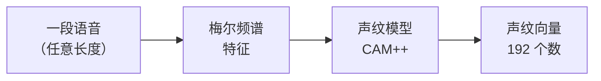
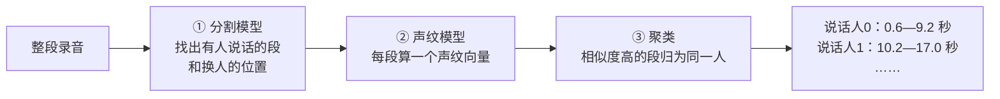
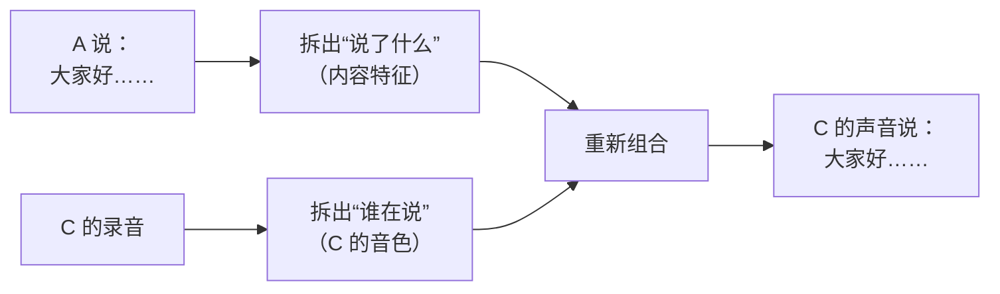
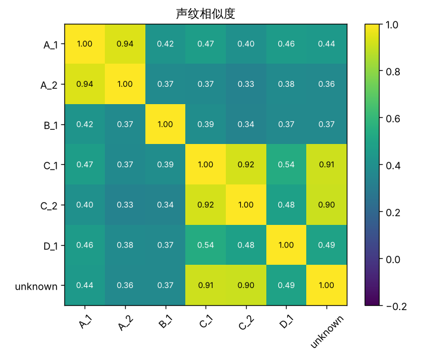
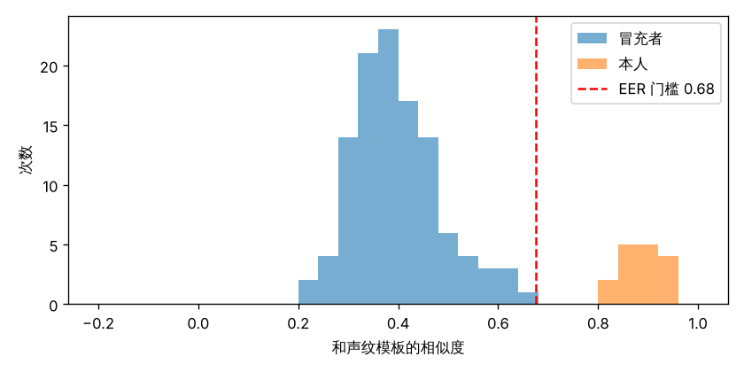
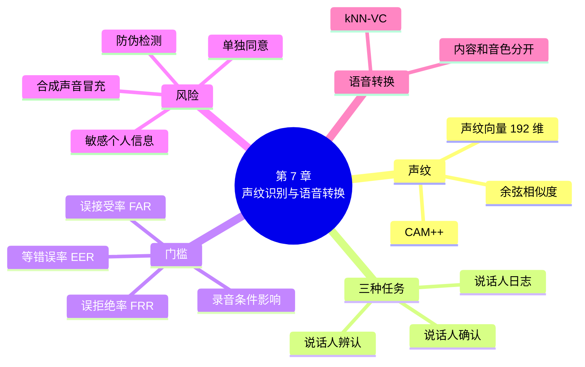

# 第 7 章 声纹识别与语音转换

!!! abstract "本章学时"
    理论 4 学时（其中线下 2 学时）· 实验 4 学时（本章共 4 个实验，教师可任选）

## 学习目标

学完本章，你应该能够：

1. **说出**声纹和声纹向量的含义，用余弦相似度手算两个小向量有多像（理解、应用）；
2. **区分**说话人确认、说话人辨认、说话人日志三种任务，各举一个应用例子（理解）；
3. **解释**门槛如何影响误接受率和误拒绝率，能根据场景选择门槛（分析、评价）；
4. **运行并修改**代码，完成声纹比对、声纹登录和多人会议“谁在说话”的纪要（应用）；
5. **说出**声纹属于敏感个人信息，采集和使用需要取得本人单独同意（记忆、理解）；
6. **解释**语音转换把“说什么”和“谁在说”分开的思路，说出它和第 8 章语音克隆的区别（理解）。

!!! info "先修要求"
    学习本章前，你需要：

    - 学完第 2 章，知道梅尔频谱、基频是什么；
    - 学完第 4 章，会用 `transcribe` 识别一段录音、用 VAD 切句；
    - 知道向量是“一串数字”，会用 numpy 做数组运算（《Python 编程》）；相似度和阈值的更多内容在《机器学习》课里讲。

??? abstract "本章概念清单（10 个，点击查看定义和例子）"
    1. [声纹](../../appendix/glossary.md#g-声纹)
    2. [声纹向量](../../appendix/glossary.md#g-声纹向量)
    3. [余弦相似度](../../appendix/glossary.md#g-余弦相似度)
    4. [说话人确认](../../appendix/glossary.md#g-说话人确认)
    5. [说话人辨认](../../appendix/glossary.md#g-说话人辨认)
    6. [说话人日志](../../appendix/glossary.md#g-说话人日志)
    7. [误接受率](../../appendix/glossary.md#g-误接受率)
    8. [误拒绝率](../../appendix/glossary.md#g-误拒绝率)
    9. [等错误率](../../appendix/glossary.md#g-等错误率)
    10. [语音转换](../../appendix/glossary.md#g-语音转换)

## 情景导入

社区语音服务站上线一个月，小周遇到了两件新鲜事。

第一件：服务站的热线每天接到几十个电话，有些是独居老人打来的。居委会想做一个“老人专线”：老人打进来说一句话，系统就能认出是哪位老人，自动调出他家的地址和联系人，不用老人再报一遍姓名、楼号。

第二件：上周议事会的录音，第 4 章已经转成了文字，可是纪要里只有一句接一句的话，分不清哪句是主持人说的、哪句是老王说的。书记说：“纪要要写清楚谁提的建议。”

两件事都要电脑“听出是谁在说话”。这就是本章的主题：声纹识别。学完以后，你还会明白，为什么银行的声纹登录不能完全靠得住，以及为什么采集声纹要先征得本人同意。

## 7.1 声纹：嗓子的“指纹” { #71 }

每个人的声带长短厚薄不同，口腔、鼻腔的形状不同，说话的习惯也不同，所以每个人的声音都有自己的特点。熟人打电话，“喂”一声我们就知道是谁。这种能区分不同人的嗓音特征，叫[**声纹**](../../appendix/glossary.md#g-声纹 "一个人嗓音的独特特征，像指纹一样可以用来区分不同的人；在计算机里用一串数字（声纹向量）表示"){ .term }。

人靠耳朵记住声纹，电脑靠一个“声纹模型”。声纹模型读入一段语音（先转成梅尔频谱一类的特征），输出一串固定长度的数字，叫[**声纹向量**](../../appendix/glossary.md#g-声纹向量 "声纹模型把一段语音转换成的固定长度的一串数字，同一个人的向量相近，不同人的相远"){ .term }。本书用的 CAM++ 模型<sup class="cite">[[1]](#ref7-1)</sup>，不管录音是 2 秒还是 20 秒，都输出 192 个数。



这个模型是怎么学会的？训练时给它看几千个人、几十万段录音，要求它做到：同一个人的录音，输出的向量要靠近；不同人的录音，输出的向量要远离。训练好以后，它就能给从没见过的人也算出向量，这正是声纹能用于“注册新用户”的原因。2018 年提出的 x-vector<sup class="cite">[[2]](#ref7-2)</sup>让这种“神经网络提取声纹向量”的方法成为主流，CAM++ 是它的改进版本之一，由阿里巴巴的 3D-Speaker 团队开源。

!!! tip "声纹向量里没有“说了什么”"
    声纹模型故意忽略说话的内容，只保留“谁在说”。所以同一个人说不同的话，向量依然相近。这一点和识别模型正好相反：识别模型要忽略“谁在说”，只保留“说了什么”。7.6 节的语音转换就是把这两样东西拆开再重新组合。

打开[声纹地图](../../sims/voiceprint-map/index.md)，可以看到 45 段录音的声纹向量投到平面上的样子：同一个人的录音聚成一团。

## 7.2 两串数字有多像：余弦相似度 { #72 }

有了向量，怎样判断两段录音是不是同一个人？要算两个向量“有多像”。声纹最常用的是[**余弦相似度**](../../appendix/glossary.md#g-余弦相似度 "两个向量夹角的余弦值，范围 -1 到 1，越接近 1 方向越一致、越像"){ .term }。

把向量想成从原点出发的一支箭头。两支箭头方向越一致，夹角越小，余弦值就越接近 1；方向垂直，余弦值是 0；方向相反，是 -1。只看方向、不看长短，所以录音音量大小不影响结果。

公式是：

$$
\text{余弦相似度} = \frac{a_1 b_1 + a_2 b_2 + \cdots + a_n b_n}{\sqrt{a_1^2 + \cdots + a_n^2}\ \sqrt{b_1^2 + \cdots + b_n^2}}
$$

分子叫“点积”（对应位置相乘再相加），分母是两个向量各自的长度。

!!! example "算一算"
    设三段录音的声纹向量只有 2 个数（真实的有 192 个）：

    - 录音甲 $a = (3, 4)$，长度 $\sqrt{9+16} = 5$
    - 录音乙 $b = (6, 8)$，长度 $\sqrt{36+64} = 10$
    - 录音丙 $c = (4, -3)$，长度 $5$

    甲和乙：点积 $3 \times 6 + 4 \times 8 = 50$，相似度 $= 50 \div (5 \times 10) = 1$。方向完全一样，乙只是“声音大一倍”。

    甲和丙：点积 $3 \times 4 + 4 \times (-3) = 0$，相似度 $= 0$。方向垂直，一点也不像。

本书的 `voicelab.embed()` 已经把每个声纹向量“缩放”成长度为 1，这时分母等于 1，余弦相似度就是点积，用 numpy 写成 `a @ b` 一个符号就算完了。

实验 7-1 的实测结果：同一位志愿者的两段录音相似度 0.92—0.94，不同志愿者之间 0.33—0.54。“未知录音”和志愿者 C 的两段录音相似度是 0.91 和 0.90，和其他人都不到 0.5，可以判断是 C 说的。

!!! note "为什么“不同人”也有 0.4 左右？"
    书里的志愿者都是同一个合成模型（Kokoro）生成的声音，录音条件完全一样，彼此之间比真实的不同人更“像”一些。编者早先用其他录音测试时，不同人之间只有 0.1 左右。所以门槛不能照搬别人的数字，要用自己场景的数据来定。

## 7.3 门槛的取舍：两种错误 { #73 }

### 7.3.1 说话人确认要一个门槛 { #731 }

“老人专线”的第一步，是[**说话人确认**](../../appendix/glossary.md#g-说话人确认 "判断一段语音“是不是某个人说的”，回答是或否"){ .term }：老人报了身份（比如拨的是自己登记的号码），系统核验这个声音是不是他本人，回答“是”或“否”。

做法分两步：

1. **注册**：请本人录几段话，提取声纹向量取平均，存成这个人的“声纹模板”；
2. **验证**：新来的录音提取向量，和模板算相似度。**相似度 ≥ 门槛就放行**，否则拒绝。

门槛定多少，是一个取舍。

### 7.3.2 两种错误 { #732 }

验证可能犯两种错误：

| | 系统说“是本人” | 系统说“不是本人” |
|---|---|---|
| **真的是本人** | ✓ 正确 | ✗ **误拒绝**（本人进不去） |
| **其实是冒充者** | ✗ **误接受**（冒充者进去了） | ✓ 正确 |

- [**误接受率**](../../appendix/glossary.md#g-误接受率 "冒充者被错误放行的次数占冒充测试总次数的比例"){ .term }（FAR）= 冒充者被放行的次数 ÷ 冒充测试总次数；
- [**误拒绝率**](../../appendix/glossary.md#g-误拒绝率 "本人被错误拒绝的次数占本人测试总次数的比例"){ .term }（FRR）= 本人被拒绝的次数 ÷ 本人测试总次数。

门槛调高，冒充者更难进来（FAR 下降），但本人也更容易被拒（FRR 上升）；门槛调低则相反。两种错误此消彼长，不可能同时降到很低，除非模型本身更好。实验 7-2 的实测：

| 门槛 | 0.3 | 0.5 | 0.6 | 0.7 | 0.8 | 0.9 |
|---|---|---|---|---|---|---|
| 误接受率 FAR | 90.2% | 13.4% | 3.6% | 0 | 0 | 0 |
| 误拒绝率 FRR | 0 | 0 | 0 | 0 | 0 | 62.5% |

把门槛从低往高调，总能找到一个点，让 FAR 正好等于 FRR，这时的错误率叫[**等错误率**](../../appendix/glossary.md#g-等错误率 "调节门槛使误接受率等于误拒绝率时的错误率，越低说明系统越好"){ .term }（EER）。EER 越低，说明模型把“本人”和“冒充者”分得越开。论文和产品说明里常用 EER 比较声纹模型，CAM++ 在公开测试集上的 EER 不到 1%<sup class="cite">[[1]](#ref7-1)</sup>。

### 7.3.3 门槛要看场景 { #733 }

| 场景 | 更怕哪种错误 | 门槛 |
|---|---|---|
| 银行转账、门禁 | 误接受：冒充者进来损失很大 | 偏高，宁可让本人多说一遍 |
| 老人专线自动调出信息 | 误拒绝：老人被拒会很烦；调错信息也有隐私风险 | 适中，并且只调出不敏感的信息，关键操作再人工确认 |
| 会议纪要分人 | 两种错误代价都不大 | 按 EER 附近取 |

!!! warning "实验室里的“零错误”靠不住"
    实验 7-2 中，门槛在 0.68—0.83 之间时两种错误都是 0。但把同样的本人录音换成电话音质（8 kHz）后，本人的平均分从 0.89 降到 0.59，门槛 0.75 时误拒绝率变成 100%；只说 1 秒时，误拒绝率也有 62%。**注册和使用时的录音条件不一样（设备、线路、环境、时长），声纹分数会大幅下降。** 真实系统要用多种条件的录音注册，或者针对电话场景专门调整。打开[门槛与两种错误](../../sims/threshold-errors/index.md)，切换“电话音质”试一试。

## 7.4 三种任务：确认、辨认、日志 { #74 }

同样是用声纹，任务不同，问法不同：

| 任务 | 问的问题 | 怎么做 | 例子 |
|---|---|---|---|
| **说话人确认** | “你是不是 A？” | 和 A 的模板比，过门槛就是 | 声纹登录、电话银行核验 |
| [**说话人辨认**](../../appendix/glossary.md#g-说话人辨认 "判断一段语音“是已注册的哪个人说的”，从多人中选一个"){ .term } | “你是 A、B、C、D 里的谁？” | 和所有模板比，选最像的（还可以设门槛，都不像就说“不认识”） | 老人专线认出是哪位老人；判断“未知录音”是谁 |
| [**说话人日志**](../../appendix/glossary.md#g-说话人日志 "把一段多人录音切成小段，标出“谁在什么时候说话”"){ .term } | “这段录音里，谁在什么时候说话？” | 先切段，再把声纹相近的段归成一类 | 会议纪要分人、庭审记录、访谈整理 |

**说话人日志**比前两个复杂，因为事先不一定知道有几个人、每个人是谁。sherpa-onnx 的做法分三步<sup class="cite">[[3]](#ref7-3)</sup>：



第 ① 步用的是 pyannote 的分割模型<sup class="cite">[[4]](#ref7-4)</sup>，它每隔一小段时间判断“现在有几个人在说话、是不是换人了”。第 ③ 步“聚类”就是把彼此相似度超过门槛的段放进同一组，组数就是人数。如果事先知道人数，也可以直接指定分成几组。

日志只能告诉你“说话人 0、1、2”，不知道他们叫什么。要写成“主持人：……”，还需要一步**辨认**：拿每一组的声纹和注册过的模板比。实验 7-3 就是把日志、辨认和第 4 章的识别连起来，输出带名字的会议纪要。

实测结果：议事会 51 秒录音、3 个人、7 句话，日志找出 3 个人，7 句话中 6 句的发言人正确。出错的是主持人和李阿姨，两人都是女声。主持人的第二句话被从中间切成两段，前半段分给了李阿姨；最后一句也被分给了李阿姨。如果事先注册过 3 个人的声纹，跳过聚类，直接逐段辨认，7 句全对。

## 7.5 声纹的用途和风险 { #75 }

### 7.5.1 用在哪里

- **身份核验**：电话银行、证券、社保的声纹登录，智能音箱区分家庭成员（“小爱，播放我的歌单”）；
- **会议和访谈**：自动生成分人纪要、字幕；
- **安全与司法**：电信反诈中识别已知诈骗人员的声音，司法鉴定中的声纹比对（由专业机构进行）；
- **个性化服务**：车载语音根据声音调出驾驶者的座椅和音乐设置。

### 7.5.2 合成声音能骗过声纹吗 { #752 }

能，而且越来越容易。第 8 章会看到，只要几秒钟的参考录音，就能克隆出一个人的音色。编者在实验中测过：用 6 秒参考录音克隆的声音，和本人的声纹相似度达到 0.73，已经接近本章“本人”的分数。

所以声纹系统需要配一道“防伪检测”：判断这段声音是真人对着麦克风说的，还是合成、转换、录音回放的。国际上有专门的 ASVspoof 挑战赛评测这类检测方法，2024 年的第五届已经包括大量用最新合成和转换技术生成的“深度伪造”语音<sup class="cite">[[5]](#ref7-5)</sup>。对普通用户来说，结论很简单：**声纹不能作为大额转账等关键操作的唯一凭证。**

### 7.5.3 声纹是敏感个人信息 { #753 }

声纹能唯一地识别一个人，一旦泄露无法像密码一样更换。《中华人民共和国个人信息保护法》<sup class="cite">[[6]](#ref7-6)</sup>：

- **第二十八条**把“生物识别”信息列为敏感个人信息，规定只有在具有特定的目的和充分的必要性，并采取严格保护措施的情形下，才可以处理敏感个人信息；
- **第二十九条**规定，处理敏感个人信息应当取得个人的**单独同意**。

落到“老人专线”上，意味着：

1. 采集老人的声纹前，要单独告诉他“采集什么、做什么用、存多久、能不能撤回”，取得他本人的同意，不能夹在一大堆条款里一次勾选；
2. 只存声纹向量，不长期保存原始录音；向量加密存放，只有专线系统能用；
3. 老人随时可以要求删除；
4. 有替代方式：不愿意用声纹的老人，照样可以报姓名办事。

书里的实验全部使用合成的“虚拟授权人”，不涉及真人的声纹。如果你用同学的声音做实验，也要先征得同意（第 8 章和附录 D 有授权书模板）。

## 7.6 语音转换：换一副嗓子 { #76 }

声纹模型只要“谁在说”，识别模型只要“说了什么”。如果能把一段语音拆成这两部分，再把“谁在说”换成另一个人的，就得到了[**语音转换**](../../appendix/glossary.md#g-语音转换 "保留一段语音“说了什么”，把“谁在说”换成另一个人的音色的技术，俗称变声"){ .term }（也叫变声）：A 说的话，听起来像 C 在说。



**kNN-VC** 是一种思路特别直观的语音转换方法<sup class="cite">[[7]](#ref7-7)</sup>。它先用一个大模型（WavLM）把语音变成一帧一帧的特征，这些特征里“说了什么”的信息很多；然后把 C 的所有录音也变成特征，组成一个“素材库”。转换时，A 的每一帧，都到 C 的素材库里找最像的 4 帧（k 近邻，k=4），用它们的平均值代替，最后用声码器变回声音。这就像用 C 说过的“音节碎片”，拼出 A 说的内容。C 的素材越多（作者建议 5 分钟左右），拼得越自然。

语音转换和第 8 章的语音克隆很像，区别在于输入：

| | 语音转换 | 语音克隆（零样本合成） |
|---|---|---|
| 输入 | 一段**语音**（A 说的）+ 目标人的录音 | 一段**文字** + 目标人的录音 |
| 保留什么 | A 的语调、节奏、情感 | 由模型自己决定怎么读 |
| 典型用途 | 直播变声、影视配音、保护说话人隐私 | 有声书、导航、智能助手 |

两者都能“冒用”别人的声音，所以伦理和法律要求是一样的，第 8 章一起讲。

## 7.7 前沿视窗

**声纹和防伪走到一起**。过去声纹识别只回答“是不是这个人”，现在还要回答“是不是真人”。ASVspoof 5 等评测推动了“说话人确认 + 伪造检测”的联合系统，有的手机和银行应用已经要求用户念一串随机数字，同时检测活体和声纹，防止用录音或合成声音冒充。

**会议纪要的“谁说了什么”一步到位**。传统的做法是本章的“日志 + 识别”两步走。截至 2026 年，越来越多的语音大模型可以直接输出带说话人标签的转写稿，在线会议软件的自动纪要大多已经能区分发言人。不过，对口音重、多人抢话、声音相近的录音，分人仍然是难点，本章实验里两位女声被混淆就是一个缩影。

## 本章实验

!!! abstract "实验总览"
    | 实验 | 类型 | 建议时长 | 内容 |
    |---|---|---|---|
    | 实验 7-1 | ★ 基础 | 45 分钟 | 7 段录音两两算声纹相似度，画热力图，找出“未知录音”是谁 |
    | 实验 7-2 | ★ 基础 | 45 分钟 | 注册 4 个人的声纹，用 32 段录音测试，调门槛，算 FAR、FRR、EER，换电话音质再测 |
    | 实验 7-3 | ★ 基础 | 45 分钟 | 议事会录音做说话人日志，配合识别输出带名字的纪要，和标准答案对比 |
    | 实验 7-4 | ☆ 拓展 | 45 分钟 | 用 kNN-VC 把 A 的话换成 C 的音色，用声纹检查（需 PyTorch 和约 1.3 GB 模型，待实测） |

    代码见配套资源 `labs/ch07/` 目录。运行前在 `labs` 文件夹里执行 `python models.py ch07`。实验数据在 `labs/data/voices/`、`labs/data/speaker_test/` 和 `labs/data/meeting/`，全部是合成的虚拟声音。

### 实验 7-1 ★ 声纹比一比

**实验目的**

1. 会用声纹模型提取声纹向量；
2. 会计算余弦相似度矩阵并画成热力图；
3. 能根据相似度判断哪些录音是同一个人。

**实验环境**：本机 CPU 或云端 Notebook。**实验数据**：`labs/data/voices/` 中志愿者 A、B、C、D 的 6 段录音和 1 段身份未知的录音。模型 `speaker`。

**实验步骤与代码**

运行 `lab7_1_similarity.py`：

```python
import sys

import matplotlib.pyplot as plt
import numpy as np

sys.path.append("..")
from voicelab import embed

plt.rcParams["font.sans-serif"] = ["Microsoft YaHei", "SimHei", "Noto Sans CJK SC", "WenQuanYi Zen Hei"]
files = ["volunteer_A_1", "volunteer_A_2", "volunteer_B_1", "volunteer_C_1",     # ← 改这里
         "volunteer_C_2", "volunteer_D_1", "unknown"]

# 1. 每段录音 → 一个 192 维的声纹向量（已经缩放成长度为 1）
vectors = np.array([embed(f"../data/voices/{name}.wav") for name in files])
print("声纹向量的形状：", vectors.shape)
print("A_1 的前 5 个数：", np.round(vectors[0, :5], 3))

# 2. 两两算余弦相似度：长度为 1 的向量，点积就是余弦相似度
sim = vectors @ vectors.T
labels = [n.replace("volunteer_", "") for n in files]
print("\n相似度矩阵：")
print("        " + "".join(f"{x:>8}" for x in labels))
for name, row in zip(labels, sim):
    print(f"{name:>8}" + "".join(f"{v:8.2f}" for v in row))

# 3. 画热力图
fig, ax = plt.subplots(figsize=(6, 5))
im = ax.imshow(sim, cmap="viridis", vmin=-0.2, vmax=1)
ax.set_xticks(range(len(labels)), labels, rotation=45)
ax.set_yticks(range(len(labels)), labels)
for i in range(len(labels)):
    for j in range(len(labels)):
        ax.text(j, i, f"{sim[i, j]:.2f}", ha="center", va="center", color="w" if sim[i, j] < 0.6 else "k", fontsize=8)
fig.colorbar(im)
ax.set_title("声纹相似度")
fig.tight_layout()
fig.savefig("similarity.png", dpi=120)

# 4. 未知录音最像谁？
for name, s in sorted(zip(labels[:-1], sim[-1, :-1]), key=lambda x: -x[1]):
    print(f"unknown 和 {name} 的相似度：{s:.2f}")
```

**运行结果**（编者运行，约 5 秒）

```text
声纹向量的形状： (7, 192)
A_1 的前 5 个数： [ 0.078  0.028 -0.032 -0.12  -0.   ]
相似度矩阵：
             A_1     A_2     B_1     C_1     C_2     D_1 unknown
     A_1    1.00    0.94    0.42    0.47    0.40    0.46    0.44
     A_2    0.94    1.00    0.37    0.37    0.33    0.38    0.36
     B_1    0.42    0.37    1.00    0.39    0.34    0.37    0.37
     C_1    0.47    0.37    0.39    1.00    0.92    0.54    0.91
     C_2    0.40    0.33    0.34    0.92    1.00    0.48    0.90
     D_1    0.46    0.38    0.37    0.54    0.48    1.00    0.49
 unknown    0.44    0.36    0.37    0.91    0.90    0.49    1.00
unknown 和 C_1 的相似度：0.91
unknown 和 C_2 的相似度：0.90
unknown 和 D_1 的相似度：0.49
unknown 和 A_1 的相似度：0.44
unknown 和 B_1 的相似度：0.37
unknown 和 A_2 的相似度：0.36
```



读结果：

- 对角线都是 1.00，因为每段录音和自己完全一样。
- A_1 和 A_2 是 0.94，C_1 和 C_2 是 0.92：同一个人说不同的话，相似度很高。
- 不同人之间 0.33—0.54。C 和 D 都是男声，相似度 0.54，是不同人里最高的。
- unknown 和 C 的两段录音都在 0.90 以上，和其他人都低于 0.5，所以未知录音是 C 说的（在 `voices.csv` 里可以核对答案）。

**改一改**

1. 把 `files` 换成 `volunteer_B_1`、`volunteer_B_2`、`volunteer_B_3`、`volunteer_D_2`、`volunteer_D_3`，看热力图有什么变化。
2. 用手机录自己说的两句话（转成 WAV），加到 `files` 里，看你的两句话之间相似度是多少，和志愿者相似度是多少。（只用自己的声音，不要录别人。）

**实验记录表**

| 录音对 | 是否同一个人 | 相似度 |
|---|---|---|
| A_1 与 A_2 | 是 | |
| C_1 与 D_1 | 否 | |
| unknown 与 C_1 | | |
| 自己的两句话 | 是 | |

**常见问题排查**

| 现象 | 原因 | 解决办法 |
|---|---|---|
| `FileNotFoundError: 模型 speaker 还没下载` | 模型没下载 | `python models.py speaker` |
| 热力图上中文显示成方块 | 系统没有中文字体 | 代码已设置微软雅黑等字体；Linux 可安装 `fonts-noto-cjk` |
| 自己的录音和自己相似度很低 | 两次录音环境、设备差别大，或录音太短、噪声太大 | 在同一个安静的地方、用同一部手机，每句说 3 秒以上 |

**思考与练习**

1. 为什么 `embed` 把向量缩放成长度为 1 之后，点积就是余弦相似度？
2. 7.2 节提到其他录音中不同人的相似度只有 0.1 左右，书里的合成声音为什么更高？

**实验报告要求**

提交热力图和记录表，并写出你判断“未知录音”是谁的依据。

### 实验 7-2 ★ 声纹登录

**实验目的**

1. 会做声纹注册（多段录音取平均作为模板）和验证；
2. 会统计误接受率、误拒绝率，找出等错误率；
3. 能说明录音条件变化对声纹验证的影响。

**实验环境**：本机 CPU 或云端 Notebook。**实验数据**：注册用 `labs/data/voices/` 中 A、B、C、D 各 2 段录音；测试用 `labs/data/speaker_test/` 中 A—D 各 4 段新录音（本人）和 8 个其他音色各 2 段录音（冒充者），文字见 `speaker_test.csv`。模型 `speaker`。

**实验步骤与代码**

运行 `lab7_2_login.py`。每段测试录音都分别和 4 个模板比较：和自己的模板比算一次“本人测试”，和别人的模板比算一次“冒充测试”。

```python
import csv
import sys

import matplotlib.pyplot as plt
import librosa
import numpy as np

sys.path.append("..")
from voicelab import embed, read_audio

plt.rcParams["font.sans-serif"] = ["Microsoft YaHei", "SimHei", "Noto Sans CJK SC", "WenQuanYi Zen Hei"]

# 1. 注册：每人用 2 段录音的声纹向量取平均，作为这个人的“声纹模板”
enrolled = {}
for code in "ABCD":
    v = embed(f"../data/voices/volunteer_{code}_1.wav") + embed(f"../data/voices/volunteer_{code}_2.wav")
    enrolled[code] = v / np.linalg.norm(v)
print("已注册：", list(enrolled))

# 2. 测试：每段测试录音都分别“声称”自己是 A、B、C、D，算和模板的相似度
genuine, impostor = [], []                     # 真本人的分数、冒充者的分数
rows = list(csv.DictReader(open("../data/speaker_test/speaker_test.csv", encoding="utf-8-sig")))
for r in rows:
    v = embed(f"../data/speaker_test/{r['文件']}")
    for code, t in enrolled.items():
        (genuine if r["真实身份"] == code else impostor).append(float(v @ t))
genuine, impostor = np.array(genuine), np.array(impostor)
print(f"真本人测试 {len(genuine)} 次，分数 {genuine.min():.2f}—{genuine.max():.2f}，平均 {genuine.mean():.2f}")
print(f"冒充测试 {len(impostor)} 次，分数 {impostor.min():.2f}—{impostor.max():.2f}，平均 {impostor.mean():.2f}")

# 3. 调门槛：分数 ≥ 门槛就“放行”
print("\n门槛   误接受率 FAR   误拒绝率 FRR")
for th in [0.3, 0.4, 0.5, 0.6, 0.7, 0.8, 0.9]:          # ← 改这里
    far = np.mean(impostor >= th)                        # 冒充者被放行的比例
    frr = np.mean(genuine < th)                          # 本人被拒绝的比例
    print(f"{th:.2f}   {far:8.1%}      {frr:8.1%}")

# 4. 找等错误率 EER：FAR 和 FRR 相等的那个门槛
ths = np.linspace(0, 1, 1001)
fars = np.array([np.mean(impostor >= t) for t in ths])
frrs = np.array([np.mean(genuine < t) for t in ths])
k = np.argmin(np.abs(fars - frrs))
print(f"\n等错误率 EER ≈ {(fars[k] + frrs[k]) / 2:.1%}，此时门槛 ≈ {ths[k]:.2f}")
ok = ths[(fars == 0) & (frrs == 0)]
if len(ok):
    print(f"门槛在 {ok.min():.2f}—{ok.max():.2f} 之间时，两种错误都是 0")

# 5. 画两种分数的分布
plt.figure(figsize=(7, 3.5))
plt.hist(impostor, bins=30, range=(-0.2, 1), alpha=0.6, label="冒充者")
plt.hist(genuine, bins=30, range=(-0.2, 1), alpha=0.6, label="本人")
plt.axvline(ths[k], color="r", linestyle="--", label=f"EER 门槛 {ths[k]:.2f}")
plt.xlabel("和声纹模板的相似度")
plt.ylabel("次数")
plt.legend()
plt.tight_layout()
plt.savefig("login_scores.png", dpi=120)

# 6. 换个条件再测：本人用电话打进来（8 kHz）、或者只说 1 秒，门槛还用 0.75
TH = 0.75                                                # ← 改这里
phone, short = [], []
for r in rows:
    if r["真实身份"] in enrolled:
        a, sr = read_audio(f"../data/speaker_test/{r['文件']}")
        tel = librosa.resample(librosa.resample(a, orig_sr=sr, target_sr=8000), orig_sr=8000, target_sr=sr)
        phone.append(float(embed(tel, sr) @ enrolled[r["真实身份"]]))
        short.append(float(embed(a[int(0.2 * sr):int(1.2 * sr)], sr) @ enrolled[r["真实身份"]]))
print(f"\n门槛 {TH}：")
print(f"正常录音  本人平均分 {genuine.mean():.2f}，误拒绝率 {np.mean(genuine < TH):.0%}")
print(f"电话音质  本人平均分 {np.mean(phone):.2f}，误拒绝率 {np.mean(np.array(phone) < TH):.0%}")
print(f"只说 1 秒 本人平均分 {np.mean(short):.2f}，误拒绝率 {np.mean(np.array(short) < TH):.0%}")
```

**运行结果**（编者运行，约 20 秒）

```text
已注册： ['A', 'B', 'C', 'D']
真本人测试 16 次，分数 0.83—0.94，平均 0.89
冒充测试 112 次，分数 0.20—0.68，平均 0.40
门槛   误接受率 FAR   误拒绝率 FRR
0.30      90.2%          0.0%
0.40      42.9%          0.0%
0.50      13.4%          0.0%
0.60       3.6%          0.0%
0.70       0.0%          0.0%
0.80       0.0%          0.0%
0.90       0.0%         62.5%
等错误率 EER ≈ 0.0%，此时门槛 ≈ 0.68
门槛在 0.68—0.83 之间时，两种错误都是 0
门槛 0.75：
正常录音  本人平均分 0.89，误拒绝率 0%
电话音质  本人平均分 0.59，误拒绝率 100%
只说 1 秒 本人平均分 0.72，误拒绝率 62%
```



读结果：

- 本人分数在 0.83—0.94 之间，冒充者在 0.20—0.68 之间，两堆分数完全分开，所以门槛取 0.68—0.83 时两种错误都是 0，EER 为 0。
- 门槛 0.5 时，112 次冒充有 15 次被放行（13.4%）；门槛 0.9 时，16 次本人测试有 10 次被拒（62.5%）。两种错误此消彼长。
- 第 6 步最重要：同样的人、同样的话，换成电话音质，平均分从 0.89 掉到 0.59，门槛 0.75 下全部被拒；只说 1 秒，也有 62% 被拒。**录音条件和时长对声纹影响很大。**

**改一改**

1. 注册时只用 1 段录音（去掉 `_2`），重新运行，比较本人的平均分和 EER。
2. 把第 6 步的门槛改成 0.55，电话音质的误拒绝率是多少？这时正常录音的误接受率又是多少？（提示：用第 3 步的表格估计。）
3. **挑战**：注册时用一段正常录音加一段电话音质录音，再测电话音质的误拒绝率。

**实验记录表**

| 条件 | 门槛 | FAR | FRR | 本人平均分 |
|---|---|---|---|---|
| 正常录音，注册 2 段 | 0.75 | | | |
| 正常录音，注册 1 段 | 0.75 | | | |
| 电话音质 | 0.75 | | | |
| 电话音质 | 0.55 | | | |

**常见问题排查**

| 现象 | 原因 | 解决办法 |
|---|---|---|
| `FileNotFoundError: ../data/speaker_test/...` | 没在 `labs/ch07` 里运行，或数据没下载完整 | `cd labs/ch07`；检查 `labs/data/speaker_test/` 里有 32 个 WAV |
| `KeyError: '真实身份'` | CSV 用别的软件另存过，编码或表头变了 | 从仓库重新下载 `speaker_test.csv`，不要用 Excel 另存 |
| EER 的门槛和编者略有不同 | `argmin` 找的是第一个最接近的门槛 | 正常；看“两种错误都是 0”的范围 |

**思考与练习**

1. 银行要上线声纹登录，你会建议门槛取 0.7 还是 0.8？还应该加什么防护？
2. 为什么第 6 步的电话音质会让本人分数大幅下降？联系第 2 章的采样定理想一想。

**实验报告要求**

提交记录表和分数分布图，给“老人专线”推荐一个门槛并说明理由。

### 实验 7-3 ★ 谁在说话

**实验目的**

1. 会用 sherpa-onnx 做说话人日志；
2. 会把日志、声纹辨认和语音识别连起来，生成带名字的会议纪要；
3. 能和标准答案对比，分析出错的原因。

**实验环境**：本机 CPU 或云端 Notebook。**实验数据**：`labs/data/meeting/meeting.wav`（第 4 章用过的三人议事会录音，51 秒）和标准答案 `meeting_truth.csv`。模型 `segmentation`、`speaker`、`sensevoice`。

**实验步骤与代码**

运行 `lab7_3_diarization.py`：

```python
import csv
import sys

import numpy as np
import sherpa_onnx as so

sys.path.append("..")
from voicelab import embed, model_path, read_audio, transcribe

# 1. 建说话人日志工具：分割模型找“换人的地方”，声纹模型提取每一段的声纹，再把声纹相近的段聚成一类
config = so.OfflineSpeakerDiarizationConfig(
    segmentation=so.OfflineSpeakerSegmentationModelConfig(
        pyannote=so.OfflineSpeakerSegmentationPyannoteModelConfig(model=f"{model_path('segmentation')}/model.onnx")),
    embedding=so.SpeakerEmbeddingExtractorConfig(
        model=f"{model_path('speaker')}/3dspeaker_speech_campplus_sv_zh-cn_16k-common.onnx"),
    clustering=so.FastClusteringConfig(num_clusters=-1, threshold=0.5),   # ← 改这里：不知道几个人时用 -1 和门槛
    min_duration_on=0.3, min_duration_off=0.5)
sd = so.OfflineSpeakerDiarization(config)

# 2. 处理整段录音
audio, sr = read_audio("../data/meeting/meeting.wav", sd.sample_rate)
segments = sd.process(audio).sort_by_start_time()
print(f"录音 {len(audio) / sr:.1f} 秒，找到 {len(segments)} 段，{len({s.speaker for s in segments})} 位发言人")

# 3. 每一段交给识别模型转文字
minutes = []
for s in segments:
    piece = audio[int(s.start * sr):int(s.end * sr)]
    minutes.append((s.start, s.end, s.speaker, transcribe(piece, sr)))
    print(f"{s.start:6.2f}—{s.end:6.2f}  说话人{s.speaker}  {minutes[-1][3]}")

# 4. 把“说话人0、1、2”对上真名：和注册过的声纹比一比（这里用标准答案里每人第一句话当注册录音）
truth = list(csv.DictReader(open("../data/meeting/meeting_truth.csv", encoding="utf-8-sig")))
names = {}
for t in truth:
    if t["发言人"] not in names:
        names[t["发言人"]] = embed(audio[int(float(t["开始秒"]) * sr):int(float(t["结束秒"]) * sr)], sr)
who = {}
for spk in sorted({s.speaker for s in segments}):
    pieces = np.concatenate([audio[int(a * sr):int(b * sr)] for a, b, k, _ in minutes if k == spk])
    v = embed(pieces, sr)
    who[spk] = max(names, key=lambda n: v @ names[n])

print("\n========== 议事会纪要 ==========")
for start, end, spk, text in minutes:
    print(f"[{int(start // 60):02d}:{start % 60:04.1f}] {who[spk]}：{text}")

# 5. 和标准答案对比：每一句话的中点落在哪个人的段里
right = 0
for t in truth:
    mid = (float(t["开始秒"]) + float(t["结束秒"])) / 2
    got = [who[s.speaker] for s in segments if s.start <= mid <= s.end]
    right += bool(got) and got[0] == t["发言人"]
print(f"\n{len(truth)} 句话中，{right} 句的发言人判断正确")

# 6. 另一种做法：事先注册过每个人的声纹，就不用聚类，直接逐段“辨认”最像谁
right = 0
for t in truth:
    mid = (float(t["开始秒"]) + float(t["结束秒"])) / 2
    for start, end, spk, text in minutes:
        if start <= mid <= end:
            v = embed(audio[int(start * sr):int(end * sr)], sr)
            right += max(names, key=lambda n: v @ names[n]) == t["发言人"]
print(f"逐段辨认：{len(truth)} 句话中，{right} 句的发言人判断正确")
```

**运行结果**（编者运行，约 13 秒）

```text
录音 51.3 秒，找到 8 段，3 位发言人
  0.55—  9.18  说话人0  大家晚上好，今天议事会讨论两件事，第一是电动车充电桩，第二是垃圾分类。
 10.17— 17.04  说话人2  我先说充电桩，楼下现在只有4个桩，晚上经常排队。
 18.07— 24.43  说话人4  我同意多装几个，不过要注意消防安全，不能在楼刀里充电。
 25.41— 27.03  说话人4  好的，那我们下周请。
 27.03— 29.06  说话人0  物业来现场看一看。
 30.05— 36.55  说话人2  垃圾分类这边，我建议在每栋楼前增加一个厨余垃圾桶。
 37.59— 43.96  说话人4  还要安排志愿者在早上7点到9点值班，提醒大家分好累再扔。
 44.92— 50.32  说话人4  这两个建议我都记下了，会后整理成绩要发到业主群。
========== 议事会纪要 ==========
[00:00.6] 主持人：大家晚上好，今天议事会讨论两件事，第一是电动车充电桩，第二是垃圾分类。
[00:10.2] 老王：我先说充电桩，楼下现在只有4个桩，晚上经常排队。
[00:18.1] 李阿姨：我同意多装几个，不过要注意消防安全，不能在楼刀里充电。
[00:25.4] 李阿姨：好的，那我们下周请。
[00:27.0] 主持人：物业来现场看一看。
[00:30.1] 老王：垃圾分类这边，我建议在每栋楼前增加一个厨余垃圾桶。
[00:37.6] 李阿姨：还要安排志愿者在早上7点到9点值班，提醒大家分好累再扔。
[00:44.9] 李阿姨：这两个建议我都记下了，会后整理成绩要发到业主群。
7 句话中，6 句的发言人判断正确
逐段辨认：7 句话中，7 句的发言人判断正确
```

读结果：

- 日志找到 3 位发言人（编号 0、2、4，编号不连续不影响使用），切成 8 段。
- 25.41 秒处，主持人说的“好的，那我们下周请物业来现场看一看”被从中间切开，前半句分给了李阿姨；最后一句主持人的话也分给了李阿姨。主持人和李阿姨都是女声，声纹比较接近。
- 第 5 步按“每句话的中点落在谁的段里”统计，7 句对了 6 句。
- 第 6 步跳过聚类，每段直接和 3 个人的注册声纹比，7 句全对。**知道有哪些人时，“辨认”比“聚类”更可靠。** 不过要注意，这里的注册录音取自本次会议，有点“开卷”；实际使用时，应在会前单独录注册录音。
- 识别里还有几个错字（楼刀、分好累、成绩要），这是第 4 章识别模型的问题，和说话人日志无关。

**改一改**

1. 把聚类门槛 `threshold` 改成 0.3、0.7，记录找到几位发言人、对了几句。（编者实测：0.3 找到 5 人，0.7 只找到 2 人。）
2. 把 `num_clusters=-1` 改成 `num_clusters=3`（告诉它有 3 个人），结果变好了吗？
3. **挑战**：把纪要保存成 `minutes.txt`，并按发言人统计每人说了多少秒。

**实验记录表**

| 设置 | 找到几人 | 切成几段 | 正确句数 / 7 |
|---|---|---|---|
| threshold=0.5 | | | |
| threshold=0.3 | | | |
| threshold=0.7 | | | |
| num_clusters=3 | | | |
| 逐段辨认 | — | | |

**常见问题排查**

| 现象 | 原因 | 解决办法 |
|---|---|---|
| `AttributeError: module 'sherpa_onnx' has no attribute 'OfflineSpeakerDiarizationConfig'` | sherpa-onnx 版本太旧 | `pip install -U sherpa-onnx`（本书用 2.0.1） |
| 找到的人数比实际多 | 聚类门槛太低，同一个人被拆成几类 | 调高 `threshold`，或直接指定 `num_clusters` |
| 找到的人数比实际少 | 门槛太高，或两个人声音太像 | 调低 `threshold`；有注册声纹时改用逐段辨认 |
| 处理自己的录音时报采样率错误 | 录音不是 16 kHz | `read_audio` 已经自动重采样，检查是否用了它 |

**思考与练习**

1. 说话人日志为什么只能给出“说话人 0、1、2”，而不能直接给出名字？
2. 如果议事会有 10 个人，而且经常抢着说话，你预计日志会遇到什么困难？

**实验报告要求**

提交带名字的纪要和记录表，分析出错的句子是什么原因。

### 实验 7-4 ☆ 语音转换体验（待实测）

**实验目的**

1. 体验语音转换：保留内容，换掉音色；
2. 会用声纹相似度客观检查转换效果；
3. 理解目标人录音的时长对转换质量的影响。

**实验环境**：建议用有显卡的云端 Notebook；本机 CPU 也能运行，但较慢。需要安装 PyTorch（`pip install torch torchaudio`，CPU 版本见 PyTorch 官网），首次运行自动从 GitHub 下载约 1.3 GB 的模型。**实验数据**：志愿者 A 的一句话，志愿者 C 的 3 段录音（共约 20 秒）。

**实验步骤与代码**

运行 `lab7_4_knn_vc.py`：

```python
import sys

import torch
import torchaudio

sys.path.append("..")
from voicelab import embed, read_audio, save_audio

# 1. 加载 kNN-VC（第一次会自动下载模型，放在用户目录的 .cache/torch/hub 里）
knn_vc = torch.hub.load("bshall/knn-vc", "knn_vc", prematched=True, trust_repo=True, pretrained=True, device="cpu")   # 没有显卡时一定要写 device="cpu"

# 2. 源语音（说什么）：A 的一句话；目标音色（谁在说）：C 的全部录音
#    kNN-VC 要求 16 kHz，书里的志愿者录音是 24 kHz，先转一份 16 kHz 的
def to16k(name):
    audio, sr = read_audio(f"../data/voices/{name}.wav", 16000)
    save_audio(f"{name}_16k.wav", audio, sr)
    return f"{name}_16k.wav"


source = to16k("volunteer_A_1")
targets = [to16k(f"volunteer_C_{k}") for k in (1, 2, 3)]       # ← 改这里：换成 B 或 D；目标录音越长效果越好

query = knn_vc.get_features(source)               # 把源语音变成一帧一帧的“内容特征”
matching_set = knn_vc.get_matching_set(targets)   # 把目标人的录音也变成特征，组成“素材库”
out = knn_vc.match(query, matching_set, topk=4)   # 每一帧换成素材库里最像的 4 帧的平均，再变回声音
torchaudio.save("A_to_C.wav", out[None], 16000)

# 3. 用声纹检查：转换后的声音更像 A 还是更像 C？
converted, sr = read_audio("A_to_C.wav")
for code in "AC":
    print(f"转换结果和 {code} 的声纹相似度：{embed(converted, sr) @ embed(f'../data/voices/volunteer_{code}_2.wav'):.2f}")
```

**运行结果**：本实验**待实测**。编者的写作环境无法下载 PyTorch 安装包，代码按 kNN-VC 官方说明<sup class="cite">[[7]](#ref7-7)</sup>编写。按原理预计：转换结果和 C 的相似度应明显高于和 A 的相似度；C 的录音只有约 20 秒，远少于作者建议的 5 分钟，声音可能有些含糊、断续。

**实验记录表**

| 目标人 | 目标录音总时长 | 和 A 的相似度 | 和目标人的相似度 | 听感（像不像、清不清楚） |
|---|---|---|---|---|
| C | 约 20 秒 | | | |
| B | | | | |

**常见问题排查**

| 现象 | 原因 | 解决办法 |
|---|---|---|
| `ModuleNotFoundError: No module named 'torch'` | 没装 PyTorch | 按 PyTorch 官网选 CPU 版本安装 |
| 下载模型很慢或失败 | 要从 GitHub 下载约 1.3 GB | 换网络，或在云端 Notebook 运行 |
| `AssertionError` 或 CUDA 相关报错 | 没有显卡却用了默认的 `device="cuda"` | 确认代码里写了 `device="cpu"` |
| 声音含糊、像“拼起来的” | 目标人的录音太少 | 增加目标人的录音时长 |

**思考与练习**

1. 语音转换和语音克隆，哪个更容易被用来冒充别人打电话？为什么？
2. 直播平台提供“变声”功能，需要遵守哪些规定？（提示：第 6 章的标识办法、第 8 章的深度合成规定。）

**实验报告要求**

提交记录表；如果没有条件运行，画出 kNN-VC 的流程图，说明每一步做什么。

## 本章小结

- **声纹**是区分不同人的嗓音特征；声纹模型把一段语音变成固定长度的**声纹向量**（CAM++ 输出 192 个数），同一个人的向量相近，不同人的相远。
- **余弦相似度**只看方向不看长短，范围 -1 到 1；向量缩放成长度为 1 后，就是点积 `a @ b`。
- 三种任务：**说话人确认**（是不是他）、**说话人辨认**（是谁）、**说话人日志**（谁在什么时候说话：分割 → 声纹 → 聚类）。
- 门槛决定两种错误：**误接受率**和**误拒绝率**此消彼长，**等错误率**越低模型越好。门槛要看场景；录音条件、时长变化会让分数大幅下降。
- 合成声音能骗过声纹，要配防伪检测；声纹是敏感个人信息，采集要取得本人单独同意。
- **语音转换**把“说什么”和“谁在说”拆开重组；kNN-VC 用目标人录音的“碎片”拼出新内容。



**下一章预告**

本章的语音转换要先有一段“A 说的话”，再换成 C 的声音。下一章更进一步：只要 C 的几秒钟录音和一段文字，就能让“C”说出任何话，这就是语音克隆。技术门槛越低，越需要规矩：克隆谁的声音要先拿到什么授权？克隆出来的声音怎么标识？法院是怎么判 AI 声音侵权案的？第 8 章是本书的样章，技术和伦理、法律一起讲。

## 参考文献

正文中的上标编号（如<sup class="cite">[[1]](#ref7-1)</sup>）对应下面的文献。带链接的可以直接打开。

<div class="refs" markdown>

**论文**

- <span id="ref7-1"></span>[1] WANG H, ZHENG S, CHEN Y, et al. CAM++: a fast and efficient network for speaker verification using context-aware masking[C]//Proceedings of Interspeech 2023. 2023: 5301-5305. DOI: 10.21437/Interspeech.2023-1513.
    <span class="ref-note">本书声纹模型 CAM++ 的论文，对应 7.1 节、7.3 节和实验 7-1、7-2。</span>
- <span id="ref7-2"></span>[2] SNYDER D, GARCIA-ROMERO D, SELL G, et al. X-vectors: robust DNN embeddings for speaker recognition[C]//2018 IEEE International Conference on Acoustics, Speech and Signal Processing (ICASSP). 2018: 5329-5333.
    <span class="ref-note">用神经网络提取声纹向量的代表性方法，对应 7.1 节。</span>
- <span id="ref7-4"></span>[4] PLAQUET A, BREDIN H. Powerset multi-class cross entropy loss for neural speaker diarization[C]//Proceedings of Interspeech 2023. 2023: 3222-3226. DOI: 10.21437/Interspeech.2023-205.
    <span class="ref-note">实验 7-3 所用 pyannote 分割模型（segmentation-3.0）的论文，对应 7.4 节。</span>
- <span id="ref7-5"></span>[5] WANG X, DELGADO H, TAK H, et al. ASVspoof 5: crowdsourced speech data, deepfakes, and adversarial attacks at scale[C]//The Automatic Speaker Verification Spoofing Countermeasures Workshop (ASVspoof 2024). 2024: 1-8. DOI: 10.21437/ASVspoof.2024-1.
    <span class="ref-note">第五届声纹防伪挑战赛，评测合成、转换等“深度伪造”语音的检测方法，对应 7.5.2 节和 7.7 节。</span>
- <span id="ref7-7"></span>[7] BAAS M, VAN NIEKERK B, KAMPER H. Voice conversion with just nearest neighbors[C]//Proceedings of Interspeech 2023. 2023: 2053-2057. DOI: 10.21437/Interspeech.2023-419.
    <span class="ref-note">kNN-VC 的论文，代码和模型在 https://github.com/bshall/knn-vc ，对应 7.6 节和实验 7-4。</span>

**法律法规**

- <span id="ref7-6"></span>[6] 中华人民共和国个人信息保护法[Z]. 2021-08-20 通过, 2021-11-01 施行.
    <span class="ref-note">第二十八条把生物识别信息列为敏感个人信息，第二十九条要求处理敏感个人信息取得个人单独同意，对应 7.5.3 节。</span>

**在线资源**

- <span id="ref7-3"></span>[3] k2-fsa. sherpa-onnx 文档：Speaker diarization[EB/OL]. [2026-11-01]. https://k2-fsa.github.io/sherpa/onnx/speaker-diarization/index.html.
    <span class="ref-note">实验 7-3 所用说话人日志工具的说明和模型下载，对应 7.4 节。</span>

</div>

## 课后练习

选择题和判断题可以直接点击选项作答，系统会马上告诉你对错，并展开答案与解析；多选题选好后点“提交答案”。简答和实操题请先自己作答，再点开“答案与解析”核对。每道题的解析下方都有“回看”链接，做错了可以直接跳回正文复习。

**一、单项选择题**

<div class="quiz" data-answer="B" markdown>

**1.** 声纹模型 CAM++ 对一段 2 秒的录音和一段 20 秒的录音，输出的声纹向量（　　）。

- A. 长度分别是 2 和 20
- B. 长度都是 192
- C. 长度和采样率有关
- D. 没有固定长度

</div>

??? tip "答案与解析"
    **答案：B**

    声纹模型不管录音多长，都输出固定长度的向量，CAM++ 是 192 个数。

    考查：声纹向量 · 认知层次：记忆 · [回看 7.1](#71)
    { .quiz-meta }

<div class="quiz" data-answer="C" markdown>

**2.** 向量 $a = (1, 0)$ 和 $b = (0, 2)$ 的余弦相似度是（　　）。

- A. 1
- B. 2
- C. 0
- D. -1

</div>

??? tip "答案与解析"
    **答案：C**

    点积 $1 \times 0 + 0 \times 2 = 0$，所以余弦相似度为 0，两个向量互相垂直。

    考查：余弦相似度计算 · 认知层次：应用 · [回看 7.2](#72)
    { .quiz-meta }

<div class="quiz" data-answer="A" markdown>

**3.** 向量 $a = (3, 4)$ 和 $b = (6, 8)$ 的余弦相似度是 1，说明（　　）。

- A. 两个向量方向完全相同，只是长短不同
- B. 两个向量完全相等
- C. 计算错误，相似度不可能是 1
- D. 两个向量互相垂直

</div>

??? tip "答案与解析"
    **答案：A**

    余弦相似度只看方向不看长短，$b$ 正好是 $a$ 的 2 倍。

    考查：余弦相似度含义 · 认知层次：理解 · [回看 7.2](#72)
    { .quiz-meta }

<div class="quiz" data-answer="D" markdown>

**4.** “这段会议录音里，谁在什么时候说话？”属于（　　）。

- A. 说话人确认
- B. 说话人辨认
- C. 语音转换
- D. 说话人日志

</div>

??? tip "答案与解析"
    **答案：D**

    说话人日志要把录音切成段，并标出每段是谁说的。

    考查：三种任务 · 认知层次：理解 · [回看 7.4](#74)
    { .quiz-meta }

<div class="quiz" data-answer="B" markdown>

**5.** 声纹验证中把门槛从 0.6 调高到 0.9，通常会（　　）。

- A. 误接受率上升，误拒绝率下降
- B. 误接受率下降，误拒绝率上升
- C. 两种错误都下降
- D. 两种错误都不变

</div>

??? tip "答案与解析"
    **答案：B**

    门槛越高越难通过：冒充者更难进来，本人也更容易被拒。

    考查：门槛与两种错误 · 认知层次：理解 · [回看 7.3.2](#732)
    { .quiz-meta }

<div class="quiz" data-answer="C" markdown>

**6.** 某系统 112 次冒充测试中有 15 次被放行，误接受率约为（　　）。

- A. 15%
- B. 1.5%
- C. 13.4%
- D. 86.6%

</div>

??? tip "答案与解析"
    **答案：C**

    误接受率 = 15 ÷ 112 ≈ 13.4%。

    考查：误接受率计算 · 认知层次：应用 · [回看 7.3.2](#732)
    { .quiz-meta }

<div class="quiz" data-answer="A" markdown>

**7.** 根据《个人信息保护法》，采集居民的声纹用于身份核验，应当（　　）。

- A. 取得本人的单独同意
- B. 在用户协议里写一句即可
- C. 只要不公开就不需要同意
- D. 由物业统一决定

</div>

??? tip "答案与解析"
    **答案：A**

    声纹属于生物识别信息，是敏感个人信息；第二十九条要求处理敏感个人信息取得个人的单独同意。

    考查：敏感个人信息 · 认知层次：应用 · [回看 7.5.3](#753)
    { .quiz-meta }

<div class="quiz" data-answer="D" markdown>

**8.** kNN-VC 做语音转换时，源语音的每一帧被替换成（　　）。

- A. 源说话人自己的另一帧
- B. 随机生成的噪声
- C. 文字对应的拼音
- D. 目标说话人录音中最像的几帧的平均

</div>

??? tip "答案与解析"
    **答案：D**

    kNN-VC 在目标人的“素材库”里找 k 个最近邻（默认 4 个），用它们的平均值代替源语音的这一帧。

    考查：kNN-VC 原理 · 认知层次：理解 · [回看 7.6](#76)
    { .quiz-meta }

**二、多项选择题**

<div class="quiz" data-answer="ABC" data-multi="true" markdown>

**9.** 下面哪些情况会让本人的声纹验证分数明显下降？（　　）

- A. 注册时用手机录音，验证时通过电话线路说话
- B. 验证时只说了 1 秒
- C. 验证时环境很吵
- D. 验证时说的内容和注册时不一样

</div>

??? tip "答案与解析"
    **答案：ABC**

    声纹模型忽略说话的内容，所以内容不同影响不大；但录音条件、时长、噪声变化会让分数大幅下降（实验 7-2 中电话音质平均分从 0.89 降到 0.59）。

    考查：影响声纹的因素 · 认知层次：分析 · [回看 7.3.3](#733)
    { .quiz-meta }

<div class="quiz" data-answer="ACD" data-multi="true" markdown>

**10.** sherpa-onnx 做说话人日志的步骤包括（　　）。

- A. 用分割模型找出说话的段和换人的位置
- B. 用合成模型生成参考音
- C. 每段提取声纹向量
- D. 把相似的段聚成一类

</div>

??? tip "答案与解析"
    **答案：ACD**

    说话人日志是“分割 → 声纹 → 聚类”三步，不需要合成。

    考查：说话人日志流程 · 认知层次：理解 · [回看 7.4](#74)
    { .quiz-meta }

<div class="quiz" data-answer="BCD" data-multi="true" markdown>

**11.** 社区建设“老人专线”声纹系统，下面哪些做法是合规、负责任的？（　　）

- A. 把老人的原始录音长期保存，以备以后训练模型
- B. 采集前单独告知用途、存储期限，取得老人同意
- C. 老人可以随时要求删除自己的声纹
- D. 不愿用声纹的老人，可以报姓名办事

</div>

??? tip "答案与解析"
    **答案：BCD**

    应当最小化保存（只存向量，不长期保存原始录音），单独同意、可撤回、有替代方式。

    考查：声纹的合规使用 · 认知层次：评价 · [回看 7.5.3](#753)
    { .quiz-meta }

**三、判断题**

<div class="quiz" data-answer="A" data-type="tf" markdown>

**12.** 同一个人说两句内容完全不同的话，声纹相似度仍然可以很高。（　　）

- A. 正确
- B. 错误

</div>

??? tip "答案与解析"
    **答案：正确**

    声纹模型故意忽略说话内容，实验 7-1 中 A 的两句不同的话相似度为 0.94。

    考查：声纹与内容无关 · 认知层次：理解 · [回看 7.1](#71)
    { .quiz-meta }

<div class="quiz" data-answer="B" data-type="tf" markdown>

**13.** 只要门槛选得好，误接受率和误拒绝率可以同时降到 0，而且在任何录音条件下都成立。（　　）

- A. 正确
- B. 错误

</div>

??? tip "答案与解析"
    **答案：错误**

    实验室数据可能出现两种错误都为 0 的门槛，但换成电话音质或短录音后误拒绝率大幅上升。

    考查：门槛与录音条件 · 认知层次：评价 · [回看 7.3.3](#733)
    { .quiz-meta }

<div class="quiz" data-answer="A" data-type="tf" markdown>

**14.** 等错误率越低，说明声纹模型把本人和冒充者分得越开。（　　）

- A. 正确
- B. 错误

</div>

??? tip "答案与解析"
    **答案：正确**

    等错误率是误接受率等于误拒绝率时的错误率，是比较声纹模型的常用指标。

    考查：等错误率 · 认知层次：理解 · [回看 7.3.2](#732)
    { .quiz-meta }

<div class="quiz" data-answer="B" data-type="tf" markdown>

**15.** 用了声纹登录，就可以放心地让它作为大额转账的唯一凭证。（　　）

- A. 正确
- B. 错误

</div>

??? tip "答案与解析"
    **答案：错误**

    合成和转换的声音可能骗过声纹系统，关键操作要有其他验证方式和防伪检测。

    考查：声纹的风险 · 认知层次：评价 · [回看 7.5.2](#752)
    { .quiz-meta }

<div class="quiz" data-answer="A" data-type="tf" markdown>

**16.** 语音转换的输入是一段语音，语音克隆（零样本合成）的输入是一段文字。（　　）

- A. 正确
- B. 错误

</div>

??? tip "答案与解析"
    **答案：正确**

    语音转换保留源语音的内容和语调，只换音色；语音克隆从文字合成目标人的声音。

    考查：语音转换与语音克隆 · 认知层次：理解 · [回看 7.6](#76)
    { .quiz-meta }

**四、简答题**

**17.** 请用自己的话说明说话人确认、说话人辨认、说话人日志的区别，各举一个生活中的例子。

??? tip "答案与解析"
    **参考答案**：说话人确认回答“是不是某个人”，只和一个模板比，例如电话银行核验身份；说话人辨认回答“是已注册的哪个人”，和所有模板比、选最像的，例如老人专线认出是哪位老人；说话人日志回答“谁在什么时候说话”，要先把录音切段再归类，例如会议纪要区分发言人。

    考查：三种任务 · 认知层次：理解 · [回看 7.4](#74)
    { .quiz-meta }

**18.** 银行声纹登录和会议纪要分人，门槛的选择有什么不同？为什么？

??? tip "答案与解析"
    **参考答案**：银行声纹登录最怕误接受，冒充者进入会造成财产损失，所以门槛偏高，宁可让本人多说一遍，还要配合其他验证和防伪检测；会议纪要分人，两种错误的代价都不大，分错了可以人工改，所以门槛取在等错误率附近即可。门槛的选择取决于哪种错误的代价更大。

    考查：门槛与场景 · 认知层次：评价 · [回看 7.3.3](#733)
    { .quiz-meta }

**19.** 实验 7-3 中，说话人日志把主持人的话分给了李阿姨，请分析可能的原因，并提出两种改进方法。

??? tip "答案与解析"
    **参考答案**：原因：主持人和李阿姨都是女声，声纹向量比较接近；分割模型在一句话中间切开，切出的片段太短（约 1.6 秒），声纹不稳定。改进：（1）事先注册每个人的声纹，跳过聚类，直接逐段辨认（实验中 7 句全对）；（2）调整聚类门槛或指定人数；（3）调整 `min_duration_off` 等参数，减少一句话被切开的情况；（4）对很短的片段，按前后片段的发言人合并。

    考查：说话人日志的误差分析 · 认知层次：分析 · [回看实验 7-3](#7-3)
    { .quiz-meta }

**五、实操题**

**20.** 修改 `lab7_2_login.py`：注册时只用每人的第 1 段录音，并在第 6 步增加一种条件“加噪声”（在本人录音上加 `0.02 * np.random.randn(len(a))` 的噪声）。记录三种条件下门槛 0.75 的误拒绝率，写出结论。

??? tip "答案与解析"
    **参考做法**：第 1 步改成 `v = embed(f"../data/voices/volunteer_{code}_1.wav")`；第 6 步循环中增加 `noisy = a + 0.02 * np.random.randn(len(a)).astype("float32")`，计算 `embed(noisy, sr) @ enrolled[...]` 并统计。只注册 1 段时模板不如 2 段稳定，本人平均分会略降；噪声和电话音质都会使本人分数下降、误拒绝率上升（编者用 2 段注册测试时，加同样噪声后本人分数多在 0.5—0.7 之间）。结论：注册要用多段、多条件录音，验证时要尽量安静。

    考查：声纹验证实验设计 · 认知层次：应用 · [回看实验 7-2](#7-2)
    { .quiz-meta }
