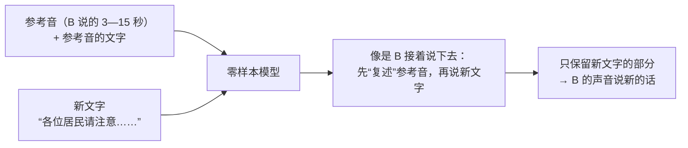
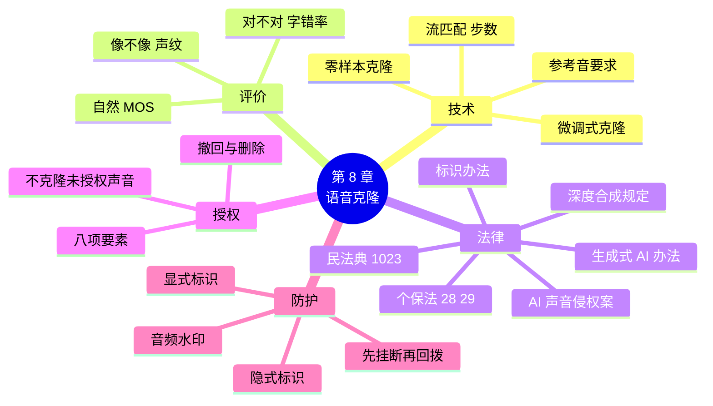

# 第 8 章 语音克隆：技术、伦理与授权

!!! abstract "本章学时"
    理论 4 学时（其中线下 2 学时）· 实验 4 学时（本章共 4 个实验，教师可任选）

!!! note "本章是样章"
    语音克隆是本书技术上最“新”、社会影响最大的一章。本章把技术和规则放在同等位置：每一个克隆实验都从“授权”开始，以“标识”结束。

## 学习目标

学完本章，你应该能够：

1. **说出**语音克隆的含义，比较微调式克隆和零样本克隆在数据、成本、效果、风险上的区别（记忆、理解）；
2. **按要求**准备一段合格的参考音，并用程序检查它的质量（应用）；
3. **运行并修改**代码，用零样本模型克隆授权声音，从相似度、字错率、自然度三方面评价克隆效果（应用、评价）；
4. **说出**《民法典》第一千零二十三条、《个人信息保护法》第二十八条和第二十九条、深度合成规定、生成式人工智能办法、标识办法中与声音有关的要求，能判断一个克隆情境是否合规（理解、评价）；
5. **写出**一份要素齐全的声音使用授权书（应用）；
6. **给**克隆作品加上显式标识、隐式标识和简单水印，说出个人防范“AI 声音诈骗”的方法（应用）。

!!! info "先修要求"
    学习本章前，你需要：

    - 学完第 5 章，知道声学模型、声码器和 MOS、回识别字错率；
    - 学完第 6 章，知道显式标识和隐式标识，会用 ffmpeg 写元数据；
    - 学完第 7 章，会算声纹相似度，知道声纹是敏感个人信息。

??? abstract "本章概念清单（8 个，点击查看定义和例子）"
    1. [零样本克隆](../../appendix/glossary.md#g-零样本克隆)
    2. [微调式克隆](../../appendix/glossary.md#g-微调式克隆)
    3. [参考音](../../appendix/glossary.md#g-参考音)
    4. [声音权益](../../appendix/glossary.md#g-声音权益)
    5. [深度合成](../../appendix/glossary.md#g-深度合成)
    6. [单独同意](../../appendix/glossary.md#g-单独同意)
    7. [声音授权书](../../appendix/glossary.md#g-声音授权书)
    8. [音频水印](../../appendix/glossary.md#g-音频水印)

## 情景导入

这个星期，社区服务站发生了两件事。

**第一件是好事。** 社区广播一直由志愿者 B 播报，居民都熟悉她的声音。B 下个月要去外地照顾孩子，半年回不来。她主动提出：“能不能用我的声音做个 AI 播音员？我不在的时候，通知还用我的声音播。”

**第二件是坏事。** 住在 5 号楼的王阿姨接到一个电话，“孙子”哭着说在外地出了车祸，急需 2 万元。声音、口气都和孙子一模一样。幸好王阿姨记得第 6 章那份告居民书里说的，先挂断，再给孙子打回去，孙子正在学校上课。

同一项技术，一边是方便和温暖，一边是诈骗和伤害。分界线在哪里？答案就是本章的三个关键词：**授权、用途、标识**。小周决定把 B 的请求做成一个“合规样板”：先签授权书，再录[参考音](../../appendix/glossary.md#g-参考音 "克隆时提供给模型、代表目标音色的一段录音，通常要求安静、单人、几秒到十几秒，并附上准确的文字"){ .term }，克隆以后加上标识，最后把整个过程讲给居民听。

## 8.1 什么是语音克隆 { #81 }

[语音克隆](../../appendix/glossary.md#g-语音克隆)是用一个人的少量录音，让机器用这个人的声音说出任意内容的技术。

它和前几章的技术是什么关系？

| 技术 | 输入 | 输出 | 本书章节 |
|---|---|---|---|
| 语音合成 | 文字 | 模型自带的某种声音 | 第 5、6 章 |
| 多说话人合成 | 文字 + 说话人编号 | 训练数据里某个人的声音 | 第 6 章 |
| 语音转换 | A 说的一段话 + 目标人录音 | 目标人的声音说同样的话 | 第 7 章 |
| **语音克隆** | 文字 + **目标人的一段录音** | 目标人的声音说新的话 | 本章 |

和多说话人合成相比，克隆的关键在于：目标人**不需要在训练数据里**，临时给一段录音就行。这让它非常方便，也非常危险。

## 8.2 两条技术路线 { #82 }

### 8.2.1 微调式和零样本

| 对比 | [**微调式克隆**](../../appendix/glossary.md#g-微调式克隆 "准备几分钟到一小时某人的录音，在预训练模型上再训练一会儿，得到专属这个人的合成模型"){ .term } | [**零样本克隆**](../../appendix/glossary.md#g-零样本克隆 "不用重新训练模型，只给几秒到十几秒的参考音和它的文字，就能用这个音色朗读新内容的克隆方法"){ .term } |
|---|---|---|
| 要多少录音 | 几分钟到一小时 | 3—15 秒 |
| 要不要训练 | 要：在预训练模型上再训练几十分钟到几小时，最好有显卡 | 不要：直接用 |
| 效果 | 更像，口音、语气、习惯都能学到 | 音色像，说话习惯学得少一些 |
| 速度 | 训练慢，训练好以后合成快 | 每次都要带上参考音，合成稍慢 |
| 代表 | GPT-SoVITS<sup class="cite">[[1]](#ref8-1)</sup>，以及各家云平台的“定制音色” | ZipVoice<sup class="cite">[[2]](#ref8-2)</sup>、F5-TTS<sup class="cite">[[3]](#ref8-3)</sup>、CosyVoice<sup class="cite">[[4]](#ref8-4)</sup> |
| 风险 | 要收集大量录音，本人一般知情 | 一条语音消息、一段短视频就够，**本人可能完全不知道** |

本书的实验用零样本克隆（ZipVoice，int8 版约 160 MB，CPU 能跑）。微调式克隆需要 GPU，放在选做的实验 8-4 里。

### 8.2.2 零样本克隆的直观

零样本克隆模型是用几万到十几万小时、成千上万人的录音训练出来的。ZipVoice 用了约 10 万小时的多语种数据<sup class="cite">[[2]](#ref8-2)</sup>。听过这么多人说话，模型学到了一种能力：**听几秒钟，就能抓住一个人声音的特点，并“续写”下去。**

可以这样理解它的工作方式：



模型把“参考音的文字 + 新文字”连在一起，把参考音当作“已经说完的开头”，然后补全后面的声音。因为开头是 B 的声音，补出来的部分自然也是 B 的音色和说话方式。这就是为什么**参考音的文字必须和录音完全对应**：文字对不上，模型就不知道开头哪一段对应哪个字，后面会读错、读乱。

ZipVoice 用的“流匹配”方法和第 5 章的 Matcha-TTS 是同一类：从一团随机噪声开始，一步步“修”成梅尔频谱。修的步数就是代码里的 `steps`，步数越多越慢，但不一定越好（实验 8-2）。

## 8.3 参考音怎么准备 { #83 }

零样本克隆“听几秒就学”，所以参考音的质量直接决定结果。参考音的要求：

| 要求 | 为什么 | 常见翻车 |
|---|---|---|
| **安静** | 噪声也会被“学”进去 | 在马路边、食堂录，克隆出来带着嘈杂声 |
| **单人** | 两个人的声音混在一起，模型不知道学谁 | 背景里有人说话、电视在响 |
| **5—15 秒** | 太短抓不住特点，太长更慢，提升有限 | 只说了“喂，你好” |
| **不削波、不太小** | 削波会带进“破音”，太小则噪声相对变大 | 嘴贴着麦克风大喊 |
| **首尾静音短** | 长静音浪费时长，还可能让模型在开头停顿 | 按下录音后等了 3 秒才开口 |
| **文字完全对应** | 模型靠文字和声音对齐（8.2.2 节） | 录的时候改了几个字，文字没跟着改 |
| **语气平稳自然** | 参考音的情绪会被带到所有输出里 | 用一段哭腔或喊叫当参考音 |

实验 8-1 写了一个“参考音体检”程序，逐项检查这些要求，并用识别模型检查文字是否对应。

**参考音要多长？** 实验 8-2 用虚拟授权人 B 的 4 段不同长度的参考音克隆同一句话：

| 参考音长度 | 2.8 秒 | 5.8 秒 | 9.3 秒 | 14.2 秒 |
|---|---|---|---|---|
| 克隆结果和 B 真实录音的相似度 | 0.70 | 0.68 | 0.68 | 0.71 |
| 和其他志愿者的最高相似度 | 0.42 | 0.43 | 0.37 | 0.39 |
| 实时率 | 0.50 | 0.80 | 1.25 | 1.81 |

**只用不到 3 秒的参考音，相似度就和 14 秒的差不多。** 这些参考音都是干净的合成声音，真人录音有噪声、有口音时，长一点会更稳定；但这个结果已经说明了零样本克隆的威力，以及它的危险：一条短短的语音消息，就可能被拿去克隆。下面的动画“参考时长与相似度”，可以听一听这几段克隆结果。

<iframe class="sim-frame" src="../../sims/clone-settings/main.html" height="620" loading="lazy" title="参考时长与相似度"></iframe>
动画：参考时长与相似度。改参考音长度和生成步数，听克隆结果，比较相似度。[全屏打开](../../sims/clone-settings/main.html){ target=_blank }
{ .sim-caption }

## 8.4 克隆效果怎么评价 { #84 }

评价克隆，要看三个方面，正好用上前几章的工具：

| 方面 | 问题 | 方法 | 本书工具 |
|---|---|---|---|
| **像不像** | 听起来是不是这个人 | 克隆结果和本人另一段录音的声纹相似度 | 第 7 章 `embed` |
| **对不对** | 字有没有读错、漏读 | 回识别字错率 | 第 4 章 `transcribe`、第 3 章 `cer` |
| **自然不自然** | 像不像真人在说话 | MOS 盲听打分 | 第 5 章实验 5-4 |

注意“像不像”要用本人**另一段**录音比，不能和参考音本身比，否则就像“用考题当标准答案”。

实验 8-2 的结果：克隆结果和 B 的相似度约 0.66—0.71，和其他志愿者最高 0.37—0.43；第 7 章中 B 本人两段录音的相似度约 0.9。也就是说，克隆的声音明显像 B、不像别人，但还没有到“和本人一模一样”的程度。

!!! warning "0.70 意味着什么？"
    第 7 章的声纹登录实验中，门槛取 0.68 时恰好“两种错误都是 0”。如果门槛真的设在 0.68，相似度 0.70 的克隆声音就能**冒充 B 登录成功**。这就是 7.5.2 节说的“合成声音能骗过声纹”，也是声纹系统必须配防伪检测的原因。

## 8.5 正当用途与风险 { #85 }

**正当用途**（前提都是本人授权）：

- **个性化语音助手**：用自己或家人的声音做导航、读消息；
- **有声书与配音**：主播授权后，用克隆声音录新书、做多语种配音，主播只需审听；
- **虚拟主播和数字人**：签约主播的“AI 分身”，在主播休息时播报固定内容；
- **为患者“保存声音”**：渐冻症、喉癌等患者在失声前录下声音，以后用合成的“自己的声音”和家人交流，这是语音克隆最有温度的用途之一；
- **教育**：外语教师用自己的声音生成大量听力材料。

**风险**：

- **冒充亲友诈骗**：克隆子女、孙辈的声音打电话借钱，就像王阿姨遇到的那样；
- **冒用名人**：用名人声音带货、发表虚假言论；
- **伪造证据**：伪造一段“某人亲口承认”的录音；
- **虚假新闻**：伪造官员、专家的讲话；
- **侵犯从业者权益**：配音演员、主播的声音被未经许可“AI 化”后出售，抢走他们的工作。

## 8.6 法律与规则 { #86 }

本节是本章的重点。下面的条文都已核对原文，引用时写明了条号，方便查阅。

### 8.6.1 声音受法律保护 { #861 }

《中华人民共和国民法典》第一千零二十三条第二款<sup class="cite">[[5]](#ref8-5)</sup>：

> 对自然人声音的保护，参照适用肖像权保护的有关规定。

肖像权的核心是：**未经本人同意，不得制作、使用、公开他人的肖像。**参照到声音，就是：未经本人同意，不得模仿、使用、公开他人的声音，更不能用来营利。这就是[**声音权益**](../../appendix/glossary.md#g-声音权益 "自然人对自己声音享有的人格权益，《民法典》规定参照肖像权保护，未经许可不得使用"){ .term }。

**判例：全国首例 AI 生成声音人格权侵权案。** 2024 年 4 月 23 日，北京互联网法院对一起案件作出一审判决<sup class="cite">[[6]](#ref8-6)</sup>：

- **案情**：原告是一位配音师。他发现，一款配音软件里出售的一个 AI 音色就是用他的声音做的。原来，他曾为一家文化传媒公司录制有声书，这家公司把录音交给一家软件公司，软件公司用这些录音做成了 AI 音色，通过平台对外出售。
- **被告的说法**：传媒公司认为，按合同，录音制品的著作权归公司，所以可以使用。
- **法院的认定**：
    1. 在具备**可识别性**的前提下（一般人听到 AI 声音能联想到原告），自然人声音权益的保护范围可以及于 AI 生成的声音；
    2. 公司拥有录音制品的著作权，**不等于**获得了把原告的声音拿去做 AI 化使用的授权；
    3. 判决两家被告公司赔偿原告经济损失 25 万元，相关被告向原告书面赔礼道歉。

这个案例告诉我们：**“我手里有这个人的录音”和“我可以克隆这个人的声音”是两回事**，后者需要专门的授权。

### 8.6.2 声纹是敏感个人信息

第 7 章讲过，《个人信息保护法》第二十八条把生物识别信息列为敏感个人信息，第二十九条要求处理敏感个人信息取得个人的[**单独同意**](../../appendix/glossary.md#g-单独同意 "针对某一项个人信息处理活动专门、单独取得的同意，不能和其他条款捆绑一次勾选"){ .term }<sup class="cite">[[7]](#ref8-7)</sup>。克隆一个人的声音，要采集、分析他的录音，属于处理他的个人信息；用来做身份识别时更是敏感个人信息。

### 8.6.3 深度合成规定

《互联网信息服务深度合成管理规定》由国家互联网信息办公室、工业和信息化部、公安部发布，2023 年 1 月 10 日起施行<sup class="cite">[[8]](#ref8-8)</sup>。规定所说的[**深度合成**](../../appendix/glossary.md#g-深度合成 "利用深度学习等生成合成类算法制作文本、图像、音频、视频等网络信息的技术，包括合成人声、仿声"){ .term }，是指利用深度学习等生成合成类算法制作文本、图像、音频、视频等网络信息的技术，语音克隆正在其中。和声音有关的条款：

- **第十四条第二款**：深度合成服务提供者和技术支持者提供人脸、人声等生物识别信息编辑功能的，应当提示深度合成服务使用者依法告知被编辑的个人，并取得其单独同意。
- **第十六条**：服务提供者对生成或编辑的内容，应当添加不影响用户使用的标识。
- **第十七条**：提供“合成人声、仿声等语音生成或者显著改变个人身份特征的编辑服务”，可能导致公众混淆或者误认的，应当在合理位置进行显著标识。

### 8.6.4 生成式人工智能服务管理暂行办法

国家互联网信息办公室等七部门联合公布，2023 年 8 月 15 日起施行<sup class="cite">[[9]](#ref8-9)</sup>。第四条第（四）项要求提供和使用生成式人工智能服务，应当“尊重他人合法权益……不得侵害他人肖像权、名誉权、荣誉权、隐私权和个人信息权益”；第十二条要求按照深度合成规定对生成内容进行标识。

### 8.6.5 标识办法

第 6 章介绍过的《人工智能生成合成内容标识办法》，2025 年 9 月 1 日起施行<sup class="cite">[[10]](#ref8-10)</sup>。对克隆声音来说，最重要的是两条：

- **第四条**：音频要在起始、末尾或中间适当位置添加语音提示或音频节奏提示等显式标识；
- **第十条**：用户发布生成合成内容，应当主动声明并使用标识功能；**任何组织和个人不得恶意删除、篡改、伪造、隐匿标识**。

### 8.6.6 平台规则

主流短视频、直播和音频平台都要求发布者对 AI 生成的声音、数字人内容主动添加“AI 生成”声明，未声明的可能被限流或下架，冒用他人声音的会被处理。具体规则各平台不同、更新也快，发布前要看平台的最新公告。

把这些规则合在一起，可以记成三句话：

1. **克隆谁的声音，先拿到谁的授权**（民法典、个保法、深度合成规定）；
2. **用途正当，不冒充、不欺骗、不侵权**（生成式人工智能办法）；
3. **作品出门，必须标识，不许删除标识**（深度合成规定、标识办法）。

用下面的动画“这样克隆合规吗”做 10 道情境判断题。

<iframe class="sim-frame" src="../../sims/clone-compliance/main.html" height="480" loading="lazy" title="这样克隆合规吗"></iframe>
动画：这样克隆合规吗。10 个克隆情境，先自己判断，再看答案和依据条款。[全屏打开](../../sims/clone-compliance/main.html){ target=_blank }
{ .sim-caption }

## 8.7 授权怎么做 { #87 }

### 8.7.1 授权书要写清什么

一份合格的[**声音授权书**](../../appendix/glossary.md#g-声音授权书 "声音所有人书面同意他人在约定用途、范围、期限内采集和使用其声音的文件"){ .term }至少要写清 8 项内容：

| 要素 | 写什么 | 为什么 |
|---|---|---|
| 1. 授权人和被授权人 | 姓名、联系方式 | 谁授权给谁 |
| 2. 授权内容 | 允许采集哪些录音、允许克隆生成什么 | 范围要具体 |
| 3. 用途 | 例如“社区通知广播”，不包括广告、政治、娱乐恶搞 | 用途正当、可以追责 |
| 4. 发布范围 | 只在社区广播和业主群，还是可以公开到网上 | 防止扩散 |
| 5. 期限 | 起止日期 | 到期自动失效 |
| 6. 是否商用、有无报酬 | 明确写“非商业用途、无偿”或报酬标准 | 避免纠纷 |
| 7. 标识要求 | 每段作品必须带“AI 合成”提示 | 落实标识办法 |
| 8. 撤回与删除 | 授权人随时可以书面撤回；撤回或到期后，删除录音、模型和生成内容的时限 | 落实个保法的撤回权 |

### 8.7.2 授权书模板

下面是本书的模板（附录 D 有可打印的版本）。实验 8-1 要求你填一份“授权给自己的课程作业”的授权书。

!!! example "声音使用授权书（模板）"
    **授权人**：＿＿＿＿（姓名），联系电话＿＿＿＿
    **被授权人**：＿＿＿＿（单位或个人），联系人＿＿＿＿，联系电话＿＿＿＿

    本人自愿授权被授权人在以下范围内采集和使用本人的声音：

    1. **采集内容**：本人朗读指定文字的录音共＿＿段，总时长约＿＿分钟。
    2. **使用方式**：使用语音合成和语音克隆技术，以本人的声音生成新的语音内容。
    3. **用途**：仅用于＿＿＿＿＿＿＿＿（例如：幸福里社区通知广播）。**不得**用于广告代言、商业营销、政治宣传、娱乐恶搞、冒充本人与他人沟通，以及其他本授权书未列明的用途。
    4. **发布范围**：＿＿＿＿＿＿＿＿（例如：社区广播站、社区业主微信群）。
    5. **期限**：自＿＿年＿＿月＿＿日至＿＿年＿＿月＿＿日。
    6. **商业性质**：□ 非商业用途，无偿　□ 商业用途，报酬为＿＿＿＿
    7. **标识**：被授权人发布的每一段生成内容，都应在开头以语音提示“以下内容由人工智能合成”，并在文件中保留相应标识。
    8. **审听**：重要内容发布前，本人有权先行审听；本人认为不妥的，被授权人不得发布。
    9. **数据保护**：被授权人应妥善保管本人的录音和声音模型，不得提供给第三方。
    10. **撤回与删除**：本人可随时以书面方式撤回本授权。撤回或期限届满后，被授权人应在＿＿日内删除本人的录音、声音模型和尚未发布的生成内容，并停止使用。

    本人已阅读并理解以上内容，明白声音属于本人的人格权益、声纹属于敏感个人信息，同意按上述约定单独授权。

    授权人签字：＿＿＿＿　　日期：＿＿＿＿
    被授权人签字（盖章）：＿＿＿＿　　日期：＿＿＿＿

!!! warning "没有授权的声音，一律不克隆"
    包括：公众人物和明星的声音、网上下载的录音、同学朋友的声音（哪怕是开玩笑）、已经去世的人的声音（要征得近亲属同意，并且只能私下使用）。**模型下载包里自带的示例音频也不要用**：本书使用的 ZipVoice 模型包 `test_wavs` 文件夹里有真实公众人物的录音，所有实验都只使用书里的“虚拟授权人”或你自己的声音。

## 8.8 技术防护与个人防诈 { #88 }

### 8.8.1 技术防护

- **显式标识**：开头的语音提示，人一听就知道（实验 8-3）；
- **隐式标识**：文件元数据里的“AI 生成”信息，机器能读出来（实验 8-3）；
- [**音频水印**](../../appendix/glossary.md#g-音频水印 "嵌入在声音里、人耳几乎听不出、但用密钥可以检测出来的标记，用来证明来源或标明 AI 生成"){ .term }：把一段人耳几乎听不出的“暗记”混在声音里，用密钥才能检测。元数据一转格式可能就丢了，水印却跟着声音走。实验 8-3 做了一个教学用的简单水印：能量比声音低 34 dB，转成 MP3 后仍然能检测出来，换一个密钥就检测不到。正式产品要用更强的专业方案，并符合国家标准 GB 45438—2025<sup class="cite">[[11]](#ref8-11)</sup>；
- **合成语音检测**：训练专门的模型区分真人和合成声音（第 7 章的 ASVspoof 评测）。

### 8.8.2 个人防诈：给家人的四条建议

这几条可以直接讲给社区里的老人听：

1. **涉及钱，先挂断，再回拨**：用自己手机里存的号码打回去确认，不用对方给的号码；
2. **约一个家庭暗号**：家人之间约一个只有自己知道的问题或词，电话里要钱时先对暗号；
3. **少在网上公开长段语音**：公开的视频、语音消息都可能被拿去克隆；
4. **拿不准就问**：拨打 96110 反诈专线，或者找社区、派出所。

## 8.9 前沿视窗

**几秒钟就能克隆，“声音身份”还靠得住吗？** 本章的实验已经说明：不到 3 秒的参考音就能克隆出相似度 0.70 的声音。2023 年微软的 VALL-E 只用 3 秒录音就能克隆<sup class="cite">[[12]](#ref8-12)</sup>；此后 CosyVoice、F5-TTS、ZipVoice 等开源模型让零样本克隆可以在普通电脑上运行。“听声音认人”这件事，正在从“可靠”变成“需要核实”。

应对的思路也在变化：一方面，用法律和标识规范“谁能克隆、克隆后要标明”；另一方面，研究人员在开发更难去除的水印和更强的伪造检测。对每一个学习这门技术的人来说，最重要的防线还是自己：**只克隆授权的声音，只做正当的用途，作品出门先加标识。**

## 本章实验

!!! abstract "实验总览"
    | 实验 | 类型 | 建议时长 | 内容 |
    |---|---|---|---|
    | 实验 8-1 | ★ 基础 | 45 分钟 | 填写声音授权书，录参考音，用“体检”程序检查 6 种常见问题 |
    | 实验 8-2 | ★ 基础 | 45 分钟 | 用 ZipVoice 零样本克隆虚拟授权人 B 的声音，改参考时长和生成步数，测相似度、字错率、实时率 |
    | 实验 8-3 | ★ 基础 | 45 分钟 | 给克隆结果加开头语音提示、元数据隐式标识和简单水印，并检测水印 |
    | 实验 8-4 | ☆ 拓展 | 90 分钟 | 在云端 GPU 上用 GPT-SoVITS 微调自己的声音，与零样本对比（待实测） |

    代码见配套资源 `labs/ch08/` 目录。运行前在 `labs` 文件夹里执行 `python models.py ch08`。**所有实验只使用书里的虚拟授权人（A、B、C、D，均为合成声音）或已签授权书的你自己的声音。**

### 实验 8-1 ★ 签授权书，录参考音

**实验目的**

1. 会填写一份要素齐全的声音使用授权书；
2. 会按要求录制参考音；
3. 会用程序检查参考音的时长、音量、削波、静音、噪声和文字对应。

**实验环境**：本机 CPU 或云端 Notebook，手机或电脑麦克风（可选）。**实验数据**：虚拟授权人 B 的录音 `volunteer_B_1.wav` 和 `ref_B_3s.wav`，以及程序用它们“故意做坏”的几段录音。模型 `sensevoice`。

**实验步骤与代码**

第 1 步，**填写授权书**。打印附录 D 的《声音使用授权书》，授权人和被授权人都写你自己，用途写“《TTS、SST 与语音克隆》课程实验作业”，发布范围写“仅提交给任课教师”，期限写到本学期结束，勾选“非商业用途，无偿”。不愿意用自己声音的同学，直接用虚拟授权人 B，跳过第 2 步。

第 2 步，**录参考音**。找一个安静的房间，手机离嘴一拳远，用平稳的语气读：“大家好，我是社区志愿者，平时负责每周的社区广播和活动通知，很高兴为大家服务。”保存为 WAV（手机录的 m4a 可以用第 2 章的方法转换）。

第 3 步，运行 `lab8_1_check_reference.py`。`check` 函数逐项检查，返回不合格的项目：

```python
import sys

import librosa
import numpy as np
import soundfile as sf

sys.path.append("..")
from voicelab import cer, save_audio, transcribe


def check(file, text):
    """检查一段参考音，返回不合格的项目列表"""
    info = sf.info(file)
    audio, sr = librosa.load(file, sr=None, mono=True)
    dur = len(audio) / sr
    problems = []
    if not 5 <= dur <= 15:
        problems.append(f"时长 {dur:.1f} 秒，建议 5—15 秒")
    if info.channels > 1:
        problems.append("双声道，建议录成单声道")
    if sr < 16000:
        problems.append(f"采样率 {sr} Hz 太低，至少 16000 Hz")
    if np.mean(np.abs(audio) > 0.99) > 0.001:
        problems.append("有削波（声音太大被“削顶”），离麦克风远一点")
    if np.abs(audio).max() < 0.1:
        problems.append("声音太小，靠近一点或调大录音音量")
    frames = librosa.feature.rms(y=audio, frame_length=1024, hop_length=256)[0]
    loud = frames > 0.1 * frames.max()                          # 有声音的帧
    lead, tail = np.argmax(loud) * 256 / sr, np.argmax(loud[::-1]) * 256 / sr
    if lead > 1 or tail > 1:
        problems.append(f"开头静音 {lead:.1f} 秒、结尾静音 {tail:.1f} 秒，剪到 0.5 秒以内")
    snr = 20 * np.log10(np.percentile(frames, 90) / (np.percentile(frames, 10) + 1e-9))
    if snr < 25:
        problems.append(f"背景噪声偏大（信噪比约 {snr:.0f} dB），换个安静的地方")
    heard = transcribe(audio, sr)
    if cer(text, heard)[0] > 0.1:
        problems.append(f"文字对不上：识别结果是“{heard}”")
    return problems


# 1. 准备几段“有问题”的参考音（用虚拟授权人 B 的录音故意做坏）
good = "../data/voices/volunteer_B_1.wav"
text = "大家好，我是社区志愿者，平时负责每周的社区广播和活动通知，很高兴为大家服务。"
audio, sr = librosa.load(good, sr=None)
rng = np.random.default_rng(0)
save_audio("bad_noisy.wav", audio + 0.03 * rng.standard_normal(len(audio)), sr)
save_audio("bad_clipped.wav", np.clip(audio * 5, -1, 1), sr)
save_audio("bad_silence.wav", np.concatenate([np.zeros(3 * sr), audio, np.zeros(3 * sr)]), sr)
cases = [("合格的参考音", good, text),
         ("太短", "../data/voices/ref_B_3s.wav", "大家好，我是社区志愿者。"),
         ("有噪声", "bad_noisy.wav", text),
         ("削波", "bad_clipped.wav", text),
         ("首尾静音太长", "bad_silence.wav", text),
         ("文字写错了", good, "大家好，我是物业的工作人员，负责小区的保洁和绿化。")]

# 2. 逐个检查
for name, file, t in cases:                                      # ← 改这里：换成你自己的录音和文字
    problems = check(file, t)
    print(f"【{name}】", "✓ 合格" if not problems else "✗ " + "；".join(problems))
```

**运行结果**（编者运行）

```text
【合格的参考音】 ✓ 合格
【太短】 ✗ 时长 2.8 秒，建议 5—15 秒
【有噪声】 ✗ 背景噪声偏大（信噪比约 9 dB），换个安静的地方
【削波】 ✗ 有削波（声音太大被“削顶”），离麦克风远一点
【首尾静音太长】 ✗ 时长 15.3 秒，建议 5—15 秒；开头静音 3.1 秒、结尾静音 3.2 秒，剪到 0.5 秒以内
【文字写错了】 ✗ 文字对不上：识别结果是“大家好，我是社区志愿者。平时负责每周的社区广播和活动通知，很高兴为大家服务。”
```

读结果：

- 合格的参考音 6 项全部通过。
- “太短”只有 2.8 秒，低于建议的 5 秒（实验 8-2 会看到，对干净的声音 3 秒也能克隆，但真人录音最好长一些）。
- “首尾静音太长”同时触发了两条：总时长超过 15 秒，首尾各有 3 秒静音。
- “文字写错了”：识别结果和给出的文字差别很大，说明文字和录音对不上，这种参考音会让克隆读错。

**改一改**

1. 把 `cases` 换成你自己的录音和文字，运行体检，直到“✓ 合格”。
2. 把噪声 `0.03` 改成 `0.005`，还会报“背景噪声偏大”吗？信噪比是多少？

**实验记录表**

| 项目 | 第一次录音 | 改进后 |
|---|---|---|
| 时长（秒） | | |
| 发现的问题 | | |
| 改进方法 | | |
| 识别结果和原文是否一致 | | |
| 授权书是否填写完整（8 项要素） | | |

**常见问题排查**

| 现象 | 原因 | 解决办法 |
|---|---|---|
| `soundfile.LibsndfileError: Format not recognised` | 手机录的是 m4a、aac 等格式 | 用 ffmpeg 转换：`ffmpeg -i 录音.m4a -ac 1 -ar 24000 录音.wav` |
| 总是报“背景噪声偏大” | 环境吵，或手机开了降噪导致忽大忽小 | 换安静的房间、关空调风扇；离麦克风近一点 |
| 识别结果总有一两个字不同 | 口音或读得快 | 字错率 10% 以内程序不会报错；差别大就重录，或按实际读的内容修改文字 |

**思考与练习**

1. 为什么参考音的文字要和录音完全对应？
2. 授权书第 10 条“撤回与删除”为什么重要？

**实验报告要求**

提交填好的授权书（扫描件或照片，用虚拟授权人的同学提交空白模板并写出每一项应该怎么填）、体检结果截图和记录表。

### 实验 8-2 ★ 零样本克隆

**实验目的**

1. 会用 ZipVoice 进行零样本克隆；
2. 会用声纹相似度、回识别字错率和实时率评价克隆结果；
3. 能说出参考音长度和生成步数对克隆的影响。

**实验环境**：本机 CPU 或云端 Notebook。**实验数据**：虚拟授权人 B 的 4 段不同长度的参考音（`ref_B_3s.wav`、`ref_B_6s.wav`、`volunteer_B_1.wav`、`ref_B_15s.wav`，文字见 `ref_lengths.csv`），以及 A、B、C、D 各一段没参与克隆的录音（`volunteer_*_3.wav`）。模型 `zipvoice`、`speaker`、`sensevoice`。

**实验步骤与代码**

运行 `lab8_2_clone.py`。`voicelab.clone()` 需要三样东西：新文字、参考音、参考音的文字。

```python
import csv
import sys
import time

sys.path.append("..")
from voicelab import cer, clone, embed, save_audio, transcribe

text = "各位居民请注意，本周六上午九点，社区卫生服务站提供免费量血压服务。"      # ← 改这里：要克隆声音说的话
refs = {row["文件"]: row["文字"] for row in csv.DictReader(open("../data/voices/ref_lengths.csv", encoding="utf-8-sig"))}
refs["volunteer_B_1.wav"] = "大家好，我是社区志愿者，平时负责每周的社区广播和活动通知，很高兴为大家服务。"
order = ["ref_B_3s.wav", "ref_B_6s.wav", "volunteer_B_1.wav", "ref_B_15s.wav"]

# 用 B 没参与克隆的一段录音当“真身”，看克隆结果像不像 B；再和 A、C、D 比，看是否“不像别人”
real = {c: embed(f"../data/voices/volunteer_{c}_3.wav") for c in "ABCD"}
clone("预热", "../data/voices/ref_B_3s.wav", refs["ref_B_3s.wav"])   # 先加载模型


def evaluate(audio, sr, used):
    v = embed(audio, sr)
    others = max(v @ real[c] for c in "ACD")
    heard = transcribe(audio, sr)
    return f"像 B {v @ real['B']:.2f}  像别人(最高) {others:.2f}  字错率 {cer(text, heard)[0]:4.0%}  实时率 {used / (len(audio) / sr):.2f}"


print("== 第 1 步：参考音长短不同（生成步数 4）==")
for name in order:
    start = time.time()
    audio, sr = clone(text, f"../data/voices/{name}", refs[name], steps=4)
    used = time.time() - start
    save_audio(f"clone_{name}", audio, sr)
    print(f"{name:<18} {evaluate(audio, sr, used)}")

print("\n== 第 2 步：生成步数不同（参考音 volunteer_B_1，约 9 秒）==")
for steps in [1, 2, 4, 8, 16]:                                   # ← 改这里
    start = time.time()
    audio, sr = clone(text, "../data/voices/volunteer_B_1.wav", refs["volunteer_B_1.wav"], steps=steps)
    used = time.time() - start
    save_audio(f"clone_steps{steps}.wav", audio, sr)
    print(f"步数 {steps:>2}  {evaluate(audio, sr, used)}")
```

**运行结果**（编者运行，约 2 分钟）

```text
== 第 1 步：参考音长短不同（生成步数 4）==
ref_B_3s.wav       像 B 0.70  像别人(最高) 0.42  字错率   3%  实时率 0.50
ref_B_6s.wav       像 B 0.68  像别人(最高) 0.43  字错率   3%  实时率 0.80
volunteer_B_1.wav  像 B 0.68  像别人(最高) 0.37  字错率   3%  实时率 1.25
ref_B_15s.wav      像 B 0.71  像别人(最高) 0.39  字错率   3%  实时率 1.81
== 第 2 步：生成步数不同（参考音 volunteer_B_1，约 9 秒）==
步数  1  像 B 0.17  像别人(最高) 0.10  字错率  23%  实时率 0.30
步数  2  像 B 0.59  像别人(最高) 0.33  字错率   3%  实时率 0.60
步数  4  像 B 0.66  像别人(最高) 0.38  字错率   3%  实时率 1.09
步数  8  像 B 0.60  像别人(最高) 0.33  字错率   3%  实时率 2.24
步数 16  像 B 0.59  像别人(最高) 0.27  字错率   3%  实时率 4.51
```

读结果：

- **参考时长**：2.8 秒到 14.2 秒，相似度都在 0.68—0.71 之间，差别不大；但参考音越长越慢，实时率从 0.50 升到 1.81。
- **生成步数**：1 步时声音模糊，相似度只有 0.17，还漏读了字（字错率 23%）；2 步就基本可用；4 步以上相似度不再提高，速度却成倍变慢。默认的 4 步是折中。
- 字错率 3% 不是真的读错：原文写“九点”，识别结果写成“9点”，是写法不同（第 3 章讲过比较前要统一写法）。
- 克隆结果和其他志愿者的相似度最高 0.43，明显低于和 B 的相似度。

**改一改**

1. 用你自己的参考音（实验 8-1 合格的那段）克隆，改 `text` 说一句你想说的话，算一算和你另一段录音的相似度。
2. 用 C（男声）的 `volunteer_C_1.wav` 当参考音，克隆同一句话，看相似度。
3. **挑战**：给 B 的参考音加上实验 8-1 的噪声再克隆，听一听噪声有没有被“学”进去。

**实验记录表**

| 参考音 | 时长 | 步数 | 像本人 | 像别人（最高） | 字错率 | 实时率 | 听感（1—5 分） |
|---|---|---|---|---|---|---|---|
| | | | | | | | |
| | | | | | | | |
| | | | | | | | |

**常见问题排查**

| 现象 | 原因 | 解决办法 |
|---|---|---|
| `FileNotFoundError: 模型 zipvoice 还没下载` | 模型没下载 | `python models.py zipvoice`（约 160 MB） |
| 克隆出来是乱码一样的声音 | 用了旧版非 int8 模型包 | 按附录 B 下载 `sherpa-onnx-zipvoice-distill-int8-zh-en-emilia` |
| 克隆结果开头多出参考音里的话 | 参考音文字比录音少了几个字 | 让参考音文字和录音完全一致 |
| 运行很慢 | ZipVoice 在 CPU 上实时率约 1 | 正常；可以把步数降到 2，或用云端 GPU |

**思考与练习**

1. 为什么评价“像不像”要用本人另一段录音，而不是参考音本身？
2. 只要 3 秒参考音就能克隆，这对你在网上发语音、发视频有什么启发？

**实验报告要求**

提交记录表和你认为效果最好的一段克隆音频（必须是授权声音），说明选择理由。

### 实验 8-3 ★ 克隆像不像，并贴上标签

**实验目的**

1. 会给克隆作品加显式标识（开头语音提示）和隐式标识（元数据）；
2. 理解音频水印的原理，会嵌入和检测一个简单水印；
3. 能说出元数据和水印各自的优缺点。

**实验环境**：本机 CPU 或云端 Notebook，需要 ffmpeg。**实验数据**：实验 8-2 生成的 `clone_volunteer_B_1.wav`。模型 `matcha-zh`。

**实验步骤与代码**

第 1 步，看看 `watermark.py`。水印原理是“叠加平均”：用密钥生成一段 4096 个采样点的伪随机噪声，只保留 1—4 kHz（这个频段压缩成 MP3 时不容易被去掉），一遍遍铺满整段声音。检测时，把声音切成 4096 点一块，所有块叠加平均：声音每块都不一样，平均后互相抵消；水印每块都一样，平均后保留下来。再和用同一个密钥生成的图案做相关，得分高就说明有水印。

```python
import numpy as np
from scipy.signal import butter, sosfilt

BLOCK = 4096                                            # 水印图案的长度（采样点）


def _pattern(key, sr):
    """用密钥生成一段固定的伪随机噪声，并只保留 1—4 kHz（压缩成 MP3 后也不容易丢）"""
    rng = np.random.default_rng(key)
    p = rng.standard_normal(BLOCK)
    p = sosfilt(butter(4, [1000, 4000], btype="band", fs=sr, output="sos"), p)
    return p / np.sqrt(np.mean(p ** 2))


def embed_watermark(audio, sr, key, strength=0.02):
    """把水印图案一遍遍铺满整段声音。strength 是水印相对于声音音量的比例"""
    p = _pattern(key, sr)
    tiled = np.resize(p, len(audio))
    rms = np.sqrt(np.mean(audio ** 2))
    return (audio + strength * rms * tiled).astype(np.float32)


def detect_watermark(audio, sr, key):
    """返回检测得分：把声音切成和图案一样长的块，叠加平均后和图案做相关。没有水印时得分一般在 -3 到 3 之间，有水印时大于 5（声音越长越明显）"""
    p = _pattern(key, sr)
    n = len(audio) // BLOCK
    if n == 0:
        return 0.0
    avg = audio[:n * BLOCK].reshape(n, BLOCK).mean(axis=0)        # 叠加平均：声音互相抵消，水印越叠越强
    avg = sosfilt(butter(4, [1000, 4000], btype="band", fs=sr, output="sos"), avg)
    corr = np.dot(avg, p) / (np.linalg.norm(avg) * np.linalg.norm(p) + 1e-12)
    return float(corr * np.sqrt(BLOCK))                           # 换算成“比随机水平高几倍”
```

第 2 步，运行 `lab8_3_label.py`：

```python
import json
import subprocess
import sys

import librosa
import numpy as np

sys.path.append("..")
from voicelab import read_audio, save_audio, speak
from watermark import detect_watermark, embed_watermark

KEY = 2026                                                     # 水印密钥，只有知道密钥的人能检测  ← 改这里
cloned, sr = read_audio("clone_volunteer_B_1.wav", sr=None)

# 1. 显式标识：开头加一句语音提示，用另一个声音（Matcha）说，和克隆的声音区分开
notice, nsr = speak("以下内容由人工智能合成。", model="matcha-zh")
notice = librosa.resample(notice, orig_sr=nsr, target_sr=sr)
labeled = np.concatenate([notice, np.zeros(int(0.5 * sr)), cloned]).astype(np.float32)

# 2. 水印：把密钥生成的微弱噪声铺进整段声音
marked = embed_watermark(labeled, sr, KEY)
save_audio("labeled.wav", marked, sr)

# 3. 隐式标识：用 ffmpeg 转成 MP3，元数据里写上生成合成属性、制作者、内容编号
meta = {"AIGC": "AI生成", "Producer": "某某学院-语音课程作业-学号20260001", "ContentID": "ch08-lab3-0001",
        "Model": "ZipVoice", "Voice": "虚拟授权人B（已授权）"}
subprocess.run(["ffmpeg", "-y", "-loglevel", "error", "-i", "labeled.wav", "-b:a", "64k",
                "-metadata", "comment=" + json.dumps(meta, ensure_ascii=False), "labeled.mp3"], check=True)
probe = subprocess.run(["ffprobe", "-v", "error", "-show_entries", "format_tags=comment", "-of", "default=nw=1:nk=1",
                        "labeled.mp3"], capture_output=True, text=True).stdout.strip()
print("MP3 里读出的隐式标识：", probe)

# 4. 检测水印：有水印、没水印、转成 MP3 后、用错密钥、B 的真实录音
mp3, msr = librosa.load("labeled.mp3", sr=sr)
real, rsr = read_audio("../data/voices/volunteer_B_3.wav", sr=None)
tests = [("加了水印的 WAV", marked, KEY), ("没加水印的克隆", labeled, KEY), ("转成 MP3 以后", mp3, KEY),
         ("用错误的密钥检测", marked, 1234), ("B 的真实录音", real, KEY)]
print("\n检测对象            得分    结论（得分 > 5 判为有水印）")
for name, audio, key in tests:
    score = detect_watermark(audio, sr, key)
    print(f"{name:<14}  {score:6.1f}    {'有水印' if score > 5 else '没有检测到'}")

# 5. 水印会不会影响听感？算一算水印比声音小多少分贝
noise = marked - labeled
print(f"\n水印能量比声音低 {10 * np.log10(np.mean(labeled ** 2) / np.mean(noise ** 2)):.0f} dB")
```

**运行结果**（编者运行）

```text
MP3 里读出的隐式标识： {"AIGC": "AI生成", "Producer": "某某学院-语音课程作业-学号20260001", "ContentID": "ch08-lab3-0001", "Model": "ZipVoice", "Voice": "虚拟授权人B（已授权）"}
检测对象            得分    结论（得分 > 5 判为有水印）
加了水印的 WAV          8.4    有水印
没加水印的克隆            1.7    没有检测到
转成 MP3 以后          8.2    有水印
用错误的密钥检测          -0.4    没有检测到
B 的真实录音            1.7    没有检测到
水印能量比声音低 34 dB
```

读结果：

- 元数据里写了 5 项信息（生成合成属性、制作者、内容编号、模型、音色来源），对应标识办法第五条要求的“生成合成内容属性信息、服务提供者名称或者编码、内容编号等”，这里是课程作业的简化写法。
- 水印能量比声音低 34 dB，人耳几乎听不出。有水印的 WAV 和转成 MP3 后得分都在 8 以上；没加水印的克隆、B 的真实录音、用错误的密钥，得分都低于 2。编者另用 26 段没有水印的录音、各试 30 个密钥（共 780 次）检测，得分全部低于 5，没有误报。
- 元数据和水印的区别：元数据转一次格式、截一段音就可能丢；水印跟着声音走，但简单水印也能被专门的处理去掉。两者要配合使用。

**改一改**

1. 把 `strength` 改成 0.005 和 0.1，听一听水印能不能听出来，再看检测得分怎么变。（编者用克隆的那段声音测试：0.005 约 2.8，0.1 约 10.9。）
2. 只取 `labeled.wav` 的前 2 秒检测水印，得分是多少？为什么声音越短越难检测？（编者实测：前 2 秒约 5.1，前 4 秒约 7.2。）
3. **挑战**：用 ffmpeg 把 `labeled.mp3` 转成 32 kbps，或者加一点噪声，看水印还能不能检测出来。

**实验记录表**

| 检测对象 | 得分 | 是否检测到 |
|---|---|---|
| 加了水印的 WAV | | |
| 转成 MP3 以后 | | |
| 用错误的密钥 | | |
| 你自己的设置（strength=＿＿） | | |

**常见问题排查**

| 现象 | 原因 | 解决办法 |
|---|---|---|
| `FileNotFoundError: clone_volunteer_B_1.wav` | 没先做实验 8-2 | 先运行 `lab8_2_clone.py` |
| `FileNotFoundError: [WinError 2]` | 没装 ffmpeg | 按附录 B 安装 |
| Windows 上元数据显示成乱码 | 部分播放器不支持 UTF-8 中文元数据 | 用 `ffprobe` 查看；或把中文换成英文 |
| 水印得分在 4—5 之间 | 声音太短 | 用 4 秒以上的声音检测 |

**思考与练习**

1. 如果有人把开头的语音提示剪掉、把元数据删掉再发布，标识办法怎么规定？技术上还有什么办法发现？
2. 为什么检测水印必须用同一个密钥？密钥泄露会有什么后果？

**实验报告要求**

提交 `labeled.mp3`、`ffprobe` 读出的元数据截图和记录表，用自己的话解释水印“叠加平均”的原理。

### 实验 8-4 ☆ 微调式克隆（待实测）

**实验目的**

1. 了解微调式克隆的完整流程：数据准备、切分、标注、训练、推理；
2. 比较微调式克隆和零样本克隆的效果和成本。

**实验环境**：带 GPU 的云端 Notebook（如 AutoDL、魔搭、AI Studio 等平台，显存 8 GB 以上），GPT-SoVITS<sup class="cite">[[1]](#ref8-1)</sup>。**实验数据**：你自己的录音 5—10 分钟（**先签授权书**），或者用 Kokoro 生成虚拟授权人 B 的 5 分钟朗读。

**实验步骤**

1. 在云平台选择预装 GPT-SoVITS 的镜像，或按项目说明安装；
2. 上传录音，用项目自带的工具完成：人声分离（去背景音）→ 切分成短句 → 自动识别生成文字 → 人工校对文字；
3. 训练两个模型（项目界面里分别叫 SoVITS 和 GPT），各训练几轮；
4. 在推理界面输入新文字，生成语音；
5. 用实验 8-2 的 `evaluate` 方法，比较微调结果和零样本结果的相似度、字错率，并组织 MOS 打分；
6. 实验结束后，按授权书约定**删除录音和训练好的模型**。

**运行结果**：本实验**待实测**。编者的写作环境没有 GPU，也无法访问相关下载源；GPT-SoVITS 更新很快，具体操作以项目说明为准。

**实验记录表**

| 对比项 | 零样本（实验 8-2） | 微调式 |
|---|---|---|
| 用了多少录音 | | |
| 准备和训练用时 | | |
| 像本人 | | |
| 字错率 | | |
| MOS | | |
| 费用 | 免费（CPU） | |

**思考与练习**

1. 微调式克隆效果更好，为什么零样本克隆反而让人更担心？
2. 实验结束后，你是怎样删除录音和模型的？怎样证明已经删除？

**实验报告要求**

提交记录表和对比结论；没有条件运行的同学，画出微调式克隆的流程图，标出每一步需要注意的合规要求。

## 本章小结

- 语音克隆用一个人的少量录音，让机器用他的声音说任何话。**微调式克隆**需要几分钟以上录音和训练，更像；**零样本克隆**只要几秒**参考音**，不用训练，更方便也更危险。
- 参考音要安静、单人、5—15 秒、不削波、首尾静音短、文字完全对应。实测不到 3 秒的参考音就能克隆出相似度 0.70 的声音。
- 评价克隆看三方面：像不像（声纹相似度，用本人另一段录音比）、对不对（回识别字错率）、自然不自然（MOS）。
- 法律与规则：**声音权益**参照肖像权保护（民法典第一千零二十三条），录音的著作权不等于 AI 化授权（2024 年北京互联网法院案）；声纹是敏感个人信息，需**单独同意**（个保法第二十八、二十九条）；**深度合成**规定要求人声编辑取得单独同意并显著标识；生成式人工智能办法要求不侵害他人权益；标识办法要求加标识、不得删除标识。
- **声音授权书**要写清授权双方、内容、用途、范围、期限、商业性质、标识、撤回与删除。没有授权的声音一律不克隆。
- 技术防护：显式标识、隐式标识、**音频水印**、伪造检测；个人防诈：先挂断再回拨、家庭暗号、少公开长语音、拿不准就问。



**下一章预告**

识别、合成、声纹、克隆，所有零件都齐了。最后一章，我们把它们组装成一个完整的“社区语音问答小助手”：居民对着网页说一句话，小助手听懂、查到答案、再用声音回答。从说完话到听到回答，要等多久？哪一步最慢？怎样让居民觉得好用？这就是第 9 章的综合项目。

## 参考文献

正文中的上标编号（如<sup class="cite">[[1]](#ref8-1)</sup>）对应下面的文献。带链接的可以直接打开。

<div class="refs" markdown>

**论文**

- <span id="ref8-2"></span>[2] ZHU H, KANG W, YAO Z, et al. ZipVoice: fast and high-quality zero-shot text-to-speech with flow matching[EB/OL]. arXiv:2506.13053, 2025. https://arxiv.org/abs/2506.13053.
    <span class="ref-note">本章零样本克隆模型的论文，用约 10 万小时多语种数据训练，对应 8.2 节和实验 8-2。</span>
- <span id="ref8-3"></span>[3] CHEN Y, NIU Z, MA Z, et al. F5-TTS: a fairytaler that fakes fluent and faithful speech with flow matching[EB/OL]. arXiv:2410.06885, 2024. https://arxiv.org/abs/2410.06885.
    <span class="ref-note">流行的开源零样本克隆模型，对应 8.2.1 节。</span>
- <span id="ref8-4"></span>[4] DU Z, CHEN Q, ZHANG S, et al. CosyVoice: a scalable multilingual zero-shot text-to-speech synthesizer based on supervised semantic tokens[EB/OL]. arXiv:2407.05407, 2024. https://arxiv.org/abs/2407.05407.
    <span class="ref-note">阿里巴巴开源的零样本合成模型（第 5 章文献 [8]），对应 8.2.1 节。</span>
- <span id="ref8-12"></span>[12] WANG C, CHEN S, WU Y, et al. Neural codec language models are zero-shot text to speech synthesizers[EB/OL]. arXiv:2301.02111, 2023. https://arxiv.org/abs/2301.02111.
    <span class="ref-note">VALL-E 的论文，只用 3 秒录音就能克隆音色，对应 8.9 节。</span>

**法律法规与标准**

- <span id="ref8-5"></span>[5] 中华人民共和国民法典[Z]. 2020-05-28 通过, 2021-01-01 施行.
    <span class="ref-note">第一千零二十三条第二款：对自然人声音的保护，参照适用肖像权保护的有关规定；第九百九十四条：逝者人格利益的保护，对应 8.6.1 节。</span>
- <span id="ref8-7"></span>[7] 中华人民共和国个人信息保护法[Z]. 2021-08-20 通过, 2021-11-01 施行.
    <span class="ref-note">第二十八条敏感个人信息（含生物识别），第二十九条单独同意，对应 8.6.2 节。</span>
- <span id="ref8-8"></span>[8] 国家互联网信息办公室, 工业和信息化部, 公安部. 互联网信息服务深度合成管理规定: 第12号令[EB/OL]. (2022-12-11)[2026-11-01]. https://www.cac.gov.cn/2022-12/11/c_1672221949354811.htm.
    <span class="ref-note">2023 年 1 月 10 日起施行；第十四条人声编辑须告知并取得单独同意，第十六、十七条标识要求，对应 8.6.3 节。</span>
- <span id="ref8-9"></span>[9] 国家互联网信息办公室, 国家发展和改革委员会, 教育部, 等. 生成式人工智能服务管理暂行办法: 第15号令[EB/OL]. (2023-07-13)[2026-11-01]. https://www.cac.gov.cn/2023-07/13/c_1690898327029107.htm.
    <span class="ref-note">2023 年 8 月 15 日起施行；第四条不得侵害他人肖像权、隐私权、个人信息权益等，第十二条标识，对应 8.6.4 节。</span>
- <span id="ref8-10"></span>[10] 国家互联网信息办公室, 工业和信息化部, 公安部, 国家广播电视总局. 人工智能生成合成内容标识办法: 国信办通字〔2025〕2号[EB/OL]. (2025-03-14)[2026-11-01]. https://www.cac.gov.cn/2025-03/14/c_1743654684782215.htm.
    <span class="ref-note">2025 年 9 月 1 日起施行；第四条音频显式标识，第五条隐式标识，第十条不得恶意删除标识，对应 8.6.5 节和实验 8-3。</span>
- <span id="ref8-11"></span>[11] 国家市场监督管理总局, 国家标准化管理委员会. 网络安全技术 人工智能生成合成内容标识方法: GB 45438—2025[S]. 北京: 中国标准出版社, 2025.
    <span class="ref-note">标识的具体技术要求，对应 8.8.1 节。</span>

**案例与在线资源**

- <span id="ref8-1"></span>[1] RVC-Boss. GPT-SoVITS[CP/OL]. [2026-11-01]. https://github.com/RVC-Boss/GPT-SoVITS.
    <span class="ref-note">常用的开源微调式克隆工具，对应 8.2.1 节和实验 8-4。</span>
- <span id="ref8-6"></span>[6] 光明网. 全国首例 AI 生成声音人格权侵权案一审宣判[EB/OL]. (2024-04-23)[2026-11-01]. https://m.gmw.cn/2024-04/23/content_1303719951.htm.
    <span class="ref-note">北京互联网法院 2024 年 4 月 23 日判决的配音师声音被 AI 化出售案，对应 8.6.1 节。</span>

</div>

## 课后练习

选择题和判断题可以直接点击选项作答，系统会马上告诉你对错，并展开答案与解析；多选题选好后点“提交答案”。简答和实操题请先自己作答，再点开“答案与解析”核对。每道题的解析下方都有“回看”链接，做错了可以直接跳回正文复习。

**一、单项选择题**

<div class="quiz" data-answer="B" markdown>

**1.** 零样本克隆和微调式克隆最主要的区别是（　　）。

- A. 零样本克隆效果一定更好
- B. 零样本克隆只需几秒参考音、不用重新训练
- C. 微调式克隆不需要任何录音
- D. 零样本克隆只能克隆男声

</div>

??? tip "答案与解析"
    **答案：B**

    零样本克隆直接用几秒到十几秒的参考音；微调式克隆要几分钟以上的录音并重新训练。

    考查：两条技术路线 · 认知层次：理解 · [回看 8.2.1](#821)
    { .quiz-meta }

<div class="quiz" data-answer="D" markdown>

**2.** 下面哪一段最适合作为克隆的参考音？（　　）

- A. 在食堂录的 30 秒聊天，有好几个人说话
- B. 对着麦克风大喊的 10 秒口号，有破音
- C. 安静房间里的 2 秒“你好”
- D. 安静房间里平稳朗读的 10 秒，文字和录音完全对应

</div>

??? tip "答案与解析"
    **答案：D**

    参考音要安静、单人、5—15 秒、不削波、文字完全对应。

    考查：参考音要求 · 认知层次：应用 · [回看 8.3](#83)
    { .quiz-meta }

<div class="quiz" data-answer="A" markdown>

**3.** 《民法典》第一千零二十三条规定，对自然人声音的保护（　　）。

- A. 参照适用肖像权保护的有关规定
- B. 参照适用著作权保护的有关规定
- C. 只保护公众人物的声音
- D. 不受法律保护

</div>

??? tip "答案与解析"
    **答案：A**

    第一千零二十三条第二款：对自然人声音的保护，参照适用肖像权保护的有关规定。

    考查：声音权益 · 认知层次：记忆 · [回看 8.6.1](#861)
    { .quiz-meta }

<div class="quiz" data-answer="C" markdown>

**4.** 在 2024 年北京互联网法院 AI 声音侵权案中，法院认为（　　）。

- A. 公司拥有录音制品著作权，就可以把声音做成 AI 音色出售
- B. AI 生成的声音不受任何保护
- C. 录音制品的著作权不等于把声音 AI 化使用的授权
- D. 只要不收费就不构成侵权

</div>

??? tip "答案与解析"
    **答案：C**

    法院认定，在具备可识别性的前提下，声音权益可及于 AI 生成声音；拥有录音的著作权不等于获得 AI 化授权。

    考查：AI 声音侵权案 · 认知层次：理解 · [回看 8.6.1](#861)
    { .quiz-meta }

<div class="quiz" data-answer="B" markdown>

**5.** 《互联网信息服务深度合成管理规定》要求，提供人声等生物识别信息编辑功能的，应当提示使用者依法告知被编辑的个人，并取得其（　　）。

- A. 口头同意
- B. 单独同意
- C. 家属同意
- D. 平台同意

</div>

??? tip "答案与解析"
    **答案：B**

    第十四条第二款要求取得被编辑个人的单独同意。

    考查：深度合成规定 · 认知层次：记忆 · [回看 8.6.3](#863)
    { .quiz-meta }

<div class="quiz" data-answer="D" markdown>

**6.** 评价克隆结果“像不像本人”，正确的做法是（　　）。

- A. 和参考音本身算声纹相似度
- B. 看回识别字错率
- C. 看实时率
- D. 和本人另一段没参与克隆的录音算声纹相似度

</div>

??? tip "答案与解析"
    **答案：D**

    和参考音本身比就像“用考题当标准答案”，要用本人另一段录音比。

    考查：克隆评价 · 认知层次：应用 · [回看 8.4](#84)
    { .quiz-meta }

<div class="quiz" data-answer="A" markdown>

**7.** 实验 8-2 中，把 ZipVoice 的生成步数从 4 增加到 16，结果是（　　）。

- A. 相似度没有提高，速度慢了约 4 倍
- B. 相似度提高到 0.9 以上
- C. 字错率从 3% 降到 0
- D. 克隆失败

</div>

??? tip "答案与解析"
    **答案：A**

    实测步数 16 时相似度 0.59，没有比 4 步高，实时率从约 1.1 升到 4.5。

    考查：生成步数 · 认知层次：分析 · [回看实验 8-2](#8-2)
    { .quiz-meta }

<div class="quiz" data-answer="C" markdown>

**8.** 接到“孙子”打来的要钱电话，声音和孙子一模一样，最稳妥的做法是（　　）。

- A. 声音一样就是本人，马上转账
- B. 让对方再多说几句，确认声音
- C. 先挂断，用自己保存的号码打回去确认
- D. 把钱转一半

</div>

??? tip "答案与解析"
    **答案：C**

    克隆声音可以以假乱真，听声音不能确认身份；先挂断再回拨是最有效的办法。

    考查：个人防诈 · 认知层次：应用 · [回看 8.8.2](#882)
    { .quiz-meta }

**二、多项选择题**

<div class="quiz" data-answer="ABCD" data-multi="true" markdown>

**9.** 一份合格的声音授权书应当写清（　　）。

- A. 用途和发布范围
- B. 授权期限
- C. 是否商用、有无报酬
- D. 撤回方式和数据删除

</div>

??? tip "答案与解析"
    **答案：ABCD**

    还包括授权双方、授权内容、标识要求等，共 8 项要素。

    考查：声音授权书 · 认知层次：记忆 · [回看 8.7.1](#871)
    { .quiz-meta }

<div class="quiz" data-answer="ACD" data-multi="true" markdown>

**10.** 下面哪些属于语音克隆的正当用途（前提是本人授权）？（　　）

- A. 为渐冻症患者保存声音，以后用来和家人交流
- B. 用明星的声音为网店带货
- C. 主播授权后用克隆声音录制新有声书，并标明 AI 合成
- D. 外语教师用自己的声音生成听力材料

</div>

??? tip "答案与解析"
    **答案：ACD**

    未经许可用明星声音带货侵犯声音权益。

    考查：正当用途与风险 · 认知层次：评价 · [回看 8.5](#85)
    { .quiz-meta }

<div class="quiz" data-answer="ABD" data-multi="true" markdown>

**11.** 关于音频水印和元数据隐式标识，下面说法正确的有（　　）。

- A. 元数据转换格式、截取片段时可能丢失
- B. 水印混在声音里，转成 MP3 后仍可能检测到
- C. 水印不需要密钥，任何人都能检测
- D. 两者最好配合使用

</div>

??? tip "答案与解析"
    **答案：ABD**

    实验 8-3 的水印要用同一个密钥才能检测，换密钥得分接近 0。

    考查：标识与水印 · 认知层次：理解 · [回看 8.8.1](#881)
    { .quiz-meta }

**三、判断题**

<div class="quiz" data-answer="B" data-type="tf" markdown>

**12.** 公众人物的声音已经公开，所以可以随意克隆使用。（　　）

- A. 正确
- B. 错误

</div>

??? tip "答案与解析"
    **答案：错误**

    公众人物同样享有声音权益，未经授权一律不克隆。

    考查：声音权益 · 认知层次：评价 · [回看 8.7.2](#872)
    { .quiz-meta }

<div class="quiz" data-answer="A" data-type="tf" markdown>

**13.** 参考音的文字必须和录音内容完全对应，否则克隆结果容易读错。（　　）

- A. 正确
- B. 错误

</div>

??? tip "答案与解析"
    **答案：正确**

    零样本模型靠参考音的文字和声音对齐，再“续写”新内容。

    考查：零样本克隆原理 · 认知层次：理解 · [回看 8.2.2](#822)
    { .quiz-meta }

<div class="quiz" data-answer="B" data-type="tf" markdown>

**14.** 用书里的虚拟授权人生成的声音发布到网上时，因为不是真人，可以不加 AI 标识。（　　）

- A. 正确
- B. 错误

</div>

??? tip "答案与解析"
    **答案：错误**

    标识办法要求所有生成合成内容都要标识，不得恶意删除标识，虚拟声音也不例外。

    考查：标识办法 · 认知层次：应用 · [回看 8.6.5](#865)
    { .quiz-meta }

<div class="quiz" data-answer="A" data-type="tf" markdown>

**15.** 实验 8-2 中，不到 3 秒的参考音克隆出的声音，和 B 的声纹相似度与 14 秒参考音的结果差不多。（　　）

- A. 正确
- B. 错误

</div>

??? tip "答案与解析"
    **答案：正确**

    2.8 秒参考音的相似度 0.70，14.2 秒的为 0.71。

    考查：参考时长 · 认知层次：理解 · [回看 8.3](#83)
    { .quiz-meta }

<div class="quiz" data-answer="B" data-type="tf" markdown>

**16.** 授权人一旦签了授权书，就不能再撤回。（　　）

- A. 正确
- B. 错误

</div>

??? tip "答案与解析"
    **答案：错误**

    授权书应写明授权人可随时书面撤回，撤回后被授权人要停止使用并删除录音、模型。

    考查：撤回与删除 · 认知层次：理解 · [回看 8.7.1](#871)
    { .quiz-meta }

**四、简答题**

**17.** 请比较微调式克隆和零样本克隆，并说明为什么零样本克隆的风险更大。

??? tip "答案与解析"
    **参考答案**：微调式克隆需要几分钟到一小时的录音，要在 GPU 上训练，效果更像；零样本克隆只要 3—15 秒参考音，不用训练，CPU 就能运行。零样本克隆风险更大，因为一条语音消息、一段短视频就足以克隆，本人可能完全不知道自己的声音被采集，门槛低、隐蔽性强。

    考查：两条技术路线 · 认知层次：分析 · [回看 8.2.1](#821)
    { .quiz-meta }

**18.** 社区想用志愿者 B 的声音做 AI 播音员。请列出从开始到发布要做的合规步骤。

??? tip "答案与解析"
    **参考答案**：（1）向 B 说明用途、范围、期限、标识和撤回方式，签订声音授权书，取得单独同意；（2）按要求录制参考音并检查质量；（3）只在授权范围内克隆生成社区通知，重要内容发布前请 B 审听；（4）每段音频开头加“以下内容由人工智能合成”语音提示，文件写入隐式标识；（5）妥善保管录音和模型，不提供给第三方；（6）到期或 B 撤回后，按约定删除录音、模型和未发布内容。

    考查：合规流程 · 认知层次：应用 · [回看 8.7](#87)
    { .quiz-meta }

**19.** 用自己的话解释实验 8-3 中简单水印的原理，并说明它的局限。

??? tip "答案与解析"
    **参考答案**：用密钥生成一段固定的伪随机噪声（只保留 1—4 kHz），很小声地反复铺满整段声音。检测时把声音切成同样长度的块叠加平均：声音每块不同，平均后互相抵消；水印每块相同，平均后保留，再和同一密钥的图案做相关，得分高说明有水印。局限：强度弱，声音太短时难以检测；专门的滤波、变速、重新录制等处理可能去掉它；密钥泄露后别人可以伪造或去除水印。正式产品要用更强的专业方案。

    考查：音频水印 · 认知层次：理解 · [回看实验 8-3](#8-3)
    { .quiz-meta }

**五、实操题**

**20.** 修改 `lab8_3_label.py`：（1）在结尾也加一句“以上内容由人工智能合成”；（2）在元数据里增加授权书编号 `"License": "SQ-2026-001"`；（3）把水印强度改成 0.01，检测有水印的 MP3 得分。记录结果并说明水印强度的取舍。

??? tip "答案与解析"
    **参考做法**：（1）再合成一句 `ending, _ = speak("以上内容由人工智能合成。", model="matcha-zh")`，重采样后接在 `cloned` 后面（中间加 0.5 秒静音）；（2）在 `meta` 字典里加 `"License": "SQ-2026-001"`；（3）调用 `embed_watermark(labeled, sr, KEY, strength=0.01)`。强度减半后水印更难听出，但检测得分也明显下降（编者用克隆的那段声音测试：强度 0.02 时约 7.4，0.01 时约 4.7，已经低于门槛 5，检测不到）。强度越大越容易检测，但也越可能被听出来，要在“听不出”和“测得出”之间取舍。

    考查：标识与水印 · 认知层次：应用 · [回看实验 8-3](#8-3)
    { .quiz-meta }
