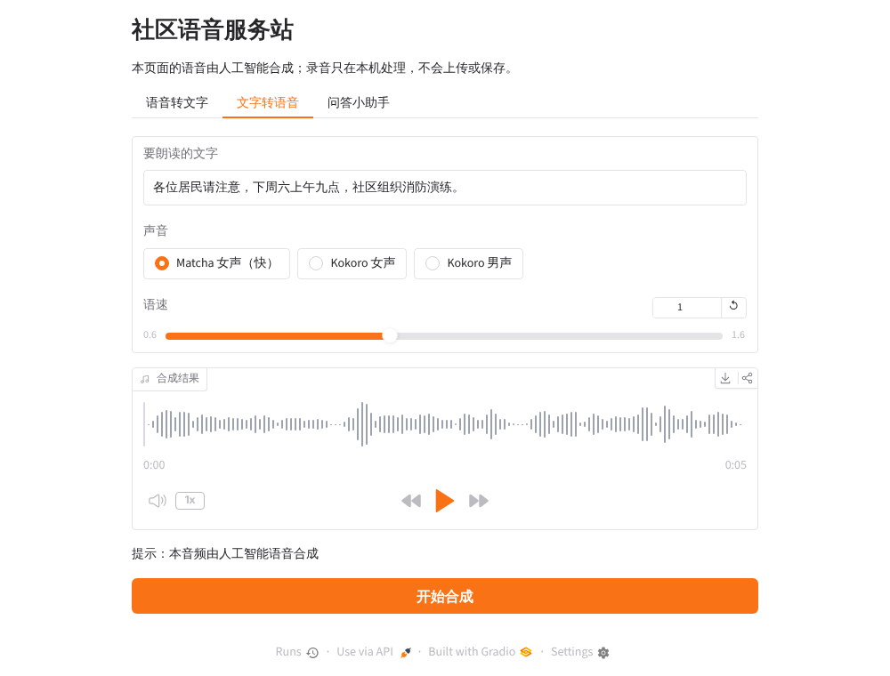
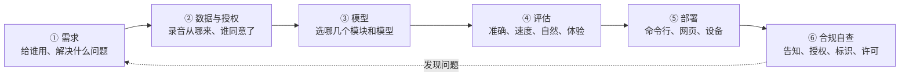
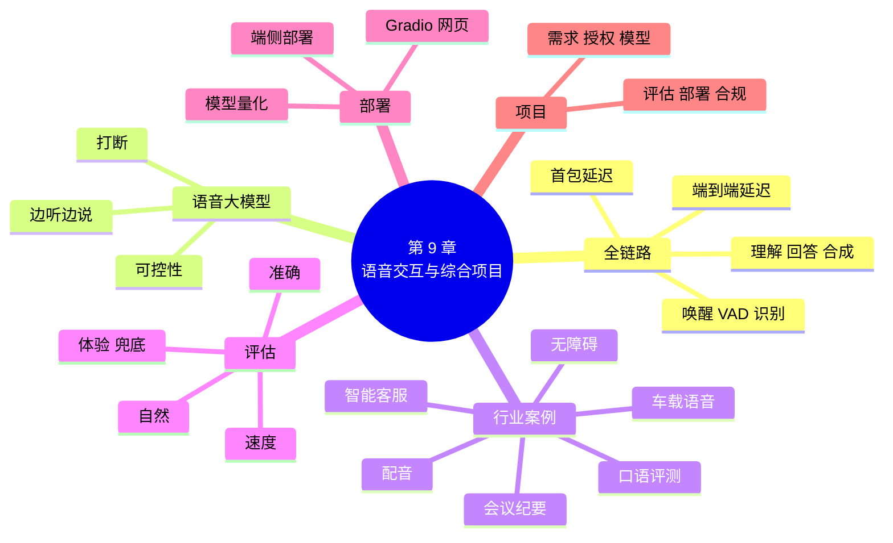

# 第 9 章 语音交互应用与综合项目

!!! abstract "本章学时"
    理论 4 学时（其中线下 2 学时）· 实验 4 学时（本章共 4 个实验，实验 9-3 综合项目可跨周完成）

## 学习目标

学完本章，你应该能够：

1. **画出**语音助手“唤醒 → 识别 → 理解 → 回答 → 合成”的全链路，算出用户的等待时间（理解、应用）；
2. **拆解**智能客服、车载语音、会议纪要等行业案例，说出各用了哪些语音模块（分析）；
3. **从**准确、速度、自然、体验四个方面设计一个语音系统的评估方案（评价）；
4. **运行并修改**代码，做出语音问答小助手，并用 Gradio 做成网页（应用）；
5. **说出**模型量化和端侧部署的作用，会比较量化前后的大小和速度（理解、应用）；
6. **完成**一个综合项目，写出项目报告和合规自查表（创造、评价）。

!!! info "先修要求"
    学习本章前，你需要：

    - 学完第 4 章（识别、VAD、唤醒词）、第 6 章（合成、标识）、第 8 章（授权与合规）；
    - 会写函数、读写 CSV 文件（《Python 编程》）。

??? abstract "本章概念清单（7 个，点击查看定义和例子）"
    1. [端到端延迟](../../appendix/glossary.md#g-端到端延迟)
    2. [首包延迟](../../appendix/glossary.md#g-首包延迟)
    3. [意图理解](../../appendix/glossary.md#g-意图理解)
    4. [兜底回复](../../appendix/glossary.md#g-兜底回复)
    5. [打断](../../appendix/glossary.md#g-打断)
    6. [模型量化](../../appendix/glossary.md#g-模型量化)
    7. [端侧部署](../../appendix/glossary.md#g-端侧部署)

## 情景导入

社区服务站的热线越来越忙。小周统计了一个月的来电：一半以上是重复的问题，“食堂几点开饭”“哪天停水”“暖气不热找谁”。每次都要人接、人答，老人还经常打不进来。

书记说：“能不能做一个‘语音小助手’？居民说一句话，它就用声音回答。答不了的再转给我们。”

小周盘点了一下手里的“零件”：第 4 章的识别和唤醒、第 6 章的合成、第 7 章的声纹、第 8 章的标识。现在要把它们装成一台完整的机器，还要回答几个新问题：居民说完话要等多久才有回答？问的问题答不了怎么办？做成网页给大家用，要注意什么？

这一章把全书串起来，最后每个人完成一个自己的综合项目。

## 9.1 一次语音对话的全链路 { #91 }

第 1 章画过一次语音对话的流程，现在每一块都学过了：


用户最关心的是：**我说完话，要等多久才听到回答？**这叫[**端到端延迟**](../../appendix/glossary.md#g-端到端延迟 "从用户说完话到听到系统回答的总等待时间，是各环节耗时之和"){ .term }，它等于各环节耗时之和：

$$
\text{等待时间} = \text{等说完} + \text{识别} + \text{理解} + \text{合成第一句} + \text{网络传输}
$$

实验 9-4 在编者笔记本电脑上实测本章的小助手：

| 环节 | 耗时 | 说明 |
|---|---|---|
| 等说完（VAD 静音判断） | 0.5 秒 | 要听到 0.5 秒静音才认为用户说完了（第 4 章） |
| 识别 | 约 0.37 秒 | SenseVoice，一句 3—5 秒的问题 |
| 理解 | 不到 1 毫秒 | 关键词匹配，几乎不花时间 |
| 合成第一句 | 约 0.49 秒 | Matcha，只合成回答的第一小句 |
| **合计** | **约 1.4 秒** | 如果等整段回答合成完再播放，约 2.0 秒 |

两个关键技巧：

1. **先播第一句**：回答合成完要 1.15 秒，但第一小句只要 0.49 秒。先播第一句，后面边播边合成，用户就少等了 0.7 秒。从开始合成到发出第一段声音的时间叫[**首包延迟**](../../appendix/glossary.md#g-首包延迟 "合成或回答开始后，到发出第一段声音所用的时间；先合成第一句就播放可以缩短它"){ .term }。
2. **能本地就本地**：本章的小助手全在本机运行，没有网络传输。接入云端大模型后，“理解”和“网络”两项会增加 1—2 秒甚至更多。

人和人对话时，一方说完到另一方开口，间隙通常只有几百毫秒，跨 10 种语言的研究都发现了这个规律<sup class="cite">[[1]](#ref9-1)</sup>。所以语音助手的等待时间超过 2 秒，用户就会觉得“它在想”；超过 4 秒，很多人会以为它没听见，又说一遍。在下面的动画“延迟拆解”里调一调每个环节，看看怎样把等待时间压到 1 秒以内。

<iframe class="sim-frame" src="../../sims/latency-breakdown/main.html" height="560" loading="lazy" title="延迟拆解"></iframe>
动画：延迟拆解。调各环节的耗时，看用户要等多久、应该先优化哪里。[全屏打开](../../sims/latency-breakdown/main.html){ target=_blank }
{ .sim-caption }

## 9.2 语音大模型：边听边说 { #92 }

上面的流水线每一步都要等上一步做完。近两年出现的**语音大模型**（第 1 章介绍过）换了一种思路：一个模型直接“听”声音、直接“说”声音，中间不再先转成文字。

- 2024 年 9 月，法国 Kyutai 实验室发布 Moshi，能同时听和说，理论延迟 160 毫秒，实际约 200 毫秒<sup class="cite">[[2]](#ref9-2)</sup>，接近人和人对话的节奏；
- 2025 年 3 月，阿里巴巴发布 Qwen2.5-Omni，一个模型能看图、听声音、读文字，边想边用语音回答<sup class="cite">[[3]](#ref9-3)</sup>。国内各大厂商的手机助手、豆包等应用，也都已上线可以实时语音对话的功能。

语音大模型的优点：快；能[**打断**](../../appendix/glossary.md#g-打断 "系统正在说话时，用户插话，系统能停下来听用户说"){ .term }（它说话时你插一句，它马上停下来听）；能听出语气、能带情感地回答。那传统的“识别 + 理解 + 合成”流水线还有用吗？有：

| 对比 | 流水线（本书做法） | 语音大模型 |
|---|---|---|
| 可控 | 每一步都能检查、修改（改问答库、改读音） | 像黑盒，很难保证说什么 |
| 资源 | CPU 就能跑，可以完全离线 | 一般要 GPU 或云服务 |
| 合规 | 回答来自审核过的问答库，不会乱说 | 可能“编造”答案，需要额外把关 |
| 体验 | 慢一些，不能自然打断 | 快、自然、能打断 |

社区、医院、政务这类“答错了有后果”的场合，很多系统仍然用流水线，或者用流水线把关、大模型补充。

## 9.3 行业案例拆解 { #93 }

全书学的模块，在各行各业是这样组合的：

| 行业案例 | 唤醒 | 识别 | 理解 / 回答 | 合成 | 声纹 | 其他 |
|---|---|---|---|---|---|---|
| **智能客服**（银行、运营商热线） | — | ✓ 电话 8 kHz | ✓ 意图分类、问答库或大模型 | ✓ | ✓ 身份核验 | 转人工、质检（通话转写后检查服务用语） |
| **车载语音** | ✓ “你好，某某” | ✓ 噪声大、要离线 | ✓ 控制空调、导航 | ✓ | ✓ 区分驾驶员和乘客 | 多个麦克风判断是谁在说话 |
| **会议纪要** | — | ✓ 长录音、带标点 | ✓ 大模型写摘要 | — | ✓ 说话人日志 | 第 4、7 章的实验就是简化版 |
| **教育口语评测** | — | ✓ 和标准读音比对 | ✓ 打分、指出错音 | ✓ 示范朗读 | — | 评测发音、流利度、完整度 |
| **无障碍**（字幕、读屏） | — | ✓ 实时字幕给听障人士 | — | ✓ 读屏给视障人士 | — | 要快、要稳定，第 4 章的流式识别 |
| **广播电视配音** | — | ✓ 生成字幕 | ✓ 翻译 | ✓ 多语种配音 | — | 克隆演员声音必须授权（第 8 章） |

拆解一个语音产品时，可以按这张表的列逐个问：它用了哪些模块？每个模块的难点是什么（噪声、口音、离线、实时）？涉及哪些个人信息和授权？

## 9.4 怎样评估一个语音系统 { #94 }

做出来能用，还要说清楚“好不好”。评估要从四个方面看：

| 方面 | 指标 | 方法 | 本书哪里学过 |
|---|---|---|---|
| **准确** | 字错率；问答匹配正确率；唤醒的误唤醒和漏唤醒 | 准备一批带标准答案的测试录音 | 第 3、4 章 |
| **速度** | 端到端延迟；首包延迟；实时率 | 每个环节计时，多测几次取平均 | 第 3 章、本章实验 9-4 |
| **自然** | MOS | 盲听打分 | 第 5 章 |
| **体验** | 能否打断；听不懂时怎么办；是否确认关键操作；老人能不能用 | 找真实用户试用、观察、访谈 | 本节 |

“体验”最容易被忽略，几条设计原则：

1. **听不懂要老实说**。准备好[**兜底回复**](../../appendix/glossary.md#g-兜底回复 "系统听不懂或答不了时给出的礼貌回复，引导用户换说法或转人工"){ .term }：“这个问题我还不会回答，您可以换个说法，或者拨打服务热线。”不要硬答一个不相关的答案。
2. **关键操作要确认**。比如“帮我预约周二理发”，要复述一遍“您要预约周二的理发，对吗？”再执行。
3. **给人留出口**。随时可以说“转人工”，并且真的有人接。
4. **照顾老人和儿童**。语速慢一点、句子短一点、音量大一点，不要连珠炮式地给选项。

!!! example "实验 9-1 的发现：关键词匹配的长处和短处"
    8 个居民提问全部答对，其中两句识别有错字（“老年时，唐”“处于垃圾挤点”），但关键词“开饭”“垃圾”还在，所以照样答对。这是关键词匹配的长处：**对识别错误不太敏感**。

    但换几个“刁钻”的问题：“厨房水龙头坏了怎么办”匹配成了“停水”，因为“水”是停水的关键词，“坏了”是报修的关键词，各命中 1 个，程序选了排在前面的那个；“暖气片漏水了找谁修”也被错配到“停水”。这是关键词匹配的短处：**不懂意思**。改进方法：给关键词加权重、增加更具体的关键词，或者把匹配不准的问题交给大模型（实验 9-1 选做）。从一句话里判断用户想问什么，叫[**意图理解**](../../appendix/glossary.md#g-意图理解 "判断用户这句话想做什么、要问什么，是语音助手“懂”的那一步"){ .term }。

## 9.5 把模型做成网页 { #95 }

命令行程序只有自己能用。要让别人试用，最快的办法是做成网页。**Gradio** 是一个专门为机器学习模型做网页界面的 Python 工具<sup class="cite">[[4]](#ref9-4)</sup>，几十行代码就能做出带录音、上传、播放功能的页面，不用学网页编程。

Gradio 的写法很像“搭积木”：

```python
import gradio as gr

def do_transcribe(audio):                  # 1. 写一个普通的函数：输入录音，返回文字
    sr, data = audio
    return transcribe(data, sr)

with gr.Blocks() as demo:                  # 2. 摆放组件
    mic = gr.Audio(sources=["microphone", "upload"], type="numpy")
    out = gr.Textbox(label="识别结果")
    gr.Button("开始识别").click(do_transcribe, mic, out)   # 3. 把按钮、函数、输入、输出连起来

demo.launch()                              # 4. 启动，浏览器打开 http://127.0.0.1:7860
```

实验 9-2 做了三个标签页：语音转文字、文字转语音、问答小助手。



!!! warning "网页上线前想一想"
    - **告知**：页面上写明“语音由人工智能合成”“录音如何处理、是否保存”；
    - **不保存录音**：除非必要并取得同意，处理完就删除；
    - **`share=True` 要慎用**：Gradio 可以生成一个临时公网链接，方便别人访问，但声音会经过外部服务器中转；涉及居民真实录音时不要用；
    - **克隆功能不要随便放上网页**：任何人上传一段录音就能克隆，等于提供了“仿声”服务，要按第 8 章的深度合成规定做好告知、同意和标识。

## 9.6 让它跑得更快 { #96 }

### 9.6.1 模型量化

神经网络模型里有几百万到几十亿个参数，每个参数原本用 32 位小数（float32）存储。[**模型量化**](../../appendix/glossary.md#g-模型量化 "把模型参数从 32 位小数换成 8 位整数等更短的表示，让模型更小更快，精度略有损失"){ .term }是把它们换成 8 位整数（int8）等更短的表示：模型大约缩小到原来的四分之一，计算更快，精度只略有损失<sup class="cite">[[5]](#ref9-5)</sup>。本书很多模型文件名里的 `int8` 就是量化后的版本。

实验 9-4 比较了第 4 章唤醒词模型的两个版本：

| 版本 | 大小 | 处理 48 秒录音用时 | 实时率 | 18 段判断正确 |
|---|---|---|---|---|
| 原始 float32 | 12.5 MB | 1.20 秒 | 0.025 | 17 |
| int8 量化 | 4.8 MB | 0.98 秒 | 0.020 | 17 |

体积缩小到约 40%，速度快了约 20%，准确率不变。对手机、音箱这类设备，省下的存储和电量很可观。

### 9.6.2 端侧部署和国产芯片

把模型放在用户自己的设备上运行，叫[**端侧部署**](../../appendix/glossary.md#g-端侧部署 "把模型放在手机、音箱、车机等用户自己的设备上运行，不依赖网络"){ .term }。好处是不用联网、延迟低、声音不出设备（隐私好）；难点是设备算力和内存有限，所以要用小模型、量化模型。sherpa-onnx 能运行在 Windows、macOS、Linux、安卓、iOS，以及树莓派等小型开发板上<sup class="cite">[[6]](#ref9-6)</sup>，也在适配国产芯片的 NPU（神经网络处理器）。

还有一个容易被忽略的好处：**小模型更省电**。本书用的模型大多几十到一百多 MB，在笔记本 CPU 上就能实时运行，和动辄几十 GB、需要 GPU 的大模型相比，耗电要少得多。不是所有问题都需要大模型，选“够用”的模型，也是一种负责任的工程选择。

## 9.7 伦理与社会影响 { #97 }

语音技术离人很近：它听你说话，也用“人”的声音和你说话。设计语音系统时要想到：

- **录音的告知与保存**：用户应当知道自己在被录音、录音用来做什么、保存多久。电话客服常说的“为了提高服务质量，您的通话可能被录音”，就是一种告知。
- **儿童和老人**：他们更容易相信“听起来像人”的声音，也更容易被 AI 声音诈骗。面向他们的产品，要说清楚“我是机器”，并且不诱导消费。
- **分不清真人还是机器**：电话里的合成声音越来越像真人。主动告诉对方“我是智能助手”，是尊重，也是标识办法的要求。
- **公平**：识别模型对方言、口音、老人、儿童的准确率往往较低。上线前要用不同人群的录音测试，不要让一部分人“说了也白说”。
- **可持续**：能用小模型就不用大模型，能本地就不上云。

### 全书合规要点回顾

| 环节 | 要点 | 依据 | 章节 |
|---|---|---|---|
| 采集录音 | 告知用途、取得同意，不过度收集 | 《个人信息保护法》 | 第 2、4 章 |
| 声纹 | 敏感个人信息，单独同意，可撤回、可删除 | 《个人信息保护法》第二十八、二十九条 | 第 7 章 |
| 克隆 | 克隆谁的声音先拿谁的授权；录音著作权不等于 AI 化授权 | 《民法典》第一千零二十三条；深度合成规定第十四条；2024 年 AI 声音侵权案 | 第 8 章 |
| 生成内容 | 显式标识 + 隐式标识，不得删除标识 | 标识办法；深度合成规定第十六、十七条 | 第 6、8 章 |
| 模型 | 看清模型和训练数据的许可，能否商用 | 各模型许可证 | 第 5、6 章 |
| 服务 | 不侵害他人权益，不生成违法内容 | 《生成式人工智能服务管理暂行办法》 | 第 8 章 |

## 9.8 一个语音项目的完整流程 { #98 }

实验 9-3 的综合项目按下面的流程做：



每一步都要留下记录：需求写成一段话，数据写清来源和授权，模型写清名称和许可，评估有数据，部署有截图，合规自查逐项打勾。附录 D 有项目报告模板和合规自查表。

## 9.9 前沿视窗

**全双工语音交互**。今天的大部分语音助手是“对讲机”式的：你说完，它再说。Moshi 等研究系统已经能像打电话一样“全双工”：两边可以同时说话，它会在你说话时“嗯”“对”地回应，你插话它能马上停下。截至 2026 年，这类能力正在进入手机和车载助手。

**从“能用”到“好用”**。语音技术的准确率已经很高，未来的竞争更多在体验：更低的延迟、更自然的打断、更懂方言和老人、更可靠的合规。这正是一个专科毕业生可以发挥作用的地方：在具体的场景里把模块组装好、测试好、部署好，让技术真正服务于人。

## 本章实验

!!! abstract "实验总览"
    | 实验 | 类型 | 建议时长 | 内容 |
    |---|---|---|---|
    | 实验 9-1 | ★ 基础 | 45 分钟 | 语音问答小助手：识别 → 关键词匹配 → 合成，测 8 个居民提问；选做接国产大模型（待实测） |
    | 实验 9-2 | ★ 基础 | 45 分钟 | 用 Gradio 做三个标签页的网页，浏览器里录音、合成、问答 |
    | 实验 9-3 | ★ 综合 | 4 学时以上（可跨周） | 综合项目四选一：会议纪要助手、有声书工坊、智能客服、无障碍字幕；写报告和合规自查表 |
    | 实验 9-4 | ☆ 拓展 | 45 分钟 | 测一次问答各环节耗时；比较 int8 量化和原始模型 |

    代码见配套资源 `labs/ch09/` 目录。`assistant.py` 是小助手的核心，实验 9-1、9-2、9-4 都用它。运行前在 `labs` 文件夹里执行 `python models.py ch09`；实验 9-2 还需要 `pip install gradio`。

### 实验 9-1 ★ 语音问答小助手

**实验目的**

1. 会把识别、理解、合成连成一个完整的问答流程；
2. 会用关键词匹配实现简单的意图理解，设计兜底回复；
3. 能测出每个环节的耗时，发现关键词匹配的长处和短处。

**实验环境**：本机 CPU 或云端 Notebook。**实验数据**：问答库 `labs/data/faq/community_faq.csv`（10 条社区常见问题，每条有关键词和回答，内容来自第 6 章的告居民书）；8 段居民提问录音 `labs/data/questions/`（Kokoro 合成，其中 1 段是问答库里没有的问题）。模型 `sensevoice`、`matcha-zh`。

**实验步骤与代码**

第 1 步，打开 `community_faq.csv` 看看问答库的样子，再读 `assistant.py`：

```python
import csv
import sys
import time
from pathlib import Path

sys.path.append(str(Path(__file__).resolve().parent.parent))
from voicelab import speak, transcribe  # noqa: E402

FAQ_FILE = Path(__file__).resolve().parent.parent / "data/faq/community_faq.csv"
FALLBACK = "抱歉，这个问题我还不会回答。您可以换个说法再问一次，或者拨打社区服务热线找工作人员。"


def load_faq(file=FAQ_FILE):
    with open(file, encoding="utf-8-sig") as f:
        return [dict(r, 关键词=r["关键词"].split()) for r in csv.DictReader(f)]


FAQ = load_faq()


def understand(text):
    """“理解”：数一数问题里出现了每条问答的几个关键词，选出现最多的；一个都没有就返回 None"""
    best, score = None, 0
    for item in FAQ:
        hits = sum(1 for w in item["关键词"] if w in text)
        if hits > score:
            best, score = item, hits
    return best


def ask(audio, sr, voice="matcha-zh"):
    t = {}
    start = time.time()
    heard = transcribe(audio, sr)                                       # 1. 听：语音识别
    t["识别"] = time.time() - start

    start = time.time()
    item = understand(heard)                                            # 2. 懂：关键词匹配
    reply = item["回答"] if item else FALLBACK
    t["理解"] = time.time() - start

    start = time.time()
    first = reply.split("，")[0] + "。"                                 # 先合成第一小句，尽快开口
    speak(first, model=voice)
    t["首句合成"] = time.time() - start
    reply_audio, reply_sr = speak(reply, model=voice)                   # 3. 说：合成整段回答
    t["全部合成"] = time.time() - start
    return {"heard": heard, "faq": item["编号"] if item else "0", "reply": reply,
            "audio": reply_audio, "sr": reply_sr, "time": t}
```

`understand` 就是全部的“理解”：数一数每条问答的关键词在问题里出现了几个，选最多的。`ask` 把识别、理解、合成串起来，并记录每一步的耗时。

第 2 步，运行 `lab9_1_assistant.py`：

```python
import csv
import sys

sys.path.append("..")
from assistant import ask
from voicelab import read_audio, save_audio, speak, transcribe

speak("预热")                                                     # 先把识别和合成模型加载好，不计入耗时
transcribe(read_audio("../data/questions/q_1.wav")[0], 16000)

right = 0
rows = list(csv.DictReader(open("../data/questions/questions.csv", encoding="utf-8-sig")))
for r in rows:
    audio, sr = read_audio(f"../data/questions/{r['文件']}")
    result = ask(audio, sr)
    save_audio(f"reply_{r['文件']}", result["audio"], result["sr"])
    ok = result["faq"] == r["应匹配的问答编号"]
    right += ok
    t = result["time"]
    print(f"【{r['文件']}】听到：{result['heard']}")
    print(f"   匹配问答 {result['faq']}（应为 {r['应匹配的问答编号']}）{'✓' if ok else '✗'}  回答：{result['reply'][:24]}……")
    print(f"   耗时：识别 {t['识别']:.2f} 秒，理解 {t['理解'] * 1000:.1f} 毫秒，首句合成 {t['首句合成']:.2f} 秒，全部合成 {t['全部合成']:.2f} 秒")
print(f"\n{len(rows)} 个问题，答对 {right} 个")

# 第 2 步：关键词匹配的弱点——直接用文字测几句“刁钻”的问题
from assistant import understand                                  # noqa: E402

print("\n========== 关键词匹配测一测 ==========")
for q in ["厨房水龙头坏了怎么办", "暖气片漏水了找谁修", "食堂的饭菜能不能少放点盐", "我要提个建议"]:   # ← 改这里
    item = understand(q)
    print(f"{q}  →  {item['编号'] + ' ' + item['主题'] if item else '没有匹配'}")
```

**运行结果**（编者运行，约 16 秒）

```text
【q_1.wav】听到：请问老年时，唐中午几点开饭？
   匹配问答 1（应为 1）✓  回答：社区老年食堂中午十一点到下午一点、晚上五点到六点……
   耗时：识别 0.17 秒，理解 0.0 毫秒，首句合成 0.34 秒，全部合成 0.97 秒
【q_2.wav】听到：我想给我妈量个血压，卫生服务站什么时候可以去？
   匹配问答 2（应为 2）✓  回答：社区卫生服务站每周二和周四上午免费给六十五岁以上……
   耗时：识别 0.39 秒，理解 0.0 毫秒，首句合成 0.49 秒，全部合成 1.26 秒
【q_3.wav】听到：明天是不是要停水？
   匹配问答 3（应为 3）✓  回答：十一月二十日上午八点到下午四点，一号楼到六号楼暂……
   耗时：识别 0.13 秒，理解 0.0 毫秒，首句合成 0.21 秒，全部合成 0.89 秒
【q_4.wav】听到：我家暖气一点都不热，怎么办？
   匹配问答 4（应为 4）✓  回答：集中供暖从十一月十五日开始，到明年三月十五日结束……
   耗时：识别 0.20 秒，理解 0.0 毫秒，首句合成 0.22 秒，全部合成 0.86 秒
【q_5.wav】听到：电动车壳已在哪里充电？
   匹配问答 5（应为 5）✓  回答：电动自行车请到小区东门和三号楼北侧的集中充电点充……
   耗时：识别 0.19 秒，理解 0.0 毫秒，首句合成 0.33 秒，全部合成 0.85 秒
【q_6.wav】听到：处于垃圾挤点可以扔。
   匹配问答 6（应为 6）✓  回答：厨余垃圾的投放时间是早上七点到九点、晚上六点到八……
   耗时：识别 0.15 秒，理解 0.0 毫秒，首句合成 0.30 秒，全部合成 0.89 秒
【q_7.wav】听到：刚才有人打电话说，我医保卡冻结了，让我转账是真的吗？
   匹配问答 8（应为 8）✓  回答：社区工作人员不会在电话里要银行卡号和验证码。接到……
   耗时：识别 0.31 秒，理解 0.0 毫秒，首句合成 0.42 秒，全部合成 1.20 秒
【q_8.wav】听到：小区附近有没有好吃的火锅店？
   匹配问答 0（应为 0）✓  回答：抱歉，这个问题我还不会回答。您可以换个说法再问一……
   耗时：识别 0.19 秒，理解 0.0 毫秒，首句合成 0.08 秒，全部合成 0.58 秒
8 个问题，答对 8 个
========== 关键词匹配测一测 ==========
厨房水龙头坏了怎么办  →  3 停水
暖气片漏水了找谁修  →  3 停水
食堂的饭菜能不能少放点盐  →  1 老年食堂
我要提个建议  →  10 议事会
```

读结果：

- 8 个问题全部答对，包括“小区附近有没有好吃的火锅店”这个问答库里没有的问题，正确地给出了兜底回复。
- 两句识别有错字，但关键词还在，照样答对（9.4 节）。
- 理解几乎不花时间，识别约 0.2—0.4 秒，首句合成约 0.1—0.5 秒，全部合成约 0.6—1.3 秒。
- 第 2 步的 4 个“刁钻”问题，前两个错配到“停水”，后两个碰巧答对。

**改一改**

1. 修改问答库，让“厨房水龙头坏了怎么办”“暖气片漏水了找谁修”都匹配到“报修”（提示：给报修增加关键词“水龙头”“漏水”，并想办法让“停水”的关键词“水”不要抢先）。
2. 给问答库增加 2 条你们社区的常见问题，用自己的声音提问测试（录音只用于本实验）。
3. **选做（待实测）**：注册阿里云百炼，运行 `llm_answer.py`，在 `understand` 返回空时改用大模型回答。下面的代码按官方的 OpenAI 兼容接口编写，编者的写作环境无法访问该服务：

```python
import os

from openai import OpenAI

from assistant import FAQ

client = OpenAI(api_key=os.environ["DASHSCOPE_API_KEY"],
                base_url="https://dashscope.aliyuncs.com/compatible-mode/v1")
SYSTEM = ("你是幸福里社区的语音助手，回答要简短（不超过 60 个字），口语化，适合朗读。"
          "只根据下面的社区信息回答；信息里没有的，就说“这个问题请咨询社区工作人员”，不要编造。\n"
          + "\n".join(f"- {item['回答']}" for item in FAQ))


def llm_answer(question, model="qwen-plus"):                    # ← 改这里：换成官方文档里的模型名
    resp = client.chat.completions.create(model=model, messages=[
        {"role": "system", "content": SYSTEM}, {"role": "user", "content": question}])
    return resp.choices[0].message.content


if __name__ == "__main__":
    print(llm_answer("暖气片漏水了找谁修？"))
```

**实验记录表**

| 提问 | 识别结果 | 匹配问答 | 是否正确 | 识别耗时 | 首句合成耗时 |
|---|---|---|---|---|---|
| | | | | | |
| | | | | | |
| | | | | | |

**常见问题排查**

| 现象 | 原因 | 解决办法 |
|---|---|---|
| `ModuleNotFoundError: No module named 'assistant'` | 没在 `labs/ch09` 文件夹里运行 | `cd labs/ch09` 后再运行 |
| `KeyError: '关键词'` | 用 Excel 编辑问答库后另存，表头或编码变了 | 用记事本编辑，保存为 UTF-8；表头保持“编号,主题,关键词,回答” |
| 新加的问题总是匹配不到 | 关键词之间要用空格隔开 | 检查 CSV 的关键词列，例如 `修 坏了 报修` |
| 大模型回答很长、不适合朗读 | 没在系统提示里限制长度 | 系统提示里写明“不超过 60 个字、口语化” |

**思考与练习**

1. 为什么第一次运行时要先“预热”，不计入耗时？
2. 社区问答为什么要先用关键词匹配，再把答不了的交给大模型，而不是全部交给大模型？

**实验报告要求**

提交记录表、修改后的问答库，以及“改一改”第 1 题的修改方法和结果。

### 实验 9-2 ★ 做成网页

**实验目的**

1. 会用 Gradio 搭建带录音、上传、播放功能的网页；
2. 会把已有的函数接到网页组件上；
3. 能在网页上落实告知和标识。

**实验环境**：本机（需要浏览器和麦克风）；云端 Notebook 也能运行，但浏览器录音需要平台支持。`pip install gradio`（本书用 6.31.0）。模型 `sensevoice`、`matcha-zh`、`kokoro`。

**实验步骤与代码**

第 1 步，运行 `lab9_2_web.py`：

```python
import sys

import gradio as gr
import numpy as np

sys.path.append("..")
from assistant import ask
from voicelab import speak, transcribe


def to_float(audio):
    """Gradio 给的录音是 (采样率, 整数数组)，可能是双声道，转成单声道小数"""
    sr, data = audio
    data = data.astype(np.float32) / (32768 if data.dtype == np.int16 else 1)
    return (data.mean(axis=1) if data.ndim == 2 else data), sr


def do_transcribe(audio):
    if audio is None:
        return "请先录音或上传一个音频文件"
    data, sr = to_float(audio)
    return transcribe(data, sr)


def do_speak(text, voice, speed):
    model, sid = {"Matcha 女声（快）": ("matcha-zh", 0), "Kokoro 女声": ("kokoro", 20),
                  "Kokoro 男声": ("kokoro", 58)}[voice]
    audio, sr = speak(text, model=model, sid=sid, speed=speed)
    return (sr, audio), "提示：本音频由人工智能语音合成"


def do_ask(audio):
    if audio is None:
        return "请先录音", "", None
    data, sr = to_float(audio)
    r = ask(data, sr)
    cost = "，".join(f"{k} {v:.2f} 秒" for k, v in r["time"].items())
    return r["heard"], f"{r['reply']}\n\n（耗时：{cost}）", (r["sr"], r["audio"])


with gr.Blocks(title="社区语音服务站") as demo:
    gr.Markdown("# 社区语音服务站\n本页面的语音由人工智能合成；录音只在本机处理，不会上传或保存。")
    with gr.Tab("语音转文字"):
        mic = gr.Audio(sources=["microphone", "upload"], type="numpy", label="录音或上传")
        out = gr.Textbox(label="识别结果")
        gr.Button("开始识别", variant="primary").click(do_transcribe, mic, out)
    with gr.Tab("文字转语音"):
        text = gr.Textbox(label="要朗读的文字", value="各位居民请注意，下周六上午九点，社区组织消防演练。")
        voice = gr.Radio(["Matcha 女声（快）", "Kokoro 女声", "Kokoro 男声"], value="Matcha 女声（快）", label="声音")
        speed = gr.Slider(0.6, 1.6, value=1.0, step=0.1, label="语速")
        player = gr.Audio(label="合成结果")
        note = gr.Markdown()
        gr.Button("开始合成", variant="primary").click(do_speak, [text, voice, speed], [player, note])
    with gr.Tab("问答小助手"):
        q = gr.Audio(sources=["microphone", "upload"], type="numpy", label="问一个社区的问题")
        heard = gr.Textbox(label="我听到的是")
        reply = gr.Textbox(label="回答")
        reply_audio = gr.Audio(label="语音回答", autoplay=True)
        gr.Button("提问", variant="primary").click(do_ask, q, [heard, reply, reply_audio])

if __name__ == "__main__":
    demo.launch()                                                  # 加 share=True 可以生成临时公网链接（会经过外部服务器，注意隐私）
```

第 2 步，浏览器打开命令行里显示的地址（一般是 `http://127.0.0.1:7860`）。在“语音转文字”标签页点麦克风录一句话，或上传 `labs/data/questions/q_3.wav`，点“开始识别”；在“文字转语音”标签页改文字、选声音、拖语速，点“开始合成”；在“问答小助手”标签页问一个社区问题。

**运行结果**（编者运行）：页面正常打开（见 9.5 节截图）。编者用 Gradio 自带的客户端程序测试了三个功能：上传 `q_3.wav` 识别为“明天是不是要停水？”；Kokoro 男声合成并显示“提示：本音频由人工智能语音合成”；上传 `q_4.wav`，小助手听到“我家暖气一点都不热，怎么办？”，回答供暖问题。网页里第一次提问时要加载合成模型，耗时会多 2—3 秒。

**改一改**

1. 在“文字转语音”标签页增加 MeloTTS（中英混读）选项。
2. 在“问答小助手”标签页增加一个文本框，可以直接打字提问（不用录音）。
3. **挑战**：增加第四个标签页“声纹比对”，上传两段录音，显示相似度（用第 7 章的 `embed`）。

**实验记录表**

| 功能 | 测试输入 | 结果 | 耗时 | 有没有问题 |
|---|---|---|---|---|
| 语音转文字 | | | | |
| 文字转语音 | | | | |
| 问答小助手 | | | | |

**常见问题排查**

| 现象 | 原因 | 解决办法 |
|---|---|---|
| `ModuleNotFoundError: No module named 'gradio'` | 没装 Gradio | `pip install gradio` |
| 浏览器打不开页面 | 程序没在运行，或端口被占用 | 看命令行是否显示地址；端口被占用时用 `demo.launch(server_port=7861)` |
| 麦克风按钮点了没反应 | 浏览器没给麦克风权限，或不是 `127.0.0.1`/`https` 地址 | 在浏览器地址栏左侧允许麦克风；用 `http://127.0.0.1:7860` 打开 |
| 识别结果是空的 | 录音太短或没声音 | 录 2 秒以上，靠近麦克风 |
| 代码和书上不同版本的 Gradio 报错 | Gradio 更新快，参数名可能变 | 安装书上的版本：`pip install gradio==6.31.0` |

**思考与练习**

1. 为什么页面顶部要写“录音只在本机处理，不会上传或保存”？如果要保存录音，还需要做什么？
2. 想让同学用手机访问你电脑上的这个网页，有哪些办法？各有什么风险？

**实验报告要求**

提交网页截图（三个标签页各一张）、记录表和你做的“改一改”代码。

### 实验 9-3 ★ 综合项目

**实验目的**

1. 综合运用全书的识别、合成、声纹、克隆和合规知识，完成一个能演示的小应用；
2. 会按“需求 → 数据与授权 → 模型 → 评估 → 部署 → 合规自查”的流程做项目；
3. 会写项目报告，进行演示和答辩。

**实验环境**：本机或云端 Notebook，2—3 人一组。**实验数据**：自选；使用他人声音的，必须先签授权书。

**选题**（四选一，也可以自选，自选题要先经教师同意）：

| 选题 | 要做什么 | 用到的章节 | 基本要求 | 加分项 |
|---|---|---|---|---|
| **A. 会议纪要助手** | 上传会议录音，输出带发言人和时间的纪要 | 第 4、7 章 | 识别 + 说话人日志 + 纪要文件 | 发言人用注册声纹显示真名；Gradio 网页 |
| **B. 有声书工坊** | 输入一篇文章，输出带片头、目录和 AI 标识的有声书 | 第 5、6、8 章 | 分句合成 + 停顿 + MP3 + 两种标识 | 多角色配音；授权克隆的声音；文本前端纠错 |
| **C. 社区智能客服** | 居民语音提问，系统语音回答，答不了转人工 | 第 4、6、9 章 | 问答库不少于 15 条 + 兜底 + 延迟测量 | 唤醒词；大模型补充；关键操作确认 |
| **D. 无障碍字幕** | 把讲座、视频的声音实时或离线转成字幕 | 第 4 章 | SRT 字幕 + 字错率评估 | 流式识别实时显示；热词；中英混合 |

**实验步骤**

1. **第 1 周：需求与授权**。写一段话说明给谁用、解决什么问题；列出要用的录音和文字，写清来源，用到他人声音的签好授权书。
2. **第 2 周：搭建**。从本书的实验代码出发，把需要的模块连起来，先在命令行跑通。
3. **第 3 周：评估与部署**。按 9.4 节的四个方面各选至少一个指标测量；做成 Gradio 网页或其他能演示的形式。
4. **第 4 周：合规自查与答辩**。填写附录 D 的合规自查表；每组 8 分钟演示加 4 分钟答辩。

**评分参考**

| 项目 | 分值 | 说明 |
|---|---|---|
| 功能完成 | 30 | 基本要求全部实现，能现场演示 |
| 评估 | 20 | 至少 3 个指标，有数据、有分析 |
| 合规 | 20 | 授权书、标识、隐私处理、模型许可，自查表完整真实 |
| 报告 | 15 | 按附录 D 模板，结构清楚 |
| 演示与答辩 | 15 | 讲清楚做了什么、遇到什么问题、怎么解决 |

!!! warning "一票否决"
    项目中使用了未经授权的他人声音（包括公众人物），或者发布的生成内容没有任何 AI 标识，合规项记 0 分。

**实验报告要求**

按附录 D 的“综合项目报告模板”提交报告、代码、演示视频（3 分钟以内）和合规自查表。

### 实验 9-4 ☆ 测一测快不快

**实验目的**

1. 会测量语音问答每个环节的耗时，计算端到端延迟和首包延迟；
2. 会比较量化模型和原始模型的大小、速度和准确率。

**实验环境**：本机 CPU 或云端 Notebook。**实验数据**：居民提问 `q_2.wav`；第 4 章的 18 段唤醒词测试录音。模型 `sensevoice`、`matcha-zh`、`kws`。

**实验步骤与代码**

运行 `lab9_4_latency.py`：

```python
import csv
import os
import sys
import time

import numpy as np
import sherpa_onnx as so

sys.path.append("..")
from assistant import ask
from voicelab import model_path, read_audio, speak

# 1. 一次问答的“等待时间”：用户说完 → 系统发现说完了（静音等待）→ 识别 → 理解 → 合成出第一句
VAD_WAIT = 0.5                                     # VAD 要听到 0.5 秒静音才认为“说完了”（第 4 章）  ← 改这里
speak("预热")
audio, sr = read_audio("../data/questions/q_2.wav")
ask(audio, sr)                                     # 预热一次
times = [ask(audio, sr)["time"] for _ in range(5)]  # 测 5 次取平均
avg = {k: np.mean([t[k] for t in times]) for k in times[0]}
print("== 一次问答各环节平均耗时（5 次）==")
for k, v in avg.items():
    print(f"{k:<6} {v:6.3f} 秒")
wait_first = VAD_WAIT + avg["识别"] + avg["理解"] + avg["首句合成"]
wait_all = VAD_WAIT + avg["识别"] + avg["理解"] + avg["全部合成"]
print(f"用户说完到听到回答：先合成第一句就播放 {wait_first:.2f} 秒；整段合成完再播放 {wait_all:.2f} 秒")


# 2. int8 量化模型 vs 原始模型：用第 4 章的唤醒词检测器，同样 18 段录音各跑一遍

d = model_path("kws")
rows = list(csv.DictReader(open("../data/kws/kws.csv", encoding="utf-8-sig")))
print("\n== int8 量化模型 vs 原始模型（唤醒词检测）==")
for tag in ["", ".int8"]:                                       # "" 是原始的 32 位小数模型，".int8" 是 8 位整数模型
    files = {p: f"{d}/{p}-epoch-12-avg-2-chunk-16-left-64{tag}.onnx" for p in ("encoder", "decoder", "joiner")}
    size = sum(os.path.getsize(x) for x in files.values()) / 1024 / 1024
    kws = so.KeywordSpotter(tokens=f"{d}/tokens.txt", **files, keywords_file="../ch04/my_keywords.txt",
                            keywords_threshold=0.25, num_threads=2)
    start, total, right = time.time(), 0.0, 0
    for r in rows:
        samples, sr = read_audio(f"../data/kws/{r['文件']}")
        total += len(samples) / sr
        stream, found = kws.create_stream(), False
        stream.accept_waveform(sr, samples)
        stream.input_finished()
        while kws.is_ready(stream):
            kws.decode_stream(stream)
            if kws.get_result(stream):
                found = True
                kws.reset_stream(stream)
        right += found == (r["含唤醒词"] == "是")
    used = time.time() - start
    print(f"{'int8' if tag else '原始 float32':<12} 大小 {size:5.1f} MB  处理 {total:.0f} 秒录音用 {used:.2f} 秒  "
          f"实时率 {used / total:.3f}  判断正确 {right}/{len(rows)}")
```

**运行结果**（编者运行）

```text
== 一次问答各环节平均耗时（5 次）==
识别      0.374 秒
理解      0.000 秒
首句合成    0.490 秒
全部合成    1.152 秒
用户说完到听到回答：先合成第一句就播放 1.36 秒；整段合成完再播放 2.03 秒
== int8 量化模型 vs 原始模型（唤醒词检测）==
原始 float32   大小  12.5 MB  处理 48 秒录音用 1.20 秒  实时率 0.025  判断正确 17/18
int8         大小   4.8 MB  处理 48 秒录音用 0.98 秒  实时率 0.020  判断正确 17/18
```

读结果：

- 用户说完到听到回答约 1.36 秒，其中“等说完”的 0.5 秒是最大的一块，其次是首句合成和识别。
- 先合成第一句就播放，比整段合成完再播放少等约 0.7 秒。
- int8 量化后，唤醒词模型从 12.5 MB 缩小到 4.8 MB，处理速度快约 20%，18 段判断正确数不变（都错了 1 段，是第 4 章分析过的“你好小张”误唤醒）。

!!! note "关于 MeloTTS 的 int8 版本"
    编者原计划比较 MeloTTS 合成模型的两个版本，但它的下载包里 `model.int8.onnx` 只有 133 字节（是一个没有下载完整的占位文件），无法加载，所以改用唤醒词模型比较。遇到“模型加载失败”时，先看看文件大小是否正常。

**改一改**

1. 把 `VAD_WAIT` 改成 0.3 和 0.8，算出等待时间。0.3 秒会有什么副作用？（提示：第 4 章实验 4-2。）
2. 把合成模型换成 Kokoro（`ask(audio, sr, voice="kokoro")`），等待时间变成多少？
3. **挑战**：用第 4 章的流式识别改写 `ask`，边说边识别，看能省下多少时间。

**实验记录表**

| 设置 | 识别 | 首句合成 | 等待时间 | 体验评价 |
|---|---|---|---|---|
| 默认（VAD 0.5 秒，Matcha） | | | | |
| VAD 0.3 秒 | | | | |
| 合成换成 Kokoro | | | | |

**常见问题排查**

| 现象 | 原因 | 解决办法 |
|---|---|---|
| 第一次的耗时特别长 | 模型加载 | 代码里已先预热；自己写程序也要预热 |
| 每次测的时间不一样 | 电脑同时在做别的事 | 多测几次取平均，关掉其他程序 |
| `Protobuf parsing failed` | 模型文件不完整 | 检查文件大小，重新下载 |

**思考与练习**

1. 为什么“等说完”这一步不能设成 0 秒？
2. 量化让模型变小变快，代价是什么？什么情况下不适合量化？

**实验报告要求**

提交记录表，为社区小助手提出 3 条降低等待时间的建议。

## 本章小结

- 语音助手全链路：唤醒 → VAD → 识别 → 理解 → 回答 → 合成。**端到端延迟**是各环节之和，本书小助手实测约 1.4 秒；先播第一句可以缩短**首包延迟**。
- 语音大模型直接听、直接说，快、能**打断**、带情感；流水线可控、离线、合规，二者各有适合的场合。
- 行业案例都是全书模块的组合：智能客服、车载语音、会议纪要、口语评测、无障碍、配音。
- 评估看四个方面：准确、速度、自然、体验；**意图理解**要准，听不懂时要有**兜底回复**。
- Gradio 几十行代码就能做出网页；上线前要做好告知、不保存录音、慎用公网链接。
- **模型量化**让模型变小变快（实测体积降到 40%、速度快 20%、准确率不变）；**端侧部署**离线、低延迟、保护隐私、省电。
- 伦理：告知录音、照顾老人儿童、主动说明“我是机器”、对方言口音公平、能小不大。项目流程：需求 → 数据与授权 → 模型 → 评估 → 部署 → 合规自查。



**全书结语**

从第 2 章“声音在电脑里是一串数字”开始，我们学会了让电脑听写、朗读、认人、仿声，最后组装成一个能对话的小助手。技术会继续飞快地变化，模型的名字几年后可能都换了一遍，但有几件事不会变：先弄清楚声音和数据从哪里来，用数据说话地评估效果，尊重每一个人的声音，并且让用户知道他在和机器对话。希望你带着这些习惯，走进语音技术的工作岗位。

## 参考文献

正文中的上标编号（如<sup class="cite">[[1]](#ref9-1)</sup>）对应下面的文献。带链接的可以直接打开。

<div class="refs" markdown>

**论文**

- <span id="ref9-1"></span>[1] STIVERS T, ENFIELD N J, BROWN P, et al. Universals and cultural variation in turn-taking in conversation[J]. Proceedings of the National Academy of Sciences, 2009, 106(26): 10587-10592. DOI: 10.1073/pnas.0903616106.
    <span class="ref-note">比较 10 种语言的对话轮换，发现说话人之间的间隙普遍很短，对应 9.1 节。</span>
- <span id="ref9-2"></span>[2] DÉFOSSEZ A, MAZARÉ L, ORSINI M, et al. Moshi: a speech-text foundation model for real-time dialogue[EB/OL]. arXiv:2410.00037, 2024. https://arxiv.org/abs/2410.00037.
    <span class="ref-note">全双工语音大模型，理论延迟 160 毫秒、实际约 200 毫秒，对应 9.2 节和 9.9 节。</span>
- <span id="ref9-3"></span>[3] XU J, GUO Z, HE J, et al. Qwen2.5-Omni technical report[EB/OL]. arXiv:2503.20215, 2025. https://arxiv.org/abs/2503.20215.
    <span class="ref-note">国产全模态大模型，能听、能看、能用语音回答，对应 9.2 节。</span>
- <span id="ref9-4"></span>[4] ABID A, ABDALLA A, ABID A, et al. Gradio: hassle-free sharing and testing of ML models in the wild[EB/OL]. arXiv:1906.02569, 2019. https://arxiv.org/abs/1906.02569.
    <span class="ref-note">Gradio 的论文，对应 9.5 节和实验 9-2。</span>
- <span id="ref9-5"></span>[5] JACOB B, KLIGYS S, CHEN B, et al. Quantization and training of neural networks for efficient integer-arithmetic-only inference[C]//2018 IEEE/CVF Conference on Computer Vision and Pattern Recognition (CVPR). 2018: 2704-2713.
    <span class="ref-note">8 位整数量化的代表性论文，对应 9.6.1 节和实验 9-4。</span>

**在线资源**

- <span id="ref9-6"></span>[6] k2-fsa. sherpa-onnx[CP/OL]. [2026-11-01]. https://github.com/k2-fsa/sherpa-onnx.
    <span class="ref-note">本书主力工具的代码仓库，列出了支持的平台和设备，对应 9.6.2 节。</span>

</div>

## 课后练习

选择题和判断题可以直接点击选项作答，系统会马上告诉你对错，并展开答案与解析；多选题选好后点“提交答案”。简答和实操题请先自己作答，再点开“答案与解析”核对。每道题的解析下方都有“回看”链接，做错了可以直接跳回正文复习。

**一、单项选择题**

<div class="quiz" data-answer="C" markdown>

**1.** 语音助手的端到端延迟指的是（　　）。

- A. 识别模型的实时率
- B. 合成一整段回答的时间
- C. 用户说完话到听到回答的总等待时间
- D. 唤醒词检测的时间

</div>

??? tip "答案与解析"
    **答案：C**

    端到端延迟是各环节耗时之和，是用户实际感受到的等待时间。

    考查：端到端延迟 · 认知层次：记忆 · [回看 9.1](#91)
    { .quiz-meta }

<div class="quiz" data-answer="A" markdown>

**2.** 实验 9-4 中，“先合成第一句就播放”比“整段合成完再播放”少等约 0.7 秒，这缩短的是（　　）。

- A. 首包延迟
- B. 识别耗时
- C. VAD 静音等待
- D. 网络传输

</div>

??? tip "答案与解析"
    **答案：A**

    首包延迟是从开始合成到发出第一段声音的时间，只合成第一小句就能更快开口。

    考查：首包延迟 · 认知层次：理解 · [回看 9.1](#91)
    { .quiz-meta }

<div class="quiz" data-answer="D" markdown>

**3.** 用户问“厨房水龙头坏了怎么办”，关键词匹配却回答了停水通知，最可能的原因是（　　）。

- A. 识别模型听错了
- B. 合成模型读错了
- C. 问答库里没有任何关键词
- D. 关键词匹配不懂意思，“水”命中了停水的关键词

</div>

??? tip "答案与解析"
    **答案：D**

    “水”和“坏了”各命中一条问答的关键词，程序选了排在前面的“停水”。

    考查：关键词匹配的局限 · 认知层次：分析 · [回看 9.4](#94)
    { .quiz-meta }

<div class="quiz" data-answer="B" markdown>

**4.** 语音助手听不懂用户的问题时，最好的做法是（　　）。

- A. 随便选一个最接近的答案回答
- B. 给出兜底回复，请用户换个说法或转人工
- C. 不回答，保持沉默
- D. 让用户重启设备

</div>

??? tip "答案与解析"
    **答案：B**

    听不懂要老实说，并给用户出口。

    考查：兜底回复 · 认知层次：应用 · [回看 9.4](#94)
    { .quiz-meta }

<div class="quiz" data-answer="C" markdown>

**5.** 把模型参数从 32 位小数换成 8 位整数，叫做（　　）。

- A. 端侧部署
- B. 重采样
- C. 模型量化
- D. 音量归一化

</div>

??? tip "答案与解析"
    **答案：C**

    量化让模型更小更快，模型文件名中的 int8 就是量化版本。

    考查：模型量化 · 认知层次：记忆 · [回看 9.6.1](#961)
    { .quiz-meta }

<div class="quiz" data-answer="A" markdown>

**6.** 下面哪个是端侧部署的优点？（　　）

- A. 不用联网，声音不出设备，隐私更好
- B. 可以运行任意大的模型
- C. 不需要考虑设备的内存
- D. 一定比云端更准确

</div>

??? tip "答案与解析"
    **答案：A**

    端侧部署离线、低延迟、保护隐私，但受设备算力和内存限制。

    考查：端侧部署 · 认知层次：理解 · [回看 9.6.2](#962)
    { .quiz-meta }

<div class="quiz" data-answer="B" markdown>

**7.** 在 Gradio 中，`gr.Button("开始识别").click(do_transcribe, mic, out)` 的作用是（　　）。

- A. 定义一个新函数
- B. 点按钮时，把 `mic` 的内容交给 `do_transcribe`，结果显示在 `out` 里
- C. 启动网页服务器
- D. 播放录音

</div>

??? tip "答案与解析"
    **答案：B**

    `click` 把按钮、处理函数、输入组件和输出组件连起来。

    考查：Gradio 用法 · 认知层次：理解 · [回看 9.5](#95)
    { .quiz-meta }

<div class="quiz" data-answer="D" markdown>

**8.** 和流水线相比，语音大模型的主要优势是（　　）。

- A. 可以完全离线在普通 CPU 上运行
- B. 每一步都可以单独检查和修改
- C. 回答一定来自审核过的问答库
- D. 延迟低、能打断、能带情感

</div>

??? tip "答案与解析"
    **答案：D**

    A、B、C 是流水线的优势。

    考查：语音大模型 · 认知层次：理解 · [回看 9.2](#92)
    { .quiz-meta }

**二、多项选择题**

<div class="quiz" data-answer="ABCD" data-multi="true" markdown>

**9.** 评估一个语音系统，应当从哪些方面考虑？（　　）

- A. 准确：字错率、匹配正确率
- B. 速度：端到端延迟、实时率
- C. 自然：MOS
- D. 体验：能否打断、听不懂怎么办

</div>

??? tip "答案与解析"
    **答案：ABCD**

    四个方面缺一不可，体验最容易被忽略。

    考查：系统评估 · 认知层次：理解 · [回看 9.4](#94)
    { .quiz-meta }

<div class="quiz" data-answer="ABD" data-multi="true" markdown>

**10.** 智能客服系统通常用到哪些语音模块？（　　）

- A. 语音识别
- B. 语音合成
- C. 语音克隆客户的声音
- D. 声纹核验身份

</div>

??? tip "答案与解析"
    **答案：ABD**

    智能客服识别客户的话、合成回答，有的用声纹核验身份；克隆客户声音既无必要也不合规。

    考查：行业案例 · 认知层次：分析 · [回看 9.3](#93)
    { .quiz-meta }

<div class="quiz" data-answer="ACD" data-multi="true" markdown>

**11.** 把语音网页给居民使用前，下面哪些做法是对的？（　　）

- A. 页面上写明语音由人工智能合成
- B. 为了方便，用 `share=True` 生成公网链接处理居民的真实录音
- C. 不必要时不保存录音
- D. 克隆功能不随便开放，要做好告知、同意和标识

</div>

??? tip "答案与解析"
    **答案：ACD**

    `share=True` 会让声音经过外部服务器，涉及真实录音时不要用。

    考查：网页上线注意事项 · 认知层次：评价 · [回看 9.5](#95)
    { .quiz-meta }

**三、判断题**

<div class="quiz" data-answer="A" data-type="tf" markdown>

**12.** 关键词匹配对识别中的个别错字不太敏感，只要关键词还在就能答对。（　　）

- A. 正确
- B. 错误

</div>

??? tip "答案与解析"
    **答案：正确**

    实验 9-1 中，“老年时，唐中午几点开饭”仍因“开饭”答对。

    考查：关键词匹配的长处 · 认知层次：理解 · [回看 9.4](#94)
    { .quiz-meta }

<div class="quiz" data-answer="B" data-type="tf" markdown>

**13.** VAD 判断“用户说完了”的静音等待时间越短越好，设成 0 秒最理想。（　　）

- A. 正确
- B. 错误

</div>

??? tip "答案与解析"
    **答案：错误**

    太短会把用户说话中的停顿当成说完，把一句话切断；一般取 0.3—0.6 秒折中。

    考查：延迟的取舍 · 认知层次：评价 · [回看 9.1](#91)
    { .quiz-meta }

<div class="quiz" data-answer="A" data-type="tf" markdown>

**14.** 实验 9-4 中，唤醒词模型量化成 int8 后，体积变小、速度变快，判断正确的段数没有变化。（　　）

- A. 正确
- B. 错误

</div>

??? tip "答案与解析"
    **答案：正确**

    12.5 MB 降到 4.8 MB，实时率 0.025 降到 0.020，都是 17/18 正确。

    考查：模型量化 · 认知层次：理解 · [回看 9.6.1](#961)
    { .quiz-meta }

<div class="quiz" data-answer="B" data-type="tf" markdown>

**15.** 有了语音大模型，传统的“识别 + 理解 + 合成”流水线已经完全没有用了。（　　）

- A. 正确
- B. 错误

</div>

??? tip "答案与解析"
    **答案：错误**

    流水线可控、可离线、回答来源可审核，在社区、医院、政务等场合仍然常用。

    考查：流水线与语音大模型 · 认知层次：评价 · [回看 9.2](#92)
    { .quiz-meta }

<div class="quiz" data-answer="A" data-type="tf" markdown>

**16.** 综合项目中使用了未经授权的他人声音，合规项记 0 分。（　　）

- A. 正确
- B. 错误

</div>

??? tip "答案与解析"
    **答案：正确**

    这是综合项目的一票否决项。

    考查：项目合规 · 认知层次：记忆 · [回看实验 9-3](#9-3)
    { .quiz-meta }

**四、简答题**

**17.** 请列出语音问答小助手的各个环节，并说明怎样把用户的等待时间缩短到 1 秒左右。

??? tip "答案与解析"
    **参考答案**：环节：唤醒 → VAD 等说完 → 识别 → 理解 → 回答 → 合成 → 播放。缩短等待时间的方法：VAD 静音等待取 0.3—0.5 秒；用流式识别边说边识别，说完时识别也基本完成；常见问题用关键词匹配，只把难题交给大模型，并让大模型流式输出；合成只合成第一小句就开始播放；模型尽量放在本地或近处服务器，减少网络传输；使用量化模型加快计算。

    考查：延迟优化 · 认知层次：应用 · [回看 9.1](#91)
    { .quiz-meta }

**18.** 任选一个行业案例（智能客服、车载语音、会议纪要、口语评测、无障碍、配音），说出它用了哪些语音模块，主要难点是什么，涉及哪些合规问题。

??? tip "答案与解析"
    **参考答案**（以车载语音为例）：用到唤醒词（“你好，某某”）、语音识别（控制空调、导航）、意图理解、语音合成，有的用声纹区分驾驶员和乘客。难点：车内噪声大（发动机、风噪、音乐），要离线也能用，要快，多个乘客同时说话时要分清是谁。合规：车内录音的告知和保存，声纹属于敏感个人信息需单独同意，不要把录音传给第三方。其他案例按 9.3 节的表格作答即可。

    考查：行业案例拆解 · 认知层次：分析 · [回看 9.3](#93)
    { .quiz-meta }

**19.** 为什么说“能用小模型就不用大模型”也是一种负责任的选择？

??? tip "答案与解析"
    **参考答案**：小模型可以在 CPU 或手机上离线运行，耗电少，更环保；声音不出设备，保护隐私；延迟低；成本低，社区、学校等小单位也用得起；行为更可控，回答来自审核过的问答库，不容易“编造”。大模型能力强，但耗电多、成本高、要联网、可能乱答。应当按需求选“够用”的模型。

    考查：伦理与可持续 · 认知层次：评价 · [回看 9.6.2](#962)
    { .quiz-meta }

**五、实操题**

**20.** 修改 `assistant.py` 的 `understand` 函数：（1）关键词命中数相同时，选关键词更长的那一条；（2）至少命中 1 个关键词且关键词总长度不少于 2 个字才算匹配，否则返回兜底。用实验 9-1 第 2 步的 4 个问题测试，记录结果。

??? tip "答案与解析"
    **参考做法**：

    ```python
    def understand(text):
        best, score = None, (0, 0)
        for item in FAQ:
            hits = [w for w in item["关键词"] if w in text]
            s = (len(hits), sum(len(w) for w in hits))     # 先比命中个数，再比命中关键词的总字数
            if s > score:
                best, score = item, s
        return best if score[1] >= 2 else None
    ```

    这样“厨房水龙头坏了怎么办”中，“坏了”（2 个字）比“水”（1 个字）长，会匹配到“报修”；“暖气片漏水了找谁修”中，“暖气”“修”与“水”比较后会匹配到“供暖”，更合理的做法是给报修增加“漏水”“水龙头”关键词。结论：规则可以一步步改进，但总有覆盖不到的说法，这正是意图理解需要更强模型的原因。

    考查：意图理解改进 · 认知层次：应用 · [回看实验 9-1](#9-1)
    { .quiz-meta }
