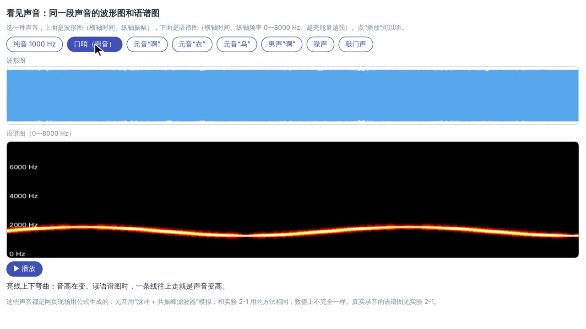
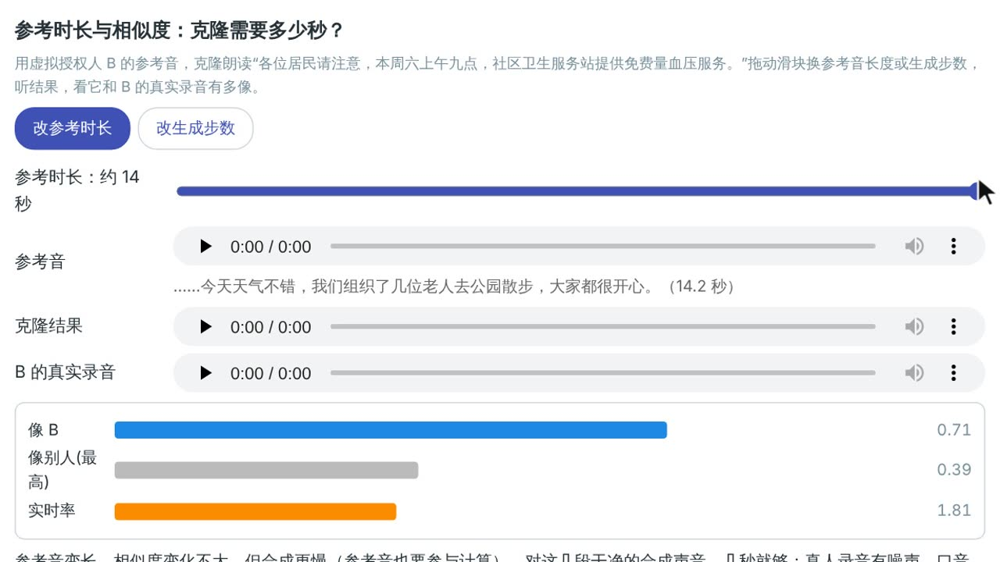
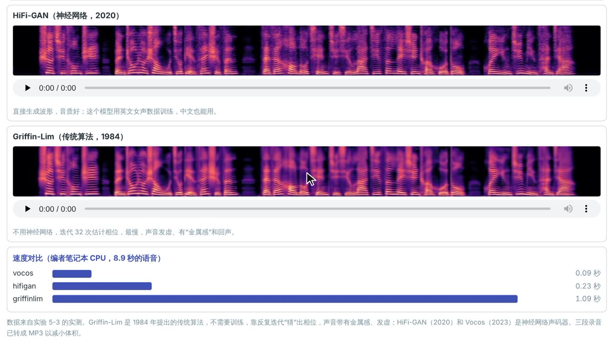
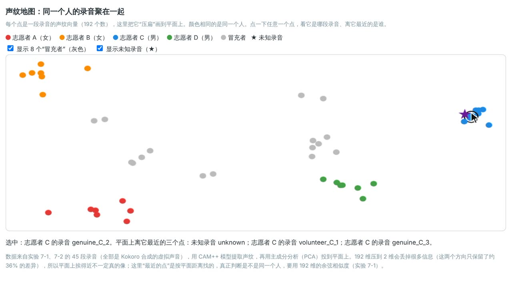
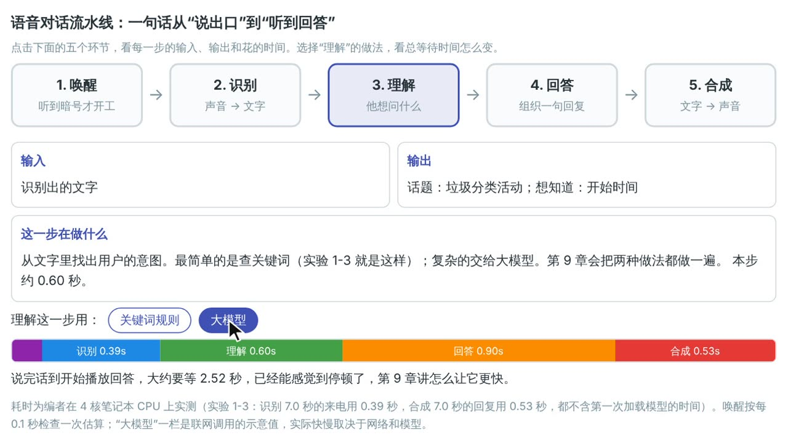

# TTS、SST 与语音克隆的理论与应用

**面向成人教育人工智能技术应用专业（专科）的《TTS、SST 与语音克隆的理论与应用》教材**

<!-- 书名、课程信息框和“目录与实验”表由 python tools/course.py sync 根据 course.yml 生成；全书概览表由 python tools/book_stats.py 生成 -->

<!-- course:start -->
!!! abstract "课程信息"
    4 学分 · 72 学时（理论 36 学时 + 实验 36 学时） · 第 4 学期 · 9 章 · 36 个实验 · 期末开卷
<!-- course:end -->

<!-- showcase:start -->
## 先玩一玩

让机器听得懂、说得像、认得出

<ol class="sc-list">
<li data-sim="sims/spectrogram-viewer/main.html" data-video="assets/showcase/spectrogram-viewer" data-title="看见声音" data-play="切换声音，看共振峰的亮线怎样移动。">
同一个“啊”，男声和女声在频谱上差在哪？

<b>看见声音</b>　切换声音，看共振峰的亮线怎样移动。

<a href="sims/spectrogram-viewer/main.html">打开动画</a>　<a class="sc-chap" href="chapters/02-audio/" title="第 2 章 声音的数字化与音频处理">去读第2章 →</a>
</li>
<li data-sim="sims/clone-settings/main.html" data-video="assets/showcase/clone-settings" data-title="参考时长与相似度" data-play="拖长参考录音，相似度一路上升。">
只给 3 秒录音，能克隆出你的声音吗？

<b>参考时长与相似度</b>　拖长参考录音，相似度一路上升。

<a href="sims/clone-settings/main.html">打开动画</a>　<a class="sc-chap" href="chapters/08-voice-cloning/" title="第 8 章 语音克隆：技术、伦理与授权">去读第8章 →</a>
</li>
<li data-sim="sims/vocoder-compare/main.html" data-video="assets/showcase/vocoder-compare" data-title="从频谱到声音" data-play="Griffin-Lim、HiFi-GAN、Vocos 逐个播放。">
同一张频谱，三代声码器念出来差多少？

<b>从频谱到声音</b>　Griffin-Lim、HiFi-GAN、Vocos 逐个播放。

<a href="sims/vocoder-compare/main.html">打开动画</a>　<a class="sc-chap" href="chapters/05-tts-principles/" title="第 5 章 语音合成原理：从文字到声音">去读第5章 →</a>
</li>
<li data-sim="sims/voiceprint-map/main.html" data-video="assets/showcase/voiceprint-map" data-title="声纹地图" data-play="冒充者混进来，离真身有多远？">
每个人的声音，在地图上都有自己的位置

<b>声纹地图</b>　冒充者混进来，离真身有多远？

<a href="sims/voiceprint-map/main.html">打开动画</a>　<a class="sc-chap" href="chapters/07-speaker/" title="第 7 章 声纹识别与语音转换">去读第7章 →</a>
</li>
<li data-sim="sims/speech-pipeline/main.html" data-video="assets/showcase/speech-pipeline" data-title="语音对话流水线" data-play="唤醒、识别、理解、回答、合成，看延迟花在哪。">
一句话从说出口到听到回答，要经过几站？

<b>语音对话流水线</b>　唤醒、识别、理解、回答、合成，看延迟花在哪。

<a href="sims/speech-pipeline/main.html">打开动画</a>　<a class="sc-chap" href="chapters/01-overview/" title="第 1 章 走进语音技术">去读第1章 →</a>
</li>
</ol>

<!-- showcase:end -->

## 这本书讲什么

这门课研究怎样让机器“听”和“说”：**语音识别**把人说的话变成文字，**语音合成**把文字读成自然的声音，**声纹识别**听出是谁在说话，**语音克隆**用几秒钟的录音让机器学会一个人的嗓音。这些技术就在身边：微信语音转文字、会议实时字幕、导航播报、有声书、智能音箱、银行的声纹核验，还有借 AI 声音行骗的电话诈骗。

全书 9 章，围绕一个虚构的“幸福里社区语音服务站”展开：第 1 章先让电脑说第一句话、听写第一句话；第 2 章讲声音怎样变成数字；第 3、4 章从原理到实战讲语音识别，做字幕、做唤醒词；第 5、6 章从原理到实战讲语音合成，做多音色播报和有声书；第 7 章讲声纹识别和语音转换；第 8 章讲语音克隆，把法律、伦理和授权放在和技术同样重要的位置；第 9 章把识别、理解、合成串成一个语音问答小助手，做成网页，并完成综合项目。

全部实验用开源工具 sherpa-onnx 在普通笔记本电脑的 CPU 上离线运行，不需要显卡，也不训练神经网络。书中克隆的声音都是合成的“虚拟授权人”，克隆真人的声音必须先取得本人的书面授权。

## 本书的特点

- **通俗易懂**：用生活中的例子和“算一算”小计算讲清原理，公式只保留最必要的部分；
- **每章动手实验**：★ 为基础实验，☆ 为拓展实验，教师可按课时选做，其余作为课后练习；
- **结果真实**：书中的运行结果都是编者实际运行得到的；编写环境无法运行的部分标为“待实测”，并提供记录表；
- **在线练习**：每章课后的单选、多选和判断题可以在网页上直接作答，并查看解析；
- **贴近岗位**：实验按智能客服、会议转写、有声书、语音助手等岗位任务设计，本课程不对应职业证书。

## 全书概览

<!-- stats:start -->

| 章 | 正文字数 | 实验 | 课后练习 （可在线作答） | 术语 | 参考文献 | 交互动画 |
|---|---|---|---|---|---|---|
| [第 1 章](chapters/01-overview/index.md) | 0.8 万 | 4 | 20（16） | 9 | 8 | 1 |
| [第 2 章](chapters/02-audio/index.md) | 1.1 万 | 4 | 20（16） | 24 | 9 | 2 |
| [第 3 章](chapters/03-asr-principles/index.md) | 1.0 万 | 4 | 20（16） | 19 | 9 | 3 |
| [第 4 章](chapters/04-asr-practice/index.md) | 0.8 万 | 4 | 20（16） | 13 | 6 | 1 |
| [第 5 章](chapters/05-tts-principles/index.md) | 0.8 万 | 4 | 20（16） | 12 | 13 | 2 |
| [第 6 章](chapters/06-tts-practice/index.md) | 0.7 万 | 4 | 20（16） | 8 | 9 | 1 |
| [第 7 章](chapters/07-speaker/index.md) | 0.7 万 | 4 | 20（16） | 10 | 7 | 2 |
| [第 8 章](chapters/08-voice-cloning/index.md) | 0.9 万 | 4 | 20（16） | 8 | 12 | 2 |
| [第 9 章](chapters/09-applications/index.md) | 0.7 万 | 4 | 20（16） | 7 | 6 | 1 |
| **合计** | **7.6 万** | **36** | **180（144）** | **110** | **79** | **15** |

正文字数只统计汉字，不含代码和课后练习；单选、多选和判断题可以在网页上直接作答。配套学习资源：[交互动画](sims/index.md) 15 个 · [学习图谱](learning-graph/index.md) 110 个概念 · [常见问题](faq/index.md) 29 问 · [术语表](appendix/glossary.md) 110 条。

<!-- stats:end -->

## 目录与实验

<!-- toc:start -->
| 章节 | 实验 |
|---|---|
| [第 1 章 走进语音技术](chapters/01-overview/index.md) | 实验 1-1 ★ 让电脑说第一句话 实验 1-2 ★ 让电脑听写 实验 1-3 ★ 一来一回 实验 1-4 ☆ 在自己的电脑上安装环境 |
| [第 2 章 声音的数字化与音频处理](chapters/02-audio/index.md) | 实验 2-1 ★ 看见声音 实验 2-2 ★ 采样率听一听 实验 2-3 ★ 整理居民来电 实验 2-4 ☆ 梅尔频谱、MFCC 与降噪 |
| [第 3 章 语音识别原理：从模板匹配到深度学习](chapters/03-asr-principles/index.md) | 实验 3-1 ★ 模板匹配认数字 实验 3-2 ★ HMM 数字识别器 实验 3-3 ★ 算一算字错率 实验 3-4 ☆ 语言模型来纠错 |
| [第 4 章 语音识别实战：转写、字幕与唤醒](chapters/04-asr-practice/index.md) | 实验 4-1 ★ 三个模型比一比 实验 4-2 ★ 议事会录音做字幕 实验 4-3 ★ 自定义唤醒词 实验 4-4 ☆ 噪声和热词 |
| [第 5 章 语音合成原理：从文字到声音](chapters/05-tts-principles/index.md) | 实验 5-1 ★ 做一个文本前端 实验 5-2 ★ 拼接合成听“机器腔” 实验 5-3 ★ 拆开看声学模型和声码器 实验 5-4 ☆ 给合成打分 |
| [第 6 章 语音合成实战：多音色与有声书](chapters/06-tts-practice/index.md) | 实验 6-1 ★ 一个模型多种声音 实验 6-2 ★ 中英混读 实验 6-3 ★ 社区有声广播 实验 6-4 ☆ 云平台合成接口（待实测） |
| [第 7 章 声纹识别与语音转换](chapters/07-speaker/index.md) | 实验 7-1 ★ 声纹比一比 实验 7-2 ★ 声纹登录 实验 7-3 ★ 谁在说话 实验 7-4 ☆ 语音转换体验（待实测） |
| [第 8 章 语音克隆：技术、伦理与授权](chapters/08-voice-cloning/index.md) | 实验 8-1 ★ 签授权书，录参考音 实验 8-2 ★ 零样本克隆 实验 8-3 ★ 克隆像不像，并贴上标签 实验 8-4 ☆ 微调式克隆（待实测） |
| [第 9 章 语音交互应用与综合项目](chapters/09-applications/index.md) | 实验 9-1 ★ 语音问答小助手 实验 9-2 ★ 做成网页 实验 9-3 ★ 综合项目 实验 9-4 ☆ 测一测快不快 |

附录：[A sherpa-onnx 与音频处理速查](appendix/a-libraries.md) · [B 实验环境、模型与数据说明](appendix/b-environment.md) · [C 术语表](appendix/glossary.md) · [D 实验报告、声音授权书与项目模板](appendix/d-templates.md)
<!-- toc:end -->

## 配套资源

- [交互动画](sims/index.md)、[学习图谱](learning-graph/index.md)、[常见问题](faq/index.md)
- 实验代码与数据：仓库中的 `labs/` 目录
- 课件、教案和 Word/PDF 版教材：见仓库的 Releases 页面
